# H-JEPA: End-to-End Learning of Hierarchical World Models for Visual Planning

**H-JEPA：面向视觉规划的分层世界模型端到端学习**

**Wancong Zhang**1,2,* · **Basile Terver**2,3,* · **Michael Rabbat**2 · **Yann LeCun**1,2,† · **Randall Balestriero**2,4,†

1NYU · 2Advanced Machine Intelligence · 3INRIA Paris · 4Brown University

1纽约大学 · 2Advanced Machine Intelligence · 3INRIA Paris · 4布朗大学

* Equal contribution; order determined by coin toss.

* 同等贡献；署名顺序通过抛硬币决定。

† Equal advising.

† 同等指导。

[Website](https://h-jepa.com/) · [Code](https://github.com/kevinghst/H-JEPA)

[项目网站](https://h-jepa.com/) · [代码](https://github.com/kevinghst/H-JEPA)

## Abstract

**摘要**

Long-horizon planning with latent world models requires reasoning across timescales and levels of abstraction. Existing task-agnostic JEPA world models predict and plan in a single latent space, often at a single timescale. We introduce **H-JEPA**, an end-to-end recipe for training a hierarchy of action-conditioned JEPAs in which each level predicts farther ahead in its own learned latent space. Planning proceeds top-down: the top level optimizes progress toward the goal, and each level's predictions become subgoals for the planner below it. When factors in the data evolve at separated timescales, higher levels discard fast, unpredictable detail and retain slower task-relevant state. Across four simulated navigation and manipulation environments, hierarchical planning improves over a flat JEPA; on Visual AntMaze, a three-level hierarchy raises success from 18% to 73% using less planner compute. Ablations attribute these gains to both temporal decomposition and higher-level goal representations. With inverse-dynamics supervision, the approach extends to diverse real-robot videos from DROID, where hierarchy improves offline planning fidelity at lower planner compute.

利用潜在世界模型进行长时域规划，需要跨时间尺度和抽象层级推理。现有的任务无关 JEPA 世界模型在单一潜在空间中预测和规划，而且通常只采用单一时间尺度。我们提出 **H-JEPA**：一种端到端训练动作条件 JEPA 层级结构的方法，其中每一层都在自身学习到的潜在空间中预测更远的未来。规划自顶向下进行：最高层优化朝目标的进展，每一层的预测则成为下一层规划器的子目标。当数据中的不同因素在相互分离的时间尺度上变化时，高层会舍弃快速、不可预测的细节，保留变化较慢、与任务相关的状态。在四个模拟导航和操作环境中，分层规划优于扁平 JEPA；在 Visual AntMaze 上，三层结构以更少的规划计算量将成功率从 18% 提高到 73%。消融实验表明，这些收益同时来自时间分解和高层目标表征。借助逆动力学监督，该方法进一步扩展到 DROID 中多样化的真实机器人视频，在更低的规划计算量下，层级结构提升了离线规划保真度。

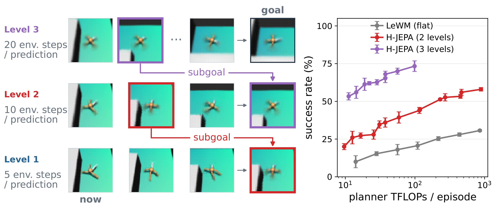

**Figure 1.** **Hierarchical abstractions support planning at multiple timescales.** *Left:* visualization of hierarchical planning in Visual AntMaze. Level 3 plans toward the final goal in the most abstract latent space. Its first predicted state becomes a subgoal for the level-2 planner; this decomposition recurses to the level-1 planner, which outputs raw actions. The first and last columns decode each level's start and goal latents, respectively; the middle columns decode its planned predictions. Higher-level latents retain the ant's position and maze layout while losing leg-pose detail. See §2.2 for the formal planning procedure. *Right:* planning success versus planner compute on AntMaze. Curves show Pareto fronts for flat LeWM [[53]](#ref-maes2026lewm) and two-/three-level H-JEPA; error bars are standard error (SE) over three paired model and planner seeds (§4.1).

**图 1。** **分层抽象支持在多个时间尺度上规划。** *左：* Visual AntMaze 中分层规划的可视化。第 3 层在最抽象的潜在空间中朝最终目标规划，其第一个预测状态成为第 2 层规划器的子目标；这一分解递归进行，直到输出原始动作的第 1 层规划器。第一列和最后一列分别解码各层的起始潜变量和目标潜变量；中间各列解码其规划预测。高层潜变量保留了蚂蚁的位置和迷宫布局，同时丢失腿部姿态细节。正式规划过程见 §2.2。*右：* AntMaze 上的规划成功率与规划计算量。曲线表示扁平 LeWM [[53]](#ref-maes2026lewm) 与两层、三层 H-JEPA 的帕累托前沿；误差条为三组配对模型种子和规划器种子的标准误（SE，§4.1）。

## 1 Introduction

**1 引言**

World models learn the dynamics of an environment from experience so that an agent can predict, understand, and plan [[29]](#ref-haschmidhuber2018worldmodels), [[30]](#ref-hafner2019planet), [[31]](#ref-hafner2020dreamer). Joint-Embedding Predictive Architectures (JEPAs) learn such models by predicting masked *latent* states rather than pixels [[49]](#ref-lecun2022path), [[1]](#ref-assran2023ijepa), [[9]](#ref-bardes2024vjepa), avoiding both reward and pixel reconstruction [[5]](#ref-balestriero2024reconstruction), [[59]](#ref-nilaksh2026reconstructionsemantics). Recent action-conditioned, task-agnostic JEPA world models can plan zero-shot in learned latent spaces [[93]](#ref-zhou2025dinowm), [[2]](#ref-assran2025vjepa2), [[73]](#ref-sobal2025pldm), [[53]](#ref-maes2026lewm), [[78]](#ref-terver2026whatdrives); among these models, PLDM [[73]](#ref-sobal2025pldm) and LeWM [[53]](#ref-maes2026lewm) learn the encoder and predictive dynamics jointly, end-to-end from pixels. These models, however, predict and plan within a single latent space, often at a single timescale. This has two limitations. First, at a single timescale, long-horizon prediction rolls out many fine-grained steps: prediction error compounds and the action search space grows. Second, a single shared latent space must support both low-level dynamics and goal matching. A latent that carries every fast-varying detail may model low-level dynamics well, but gives a poor goal-matching cost when the goal is more abstract than the state (a location to reach rather than a pose to match; §4.2).

世界模型从经验中学习环境动力学，使智能体能够预测、理解和规划 [[29]](#ref-haschmidhuber2018worldmodels), [[30]](#ref-hafner2019planet), [[31]](#ref-hafner2020dreamer)。联合嵌入预测架构（JEPA）通过预测被遮蔽的*潜在*状态而非像素来学习这类模型 [[49]](#ref-lecun2022path), [[1]](#ref-assran2023ijepa), [[9]](#ref-bardes2024vjepa)，既不需要奖励，也不需要像素重建 [[5]](#ref-balestriero2024reconstruction), [[59]](#ref-nilaksh2026reconstructionsemantics)。近期基于动作条件、与任务无关的 JEPA 世界模型能够在学习到的潜在空间中进行零样本规划 [[93]](#ref-zhou2025dinowm), [[2]](#ref-assran2025vjepa2), [[73]](#ref-sobal2025pldm), [[53]](#ref-maes2026lewm), [[78]](#ref-terver2026whatdrives)；其中，PLDM [[73]](#ref-sobal2025pldm) 和 LeWM [[53]](#ref-maes2026lewm) 从像素出发，端到端地联合学习编码器与预测动力学。然而，这些模型都在单一潜在空间中预测和规划，而且通常只采用单一时间尺度。这有两个局限。首先，在单一时间尺度下，长时域预测需要展开许多细粒度步骤：预测误差不断累积，动作搜索空间也随之扩大。其次，同一个共享潜在空间必须同时支持低层动力学和目标匹配。保留所有快速变化细节的潜变量可能很好地建模低层动力学，但当目标比状态更抽象时，例如目标是到达某个位置而非匹配某个姿态，它提供的目标匹配代价可能很差（§4.2）。

A hierarchical world model divides this work. Each higher level predicts over a longer horizon and keeps in its latent space what remains predictable. Higher levels operate on slow features over long strides and serve long-range prediction and high-level planning; lower levels operate on fast features over short strides and serve short-range prediction and low-level control. The brain has such hierarchical structure: cortical areas form a hierarchy of intrinsic timescales, with slower-varying representations higher up [[37]](#ref-hasson2008temporal), [[43]](#ref-kiebel2008hierarchy), [[56]](#ref-murray2014timescales), [[3]](#ref-baldassano2017event). Hierarchical world models have been studied in video prediction and reward-driven control (§M, Table 13). Hierarchical latent video models reconstruct pixels and are not used for control [[68]](#ref-saxena2021clockwork), [[44]](#ref-kim2019vta), [[55]](#ref-mounir2023streamer), while hierarchical model-based reinforcement learning learns task-specific policies from reward [[32]](#ref-hafner2022director), [[36]](#ref-hansen2025puppeteer), [[27]](#ref-gumbsch2024thick). Closest to our setting, HWM [[92]](#ref-zhang2026hierarchical) is a task-agnostic JEPA world model that plans hierarchically, but its predictors over different horizons share one latent space. It decomposes the horizon but cannot match objectives in more abstract spaces.

分层世界模型将这些工作分开。每个更高层预测更长的时域，并在自身潜在空间中保留仍然可预测的信息。高层以长步幅处理慢特征，服务于长程预测和高层规划；低层以短步幅处理快特征，服务于短程预测和低层控制。大脑具有这样的层级结构：皮层区域构成内在时间尺度的层级，越高层的表征变化越慢 [[37]](#ref-hasson2008temporal), [[43]](#ref-kiebel2008hierarchy), [[56]](#ref-murray2014timescales), [[3]](#ref-baldassano2017event)。分层世界模型已经在视频预测和奖励驱动控制中得到研究（§M，表 13）。分层潜在视频模型重建像素，但不用于控制 [[68]](#ref-saxena2021clockwork), [[44]](#ref-kim2019vta), [[55]](#ref-mounir2023streamer)；分层基于模型的强化学习则从奖励中学习任务特定策略 [[32]](#ref-hafner2022director), [[36]](#ref-hansen2025puppeteer), [[27]](#ref-gumbsch2024thick)。与我们的设定最接近的是 HWM [[92]](#ref-zhang2026hierarchical)，它是一种进行分层规划的任务无关 JEPA 世界模型，但其面向不同时域的预测器共享同一个潜在空间。它分解了时域，却无法在更抽象的空间中匹配目标。

We introduce **H-JEPA**, a hierarchical JEPA architecture in which each level predicts the future within its own latent space, at a coarser temporal stride and a higher degree of abstraction than the level below, without reward or reconstruction objectives. Fig. 1 shows the learned hierarchy and its tradeoff between planner compute and success. We make four contributions:

我们提出 **H-JEPA**，一种分层 JEPA 架构，其中每一层都在自己的潜在空间中预测未来，相较于下一层具有更粗的时间步幅和更高的抽象程度，并且不使用奖励或重建目标。图 1 展示了学习到的层级结构，以及规划计算量与成功率之间的权衡。我们的贡献有四点：

1. We introduce an end-to-end training method for hierarchical JEPA world models (§2).

   我们提出一种端到端训练分层 JEPA 世界模型的方法（§2）。

2. We show that when factors in the data evolve at separated timescales, higher levels discard fast detail they cannot predict over their horizons and retain slower, predictable state (§3).

   我们表明，当数据中的因素在相互分离的时间尺度上变化时，高层会舍弃在自身时域内无法预测的快速细节，保留较慢、可预测的状态（§3）。

3. We show that H-JEPA's hierarchical planning outperforms single-level planning at a fraction of the test-time compute (§4.1). We identify two complementary mechanisms: hierarchical latent spaces let higher-level planners score progress at the goal's own level of abstraction, while temporal decomposition breaks long-horizon tasks into easier subproblems (§4.2).

   我们表明，H-JEPA 的分层规划仅需部分测试时计算量，即可优于单层规划（§4.1）。我们识别出两种互补机制：分层潜在空间使高层规划器能够在目标自身的抽象层级上评估进展，而时间分解将长时域任务拆分为更容易的子问题（§4.2）。

4. With an inverse-dynamics term, the method extends to DROID, a real-robot manipulation corpus whose scene, lighting and objects change every episode (§4.3).

   加入逆动力学项后，该方法可扩展到 DROID；这是一个真实机器人操作语料库，其中的场景、光照和物体在每个回合都会变化（§4.3）。

## 2 Method

**2 方法**

### 2.1 Hierarchical predictive learning

**2.1 分层预测学习**

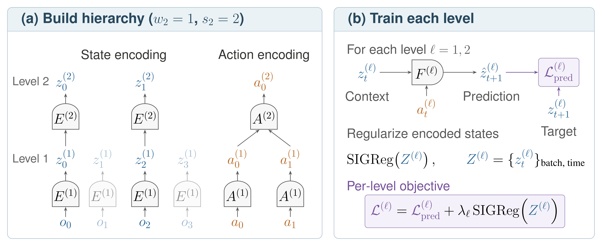

**Figure 2.** **H-JEPA training across temporal scales.** (a) With $w_2{=}1$ and $s_2{=}2$, level 2 encodes every other level-1 state pointwise and aggregates the intervening action embeddings. Faded columns are retained at level 1 but skipped at level 2. (b) Each level predicts the next latent state conditioned on preceding latent states and actions, with SIGReg regularizing the states against collapse. All levels are trained end-to-end, with gradients from upper-level objectives propagating through lower-level encoders.

**图 2。** **跨时间尺度的 H-JEPA 训练。** (a) 当 $w_2{=}1$ 且 $s_2{=}2$ 时，第 2 层逐点编码第 1 层每隔一个取出的状态，并聚合其间的动作嵌入。淡色列在第 1 层保留，但在第 2 层跳过。(b) 每一层都以前面的潜在状态和动作为条件预测下一个潜在状态，并通过 SIGReg 对状态施加正则化以防坍塌。所有层均端到端训练，高层目标的梯度会通过低层编码器传播。

H-JEPA learns a hierarchy of latent predictive models from trajectories of observations and actions. The hierarchy is temporal: level 1 operates on the finest observation stream, while each higher level consumes the latent states produced by the level below over a coarser stride. This gives a stack of JEPA world models in which each level has its own observation encoder, action encoder, and latent predictor. All levels predict future latent states from past latent states and actions.

H-JEPA 从观测和动作轨迹中学习潜在预测模型的层级结构。该层级具有时间性：第 1 层处理最细粒度的观测流，而每个更高层都以更粗的步幅接收下一层生成的潜在状态。这样便构成了一叠 JEPA 世界模型，每一层都有自己的观测编码器、动作编码器和潜在预测器。所有层都根据过去的潜在状态和动作预测未来潜在状态。

Let $o_t$ denote an observation and $a_t$ the action block for the transition from $o_t$ to $o_{t+1}$. The first level encodes the observation, optionally with the proprioceptive state, into a latent state $z^{(1)}_t = E^{(1)}(o_t)$, and the action block into $a^{(1)}_t = A^{(1)}(a_t)$. Higher levels are built compositionally: both state and action encoders pool temporal windows of latents from the level below.

用 $o_t$ 表示观测，用 $a_t$ 表示从 $o_t$ 到 $o_{t+1}$ 的转移所对应的动作块。第 1 层将观测（也可包含本体感知状态）编码为潜在状态 $z^{(1)}_t = E^{(1)}(o_t)$，并将动作块编码为 $a^{(1)}_t = A^{(1)}(a_t)$。高层以组合方式构建：状态编码器和动作编码器都对下一层潜变量的时间窗口进行池化。

Each level $\ell>1$ has two temporal hyperparameters. The *stride* $s_\ell$ is the subsampling factor: upper-level time $t$ maps to lower-level time $t\cdot s_\ell$, so consecutive upper-level states are $s_\ell$ lower-level steps apart. The *window size* $w_\ell$ is the number of lower-level steps each upper-level state summarizes. The two are independent: $s_\ell$ sets how far each window advances and $w_\ell$ how far it spans.

每个层级 $\ell>1$ 有两个时间超参数。*步幅* $s_\ell$ 是下采样因子：高层时间 $t$ 映射到低层时间 $t\cdot s_\ell$，因此相邻高层状态相隔 $s_\ell$ 个低层步骤。*窗口大小* $w_\ell$ 是每个高层状态所概括的低层步骤数。二者相互独立：$s_\ell$ 决定每个窗口前进多远，$w_\ell$ 决定窗口覆盖多远。

With $a{:}b$ denoting the $b{-}a$ indices $a,\ldots,b{-}1$, the level-$\ell$ state and action embeddings are

用 $a{:}b$ 表示 $b{-}a$ 个索引 $a,\ldots,b{-}1$，则第 $\ell$ 层的状态嵌入和动作嵌入为

$$
z^{(\ell)}_t = E^{(\ell)}\!\left(z^{(\ell-1)}_{t\cdot s_\ell\,:\,t\cdot s_\ell+w_\ell}\right),
\qquad
a^{(\ell)}_t = A^{(\ell)}\!\left(a^{(\ell-1)}_{t\cdot s_\ell+w_\ell-1\,:\,(t+1)\cdot s_\ell+w_\ell-1}\right).
\tag{1}
$$

The state encoder $E^{(\ell)}$ pools the $w_\ell$-step lower-level window into one abstract state. The action encoder $A^{(\ell)}$ instead aggregates $s_\ell$ lower-level action embeddings, independent of $w_\ell$, so $a^{(\ell)}_t$ covers the full transition from the state anchoring $z^{(\ell)}_t$ toward the next upper-level state $z^{(\ell)}_{t+1}$. All experiments use $w_\ell{=}1$, so upper-level state encoders are pointwise (Fig. 2).

状态编码器 $E^{(\ell)}$ 将包含 $w_\ell$ 个步骤的低层窗口池化为一个抽象状态。动作编码器 $A^{(\ell)}$ 则聚合 $s_\ell$ 个低层动作嵌入，与 $w_\ell$ 无关，因此 $a^{(\ell)}_t$ 覆盖了从锚定 $z^{(\ell)}_t$ 的状态到下一个高层状态 $z^{(\ell)}_{t+1}$ 的完整转移。所有实验均采用 $w_\ell{=}1$，因此高层状态编码器是逐点的（图 2）。

Each level is trained as a JEPA in its own latent space. Given a context of $c_\ell$ latent states $(z^{(\ell)}_{t-c_\ell+1}, \ldots, z^{(\ell)}_t)$ and the associated action embeddings, a predictor $F^{(\ell)}$ predicts future latent states. One-step training uses the teacher-forced latent prediction loss

每一层都在自己的潜在空间中作为一个 JEPA 进行训练。给定由 $c_\ell$ 个潜在状态 $(z^{(\ell)}_{t-c_\ell+1}, \ldots, z^{(\ell)}_t)$ 及其对应动作嵌入构成的上下文，预测器 $F^{(\ell)}$ 预测未来潜在状态。单步训练采用教师强制的潜在预测损失

$$
\mathcal{L}^{(\ell)}_{\mathrm{pred}}
= \frac{1}{c_\ell}
\sum_{\tau=1}^{c_\ell}
\left\|
F^{(\ell)}(z^{(\ell)}_{<\tau}, a^{(\ell)}_{<\tau}) - z^{(\ell)}_{\tau+1}
\right\|_2^2 .
\tag{2}
$$

The per-level loss also includes SIGReg [[6]](#ref-balestriero2025lejepa), a sketched normality regularizer that prevents collapse by encouraging an isotropic Gaussian embedding distribution (§K). Let $Z^{(\ell)} \in \mathbb{R}^{n \times D}$ collect $n$ level-$\ell$ embeddings of width $D$, flattened over batch and time. The overall level-$\ell$ objective is

每层损失还包含 SIGReg [[6]](#ref-balestriero2025lejepa)，这是一种基于随机投影的正态性正则项，通过鼓励嵌入服从各向同性高斯分布来防止坍塌（§K）。令 $Z^{(\ell)} \in \mathbb{R}^{n \times D}$ 收集 $n$ 个宽度为 $D$ 的第 $\ell$ 层嵌入，并将批次和时间维展平。第 $\ell$ 层的总目标为

$$
\mathcal{L}^{(\ell)}
= \mathcal{L}^{(\ell)}_{\mathrm{pred}}
+ \lambda_\ell \mathrm{SIGReg}\!\left(Z^{(\ell)}\right).
\tag{3}
$$

### 2.2 Hierarchical planning over learned abstractions

**2.2 基于已学抽象的分层规划**

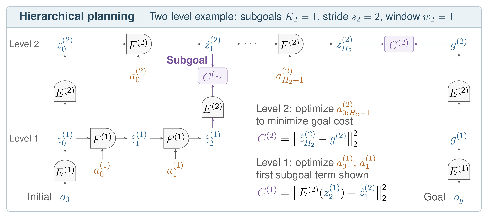

**Figure 3.** **Planning runs top-down through the hierarchy, and the lower level is steered by subgoals the upper level predicted.** Two-level instance ($L{=}2$) of §2.2. Current and goal observations $o_0$ and $o_g$ are encoded bottom-up into initial states $z^{(1)}_0, z^{(2)}_0$ and goal states $g^{(1)}, g^{(2)}$. Level 2 optimizes macro-actions by unrolling $F^{(2)}$ and matching its final prediction to $g^{(2)}$. Its predicted states $\hat z^{(2)}_i$ become subgoals for level 1, which optimizes primitive actions and lifts its predictions through $E^{(2)}$ for comparison in level-2 latent space (Eq. (6)).

**图 3。** **规划沿层级自顶向下运行，低层由高层预测的子目标引导。** 这是 §2.2 的两层实例（$L{=}2$）。当前观测 $o_0$ 和目标观测 $o_g$ 自底向上编码为初始状态 $z^{(1)}_0, z^{(2)}_0$ 和目标状态 $g^{(1)}, g^{(2)}$。第 2 层通过展开 $F^{(2)}$，并使最终预测匹配 $g^{(2)}$ 来优化宏动作。其预测状态 $\hat z^{(2)}_i$ 成为第 1 层的子目标；第 1 层优化原始动作，并通过 $E^{(2)}$ 将其预测提升到第 2 层潜在空间中进行比较（式 (6)）。

H-JEPA plans top-down through the learned hierarchy (Fig. 3). The current and goal observations are encoded at every level $\ell$, yielding initial latent states $\{z^{(\ell)}_0\}_{\ell=1}^L$ and goal latent states $\{g^{(\ell)}\}_{\ell=1}^L$, where $L$ is the number of levels. The top level proposes a coarse plan to the goal. Each lower level plans toward subgoals supplied by the predicted trajectory of the level above, refining the plan into finer-scale transitions until level 1 produces primitive actions. The top-level planner optimizes macro-actions to minimize the distance between its final predicted state and the goal:

H-JEPA 沿学习到的层级自顶向下规划（图 3）。当前观测和目标观测在每个层级 $\ell$ 编码，得到初始潜在状态 $\{z^{(\ell)}_0\}_{\ell=1}^L$ 和目标潜在状态 $\{g^{(\ell)}\}_{\ell=1}^L$，其中 $L$ 为层数。最高层提出通向目标的粗粒度计划。每个较低层都朝着上一层预测轨迹提供的子目标规划，将计划细化为更细尺度的转移，直至第 1 层产生原始动作。最高层规划器优化宏动作，使其最终预测状态与目标之间的距离最小：

$$
a^{(L),*}_{0:H_L-1}
= \arg\min_{a^{(L)}_{0:H_L-1}}
\left\|\hat{z}^{(L)}_{H_L}-g^{(L)}\right\|_2^2.
\tag{4}
$$

At each level $\ell$, the predicted states $(\hat{z}^{(\ell)}_1,\ldots,\hat{z}^{(\ell)}_{H_\ell}) = \mathrm{Roll}^{(\ell)}(z^{(\ell)}_0,a^{(\ell)}_{0:H_\ell-1})$ are obtained by autoregressively applying predictor $F^{(\ell)}$ from $z^{(\ell)}_0$ under the candidate action sequence, with horizon $H_\ell$ measured in level-$\ell$ steps. A superscript $*$ marks the optimized actions and their predicted states.

在每个层级 $\ell$，从 $z^{(\ell)}_0$ 出发，在候选动作序列条件下自回归地应用预测器 $F^{(\ell)}$，即可得到预测状态 $(\hat{z}^{(\ell)}_1,\ldots,\hat{z}^{(\ell)}_{H_\ell}) = \mathrm{Roll}^{(\ell)}(z^{(\ell)}_0,a^{(\ell)}_{0:H_\ell-1})$，其中时域 $H_\ell$ 以第 $\ell$ 层的步骤计量。上标 $*$ 表示优化后的动作及其预测状态。

For each lower level $\ell<L$, the optimized rollout from the level above, $(\hat{z}^{(\ell+1),*}_1,\ldots,\hat{z}^{(\ell+1),*}_{H_{\ell+1}})$, supplies subgoals. The lower level optimizes its actions to match these subgoals with its own predicted states, encoded into the upper-level latent space by $E^{(\ell+1)}$.

对于每个较低层 $\ell<L$，上一层优化后的展开轨迹 $(\hat{z}^{(\ell+1),*}_1,\ldots,\hat{z}^{(\ell+1),*}_{H_{\ell+1}})$ 提供子目标。低层优化自身动作，使自身预测状态经 $E^{(\ell+1)}$ 编码到高层潜在空间后与这些子目标匹配。

We first choose the number of subgoals to match, $1\le K_{\ell+1}\le H_{\ell+1}$, then set the lower-level horizon to cover the corresponding encoder windows. With upper-level stride $s_{\ell+1}$ and window size $w_{\ell+1}$, this requires $H_\ell=K_{\ell+1}s_{\ell+1}+w_{\ell+1}-1$. The encoded predictions are

我们首先选择需要匹配的子目标数量 $1\le K_{\ell+1}\le H_{\ell+1}$，随后设置低层时域，使其覆盖相应的编码器窗口。给定高层步幅 $s_{\ell+1}$ 和窗口大小 $w_{\ell+1}$，需要满足 $H_\ell=K_{\ell+1}s_{\ell+1}+w_{\ell+1}-1$。编码后的预测为

$$
\tilde{z}^{(\ell+1)}_i
= E^{(\ell+1)}\!\left(
\hat{z}^{(\ell)}_{i s_{\ell+1}\,:\,i s_{\ell+1}+w_{\ell+1}}\right),
\qquad i=1,\ldots,K_{\ell+1}.
\tag{5}
$$

Each $\tilde{z}^{(\ell+1)}_i$ is aligned with its upper-level subgoal in time and latent space. The lower level solves

每个 $\tilde{z}^{(\ell+1)}_i$ 都在时间和潜在空间上与对应的高层子目标对齐。低层求解

$$
a^{(\ell),*}_{0:H_\ell-1}
= \arg\min_{a^{(\ell)}_{0:H_\ell-1}}
\left[
\left\|\tilde{z}^{(\ell+1)}_{K_{\ell+1}}-\hat{z}^{(\ell+1),*}_{K_{\ell+1}}\right\|_2^2
+ \beta\sum_{i=1}^{K_{\ell+1}-1}
\left\|\tilde{z}^{(\ell+1)}_i-\hat{z}^{(\ell+1),*}_i\right\|_2^2
\right],
\tag{6}
$$

where $\beta\ge0$ weights each intermediate subgoal relative to the terminal target. Closed-loop planning uses $K_{\ell+1}=1$, matching only the first predicted subgoal; open-loop planning uses $K_{\ell+1}=H_{\ell+1}$, with $\beta=0$ matching only the terminal prediction and $\beta>0$ also matching intermediate subgoals.

其中，$\beta\ge0$ 赋予每个中间子目标相对于终端目标的权重。闭环规划使用 $K_{\ell+1}=1$，只匹配第一个预测子目标；开环规划使用 $K_{\ell+1}=H_{\ell+1}$，其中 $\beta=0$ 时只匹配终端预测，$\beta>0$ 时还会匹配中间子目标。

We optimize action sequences at every level by gradient descent. Level 1 returns primitive actions for execution in the environment. In closed-loop control, we execute an action prefix, encode the new observation, and repeat hierarchical planning until the evaluation budget of environment steps is exhausted. Execution schedules and solver settings are in §E.

我们通过梯度下降优化每一层的动作序列。第 1 层返回供环境执行的原始动作。在闭环控制中，我们执行动作序列的一段前缀，编码新观测，并重复分层规划，直到耗尽以环境步数计量的评估预算。执行调度和求解器设置见 §E。

## 3 Learning Hierarchical Abstractions

**3 学习分层抽象**

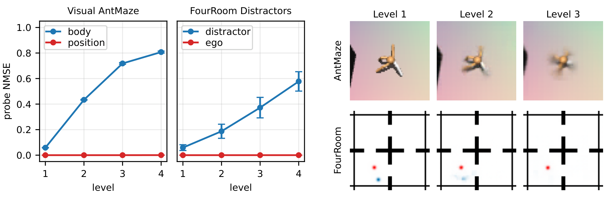

**Figure 4.** **Selective abstraction across hierarchy levels.** *Left*: MLP-probe NMSE (mean $\pm$ SE over three training seeds) at successive levels of four-level H-JEPAs on Visual AntMaze and FourRoomDistractors. Body state or distractor position becomes less recoverable at higher levels while agent position remains recoverable. *Right*: one observation decoded from levels $1$–$3$; decoders serve only for visualization. AntMaze's leg pose becomes less distinct; FourRoom's blue distractor fades while the red agent remains visible.

**图 4。** **不同层级之间的选择性抽象。** *左：* 在 Visual AntMaze 和 FourRoomDistractors 上，四层 H-JEPA 各连续层级的 MLP 探针 NMSE（三个训练种子的均值 $\pm$ 标准误）。随着层级升高，身体状态或干扰物位置更难恢复，而智能体位置仍可恢复。*右：* 从第 $1$–$3$ 层解码同一个观测；解码器仅用于可视化。AntMaze 的腿部姿态变得不清晰；FourRoom 的蓝色干扰物逐渐淡化，而红色智能体仍然可见。

**Environments.** We use FourRoomDistractors and Visual AntMaze for navigation, and Push-T and OGBench Cube for manipulation. FourRoomDistractors extends PLDM's two-room navigation environment [[73]](#ref-sobal2025pldm) to four rooms. It pairs a controlled agent with a distractor that moves independently and smoothly between occasional random teleports, while Visual AntMaze requires a quadruped to navigate a maze. Push-T involves pushing a T-shaped block, and OGBench Cube involves picking up and placing a cube. In §4.3, we extend the evaluation to DROID, a dataset of real-robot manipulation trajectories. Additional details are in §B.

**环境。** 我们使用 FourRoomDistractors 和 Visual AntMaze 进行导航，使用 Push-T 和 OGBench Cube 进行操作。FourRoomDistractors 将 PLDM 的双房间导航环境 [[73]](#ref-sobal2025pldm) 扩展到四个房间。它包含一个受控智能体和一个干扰物，后者在偶尔发生的随机瞬移之间独立、平滑地运动；Visual AntMaze 则要求四足机器人穿行迷宫。Push-T 涉及推动 T 形方块，OGBench Cube 涉及拾起并放置立方体。在 §4.3 中，我们将评估扩展到真实机器人操作轨迹数据集 DROID。更多细节见 §B。

**Setup.** We train H-JEPAs up to four levels end-to-end. The level-1 JEPA is LeWM [[53]](#ref-maes2026lewm): a ViT-Tiny encoder that summarizes each image in a global representation through its `[CLS]` token, and a causal transformer predictor. Trained on its own, this single-level model is the flat baseline we compare against throughout. Higher-level JEPAs use two-layer MLP encoders and causal transformer predictors, with stride $s_\ell{=}2$ and window $w_\ell{=}1$, so a single prediction step at each higher level spans twice as many environment timesteps as a step at the level below. Within each environment, all levels share the same SIGReg coefficient. Additional details in §C.

**设置。** 我们端到端训练最多四层的 H-JEPA。第 1 层 JEPA 为 LeWM [[53]](#ref-maes2026lewm)：它由一个通过 `[CLS]` token 将每幅图像汇总为全局表征的 ViT-Tiny 编码器，以及一个因果 Transformer 预测器组成。独立训练时，这个单层模型就是全文用于比较的扁平基线。高层 JEPA 使用两层 MLP 编码器和因果 Transformer 预测器，步幅为 $s_\ell{=}2$、窗口为 $w_\ell{=}1$，因此每个高层的单个预测步骤覆盖的环境时间步数是下一层的两倍。在每个环境中，所有层共享相同的 SIGReg 系数。更多细节见 §C。

**Evaluation protocol.** We train two-layer MLP probes on frozen representations and report variance-normalized MSE (NMSE), averaged with equal weight over an entity's dimensions. A value near $1$ is the error of predicting the marginal mean, while a value near $0$ indicates accurate recovery. Quantitative results in this section are mean $\pm$ SE over three training seeds; pixel decodings are qualitative examples from post-hoc decoders. §D details probe and decoder training.

**评估协议。** 我们在冻结表征上训练两层 MLP 探针，报告按方差归一化的均方误差（NMSE），对实体各维度等权平均。接近 $1$ 的值对应预测边缘均值的误差，接近 $0$ 的值则表示准确恢复。本节定量结果为三个训练种子的均值 $\pm$ 标准误；像素解码是事后训练的解码器给出的定性示例。§D 详细介绍探针和解码器的训练。

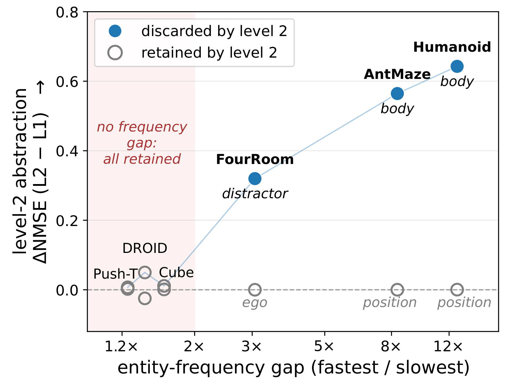

**Figure 5.** **Larger temporal-frequency gaps correlate with stronger selective abstraction.** The x-axis measures temporal separation in each training dataset: the ratio of the characteristic frequencies (spectral centroids) of the fastest- and slowest-varying state components, shown on a log scale. The y-axis shows the change in per-entity probing NMSE from level 1 to level 2; positive values indicate poorer recoverability at level 2. Across environments, larger frequency gaps coincide with greater increases in fast-entity probing error (filled markers), while slow-entity error remains near its level-1 value (open markers). Environments with gaps below $2\times$ (shaded region) show little selective abstraction.

**图 5。** **更大的时间频率差距与更强的选择性抽象相关。** 横轴衡量每个训练数据集中的时间分离程度：变化最快与最慢的状态分量的特征频率（频谱质心）之比，并采用对数刻度。纵轴表示各实体的探针 NMSE 从第 1 层到第 2 层的变化；正值表示第 2 层的可恢复性更差。在不同环境中，更大的频率差距伴随着快速实体探针误差更大的增幅（实心标记），而慢速实体的误差仍接近其第 1 层数值（空心标记）。差距小于 $2\times$ 的环境（阴影区域）几乎不表现出选择性抽象。

**Higher levels discard fast-varying features while retaining slow ones.** In Fig. 4, AntMaze's body state and FourRoom's distractor position become less recoverable with depth, while the agent's position remains accurately recoverable throughout both hierarchies. The discarded detail is consistent with each level's prediction horizon: the FourRoom distractor's motion is locally predictable between teleports, but longer horizons are more likely to cross a random teleport, making its future position harder to predict. In AntMaze, the ant's joint configurations oscillate many times faster than its global position drifts (§F.1), so they are harder to predict over long horizons. These trends are consistent with JEPA's joint optimization of the encoder and predictor: prediction-error gradients flow through the encoder, encouraging each level to retain features it can predict at its own timescale and abstract away those it cannot. In these environments, H-JEPA thus learns a hierarchy in which lower levels retain both fast- and slow-varying features, while higher levels discard detail and preserve the slow features.

**高层舍弃快速变化的特征，同时保留慢特征。** 在图 4 中，AntMaze 的身体状态和 FourRoom 的干扰物位置随着深度增加而更难恢复，而智能体位置在两个层级结构中始终能够准确恢复。被舍弃的细节与各层的预测时域一致：FourRoom 干扰物在两次瞬移之间的运动具有局部可预测性，但更长时域更可能跨越一次随机瞬移，因此其未来位置更难预测。在 AntMaze 中，蚂蚁关节构型的振荡比全局位置的漂移快许多倍（§F.1），因此更难在长时域内预测。这些趋势符合 JEPA 对编码器和预测器的联合优化机制：预测误差的梯度流经编码器，促使每层保留在自身时间尺度上可预测的特征，并抽象掉不可预测的特征。因此，在这些环境中，H-JEPA 学到的层级结构中，低层同时保留快变和慢变特征，而高层舍弃细节、保留慢特征。

Selective abstraction does not emerge in every environment. We relate the change in per-entity probing error from level 1 to level 2 to the training dataset's *entity frequency gap*: the ratio of the frequencies (spectral centroids) of the fastest- and slowest-varying state components, which define the fast and slow entities, respectively. §F.1 illustrates this separation in an AntMaze trajectory. Across environments, larger gaps accompany greater loss of fast-entity information at level 2, while slow-entity recoverability remains near its level-1 value (Fig. 5). This separation appears in AntMaze, Humanoid, and FourRoom; the manipulation datasets have smaller gaps and show little selective abstraction. Gap measurements in §F.2.

选择性抽象并非在每个环境中都会出现。我们将各实体探针误差从第 1 层到第 2 层的变化，与训练数据集的*实体频率差距*联系起来：这一差距是变化最快与最慢的状态分量的频率（频谱质心）之比，它们分别定义快速和慢速实体。§F.1 用一条 AntMaze 轨迹展示这种分离。在不同环境中，更大的差距伴随着第 2 层更多的快速实体信息损失，而慢速实体的可恢复性仍接近其第 1 层水平（图 5）。这种分离出现在 AntMaze、Humanoid 和 FourRoom 中；操作数据集的差距较小，几乎没有选择性抽象。差距测量见 §F.2。

## 4 Planning with Hierarchical Abstractions

**4 利用分层抽象进行规划**

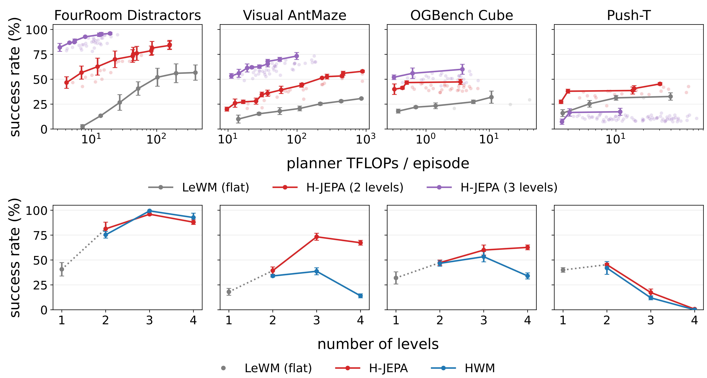

**Figure 6.** **Gradient-based planning across compute budgets and hierarchy depths**, comparing LeWM [[53]](#ref-maes2026lewm), H-JEPA, and the hierarchical world model baseline HWM [[92]](#ref-zhang2026hierarchical). Error bars in both panels show one SE over three seeds. *Top:* success versus planner FLOPs per episode, sweeping action-sample counts with other planner settings fixed. FLOPs include forward and backward passes. Bold curves are Pareto fronts. *Bottom:* success versus hierarchy depth on a separate set of $50$ tasks per environment. Planner settings are selected under a $100$-TFLOP planning budget. See §E for protocols and Fig. 9(c) for the DROID results.

**图 6。** **不同计算预算和层级深度下的梯度规划**，比较 LeWM [[53]](#ref-maes2026lewm)、H-JEPA 与分层世界模型基线 HWM [[92]](#ref-zhang2026hierarchical)。两个面板的误差条均为三个种子上的一个标准误。*上：* 每回合规划 FLOPs 与成功率的关系；扫描动作样本数量，其余规划器设置固定。FLOPs 包括前向和反向传播。粗线为帕累托前沿。*下：* 在每个环境的另一组 $50$ 个任务上，成功率随层级深度的变化。规划器设置在 $100$ TFLOP 的规划预算下选取。协议见 §E，DROID 结果见图 9(c)。

Planning top-down through the learned hierarchy improves long-horizon control. We first compare end-to-end H-JEPA with flat LeWM [[53]](#ref-maes2026lewm) across test-time compute budgets and hierarchy depths, and with HWM [[92]](#ref-zhang2026hierarchical), whose temporal hierarchy is confined to one latent space. We then examine how learned abstractions reshape the planning cost surface and how temporal decomposition breaks long-horizon control into easier subproblems. Both evaluations use simulated environments with a fixed camera and background. Finally, we scale the method to diverse scenes with real teleoperated robot video from DROID. Task construction and planner settings for all evaluations are in §E.

沿学习到的层级自顶向下规划能够改善长时域控制。我们首先在不同测试时计算预算和层级深度下，将端到端 H-JEPA 与扁平 LeWM [[53]](#ref-maes2026lewm) 以及时间层级局限于单一潜在空间的 HWM [[92]](#ref-zhang2026hierarchical) 比较。随后研究学习到的抽象如何重塑规划代价曲面，以及时间分解如何将长时域控制拆分为更容易的子问题。这两类评估均采用相机和背景固定的模拟环境。最后，我们借助 DROID 中真实遥操作机器人视频，将方法扩展到多样化场景。所有评估的任务构建和规划器设置见 §E。

### 4.1 Planning performance across compute budgets and depths

**4.1 不同计算预算和深度下的规划性能**

H-JEPA scales LeWM in depth: **LeWM** is the single-level planner, and **H-JEPA** adds levels above it, planning across distinct latent spaces with the top-down procedure of §2.2. We test up to four levels, first examining how planning success scales with test-time compute (Fig. 6, top). The sweep varies the number of trajectories optimized by gradient descent at each planning level, with other planner settings and tasks fixed within the sweep. The depth comparisons and cost ablations use a separate evaluation task set (§E). On FourRoom, AntMaze and Cube, each additional level up to three shifts the Pareto frontier up and to the left: higher success with less planner compute. Push-T is the exception: two-level H-JEPA matches or exceeds LeWM at every budget, but the three-level model performs poorly even with maximum compute. The likely cause is training data. Clips must lie within one episode, and Push-T episodes are short relative to the minimum number of clips required to train a three level model, so it sees only $58\%$ of LeWM's transitions per epoch (Table 3); the other environments retain $75$–$88\%$ at three levels.

H-JEPA 沿深度方向扩展 LeWM：**LeWM** 是单层规划器，**H-JEPA** 在其上添加层级，按 §2.2 的自顶向下过程在不同潜在空间之间规划。我们测试最多四层，首先研究规划成功率如何随测试时计算量变化（图 6，上）。扫描过程改变每个规划层级通过梯度下降优化的轨迹数量，同时固定其他规划器设置和任务。深度比较和代价消融采用另一组评估任务（§E）。在 FourRoom、AntMaze 和 Cube 上，每增加一层，直到三层，都会使帕累托前沿向左上方移动，即以更少的规划计算量取得更高成功率。Push-T 是例外：两层 H-JEPA 在每个预算下均达到或超过 LeWM，但三层模型即使使用最大计算量也表现不佳。可能的原因是训练数据。片段必须位于单个回合内，而相对于训练三层模型所需的最小片段数量，Push-T 回合较短，因此它每轮只能看到 LeWM 转移数量的 $58\%$（表 3）；其他环境在三层时仍保留 $75$–$88\%$。

**Distinct representations within a temporal hierarchy.** We compare H-JEPA depth for depth with **HWM** [[92]](#ref-zhang2026hierarchical), a hierarchical planner confined to one latent space, asking whether distinct latent spaces add to the benefit of temporal hierarchy alone. For a controlled comparison, HWM (blue curves in Fig. 6, bottom) uses the same implementation, data and training settings as H-JEPA at each depth, except that encoders above level 1 are identity maps. All levels therefore predict and plan in the same latent space. The improvement of H-JEPA over HWM is most pronounced on AntMaze, where three-level H-JEPA reaches nearly twice HWM's success. On Cube, H-JEPA also scores higher at higher depths, although more moderately relative to AntMaze. On FourRoom and Push-T, both hierarchies perform similarly. Consistent with earlier findings, both methods deteriorate on Push-T at three levels and beyond, likely because short episodes limit usable training data: three- and four-level H-JEPA see only $58\%$ and $14\%$ of LeWM's training transitions per epoch, respectively (Table 3).

**时间层级中的不同表征。** 我们将 H-JEPA 与局限于单一潜在空间的分层规划器 **HWM** [[92]](#ref-zhang2026hierarchical) 按相同深度比较，检验不同潜在空间是否能在单纯时间层级的收益之外进一步增益。为了控制变量，HWM（图 6 下方蓝色曲线）在各深度采用与 H-JEPA 相同的实现、数据和训练设置，唯一区别是第 1 层以上的编码器为恒等映射。因此，所有层在同一个潜在空间中预测和规划。H-JEPA 相对 HWM 的提升在 AntMaze 上最明显，三层 H-JEPA 的成功率接近 HWM 的两倍。在 Cube 上，H-JEPA 在更高深度时得分也更高，但提升幅度小于 AntMaze。在 FourRoom 和 Push-T 上，两种层级结构表现接近。与此前的发现一致，两种方法在 Push-T 上达到三层及以上时都会退化，可能是短回合限制了可用训练数据：三层和四层 H-JEPA 每轮分别只能看到 LeWM 训练转移的 $58\%$ 和 $14\%$（表 3）。

HWM achieves higher mean success than LeWM in all four environments, supporting the benefit of temporal decomposition even without a representational hierarchy. H-JEPA provides further gains in some environments, particularly substantial on AntMaze, suggesting that hierarchical representations offer benefits beyond temporal decomposition alone. We next examine the mechanisms through which temporal decomposition and hierarchical representations each improve planning.

HWM 在四个环境中的平均成功率均高于 LeWM，这支持了即使没有表征层级，时间分解仍有益这一结论。H-JEPA 在部分环境中进一步提升，尤其在 AntMaze 上提升显著，表明分层表征带来了超出单纯时间分解的收益。接下来，我们研究时间分解和分层表征各自改善规划的机制。

### 4.2 How hierarchy improves planning

**4.2 层级结构如何改善规划**

| Cost / planner 代价 / 规划器 | Model depth / 2 levels $\uparrow$ 模型深度 / 2 层 $\uparrow$ | Model depth / 3 levels $\uparrow$ 模型深度 / 3 层 $\uparrow$ | Model depth / 4 levels $\uparrow$ 模型深度 / 4 层 $\uparrow$ |
| --- | --- | --- | --- |
| Native L1 原生 L1 | $23.3 \pm 3.3$ | $16.7 \pm 1.8$ | $10.0 \pm 0.0$ |
| L2 projection L2 投影 | **$31.3 \pm 2.7$** | $20.7 \pm 4.8$ | $20.7 \pm 1.8$ |
| L3 projection L3 投影 | – | **$22.0 \pm 2.3$** | $21.3 \pm 4.7$ |
| L4 projection L4 投影 | – | – | **$26.7 \pm 2.9$** |
| Hierarchical 分层 | $39.3 \pm 3.7$ | $73.3 \pm 3.5$ | $63.3 \pm 7.7$ |

**Table 1.** **Changing only the cost on AntMaze.** Success (%, mean $\pm$ SE, three seeds). Within each column, the first four rows share level-1 dynamics and planner settings; only the cost space changes. Hierarchical planning is a separate reference.

**表 1。** **在 AntMaze 上仅改变代价。** 成功率（%，均值 $\pm$ 标准误，三个种子）。每列的前四行共享第 1 层动力学和规划器设置；仅代价所在空间不同。分层规划作为单独的参照。

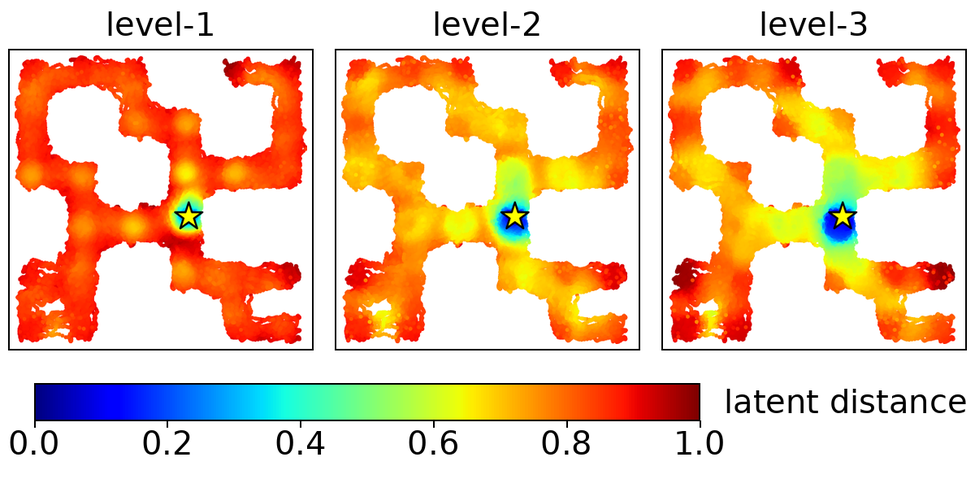

**Figure 7.** **Planning cost geometry on AntMaze.** Distance to anchor $\star$ in each latent space of a three-level H-JEPA (blue near, red far; one training seed). Higher levels show more graded costs along corridors and a broader low-cost region around the anchor.

**图 7。** **AntMaze 上的规划代价几何。** 三层 H-JEPA 各潜在空间中到锚点 $\star$ 的距离（蓝色近、红色远；一个训练种子）。高层沿走廊呈现更渐进的代价变化，并在锚点周围形成更宽的低代价区域。

Hierarchical planning changes two things at once: it decomposes the search in time, and it scores candidate futures in a more abstract latent space. We isolate the second factor, asking how much an objective in a higher, more abstract level helps on its own, independent of temporal decomposition. We focus on Visual AntMaze, where H-JEPA's substantial gains over HWM suggest benefits from hierarchical representations beyond temporal decomposition alone (Fig. 6, bottom).

分层规划同时改变了两件事：它在时间上分解搜索，并在更抽象的潜在空间中为候选未来评分。我们单独考察第二个因素，即在独立于时间分解的情况下，更高、更抽象层级中的目标函数本身能带来多大帮助。我们聚焦于 Visual AntMaze，因为 H-JEPA 相对 HWM 的显著提升表明，分层表征带来了超出单纯时间分解的收益（图 6，下）。

**Planning costs across the hierarchy.** We visualize the cost geometry in each level's latent space by mapping the latent distance from every state to a fixed anchor (Fig. 7). In a maze, a useful cost should correlate with the length of the shortest path to the anchor, around the walls. In the three-level model shown, level-1 distances are nearly constant away from the anchor, providing little signal to guide a gradient planner until it is close. At higher levels, costs rise smoothly along corridors from the low-cost anchor toward distant states. These results suggest that predicting over longer horizons both promotes abstraction and gives higher levels a more informative cost toward distant goals.

**层级中的规划代价。** 我们通过绘制每个状态到固定锚点的潜在距离，可视化各层潜在空间中的代价几何（图 7）。在迷宫中，有用的代价应当与绕过墙壁到达锚点的最短路径长度相关。在图示三层模型中，第 1 层的距离在远离锚点后几乎恒定，梯度规划器只有接近锚点时才能获得引导信号。在更高层，代价从低代价锚点沿走廊向远处状态平滑上升。这些结果表明，更长时域的预测既促进抽象，也使高层针对远距离目标提供更有信息量的代价。

**Changing only the cost.** To attribute planning gains to the cost geometry, we perform flat planning with each model's level-1 world model, keeping rollout dynamics fixed while varying only the latent space used to compute the goal cost. The native L1 cost scores a rollout by the level-1 latent distance $\lVert \hat{z}^{(1)} - g^{(1)}\rVert$ between the prediction and the goal. The *level-$k$ projection* maps both the prediction and the goal through the upper encoders $E^{(2)}\circ\cdots\circ E^{(k)}$ of the same H-JEPA model before measuring the distance; with window $w_\ell{=}1$ these encoders are pointwise, so a single level-1 latent projects to every level. Each column of Table 1 corresponds to a separately trained H-JEPA model with two, three or four levels, evaluated on the tasks of Fig. 6 (bottom). Within each column, the cost-space rows share the same level-1 world model and planner settings, varying only the latent space used to measure the goal cost. Each model's full hierarchical planner serves as a reference.

**仅改变代价。** 为将规划增益归因于代价几何，我们使用每个模型的第 1 层世界模型进行扁平规划，保持展开动力学固定，仅改变计算目标代价的潜在空间。原生 L1 代价根据预测与目标之间的第 1 层潜在距离 $\lVert \hat{z}^{(1)} - g^{(1)}\rVert$ 为展开轨迹评分。*第 $k$ 层投影*先通过同一个 H-JEPA 模型的高层编码器 $E^{(2)}\circ\cdots\circ E^{(k)}$ 映射预测和目标，再测量距离；当窗口 $w_\ell{=}1$ 时，这些编码器都是逐点的，因此单个第 1 层潜变量可以投影到每一层。表 1 每列对应一个独立训练的两层、三层或四层 H-JEPA 模型，在图 6（下）的任务上评估。同一列中，各代价空间行共享相同的第 1 层世界模型和规划器设置，仅测量目标代价的潜在空间不同。各模型的完整分层规划器作为参照。

For every tested multilevel H-JEPA, at least one upper-level cost improves planning success over the native level-1 cost (Table 1). Gains are largest where native-space planning performs poorly. The best projected level-1 planner also exceeds the separately trained LeWM baseline in mean success at every tested depth on AntMaze (LeWM: $18.0 \pm 3.5$%; Fig. 6, bottom). These gains require only level-1 planning: the upper-level encoders define the cost, but no upper-level planner generates subgoals. Learning a hierarchy of representations can thus help planning simply by providing a more abstract space in which to measure distance to the goal, before any temporal decomposition. We extend this ablation to FourRoom, Push-T and Cube in §H (Table 9). On FourRoom, abstract goal costs improve flat planning even though H-JEPA and HWM perform similarly. On Push-T and Cube, where we observe no selective abstraction, projected costs provide no clear benefit.

对于每个测试的多层 H-JEPA，至少有一种高层代价比原生第 1 层代价取得更高的规划成功率（表 1）。原生空间规划表现较差时，提升最大。在 AntMaze 所测试的每个深度上，最好的投影式第 1 层规划器的平均成功率也超过独立训练的 LeWM 基线（LeWM：$18.0 \pm 3.5$%；图 6，下）。这些提升仅需第 1 层规划：高层编码器定义代价，但没有高层规划器生成子目标。因此，即使尚未进行任何时间分解，学习表征层级也能够仅凭提供更抽象的目标距离度量空间来改善规划。§H（表 9）将该消融扩展到 FourRoom、Push-T 和 Cube。在 FourRoom 上，虽然 H-JEPA 与 HWM 表现接近，但抽象目标代价改善了扁平规划。在没有观察到选择性抽象的 Push-T 和 Cube 上，投影代价没有带来明确收益。

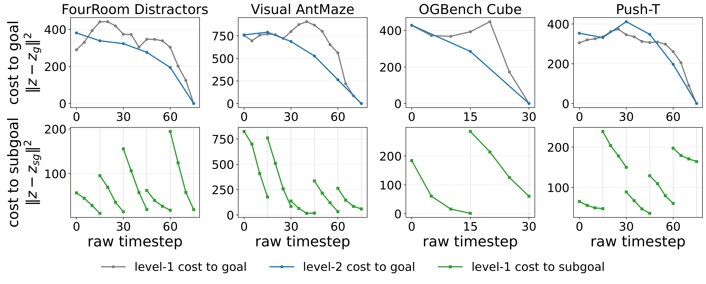

**Figure 8.** **Temporal decomposition of planning costs.** We analyze a two-level H-JEPA with $s_2=3$. *Top:* **Goal cost in level-1 and level-2 space.** For a held-out expert trajectory we encode each frame at both levels, and compute the distance between each timestep's latent $z^{(\ell)}_t$ and the goal (final-timestep) latent, $\|z^{(\ell)}_t-g^{(\ell)}\|_2^2$. At level 2 we subsample at the training stride. *Bottom:* **Subgoal tracking cost.** The level-2 subgoals are the level-2 latents at the subsampled timesteps. Within each subgoal segment we re-anchor the level-1 rollout from the encoded latent at the segment start, unroll it to the next subgoal, project it into level-2 space, and measure its distance to that subgoal. Within each segment, the cost decreases monotonically toward the next subgoal.

**图 8。** **规划代价的时间分解。** 我们分析一个 $s_2=3$ 的两层 H-JEPA。*上：* **第 1 层和第 2 层空间中的目标代价。** 对一条留出的专家轨迹，我们在两个层级编码每一帧，并计算每个时间步的潜变量 $z^{(\ell)}_t$ 与目标（最后时间步）潜变量之间的距离 $\|z^{(\ell)}_t-g^{(\ell)}\|_2^2$。在第 2 层按训练步幅下采样。*下：* **子目标跟踪代价。** 第 2 层子目标是下采样时间步上的第 2 层潜变量。在每个子目标片段内，我们将第 1 层展开重新锚定到片段起始处编码得到的潜变量，向下一子目标展开，再投影到第 2 层空间，测量其到该子目标的距离。在每个片段内，代价朝下一子目标单调下降。

**Temporal decomposition.** Independently of shaping the planning objective through higher-level representations, hierarchy helps by decomposing a long-horizon task into subgoal problems. When each lower-level planner tracks only a prefix of the upper-level plan ($K_{\ell+1}<H_{\ell+1}$), these subproblems require fewer sequential rollout steps per candidate and limit the action search to shorter horizons. This reduces compute, consistent with the improved success–compute tradeoffs in Fig. 6 (top). Second, a flat planner's full-horizon goal cost can stall or increase even along expert trajectories, providing an inconsistent measure of progress toward the goal (Fig. 8). Across all four simulated environments, the level-1 planner's costs for tracking level-2 subgoals decrease more consistently than its full-horizon goal costs: for H-JEPA, monotonicity (negative Spearman correlation between cost and time) ranges from $0.89$–$1.00$ for subgoal tracking, compared with $0.48$–$0.75$ for the full-horizon goal cost (Table 10 in §I). Both HWM and H-JEPA exhibit this improvement, consistent with temporal decomposition contributing to HWM's planning gains over LeWM even without distinct abstract representations (Fig. 6, bottom).

**时间分解。** 除了通过高层表征塑造规划目标，层级结构还通过将长时域任务分解为子目标问题提供帮助。当每个低层规划器只跟踪高层计划的一段前缀（$K_{\ell+1}<H_{\ell+1}$）时，这些子问题对每个候选所需的顺序展开步数更少，并将动作搜索限制在更短时域内。这降低了计算量，与图 6（上）中改善的成功率—计算量权衡一致。其次，即使沿专家轨迹，扁平规划器的全时域目标代价也可能停滞或增加，因此无法一致衡量向目标的进展（图 8）。在全部四个模拟环境中，第 1 层规划器跟踪第 2 层子目标的代价，比其全时域目标代价下降得更稳定：对 H-JEPA，子目标跟踪的单调性（代价与时间的负 Spearman 相关）为 $0.89$–$1.00$，全时域目标代价则为 $0.48$–$0.75$（§I 的表 10）。HWM 和 H-JEPA 都表现出这种改善，这与时间分解即使在没有不同抽象表征时也促成 HWM 相对 LeWM 的规划增益相一致（图 6，下）。

### 4.3 Scaling to diverse scenes: DROID

**4.3 扩展到多样化场景：DROID**

We now extend H-JEPA to natural scenes that change across episodes. Once the scene varies across episodes, the background becomes the easily predictable part of the signal compared to the robot, so a purely predictive objective is pushed to encode the scene and discard the agent. To address this, we add an Inverse-Dynamics Modeling (IDM) loss term to the objective.

现在，我们将 H-JEPA 扩展到回合间不断变化的自然场景。一旦场景在回合间变化，相较于机器人，背景就成了信号中容易预测的部分，因此纯预测目标会推动模型编码场景、舍弃智能体。为此，我们在目标中添加逆动力学建模（IDM）损失项。

##### Environments and evaluation.

**环境与评估。**

In this section we use DROID [[42]](#ref-khazatsky2024droid), a dataset of real teleoperated manipulation videos whose scene, lighting, and manipulated objects all change between episodes. Details about data are in §B. DROID has no simulator, so we score plans offline with the *Fréchet fidelity*, which measures how closely a plan's three-dimensional end-effector path follows the expert's. Let $p$ and $\tilde p$ be the cumulative $xyz$ paths of the planned and the expert delta-pose sequences, let $d_F$ be the discrete Fréchet distance in meters, and let $\mathbf{0}$ be the zero-action path:

本节采用 DROID [[42]](#ref-khazatsky2024droid)，这是一个真实遥操作操作视频数据集，场景、光照和被操作物体在回合间均会变化。数据细节见 §B。DROID 没有模拟器，因此我们通过 *Fréchet 保真度*离线评价计划；该指标衡量计划的三维末端执行器路径与专家路径的接近程度。令 $p$ 和 $\tilde p$ 分别为计划与专家增量位姿序列的累积 $xyz$ 路径，$d_F$ 为以米计的离散 Fréchet 距离，$\mathbf{0}$ 为零动作路径：

$$
\text{fidelity} = \frac{d_F(\mathbf{0}, \tilde{p}) - d_F(p, \tilde{p})}{d_F(\mathbf{0}, \tilde{p})}.
\tag{7}
$$

Thus, $0\%$ is satisfied by the arm not moving, $100\%$ is the expert path, and negative values are worse than doing nothing. Scoring the whole path, rather than its endpoint, is why it is relevant for the non-greedy pick-and-place tasks we evaluate. Planners and budgets are in §E, DROID clips and protocol in §J.1, and calibration of this metric against success in simulation, where it ranks graded task progress, in §J.2.

因此，机械臂不动对应 $0\%$，专家路径对应 $100\%$，负值则表示比什么都不做更差。评价整条路径而非仅评价终点，使其适用于我们评估的非贪心抓取放置任务。规划器与预算见 §E，DROID 片段和协议见 §J.1，该指标与模拟中成功情况的校准见 §J.2；在模拟中，它能够对分级任务进展排序。

##### Inverse dynamics loss avoids slow-feature collapse.

**逆动力学损失避免慢特征坍塌。**

Against a non-stationary background a purely predictive objective admits a slow-feature solution in which the encoder keeps the scene identity, which is predictable over the horizon, and discards the moving agent, which is only predictable with actions. A simple construction in §L shows that this solution is always feasible when the regularizer sees only the marginal law of the embeddings, a failure mode related to slow-feature analysis [[87]](#ref-wiskott2002slow). To avoid such collapse, a loss has to act on the joint distribution of representations across time. Following the use of inverse dynamics in PLDM [[73]](#ref-sobal2025pldm) and related JEPA world models [[77]](#ref-terver2026ebjepa), [[72]](#ref-sobal2022slowfeatures), we add a third term to the level objective of §2.1: an inverse-dynamics model that must regress, from a pair of consecutive state representations, the action relating them. With $d_a$ the action dimension and $\operatorname{sg}[\cdot]$ the stop-gradient, the level-$\ell$ IDM head $I^{(\ell)}$ gives the loss term

在非平稳背景下，纯预测目标允许一种慢特征解：编码器保留在预测时域内可预测的场景身份，却舍弃只有借助动作才能预测的运动智能体。§L 中的简单构造表明，当正则项仅观察嵌入的边缘分布时，该解始终可行；这一失效模式与慢特征分析有关 [[87]](#ref-wiskott2002slow)。为避免这种坍塌，损失必须作用于表征跨时间的联合分布。沿用 PLDM [[73]](#ref-sobal2025pldm) 和相关 JEPA 世界模型 [[77]](#ref-terver2026ebjepa), [[72]](#ref-sobal2022slowfeatures) 中的逆动力学方法，我们向 §2.1 的每层目标加入第三项：逆动力学模型必须根据一对相邻状态表征，回归连接二者的动作。用 $d_a$ 表示动作维度，$\operatorname{sg}[\cdot]$ 表示停止梯度，第 $\ell$ 层的 IDM 头 $I^{(\ell)}$ 给出损失项

$$
\mathcal{L}^{(\ell)}_{\mathrm{idm}}
= \frac{1}{T-1}\sum_{t=1}^{T-1}
\frac{1}{d_a}\left\|
I^{(\ell)}\!\left(z^{(\ell)}_t,\, z^{(\ell)}_{t+1}\right)
- \operatorname{sg}\!\left[a^{(\ell)}_t\right]
\right\|_2^2 ,
\tag{8}
$$

gets added to the level objective of Eq. (3). The term follows that prior work but, to our knowledge, has not been paired with SIGReg, so we cross-validate both weights jointly (level-1 panel of Fig. 18). At $\ell>1$ the regressed target is the pooled macro-action $a^{(\ell)}_t$ of Eq. (1), not a primitive action, so it is detached and the gradient reaches the encoder only through the two states.

该项被加入式 (3) 的每层目标。此项沿用先前工作，但据我们所知尚未与 SIGReg 配合使用，因此我们联合交叉验证两个权重（图 18 的第 1 层面板）。在 $\ell>1$ 时，回归目标是式 (1) 中经过池化的宏动作 $a^{(\ell)}_t$，而非原始动作，因此对其停止梯度，梯度只能通过两个状态到达编码器。

**(a)**

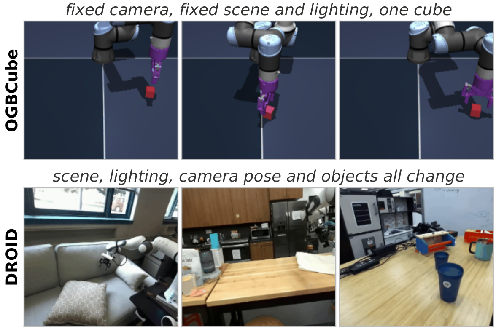

Fréchet fidelity (%) $\rightarrow$

Fréchet 保真度（%）$\rightarrow$

**(b)**

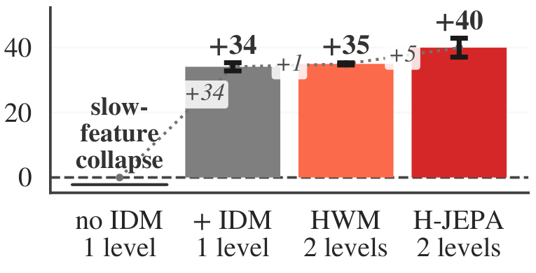

**(c)**

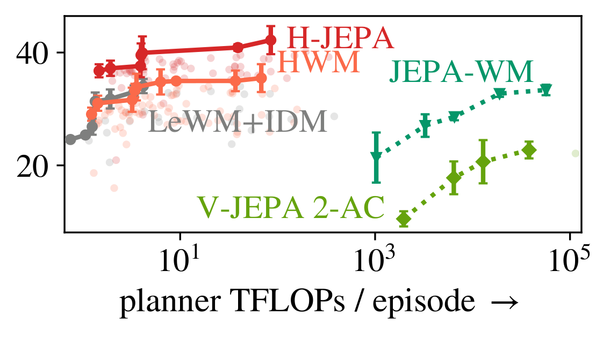

**Figure 9.** **Scene diversity makes the inverse-dynamics loss necessary, and a second level adds performance at a lower planner budget.** *(a)* First frames of three Cube and three DROID clips, showing scene variation across episodes. *(b)* DROID at $5$ fps, Fréchet fidelity (%), showing the slow-feature-collapsed LeWM, LeWM+IDM, then two hierarchies: HWM, whose level 2 is an identity encoder, and H-JEPA, whose level 2 is learned. *(c)* The one-level and two-level models of *(b)* swept over planner budgets, Fréchet fidelity against measured planner TFLOPs per episode on a log axis, the bold line being the Pareto front. Two frozen-encoder world models are shown for reference: they are public checkpoints, evaluated at their native $1$ fps on the $15$ clips whose window fits at that rate, so their intervals span three planner seeds. All other intervals are SE over three train seeds.

**图 9。** **场景多样性使逆动力学损失成为必要条件，而第二层在更低规划预算下带来性能提升。** *(a)* 三个 Cube 片段和三个 DROID 片段的首帧，展示回合间的场景变化。*(b)* DROID 在 $5$ fps 下的 Fréchet 保真度（%）：依次展示发生慢特征坍塌的 LeWM、LeWM+IDM，以及两种层级结构——第 2 层采用恒等编码器的 HWM 和第 2 层通过学习得到的 H-JEPA。*(c)* 对 *(b)* 中的单层和两层模型扫描规划预算，以对数横轴展示 Fréchet 保真度与实测每回合规划 TFLOPs 的关系，粗线为帕累托前沿。另展示两个冻结编码器的世界模型作为参照：它们使用公开检查点，以原生 $1$ fps 在窗口能够适配该帧率的 $15$ 个片段上评估，因此其区间覆盖三个规划器种子。所有其他区间均为三个训练种子的标准误。

##### Hierarchical planning results.

**分层规划结果。**

Without the loss term of Eq. (8) the model collapses and performance is zero, as in Fig. 9(b) and Fig. 17. OGBench Cube escapes it because its scene barely varies: latent variance is $75\%$ *between* episodes on DROID but only $28\%$ on Cube (§L.2), so diverse scenes pull the encoder's capacity toward scene identity. Fig. 9(b) exhibits that adding IDM makes LeWM a strong baseline, and that a second level adds performance on top of it. Both the representational lever and the temporal lever of §4.2 are active on DROID, as shown by the clear advantage of H-JEPA over HWM. Finally, Fig. 9(c) shows, like in the single-scene datasets of §4.1, that H-JEPA reaches higher performance at a lower planning budget than the flat model. The frozen-encoder baselines, shown for reference, need orders of magnitude more compute for a lower fidelity.

如果没有式 (8) 的损失项，模型就会坍塌，性能为零，如图 9(b) 和图 17 所示。OGBench Cube 能避免这一问题，因为其场景几乎不变：DROID 上有 $75\%$ 的潜在方差来自回合*之间*，而 Cube 上只有 $28\%$（§L.2），因此多样化场景会将编码器的容量吸引到场景身份上。图 9(b) 表明，加入 IDM 后 LeWM 成为强基线，第二层又在其上进一步提升性能。§4.2 中的表征机制和时间机制在 DROID 上都发挥作用，H-JEPA 相对 HWM 的明显优势证明了这一点。最后，与 §4.1 的单场景数据集相同，图 9(c) 显示 H-JEPA 以比扁平模型更低的规划预算达到更高性能。作为参照的冻结编码器基线需要高出数个数量级的计算量，却得到更低的保真度。

## 5 Related Work

**5 相关工作**

Action-conditioned JEPA world models plan in learned latent spaces without pixel reconstruction or reward supervision. DINO-WM [[93]](#ref-zhou2025dinowm) learns dynamics over frozen pretrained features, V-JEPA 2 [[2]](#ref-assran2025vjepa2) adds action-conditioned prediction after video pretraining, and PLDM [[73]](#ref-sobal2025pldm) and LeWM [[53]](#ref-maes2026lewm) train the encoder and predictor jointly from pixels. H-JEPA extends this end-to-end setting to a hierarchy of latent spaces and prediction timescales, using LeJEPA's SIGReg regularizer [[6]](#ref-balestriero2025lejepa) at every level.

动作条件 JEPA 世界模型无需像素重建或奖励监督，就能在学习到的潜在空间中规划。DINO-WM [[93]](#ref-zhou2025dinowm) 在冻结的预训练特征上学习动力学，V-JEPA 2 [[2]](#ref-assran2025vjepa2) 在视频预训练后增加动作条件预测，PLDM [[73]](#ref-sobal2025pldm) 和 LeWM [[53]](#ref-maes2026lewm) 则从像素联合训练编码器与预测器。H-JEPA 将这种端到端设定扩展为潜在空间与预测时间尺度的层级结构，并在每层使用 LeJEPA 的 SIGReg 正则项 [[6]](#ref-balestriero2025lejepa)。

Hierarchical video models learn representations at several timescales but reconstruct observations and do not plan [[68]](#ref-saxena2021clockwork), [[44]](#ref-kim2019vta), [[55]](#ref-mounir2023streamer), while hierarchical model-based control methods are reward-driven and task-specific [[32]](#ref-hafner2022director), [[36]](#ref-hansen2025puppeteer), [[27]](#ref-gumbsch2024thick). Closest to our setting, HWM [[92]](#ref-zhang2026hierarchical) trains latent world models at multiple temporal horizons from reward-free offline data and plans hierarchically, but within a shared latent space. H-JEPA additionally learns a distinct representation at each level, so that higher-level objectives can discard detail that lower-level dynamics retain. §M gives the extended survey and Table 13 compares hierarchical control methods.

分层视频模型在多个时间尺度上学习表征，但会重建观测，且不进行规划 [[68]](#ref-saxena2021clockwork), [[44]](#ref-kim2019vta), [[55]](#ref-mounir2023streamer)；分层基于模型的控制方法则由奖励驱动并针对特定任务 [[32]](#ref-hafner2022director), [[36]](#ref-hansen2025puppeteer), [[27]](#ref-gumbsch2024thick)。与我们设定最接近的 HWM [[92]](#ref-zhang2026hierarchical) 从无奖励离线数据训练多个时间时域的潜在世界模型，并进行分层规划，但所有层共享同一个潜在空间。H-JEPA 进一步在每层学习不同的表征，使高层目标能够舍弃低层动力学保留的细节。§M 提供扩展综述，表 13 比较了分层控制方法。

## 6 Conclusion

**6 结论**

We presented H-JEPA, an end-to-end method for training a hierarchy of action-conditioned JEPAs, each predicting in its own latent space over progressively longer horizons. Higher levels discard fast features that are unpredictable over their horizon and retain slow, predictable ones. Hierarchical planning with H-JEPA outperforms flat planning at lower planner compute by scoring goals in a more abstract latent space and decomposing long tasks into shorter subgoal problems. With inverse-dynamics supervision, H-JEPA also improves offline, open-loop planning fidelity on diverse real-robot videos from DROID. A next step is to test whether these gains translate to closed-loop control on a physical robot.

我们提出 H-JEPA，一种端到端训练动作条件 JEPA 层级结构的方法，每层在自己的潜在空间中预测逐渐增长的时域。高层舍弃在自身时域内不可预测的快特征，保留缓慢、可预测的特征。H-JEPA 的分层规划通过在更抽象的潜在空间中评价目标，并将长任务分解为较短的子目标问题，以更低规划计算量优于扁平规划。借助逆动力学监督，H-JEPA 还提高了 DROID 多样化真实机器人视频上的离线开环规划保真度。下一步是检验这些收益能否转化为实体机器人上的闭环控制能力。

Broader directions include learning hierarchies from action-free video and other high-dimensional temporal streams; aligning upper-level latents with language so that goals can be specified in words rather than as target observations; and training upper levels on variable-duration segments instead of fixed strides, which may yield better representations or subgoals for hierarchical planning.

更广泛的方向包括：从无动作视频及其他高维时间流中学习层级；将高层潜变量与语言对齐，使目标能够用语言而非目标观测指定；以及在可变持续时间的片段而非固定步幅上训练高层，这可能为分层规划提供更好的表征或子目标。

## Acknowledgments

**致谢**

We thank Artem Zholus for his advice on robotic data and for setting up custom RoboCasa tasks such as ObstacleReach; Raktim Goswami for generating alternative RoboCasa data used in exploratory experiments; Yilun Kuang for providing access to additional computational resources and helping run experiments; and Jean Ponce for his valuable advice throughout the project.

我们感谢 Artem Zholus 对机器人数据提出建议，并设置 ObstacleReach 等自定义 RoboCasa 任务；感谢 Raktim Goswami 生成用于探索性实验的其他 RoboCasa 数据；感谢 Yilun Kuang 提供额外计算资源并协助运行实验；感谢 Jean Ponce 在整个项目过程中提出宝贵建议。

## References

**参考文献**

[1] Mahmoud Assran, Quentin Duval, Ishan Misra, Piotr Bojanowski, Pascal Vincent, Michael Rabbat, Yann LeCun, and Nicolas Ballas. Self-supervised learning from images with a joint-embedding predictive architecture. In *IEEE/CVF Conference on Computer Vision and Pattern Recognition (CVPR)*, 2023. arXiv:2301.08243.

[2] Mahmoud Assran, Adrien Bardes, David Fan, Quentin Garrido, Russell Howes, Matthew Muckley, Ammar Rizvi, Claire Roberts, Koustuv Sinha, Artem Zholus, et al. V-JEPA 2: Self-supervised video models enable understanding, prediction and planning. *arXiv preprint arXiv:2506.09985*, 2025.

[3] Christopher Baldassano, Janice Chen, Asieh Zadbood, Jonathan W. Pillow, Uri Hasson, and Kenneth A. Norman. Discovering event structure in continuous narrative perception and memory. *Neuron*, 95(3):709–721, 2017.

[4] Federico Baldassarre, Marc Szafraniec, Basile Terver, Vasil Khalidov, Francisco Massa, Yann LeCun, Patrick Labatut, Maximilian Seitzer, and Piotr Bojanowski. Back to the features: Dino as a foundation for video world models, 2025. URL [https://arxiv.org/abs/2507.19468](https://arxiv.org/abs/2507.19468).

[5] Randall Balestriero and Yann LeCun. Learning by reconstruction produces uninformative features for perception, 2024. URL [https://arxiv.org/abs/2402.11337](https://arxiv.org/abs/2402.11337).

[6] Randall Balestriero and Yann LeCun. Lejepa: Provable and scalable self-supervised learning without the heuristics. [https://arxiv.org/abs/2511.08544](https://arxiv.org/abs/2511.08544), 2025.

[7] Amir Bar, Gaoyue Zhou, Danny Tran, Trevor Darrell, and Yann LeCun. Navigation world models. In *Proceedings of the IEEE/CVF Conference on Computer Vision and Pattern Recognition (CVPR)*, pp. 15791–15801, June 2025.

[8] Adrien Bardes, Jean Ponce, and Yann LeCun. VICReg: Variance-invariance-covariance regularization for self-supervised learning. In *International Conference on Learning Representations (ICLR)*, 2022. arXiv:2105.04906.

[9] Adrien Bardes, Quentin Garrido, Jean Ponce, Xinlei Chen, Michael Rabbat, Yann LeCun, Mahmoud Assran, and Nicolas Ballas. Revisiting feature prediction for learning visual representations from video. *arXiv preprint arXiv:2404.08471*, 2024.

[10] Tim Brooks, Bill Peebles, Connor Holmes, Will DePue, Yufei Guo, Li Jing, David Schnurr, Joe Taylor, Troy Luhman, Eric Luhman, Clarence Ng, Ricky Wang, and Aditya Ramesh. Video generation models as world simulators. OpenAI technical report, [https://openai.com/index/video-generation-models-as-world-simulators/](https://openai.com/index/video-generation-models-as-world-simulators/), 2024.

[11] Jake Bruce, Michael D. Dennis, Ashley Edwards, Jack Parker-Holder, Yuge Shi, Edward Hughes, Matthew Lai, Aditi Mavalankar, Richie Steigerwald, Chris Apps, Yusuf Aytar, Sarah Bechtle, Feryal Behbahani, Stephanie Chan, Nicolas Heess, Lucy Gonzalez, Simon Osindero, Sherjil Ozair, Scott Reed, Jingwei Zhang, Konrad Zolna, Jeff Clune, Nando de Freitas, Satinder Singh, and Tim Rocktäschel. Genie: Generative interactive environments. In *International Conference on Machine Learning (ICML)*, 2024. arXiv:2402.15391.

[12] Mathilde Caron, Hugo Touvron, Ishan Misra, Hervé Jégou, Julien Mairal, Piotr Bojanowski, and Armand Joulin. Emerging properties in self-supervised vision transformers. In *IEEE/CVF International Conference on Computer Vision (ICCV)*, 2021. arXiv:2104.14294.

[13] Ting Chen, Simon Kornblith, Mohammad Norouzi, and Geoffrey Hinton. A simple framework for contrastive learning of visual representations. In *International Conference on Machine Learning (ICML)*, 2020. arXiv:2002.05709.

[14] Xinlei Chen and Kaiming He. Exploring simple siamese representation learning. In *IEEE/CVF Conference on Computer Vision and Pattern Recognition (CVPR)*, 2021. arXiv:2011.10566.

[15] Cheng Chi, Siyuan Feng, Yilun Du, Zhenjia Xu, Eric Cousineau, Benjamin Burchfiel, and Shuran Song. Diffusion policy: Visuomotor policy learning via action diffusion. In *Robotics: Science and Systems (RSS)*, 2023. arXiv:2303.04137.

[16] Andy Clark. Whatever next? predictive brains, situated agents, and the future of cognitive science. *Behavioral and Brain Sciences*, 36(3):181–204, 2013.

[17] Harald Cramér and Herman Wold. Some theorems on distribution functions. *Journal of the London Mathematical Society*, 1(4):290–294, 1936.

[18] Peter Dayan and Geoffrey E. Hinton. Feudal reinforcement learning. In *Advances in Neural Information Processing Systems (NIPS)*, 1992.

[19] Yilun Du, Mengjiao Yang, Bo Dai, Hanjun Dai, Ofir Nachum, Joshua B. Tenenbaum, Dale Schuurmans, and Pieter Abbeel. Learning universal policies via text-guided video generation. In *Advances in Neural Information Processing Systems (NeurIPS)*, 2023. arXiv:2302.00111.

[20] Frederik Ebert, Chelsea Finn, Sudeep Dasari, Annie Xie, Alex Lee, and Sergey Levine. Visual foresight: Model-based deep reinforcement learning for vision-based robotic control. *arXiv preprint arXiv:1812.00568*, 2018.

[21] Yonathan Efroni, Dipendra Kumar Misra, Akshay Krishnamurthy, Alekh Agarwal, and John Langford. Provable rl with exogenous distractors via multistep inverse dynamics. *ArXiv*, abs/2110.08847, 2021. URL [https://api.semanticscholar.org/CorpusID:239016034](https://api.semanticscholar.org/CorpusID:239016034).

[22] T. W. Epps and Lawrence B. Pulley. A test for normality based on the empirical characteristic function. *Biometrika*, 70(3):723–726, 1983.

[23] Kuan Fang, Yuke Zhu, Animesh Garg, Silvio Savarese, and Li Fei-Fei. Dynamics learning with cascaded variational inference for multi-step manipulation. In *Conference on Robot Learning (CoRL)*, 2019. arXiv:1910.13395.

[24] Chelsea Finn and Sergey Levine. Deep visual foresight for planning robot motion. In *IEEE International Conference on Robotics and Automation (ICRA)*, pp. 2786–2793, 2017. arXiv:1610.00696.

[25] Quentin Garrido, Randall Balestriero, Laurent Najman, and Yann LeCun. Rankme: assessing the downstream performance of pretrained self-supervised representations by their rank. In *Proceedings of the 40th International Conference on Machine Learning*, ICML'23. JMLR.org, 2023.

[26] Jean-Bastien Grill, Florian Strub, Florent Altché, Corentin Tallec, Pierre H. Richemond, Elena Buchatskaya, Carl Doersch, Bernardo Avila Pires, Zhaohan Daniel Guo, Mohammad Gheshlaghi Azar, Bilal Piot, Koray Kavukcuoglu, Rémi Munos, and Michal Valko. Bootstrap your own latent: A new approach to self-supervised learning. In *Advances in Neural Information Processing Systems (NeurIPS)*, 2020. arXiv:2006.07733.

[27] Christian Gumbsch, Noor Sajid, Georg Martius, and Martin V. Butz. Learning hierarchical world models with adaptive temporal abstractions from discrete latent dynamics. In *International Conference on Learning Representations (ICLR)*, 2024.

[28] Nico Gürtler and Georg Martius. Long-horizon planning with predictable skills. In *Reinforcement Learning Conference (RLC)*, 2025.

[29] David Ha and Jürgen Schmidhuber. Recurrent world models facilitate policy evolution. In *Advances in Neural Information Processing Systems (NeurIPS)*, 2018. arXiv:1803.10122 (“World Models”).

[30] Danijar Hafner, Timothy Lillicrap, Ian Fischer, Ruben Villegas, David Ha, Honglak Lee, and James Davidson. Learning latent dynamics for planning from pixels. In *International Conference on Machine Learning (ICML)*, 2019. arXiv:1811.04551.

[31] Danijar Hafner, Timothy Lillicrap, Jimmy Ba, and Mohammad Norouzi. Dream to control: Learning behaviors by latent imagination. In *International Conference on Learning Representations (ICLR)*, 2020. arXiv:1912.01603.

[32] Danijar Hafner, Kuang-Huei Lee, Ian Fischer, and Pieter Abbeel. Deep hierarchical planning from pixels. In *Advances in Neural Information Processing Systems (NeurIPS)*, 2022. arXiv:2206.04114.

[33] Danijar Hafner, Jurgis Pasukonis, Jimmy Ba, and Timothy Lillicrap. Mastering diverse domains through world models. *arXiv preprint arXiv:2301.04104*, 2023. Published in Nature 640:647–653, 2025.

[34] Nicklas Hansen, Hao Su, and Xiaolong Wang. Temporal difference learning for model predictive control. In *International Conference on Machine Learning (ICML)*, 2022. arXiv:2203.04955.

[35] Nicklas Hansen, Hao Su, and Xiaolong Wang. TD-MPC2: Scalable, robust world models for continuous control. In *International Conference on Learning Representations (ICLR)*, 2024. arXiv:2310.16828.

[36] Nicklas Hansen, Jyothir S V, Vlad Sobal, Yann LeCun, Xiaolong Wang, and Hao Su. Hierarchical world models as visual whole-body humanoid controllers. In *International Conference on Learning Representations (ICLR)*, 2025. arXiv:2405.18418.

[37] Uri Hasson, Eunice Yang, Ignacio Vallines, David J. Heeger, and Nava Rubin. A hierarchy of temporal receptive windows in human cortex. *Journal of Neuroscience*, 28(10):2539–2550, 2008.

[38] Sukjun Hwang, Brandon Wang, and Albert Gu. Dynamic chunking for end-to-end hierarchical sequence modeling. *arXiv preprint arXiv:2507.07955*, 2025.

[39] Tomoshi Iiyama, Masahiro Suzuki, and Yutaka Matsuo. SUNTA: Hierarchical video prediction with surprise-based chunking. *arXiv preprint arXiv:2607.02087*, 2026.

[40] Petr Ivashkov, Randall Balestriero, and Bernhard Schölkopf. Sensorimotor world models: Perception for action via inverse dynamics, 2026. URL [https://arxiv.org/abs/2606.20104](https://arxiv.org/abs/2606.20104).

[41] Michael Janner, Yilun Du, Joshua B. Tenenbaum, and Sergey Levine. Planning with diffusion for flexible behavior synthesis. In *International Conference on Machine Learning (ICML)*, 2022. arXiv:2205.09991.

[42] Alexander Khazatsky, Karl Pertsch, Suraj Nair, Ashwin Balakrishna, Sudeep Dasari, Siddharth Karamcheti, Soroush Nasiriany, Mohan Kumar Srirama, Lawrence Yunliang Chen, Kirsty Ellis, et al. Droid: A large-scale in-the-wild robot manipulation dataset. In *Robotics: Science and Systems (RSS)*, 2024.

[43] Stefan J. Kiebel, Jean Daunizeau, and Karl J. Friston. A hierarchy of time-scales and the brain. *PLoS Computational Biology*, 4(11):e1000209, 2008.

[44] Taesup Kim, Sungjin Ahn, and Yoshua Bengio. Variational temporal abstraction. In *Advances in Neural Information Processing Systems (NeurIPS)*, 2019. arXiv:1910.00775.

[45] Markus Kögel, Mohamed Ibrahim, Christian Kallies, and Rolf Findeisen. Safe hierarchical model predictive control and planning for autonomous systems. *International Journal of Robust and Nonlinear Control*, 2023. arXiv:2203.14269.

[46] Yilun Kuang, Yash Dagade, Quentin Le Lidec, Lucas Maes, Randall Balestriero, and Yann LeCun. LpWM: A case for sparse representations in world models. *arXiv preprint arXiv:2608.22764*, 2026a.

[47] Yilun Kuang, Yash Dagade, Tim G. J. Rudner, Randall Balestriero, and Yann LeCun. Rectified lpjepa: Joint-embedding predictive architectures with sparse and maximum-entropy representations, 2026b. URL [https://arxiv.org/abs/2602.01456](https://arxiv.org/abs/2602.01456).

[48] Alex Lamb, Riashat Islam, Yonathan Efroni, Aniket Rajiv Didolkar, Dipendra Misra, Dylan J Foster, Lekan P Molu, Rajan Chari, Akshay Krishnamurthy, and John Langford. Guaranteed discovery of control-endogenous latent states with multi-step inverse models. *Transactions on Machine Learning Research*, 2023. ISSN 2835-8856. URL [https://openreview.net/forum?id=TNocbXm5MZ](https://openreview.net/forum?id=TNocbXm5MZ).

[49] Yann LeCun. A path towards autonomous machine intelligence. *OpenReview*, 2022. Version 0.9.2, [https://openreview.net/forum?id=BZ5a1r-kVsf](https://openreview.net/forum?id=BZ5a1r-kVsf).

[50] Alexander Levine, Peter Stone, and Amy Zhang. Multistep inverse is not all you need. *Reinforcement Learning Journal*, 2:884–925, 2024.

[51] Tianyu Li, Roberto Calandra, Deepak Pathak, Yuandong Tian, Franziska Meier, and Akshara Rai. Planning in learned latent action spaces for generalizable legged locomotion. *IEEE Robotics and Automation Letters (RA-L)*, 6(2):2682–2689, 2021. arXiv:2008.11867.

[52] Etai Littwin, Omid Saremi, Madhu Advani, Vimal Thilak, Preetum Nakkiran, Chen Huang, and Joshua M. Susskind. How JEPA avoids noisy features: The implicit bias of deep linear self distillation networks. In *The Thirty-eighth Annual Conference on Neural Information Processing Systems*, 2024. URL [https://openreview.net/forum?id=ez7w0Ss4g9](https://openreview.net/forum?id=ez7w0Ss4g9).

[53] Lucas Maes, Quentin Le Lidec, Damien Scieur, Yann LeCun, and Randall Balestriero. Leworldmodel: Stable end-to-end joint-embedding predictive architecture from pixels. [https://arxiv.org/abs/2603.19312](https://arxiv.org/abs/2603.19312), 2026.

[54] Vincent Micheli, Eloi Alonso, and François Fleuret. Transformers are sample-efficient world models. In *International Conference on Learning Representations (ICLR)*, 2023. arXiv:2209.00588.

[55] Ramy Mounir, Sujal Vijayaraghavan, and Sudeep Sarkar. STREAMER: Streaming representation learning and event segmentation in a hierarchical manner. In *Advances in Neural Information Processing Systems (NeurIPS)*, 2023.

[56] John D. Murray, Alberto Bernacchia, David J. Freedman, Ranulfo Romo, Jonathan D. Wallis, Xinying Cai, Camillo Padoa-Schioppa, Tatiana Pasternak, Hyojung Seo, Daeyeol Lee, and Xiao-Jing Wang. A hierarchy of intrinsic timescales across primate cortex. *Nature Neuroscience*, 17(12):1661–1663, 2014.

[57] Ofir Nachum, Shixiang Gu, Honglak Lee, and Sergey Levine. Data-efficient hierarchical reinforcement learning. In *Advances in Neural Information Processing Systems (NeurIPS)*, 2018. arXiv:1805.08296.

[58] Soroush Nasiriany, Abhiram Maddukuri, Lance Zhang, Adeet Parikh, Aaron Lo, Abhishek Joshi, Ajay Mandlekar, and Yuke Zhu. RoboCasa: Large-scale simulation of everyday tasks for generalist robots. In *Robotics: Science and Systems (RSS)*, 2024. arXiv:2406.02523.

[59] Nilaksh, Saurav Jha, Artem Zholus, and Sarath Chandar. Reconstruction or semantics? what makes a latent space useful for robotic world models, 2026. URL [https://arxiv.org/abs/2605.06388](https://arxiv.org/abs/2605.06388).

[60] NVIDIA. Cosmos world foundation model platform for physical ai. *arXiv preprint arXiv:2501.03575*, 2025.

[61] NVIDIA, :, Mayank Mittal, Pascal Roth, James Tigue, Antoine Richard, Octi Zhang, Peter Du, Antonio Serrano-Muñoz, Xinjie Yao, René Zurbrügg, Nikita Rudin, Lukasz Wawrzyniak, Milad Rakhsha, Alain Denzler, Eric Heiden, Ales Borovicka, Ossama Ahmed, Iretiayo Akinola, Abrar Anwar, Mark T. Carlson, Ji Yuan Feng, Animesh Garg, Renato Gasoto, Lionel Gulich, Yijie Guo, M. Gussert, Alex Hansen, Mihir Kulkarni, Chenran Li, Wei Liu, Viktor Makoviychuk, Grzegorz Malczyk, Hammad Mazhar, Masoud Moghani, Adithyavairavan Murali, Michael Noseworthy, Alexander Poddubny, Nathan Ratliff, Welf Rehberg, Clemens Schwarke, Ritvik Singh, James Latham Smith, Bingjie Tang, Ruchik Thaker, Matthew Trepte, Karl Van Wyk, Fangzhou Yu, Alex Millane, Vikram Ramasamy, Remo Steiner, Sangeeta Subramanian, Clemens Volk, CY Chen, Neel Jawale, Ashwin Varghese Kuruttukulam, Michael A. Lin, Ajay Mandlekar, Karsten Patzwaldt, John Welsh, Huihua Zhao, Fatima Anes, Jean-Francois Lafleche, Nicolas Moënne-Loccoz, Soowan Park, Rob Stepinski, Dirk Van Gelder, Chris Amevor, Jan Carius, Jumyung Chang, Anka He Chen, Pablo de Heras Ciechomski, Gilles Daviet, Mohammad Mohajerani, Julia von Muralt, Viktor Reutskyy, Michael Sauter, Simon Schirm, Eric L. Shi, Pierre Terdiman, Kenny Vilella, Tobias Widmer, Gordon Yeoman, Tiffany Chen, Sergey Grizan, Cathy Li, Lotus Li, Connor Smith, Rafael Wiltz, Kostas Alexis, Yan Chang, David Chu, Linxi "Jim" Fan, Farbod Farshidian, Ankur Handa, Spencer Huang, Marco Hutter, Yashraj Narang, Soha Pouya, Shiwei Sheng, Yuke Zhu, Miles Macklin, Adam Moravanszky, Philipp Reist, Yunrong Guo, David Hoeller, and Gavriel State. Isaac lab: A gpu-accelerated simulation framework for multi-modal robot learning, 2025. URL [https://arxiv.org/abs/2511.04831](https://arxiv.org/abs/2511.04831).

[62] Artidoro Pagnoni, Ram Pasunuru, Pedro Rodriguez, John Nguyen, Benjamin Muller, Margaret Li, Chunting Zhou, Lili Yu, Jason Weston, Luke Zettlemoyer, Gargi Ghosh, Mike Lewis, Ari Holtzman, and Srinivasan Iyer. Byte latent transformer: Patches scale better than tokens. *arXiv preprint arXiv:2412.09871*, 2024.

[63] Seohong Park, Kevin Frans, Benjamin Eysenbach, and Sergey Levine. OGBench: Benchmarking offline goal-conditioned RL. In *International Conference on Learning Representations (ICLR)*, 2025. arXiv:2410.20092.

[64] Deepak Pathak, Pulkit Agrawal, Alexei A. Efros, and Trevor Darrell. Curiosity-driven exploration by self-supervised prediction. In *Proceedings of the 34th International Conference on Machine Learning (ICML)*, volume 70 of *Proceedings of Machine Learning Research*, pp. 2778–2787. PMLR, 2017. arXiv:1705.05363.

[65] Karl Pertsch, Oleh Rybkin, Frederik Ebert, Shenghao Zhou, Dinesh Jayaraman, Chelsea Finn, and Sergey Levine. Long-horizon visual planning with goal-conditioned hierarchical predictors. In *Advances in Neural Information Processing Systems (NeurIPS)*, 2020. arXiv:2006.13205.

[66] Jean Ponce, Basile Terver, Martial Hebert, and Michael Arbel. Dual perspectives on non-contrastive self-supervised learning. In *The Fourteenth International Conference on Learning Representations*, 2026. URL [https://openreview.net/forum?id=f5MC1G6XhB](https://openreview.net/forum?id=f5MC1G6XhB).

[67] Rajesh P. N. Rao and Dana H. Ballard. Predictive coding in the visual cortex: A functional interpretation of some extra-classical receptive-field effects. *Nature Neuroscience*, 2(1):79–87, 1999.

[68] Vaibhav Saxena, Jimmy Ba, and Danijar Hafner. Clockwork variational autoencoders. In *Advances in Neural Information Processing Systems (NeurIPS)*, 2021. arXiv:2102.09532.

[69] Robin Schiewer, Anand Subramoney, and Laurenz Wiskott. Exploring the limits of hierarchical world models in reinforcement learning. *Scientific Reports*, 14, 2024. arXiv:2406.00483; DOI 10.1038/s41598-024-76719-w.

[70] Julian Schrittwieser, Ioannis Antonoglou, Thomas Hubert, Karen Simonyan, Laurent Sifre, Simon Schmitt, Arthur Guez, Edward Lockhart, Demis Hassabis, Thore Graepel, Timothy Lillicrap, and David Silver. Mastering atari, go, chess and shogi by planning with a learned model. *Nature*, 588(7839):604–609, 2020. arXiv:1911.08265.

[71] Chang Shi, Tim Pearce, Manan Tomar, Siddhartha Sen, and John Langford. Hierarchical latent prediction for language models. *arXiv preprint arXiv:2608.05806*, 2026.

[72] Vlad Sobal, Jyothir S V, Siddhartha Jalagam, Nicolas Carion, Kyunghyun Cho, and Yann LeCun. Joint embedding predictive architectures focus on slow features. [https://arxiv.org/abs/2211.10831](https://arxiv.org/abs/2211.10831), 2022.

[73] Vlad Sobal, Wancong Zhang, Kyunghyun Cho, Randall Balestriero, Tim G. J. Rudner, and Yann LeCun. Learning from reward-free offline data: A case for planning with latent dynamics models. *arXiv preprint arXiv:2502.14819*, 2025.

[74] Richard S. Sutton and Andrew G. Barto. An adaptive network that constructs and uses an internal model of its world. *Cognition and Brain Theory*, pp. 217–246, 1981.

[75] Richard S. Sutton, Doina Precup, and Satinder Singh. Between MDPs and semi-MDPs: A framework for temporal abstraction in reinforcement learning. *Artificial Intelligence*, 112(1-2):181–211, 1999.

[76] Yunhao Tang, Zhaohan Daniel Guo, Pierre Harvey Richemond, Bernardo Ávila Pires, Yash Chandak, Rémi Munos, Mark Rowland, Mohammad Gheshlaghi Azar, Charline Le Lan, Clare Lyle, András György, Shantanu Thakoor, Will Dabney, Bilal Piot, Daniele Calandriello, and Michal Valko. Understanding self-predictive learning for reinforcement learning. In *Proceedings of the 40th International Conference on Machine Learning (ICML)*, volume 202 of *Proceedings of Machine Learning Research*. PMLR, 2023. arXiv:2212.03319.

[77] Basile Terver, Randall Balestriero, Megi Dervishi, David Fan, Quentin Garrido, Tushar Nagarajan, Koustuv Sinha, Wancong Zhang, Mike Rabbat, Yann LeCun, and Amir Bar. A lightweight library for energy-based joint-embedding predictive architectures. [https://arxiv.org/abs/2602.03604](https://arxiv.org/abs/2602.03604), 2026a.

[78] Basile Terver, Tsung-Yen Yang, Jean Ponce, Adrien Bardes, and Yann LeCun. What drives success in physical planning with joint-embedding predictive world models? *Transactions on Machine Learning Research (TMLR)*, 2026b. arXiv:2512.24497.

[79] Edward C. Tolman. Cognitive maps in rats and men. *Psychological Review*, 55(4):189–208, 1948.

[80] Alexander Sasha Vezhnevets, Simon Osindero, Tom Schaul, Nicolas Heess, Max Jaderberg, David Silver, and Koray Kavukcuoglu. FeUdal networks for hierarchical reinforcement learning. In *International Conference on Machine Learning (ICML)*, 2017. arXiv:1703.01161.

[81] Tongzhou Wang, Simon Du, Antonio Torralba, Phillip Isola, Amy Zhang, and Yuandong Tian. Denoised MDPs: Learning world models better than the world itself. In Kamalika Chaudhuri, Stefanie Jegelka, Le Song, Csaba Szepesvari, Gang Niu, and Sivan Sabato (eds.), *Proceedings of the 39th International Conference on Machine Learning*, volume 162 of *Proceedings of Machine Learning Research*, pp. 22591–22612. PMLR, 17–23 Jul 2022. URL [https://proceedings.mlr.press/v162/wang22c.html](https://proceedings.mlr.press/v162/wang22c.html).

[82] Ying Wang, Oumayma Bounou, Yann LeCun, and Mengye Ren. Adajepa: An adaptive latent world model. *arXiv preprint arXiv:2606.32026*, 2026a.

[83] Ying Wang, Oumayma Bounou, Gaoyue Zhou, Randall Balestriero, Tim G. J. Rudner, Yann LeCun, and Mengye Ren. Temporal straightening for latent planning. *arXiv preprint arXiv:2603.12231*, 2026b.

[84] Manuel Watter, Jost Tobias Springenberg, Joschka Boedecker, and Martin Riedmiller. Embed to control: A locally linear latent dynamics model for control from raw images. In *Advances in Neural Information Processing Systems (NeurIPS)*, 2015. arXiv:1506.07365.

[85] Björn Weghenkel, Asja Fischer, and Laurenz Wiskott. Graph-based predictable feature analysis. *Machine Learning*, 106:1359 – 1380, 2016. URL [https://api.semanticscholar.org/CorpusID:11180992](https://api.semanticscholar.org/CorpusID:11180992).

[86] Björn Weghenkel and Laurenz Wiskott. Slowness as a proxy for temporal predictability: An empirical comparison. *Neural Computation*, 30(5):1151–1179, 05 2018. ISSN 0899-7667. [doi: 10.1162/neco_a_01070](https://doi.org/10.1162/neco_a_01070). URL [https://doi.org/10.1162/neco_a_01070](https://doi.org/10.1162/neco_a_01070).

[87] Laurenz Wiskott and Terrence J. Sejnowski. Slow feature analysis: Unsupervised learning of invariances. *Neural Computation*, 14(4):715–770, 2002.

[88] Jialong Wu, Shaofeng Yin, Ningya Feng, Xu He, Dong Li, Jianye Hao, and Mingsheng Long. iVideoGPT: Interactive videogpts are scalable world models. In *Advances in Neural Information Processing Systems (NeurIPS)*, 2024. arXiv:2405.15223.

[89] Philipp Wu, Alejandro Escontrela, Danijar Hafner, Ken Goldberg, and Pieter Abbeel. Daydreamer: World models for physical robot learning. In *Conference on Robot Learning (CoRL)*, 2022. arXiv:2206.14176.

[90] Mengjiao Yang, Yilun Du, Kamyar Ghasemipour, Jonathan Tompson, Dale Schuurmans, and Pieter Abbeel. Learning interactive real-world simulators. In *International Conference on Learning Representations (ICLR)*, 2024. arXiv:2310.06114.

[91] Jure Zbontar, Li Jing, Ishan Misra, Yann LeCun, and Stéphane Deny. Barlow twins: Self-supervised learning via redundancy reduction. In *International Conference on Machine Learning (ICML)*, 2021. arXiv:2103.03230.

[92] Wancong Zhang, Basile Terver, Artem Zholus, Soham Chitnis, Harsh Sutaria, Mido Assran, Randall Balestriero, Amir Bar, Adrien Bardes, Yann LeCun, et al. Hierarchical planning with latent world models. *arXiv preprint arXiv:2604.03208*, 2026.

[93] Gaoyue Zhou, Hengkai Pan, Yann LeCun, and Lerrel Pinto. DINO-WM: World models on pre-trained visual features enable zero-shot planning. In *International Conference on Machine Learning (ICML)*, 2025. arXiv:2411.04983.

## Appendix

**附录**

- [A Notation](#section-A)   符号说明
- [B Environments and datasets](#section-B)   环境与数据集
- [C Architecture and training](#section-C)   架构与训练
- [D Probing and decoding](#section-D)   探针与解码
- [E Planning evaluation](#section-E)   规划评估
- [F Temporal-frequency separation and selective abstraction](#section-F)   时间频率分离与选择性抽象
- [G Data specialization across levels](#section-G)   跨层级的数据专门化
- [H Planning-cost ablations across environments](#section-H)   跨环境的规划代价消融
- [I Prediction-cost monotonicity](#section-I)   预测代价的单调性
- [J DROID: corpus, planning evaluation and offline metric](#section-J)   DROID：语料库、规划评估与离线指标
- [K Anti-collapse: SIGReg, inverse dynamics and detachment](#section-K)   防止坍塌：SIGReg、逆动力学与梯度分离
- [L Slow-feature collapse in joint-embedding predictive objectives](#section-L)   联合嵌入预测目标中的慢特征坍塌
- [M Extended related work](#section-M)   扩展相关工作

## A Notation

**A 符号说明**

**Table 2.** **Notation reference.** Symbols are introduced in §2 unless the row names another section. Level superscripts are always parenthesized, $(\ell)$; a bare subscript is a time index and $a{:}b$ is a half-open range. Appendix-local symbols are defined where they are used.

**表 2。** **符号参考。** 除非某行另行注明章节，否则符号均在 §2 引入。层级上标始终带括号，即 $(\ell)$；单独的下标是时间索引，$a{:}b$ 是半开区间。附录局部使用的符号在使用处定义。

| Group 分组 | **Symbol** **符号** | **Description** **说明** |
| --- | --- | --- |
| *Levels and indices* *层级与索引* | $\ell$, $L$ | Hierarchy level index, $\ell = 1,\ldots,L$; level $1$ is the finest 层级索引，$\ell = 1,\ldots,L$；第 $1$ 层最细 |
| *Levels and indices* *层级与索引* | $t$ | Discrete time index, at the level's own rate 离散时间索引，按该层自身速率计 |
| *Levels and indices* *层级与索引* | $a{:}b$ | Half-open slice: the $b{-}a$ indices $a,\ldots,b{-}1$ 半开切片：$b{-}a$ 个索引 $a,\ldots,b{-}1$ |
| *Observations, latents and actions* *观测、潜变量与动作* | $o_t$ | Image observation at time $t$ 时刻 $t$ 的图像观测 |
| *Observations, latents and actions* *观测、潜变量与动作* | $a_t$ | Primitive action block for the transition $o_t \to o_{t+1}$ 转移 $o_t \to o_{t+1}$ 对应的原始动作块 |
| *Observations, latents and actions* *观测、潜变量与动作* | $z^{(\ell)}_t$ | Level-$\ell$ latent state; $z^{(1)}_t = E^{(1)}(o_t)$ 第 $\ell$ 层潜在状态；$z^{(1)}_t = E^{(1)}(o_t)$ |
| *Observations, latents and actions* *观测、潜变量与动作* | $\hat{z}^{(\ell)}_{1:H_\ell}$ | Action-conditioned autoregressive rollout at level $\ell$ 第 $\ell$ 层的动作条件自回归展开 |
| *Observations, latents and actions* *观测、潜变量与动作* | $\hat{z}^{(\ell+1),*}$ | Optimized rollout produced by the level above; $*$ marks an optimized quantity 上一层产生的优化展开；$*$ 表示优化后的量 |
| *Observations, latents and actions* *观测、潜变量与动作* | $a^{(\ell)}_t$ | Level-$\ell$ action embedding (a macro-action for $\ell > 1$) 第 $\ell$ 层动作嵌入（$\ell > 1$ 时为宏动作） |
| *Observations, latents and actions* *观测、潜变量与动作* | $a^{(\ell),*}_{0:H_\ell-1}$ | Optimized action sequence returned by the level-$\ell$ planner 第 $\ell$ 层规划器返回的优化动作序列 |
| *Observations, latents and actions* *观测、潜变量与动作* | $g^{(\ell)}$ | Goal state at level $\ell$, obtained by encoding the goal observation 第 $\ell$ 层的目标状态，由目标观测编码得到 |
| *Observations, latents and actions* *观测、潜变量与动作* | $Z^{(\ell)}$ | Minibatch of level-$\ell$ embeddings, $Z^{(\ell)} \in \mathbb{R}^{n \times D}$: $n$ rows of width $D$ 第 $\ell$ 层嵌入小批次，$Z^{(\ell)} \in \mathbb{R}^{n \times D}$：$n$ 行，宽度为 $D$ |
| *Observations, latents and actions* *观测、潜变量与动作* | $N$, $T$ | Sequences and timesteps of a minibatch of embeddings 嵌入小批次的序列数与时间步数 |
| *Observations, latents and actions* *观测、潜变量与动作* | $D$, $W$ | Embedding width, and the number of data-parallel ranks (§K.3) 嵌入宽度，以及数据并行进程数（§K.3） |
| *Learned components* *学习到的组件* | $E^{(\ell)}$ | State encoder at level $\ell$; pools a $w_\ell$-step lower-level window 第 $\ell$ 层状态编码器；对低层 $w_\ell$ 步窗口池化 |
| *Learned components* *学习到的组件* | $A^{(\ell)}$ | Action encoder at level $\ell$; pools an $s_\ell$-step lower-level window for $\ell > 1$ 第 $\ell$ 层动作编码器；当 $\ell > 1$ 时，对低层 $s_\ell$ 步窗口池化 |
| *Learned components* *学习到的组件* | $F^{(\ell)}$, $I^{(\ell)}$ | Latent predictor and inverse-dynamics head at level $\ell$ 第 $\ell$ 层潜在预测器和逆动力学头 |
| *Learned components* *学习到的组件* | $\mathrm{Roll}^{(\ell)}$ | Autoregressive rollout operator induced by $F^{(\ell)}$ 由 $F^{(\ell)}$ 定义的自回归展开算子 |
| *Training objective* *训练目标* | $\mathcal{L}^{(\ell)}$, $\mathcal{L}^{(\ell)}_{\mathrm{pred}}$, $\mathcal{L}^{(\ell)}_{\mathrm{idm}}$ | Total level-$\ell$ objective and its prediction and inverse-dynamics terms 第 $\ell$ 层总目标及其预测项和逆动力学项 |
| *Training objective* *训练目标* | $\mathrm{SIGReg}(Z^{(\ell)})$ | Sketched normality (anti-collapse) regularizer 基于随机投影的正态性（防坍塌）正则项 |
| *Training objective* *训练目标* | $u_m$, $h_m$ | Unit direction $u_m \in \mathbb{S}^{D-1}$ and its projection $h_m = Z^{(\ell)} u_m$ (§K) 单位方向 $u_m \in \mathbb{S}^{D-1}$ 及其投影 $h_m = Z^{(\ell)} u_m$（§K） |
| *Training objective* *训练目标* | $M$ | Number of random directions drawn by SIGReg (§K) SIGReg 抽取的随机方向数（§K） |
| *Training objective* *训练目标* | $\mathcal{T}_{\mathrm{EP}}$ | Epps–Pulley normality statistic (§K) Epps–Pulley 正态性统计量（§K） |
| *Planning* *规划* | $H_\ell$ | Planning horizon at level $\ell$, in level-$\ell$ steps 第 $\ell$ 层的规划时域，以第 $\ell$ 层步数计 |
| *Planning* *规划* | $C^{(\ell)}(z,z')$ | Pairwise cost paid by the level-$\ell$ planner; squared Euclidean distance $\lVert z-z'\rVert_2^2$ within one latent space 第 $\ell$ 层规划器承担的成对代价；同一潜在空间中的平方欧氏距离 $\lVert z-z'\rVert_2^2$ |
| *Planning* *规划* | $\tilde{z}^{(\ell+1)}_i$ | Level-$\ell$ rollout lifted into level-$(\ell{+}1)$ space by $E^{(\ell+1)}$ 通过 $E^{(\ell+1)}$ 提升到第 $(\ell{+}1)$ 层空间的第 $\ell$ 层展开 |
| *Planning* *规划* | $K_{\ell+1}$ | Number of subgoal terms in the level-$\ell$ cost; pinned by the lift, $K_{\ell+1} = \lfloor H_\ell/s_{\ell+1}\rfloor \le H_{\ell+1}$ 第 $\ell$ 层代价中的子目标项数，由提升操作确定，$K_{\ell+1} = \lfloor H_\ell/s_{\ell+1}\rfloor \le H_{\ell+1}$ |
| *Planning* *规划* | $g^{(\ell+1)}_i$ | The $i$-th subgoal handed to level $\ell$; the last is anchored, $g^{(\ell+1)}_{K_{\ell+1}} = g^{(\ell+1)}$ 提供给第 $\ell$ 层的第 $i$ 个子目标；最后一个被锚定为 $g^{(\ell+1)}_{K_{\ell+1}} = g^{(\ell+1)}$ |
| *Planning* *规划* | $\beta$ | Weight of one subgoal term relative to the terminal term, Eq. (6) 一个子目标项相对于终端项的权重，式 (6) |
| *Planning* *规划* | $t_j$, $\xi_j$ | Replanning times, and primitive commands committed at phase $j$ (the commit schedule, §E) 重新规划时刻，以及阶段 $j$ 承诺执行的原始指令（执行承诺调度，§E） |
| *Planning* *规划* | $S$, $q$, $R$ | Planner candidates per level, scored final steps of a rollout, and level-1 blocks executed per replan (§E) 每层规划候选数、展开末尾参与评分的步数，以及每次重新规划执行的第 1 层动作块数（§E） |
| *Architecture and loss hyperparameters* *架构与损失超参数* | $s_\ell$, $w_\ell$ | Temporal stride and window size from level $\ell{-}1$ to level $\ell$: each level-$\ell$ state spans $w_\ell$ lower-level states, taken every $s_\ell$ 从第 $\ell{-}1$ 层到第 $\ell$ 层的时间步幅和窗口大小：每个第 $\ell$ 层状态跨越 $w_\ell$ 个低层状态，每隔 $s_\ell$ 取一次 |
| *Architecture and loss hyperparameters* *架构与损失超参数* | $c_\ell$ | Context length, in level-$\ell$ latent states 上下文长度，以第 $\ell$ 层潜在状态数计 |
| *Architecture and loss hyperparameters* *架构与损失超参数* | $\lambda_\ell$, $\gamma_\ell$ | SIGReg and inverse-dynamics weights at level $\ell$ 第 $\ell$ 层的 SIGReg 与逆动力学权重 |

## B Environments and datasets

**B 环境与数据集**

We evaluate on two navigation environments (FourRoomDistractors and Visual AntMaze), two simulated manipulation environments (Push-T and OGBench Cube) and the real-robot DROID corpus. Push-T and Cube follow the LeWM setup [[53]](#ref-maes2026lewm) in environment and dataset; FourRoomDistractors, Visual AntMaze and their datasets are ours; DROID is a public release. Observations are RGB, $224{\times}224$ except Visual AntMaze at $64{\times}64$ and DROID at $256{\times}256$; actions are continuous.

我们在两个导航环境（FourRoomDistractors 和 Visual AntMaze）、两个模拟操作环境（Push-T 和 OGBench Cube）以及真实机器人 DROID 语料库上评估。Push-T 和 Cube 的环境与数据集遵循 LeWM 设置 [[53]](#ref-maes2026lewm)；FourRoomDistractors、Visual AntMaze 及其数据集由我们构建；DROID 是公开发布的数据。观测均为 RGB 图像，通常为 $224{\times}224$，Visual AntMaze 为 $64{\times}64$，DROID 为 $256{\times}256$；动作均为连续值。

1. **FourRoomDistractors** is a continuous 2D navigation environment derived from the two-room environment of Sobal et al. [[73]](#ref-sobal2025pldm). The world is divided into four equal rooms by two walls, each with one door; every door is closed independently with probability $0.5$ at reset, so the route between two rooms changes across episodes. The ego agent is a dot moving $2.5$ px per step under a 2D velocity command. A single distractor dot of the same speed moves under a smooth random policy that ignores the ego, and teleports to a random free location at Poisson-distributed intervals of mean $35$ steps; it neither collides with the ego nor affects the task. We collect $3{,}750$ episodes of $400$ steps ($1.5$M transitions) with a per-episode mixture of two ego policies: a heavily noised shortest-path expert that picks a new goal each time it reaches the current one, and a smooth random-exploration policy. Level 1 is trained on $1.0$M of these transitions (Table 4), and $150$ episodes of this collection serve as validation data.

   **FourRoomDistractors** 是源自 Sobal 等人 [[73]](#ref-sobal2025pldm) 双房间环境的连续二维导航环境。两道墙将世界划分为四个相同大小的房间，每道墙有一扇门；重置时每扇门独立地以 $0.5$ 的概率关闭，因此两个房间之间的路线在回合间变化。主体智能体是一个圆点，在二维速度指令下每步移动 $2.5$ 像素。另有一个速度相同的干扰圆点，按照忽略主体的平滑随机策略运动，并以均值为 $35$ 步的泊松分布间隔瞬移到随机空闲位置；它既不与主体碰撞，也不影响任务。我们采集 $3{,}750$ 个回合，每回合 $400$ 步（$1.5$M 次转移），并在每个回合混合两种主体策略：一种是噪声很强的最短路径专家，每次到达当前目标就选择新目标；另一种是平滑随机探索策略。第 1 层在这些转移中的 $1.0$M 次上训练（表 4），其中 $150$ 个回合作为验证数据。

2. **Visual AntMaze** is the OGBench `visual-antmaze-medium` environment [[63]](#ref-park2025ogbench): an 8-DoF quadruped navigating a maze from a third-person camera over a color-coded floor, so that the agent's location can be read from the image, with an 8D torque command in $[-1,1]$. The world model additionally receives the $27$-dimensional proprioceptive state (joint positions without the global $xy$, and joint velocities). We collect data with the OGBench protocol, a SAC low-level locomotion expert driven by a commanded direction, in two of its variants. `explore` resamples a random direction every $10$ steps under heavy action noise, giving low-quality but high-coverage trajectories. `stitch` drives the lightly noised expert along the maze's shortest path toward a goal four cells away, giving short goal-directed segments that must be stitched to solve longer tasks. Each variant has $12{,}500$ episodes of $400$ steps ($5.0$M transitions), and the training set combines both ($10.05$M transitions). Validation uses $1{,}250$ held-out `stitch` episodes.

   **Visual AntMaze** 是 OGBench 的 `visual-antmaze-medium` 环境 [[63]](#ref-park2025ogbench)：一个 8 自由度四足机器人从第三人称相机视角在迷宫中导航，地面用颜色编码，使智能体位置可从图像中读出，控制指令为取值在 $[-1,1]$ 的八维力矩。世界模型还接收 $27$ 维本体感知状态（不含全局 $xy$ 的关节位置，以及关节速度）。我们按 OGBench 协议采集数据，使用由方向指令驱动的 SAC 低层行走专家，并采用其两种变体。`explore` 在较强动作噪声下每 $10$ 步重新采样随机方向，产生质量较低但覆盖面广的轨迹。`stitch` 沿迷宫最短路径驱动轻度加噪的专家，朝四格之外的目标行进，产生必须拼接起来才能解决更长任务的短目标导向片段。每种变体含 $12{,}500$ 个回合，每回合 $400$ 步（$5.0$M 次转移），训练集合并二者（$10.05$M 次转移）。验证使用 $1{,}250$ 个留出的 `stitch` 回合。

3. **Push-T** is the continuous 2D manipulation task of Chi et al. [[15]](#ref-chi2023diffusionpolicy) in which a circular agent pushes a T-shaped block to a target configuration; the 2D command is the agent's target position. We use the expert dataset of DINO-WM [[93]](#ref-zhou2025dinowm) as released with LeWM: $18{,}685$ training episodes ($2.34$M frames, $125$ steps on average) and $21$ validation episodes.

   **Push-T** 是 Chi 等人 [[15]](#ref-chi2023diffusionpolicy) 提出的连续二维操作任务，圆形智能体将 T 形方块推到目标构型；二维指令是智能体的目标位置。我们使用随 LeWM 发布的 DINO-WM 专家数据集 [[93]](#ref-zhou2025dinowm)：包含 $18{,}685$ 个训练回合（$2.34$M 帧，平均 $125$ 步）和 $21$ 个验证回合。

4. **OGBench Cube** is the single-cube variant of the OGBench `cube` manipulation environment [[63]](#ref-park2025ogbench), in which a robot arm must pick up a cube and place it at a target location; the 5D command sets the end-effector displacement, yaw, and gripper. As in LeWM, the data are $10{,}000$ episodes of $200$ steps from the benchmark's scripted data-collection policy, split into $9{,}800$ training and $200$ validation episodes.

   **OGBench Cube** 是 OGBench `cube` 操作环境 [[63]](#ref-park2025ogbench) 的单立方体变体，机械臂必须拾起立方体并将其放到目标位置；五维指令控制末端执行器位移、偏航角和夹爪。与 LeWM 相同，数据来自该基准的脚本式采集策略，共 $10{,}000$ 个回合，每回合 $200$ 步，划分为 $9{,}800$ 个训练回合和 $200$ 个验证回合。

5. **DROID** [[42]](#ref-khazatsky2024droid) is a corpus of real teleoperated manipulation video with no simulator, in which scene, lighting, camera calibration and manipulated objects all change between episodes. The end-effector command is $7$-dimensional: Cartesian $xyz$, roll-pitch-yaw and gripper. Actions are normalized per coordinate against dataset statistics before training, so the gripper dimension, one to two orders of magnitude larger than the Cartesian deltas, does not dominate the mean in Eq. (8). We train on a re-encoded copy ($74{,}530$ episodes, $220{,}084$ views, three cameras at $256{\times}256$), described in §J.4. Plans are scored offline against logged expert trajectories on a frozen $16$-clip evaluation set, specified in §J.1.

   **DROID** [[42]](#ref-khazatsky2024droid) 是一个没有模拟器的真实遥操作操作视频语料库，场景、光照、相机标定和被操作物体在回合间均会变化。末端执行器指令为 $7$ 维，包含笛卡尔 $xyz$、滚转角—俯仰角—偏航角和夹爪。训练前，动作根据数据集统计按坐标归一化，避免比笛卡尔增量大一到两个数量级的夹爪维度主导式 (8) 的均值。我们在重新编码的副本上训练（$74{,}530$ 个回合，$220{,}084$ 个视图，三台相机，分辨率 $256{\times}256$），详见 §J.4。计划在固定的 $16$ 片段评估集上，针对记录的专家轨迹离线评分，具体规定见 §J.1。

## C Architecture and training

**C 架构与训练**

This appendix collects the architecture and training settings of every model in the paper: the LeWM baseline and the two-, three-, and four-level H-JEPA models of the simulated environments (§C.1), then the DROID models (§C.2). Probing and decoding are described in §D, and planning evaluation in §E.

本附录汇集论文中所有模型的架构和训练设置：先介绍模拟环境中的 LeWM 基线以及两层、三层和四层 H-JEPA（§C.1），再介绍 DROID 模型（§C.2）。探针和解码见 §D，规划评估见 §E。

### C.1 Single-scene environments

**C.1 单场景环境**

These are the models of Fig. 6 (bottom). LeWM is a single-level JEPA using the architecture and objective of Maes et al. [[53]](#ref-maes2026lewm). Each H-JEPA model trains all levels jointly from scratch in one end-to-end run, with upper-level losses backpropagating through the encoders below. We describe shared settings once and list environment-specific choices in Table 4.

这些模型对应图 6（下）。LeWM 是一个单层 JEPA，采用 Maes 等人 [[53]](#ref-maes2026lewm) 的架构和目标。每个 H-JEPA 模型都在一次端到端训练中从头联合训练所有层，高层损失通过下方编码器反向传播。我们统一说明共享设置，并在表 4 列出各环境特定的选择。

##### Data.

**数据。**

Within each environment, all four models use the same training data: $1.0$M transitions from the one-distractor FourRoom dataset; a $10.05$M-transition, equal mixture of AntMaze `explore` and `stitch`; the Push-T expert set; or the Cube scripted set (§B). Frames use ImageNet normalization without augmentation. A level-1 step spans $5$ environment steps, with the intervening actions concatenated. Every upper level has stride $s_\ell=2$ and window $w_\ell=1$. Each sample is one clip long enough to supply $T=4$ states at the top level; each lower level takes a random four-state crop of its own stream. The causal predictor receives $c_\ell=3$ states at every level and learns their teacher-forced one-step successors. If $n_\ell$ is the number of level-$\ell$ frames needed in the clip, $n_L=4$ and $n_{\ell-1}=(n_\ell-1)s_\ell+w_\ell$, giving the minimum clip lengths in Table 3. Batches contain $128$ clips. A clip must lie within one episode, so the number of clips an epoch yields decreases with the minimum clip length (Table 3): slightly on FourRoom and AntMaze, whose episodes are long, and sharply on Push-T, whose episodes are short. H-JEPA training is epoch-matched across depths, so deeper models take fewer gradient steps.

在每个环境中，四个模型使用相同训练数据：单干扰物 FourRoom 数据集中的 $1.0$M 次转移；AntMaze `explore` 与 `stitch` 等量混合的 $10.05$M 次转移；Push-T 专家集；或 Cube 脚本集（§B）。图像使用 ImageNet 归一化，不做增强。第 1 层的一个步骤跨越 $5$ 个环境步，其间动作被拼接。每个高层的步幅为 $s_\ell=2$，窗口为 $w_\ell=1$。每个样本是一个足够长、能够在最高层提供 $T=4$ 个状态的片段；每个低层从自己的序列中随机裁取四个状态。因果预测器在每层接收 $c_\ell=3$ 个状态，并学习其教师强制的单步后继。若 $n_\ell$ 是片段所需的第 $\ell$ 层帧数，则 $n_L=4$ 且 $n_{\ell-1}=(n_\ell-1)s_\ell+w_\ell$，从而得到表 3 的最小片段长度。每批含 $128$ 个片段。一个片段必须位于单个回合内，因此每轮可产生的片段数量随最小片段长度增加而减少（表 3）：在回合较长的 FourRoom 和 AntMaze 上降幅较小，在回合较短的 Push-T 上则大幅下降。不同深度的 H-JEPA 按训练轮数匹配，因此更深模型的梯度更新步数更少。

**Table 3.** **Temporal layout of one training sample and the clips it leaves per epoch.** The minimum clip length is the shortest episode segment that yields one training sample, in environment steps, including both endpoint observations. All H-JEPA models use stride two and window one at every level above the first. A clip must lie within one episode (the loader reserves $5\,n_1$ environment steps per clip), so the number of clips an epoch yields falls as the minimum clip length grows; parentheses give each count as a percentage of the LeWM count in the same environment. Each clip supplies three teacher-forced transitions per level.

**表 3。** **一个训练样本的时间布局及其对应的每轮可用片段数量。** 最小片段长度是能够产生一个训练样本的最短回合片段，以环境步计，并包含两端的观测。所有 H-JEPA 模型在第 1 层以上均使用步幅二、窗口一。片段必须位于单个回合内（加载器为每个片段预留 $5\,n_1$ 个环境步），因此最小片段长度越大，每轮产生的片段数越少；括号中为各数量占同一环境中 LeWM 数量的百分比。每个片段在每层提供三次教师强制转移。

| Group 分组 |  | LeWM | Two-level H-JEPA 两层 H-JEPA | Three-level H-JEPA 三层 H-JEPA | Four-level H-JEPA 四层 H-JEPA |
| --- | --- | --- | --- | --- | --- |
|  | Level-1 frames per clip 每片段的第 1 层帧数 | $4$ | $7$ | $13$ | $25$ |
|  | Minimum clip length (env. steps) 最小片段长度（环境步） | $16$ | $31$ | $61$ | $121$ |
| *Training clips per epoch* *每轮训练片段数* | FourRoom | $952{,}708$ | $915{,}298$ ($96\%$) | $840{,}478$ ($88\%$) | $690{,}838$ ($73\%$) |
| *Training clips per epoch* *每轮训练片段数* | AntMaze | $9{,}575{,}000$ | $9{,}200{,}000$ ($96\%$) | $8{,}450{,}000$ ($88\%$) | $6{,}950{,}000$ ($73\%$) |
| *Training clips per epoch* *每轮训练片段数* | Push-T | $1{,}981{,}721$ | $1{,}701{,}446$ ($86\%$) | $1{,}143{,}623$ ($58\%$) | $285{,}931$ ($14\%$) |
| *Training clips per epoch* *每轮训练片段数* | Cube | $1{,}783{,}600$ | $1{,}636{,}600$ ($92\%$) | $1{,}342{,}600$ ($75\%$) | $754{,}600$ ($42\%$) |

##### Training dynamics.

**训练动态。**

Fig. 10 tracks the unweighted prediction and SIGReg terms of every level of the four-level models over training. In a healthy run, the SIGReg statistic drops sharply early in training, then settles within a small factor of its value on exactly Gaussian embeddings, about $1$ (§K.3). The prediction loss often rises over the first epochs, while SIGReg spreads out the initially concentrated embeddings, then decreases to a nonzero plateau. A prediction loss falling toward zero is the signature of collapse, since constant embeddings are trivially predictable. Neither term degenerates at any level, so end-to-end training keeps all levels non-collapsed at the deepest setting we train. Both terms are ordered by level in every environment, each higher level converging to a larger prediction loss and a larger SIGReg value, consistent with the fewer clips and coarser targets an upper level sees (Table 3). Upper levels also start improving later than level 1, most visibly on AntMaze, where the abstract predictors hold a plateau over the first epochs before descending. On Push-T and Cube the level-3 and level-4 prediction curves are the noisiest and flatten earliest, in line with the short-episode clip deficit of Table 3. The total training objective, summed over levels, decreases throughout training in every environment and is flat by the final epochs.

图 10 跟踪四层模型各层在训练中的未加权预测项和 SIGReg 项。在健康训练中，SIGReg 统计量在早期迅速下降，随后稳定在完全高斯嵌入下取值（约 $1$，§K.3）的较小倍数范围内。预测损失通常在前几轮上升，此时 SIGReg 将起初集中的嵌入展开，随后损失下降到非零平台。预测损失趋于零是坍塌的标志，因为恒定嵌入很容易预测。两个项在任何层都没有退化，因此在我们训练的最深设置中，端到端训练使所有层保持未坍塌。各环境中，两项都按层级排列，每个更高层均收敛到更大的预测损失和更大的 SIGReg 值，这与高层看到更少片段和更粗目标相一致（表 3）。高层开始改善的时间也晚于第 1 层，在 AntMaze 上最明显：抽象预测器在最初几轮维持平台，随后才下降。在 Push-T 和 Cube 上，第 3、4 层预测曲线噪声最大、最早变平，与表 3 中短回合导致的片段不足一致。所有层求和的总训练目标在各环境训练过程中持续下降，并在最后几轮趋于平坦。

On DROID (bottom row of Fig. 10), no term degenerates either. The prediction loss follows the same ordering as in the other environments, with level 2 converging well above level 1. The SIGReg ordering is reversed, level 2 ending below level 1, consistent with its twice larger SIGReg weight. Level 1 of H-JEPA also reaches lower prediction and inverse-dynamics losses than the flat LeWM+IDM trained with the same weights, so training the upper level jointly does not degrade the lower one. The total training objective, almost entirely the weighted inverse-dynamics term, decreases monotonically up to epoch-to-epoch noise.

在 DROID 上（图 10 底行），各项同样没有退化。预测损失的层级排序与其他环境相同，第 2 层的收敛值明显高于第 1 层。SIGReg 的顺序相反，第 2 层最终低于第 1 层，这与其两倍大的 SIGReg 权重一致。H-JEPA 的第 1 层预测损失和逆动力学损失也低于以相同权重训练的扁平 LeWM+IDM，因此联合训练高层并未损害低层。总训练目标几乎完全由加权逆动力学项构成，除轮间噪声外单调下降。

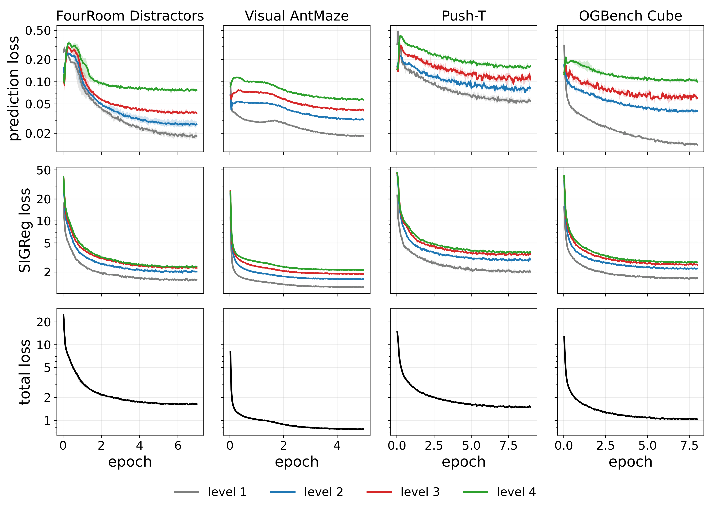

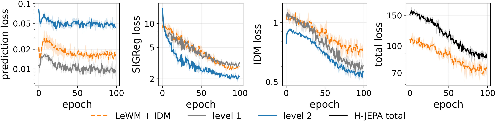

**Figure 10.** **Per-level training losses of the four-level H-JEPA models and of the DROID models.** Top three rows: unweighted prediction loss and SIGReg statistic of each level of the four-level models over training, and their total training objective, the sum over levels of the prediction loss plus the weighted SIGReg term. Every level of a model uses the same SIGReg weight ($0.18$ on FourRoom, $0.09$ elsewhere), so the weighted curves differ from the unweighted ones by a constant factor per environment. The seed band of the total objective is narrower than its line. Bottom row: unweighted prediction, SIGReg and inverse-dynamics losses of the DROID flat LeWM+IDM (orange, dashed) and of both levels of the two-level H-JEPA (solid) over their $100$ training epochs, and the total training objective, the sum of all terms weighted as in Table 5 (level 1: SIGReg $0.08$, IDM $100$; level 2: SIGReg $0.16$, IDM $50$), summed over both levels for H-JEPA. All curves are the mean over three training seeds with a min/max band, on a log scale.

**图 10。** **四层 H-JEPA 模型和 DROID 模型的逐层训练损失。** 顶部三行：四层模型各层在训练中的未加权预测损失和 SIGReg 统计量，以及总训练目标，即各层预测损失与加权 SIGReg 项之和。同一模型的各层使用相同 SIGReg 权重（FourRoom 为 $0.18$，其他环境为 $0.09$），因此在每个环境中，加权曲线与未加权曲线只相差一个常数因子。总目标的种子区间比曲线线宽还窄。底行：DROID 扁平 LeWM+IDM（橙色虚线）及两层 H-JEPA 的两个层级（实线）在 $100$ 个训练轮次中的未加权预测、SIGReg 和逆动力学损失，以及按表 5 权重加权的各项总和（第 1 层：SIGReg $0.08$、IDM $100$；第 2 层：SIGReg $0.16$、IDM $50$）；H-JEPA 对两个层级求和。所有曲线为三个训练种子的均值，带最小值/最大值区间，使用对数刻度。

##### Architecture.

**架构。**

The level-1 encoder is a ViT-Tiny whose `[CLS]` token passes through a one-hidden-layer MLP projector with Batch Normalization. On AntMaze, its $256$-dimensional pixel projection is concatenated with a $128$-dimensional embedding of the proprioceptive state from a two-layer MLP. The level-1 predictor is a causal transformer with $4$ layers, $8$ heads, width $192$, feed-forward width $1024$, action conditioning through adaptive LayerNorm, and an MLP projector of the same form as the encoder's. Each upper level uses a two-layer MLP encoder with hidden width $384$, applied to the lower-level latent; a one-layer transformer pools the two intervening lower-level action embeddings into a $4$-dimensional macro-action. The upper-level predictor has the same structure as at level 1, with dimensions given in Table 4. Within an environment, latent dimensions and upper-level architectures are shared across all H-JEPA depths.

第 1 层编码器为 ViT-Tiny，其 `[CLS]` token 通过一个含单隐藏层和批归一化的 MLP 投影头。在 AntMaze 上，$256$ 维像素投影与一个两层 MLP 产生的 $128$ 维本体感知状态嵌入拼接。第 1 层预测器为因果 Transformer，包含 $4$ 层、$8$ 个头、宽度 $192$、前馈宽度 $1024$，通过自适应 LayerNorm 注入动作条件，并使用与编码器相同形式的 MLP 投影头。每个高层使用隐藏宽度为 $384$ 的两层 MLP 编码器，作用于低层潜变量；一个单层 Transformer 将其间两个低层动作嵌入池化为 $4$ 维宏动作。高层预测器与第 1 层结构相同，维度见表 4。在同一环境内，不同 H-JEPA 深度共享潜在维度和高层架构。

##### Training.

**训练。**

We minimize the sum of $\mathcal{L}_{\mathrm{pred}}+\lambda_\ell\,\mathrm{SIGReg}$ over levels (§2.1), with $M=1024$ random projections and no stop-gradient, moving-average targets, or pretrained weights. All models use AdamW with weight decay $10^{-3}$, linear warm-up (1%) followed by cosine decay, gradient clipping at $1.0$, and `bfloat16`. Peak learning rates are $5\times10^{-5}$ for level 1 and $10^{-5}$ for every upper level. The SIGReg coefficient is uniform across levels within each H-JEPA model. Training uses three seeds ($42$, $43$, $44$). The two-, three-, and four-level H-JEPA runs share an epoch budget within each environment; longer clips change the number of valid samples, so optimizer-step counts and training FLOPs are not matched across depths.

我们最小化各层 $\mathcal{L}_{\mathrm{pred}}+\lambda_\ell\,\mathrm{SIGReg}$ 的总和（§2.1），采用 $M=1024$ 个随机投影，不使用停止梯度、移动平均目标或预训练权重。所有模型使用 AdamW，权重衰减为 $10^{-3}$，先进行线性预热（1%），再进行余弦衰减，梯度裁剪阈值为 $1.0$，精度为 `bfloat16`。第 1 层的峰值学习率为 $5\times10^{-5}$，各高层均为 $10^{-5}$。每个 H-JEPA 模型的所有层使用统一 SIGReg 系数。训练采用三个种子（$42$、$43$、$44$）。在每个环境中，两层、三层和四层 H-JEPA 使用相同轮数预算；更长片段改变有效样本数，因此不同深度的优化器步数和训练 FLOPs 并未匹配。

**Table 4.** **Per-environment architecture and training settings.** Upper-level predictor dimensions and H-JEPA epoch counts apply to every depth. H-JEPA models are initialized independently of the LeWM baselines.

**表 4。** **各环境的架构和训练设置。** 高层预测器维度与 H-JEPA 训练轮数适用于所有深度。H-JEPA 模型独立于 LeWM 基线初始化。

|  | FourRoom | AntMaze | Push-T | Cube |
| --- | --- | --- | --- | --- |
| Frame size / patch 图像大小 / 图像块 | $224$ / $14$ | $64$ / $4$ | $224$ / $14$ | $224$ / $14$ |
| Command / proprio dim. 指令 / 本体感知维度 | $2$ / n/a | $8$ / $27$ | $2$ / n/a | $5$ / n/a |
| Latent dim. $d$ 潜在维度 $d$ | $192$ | $384$ | $192$ | $192$ |
| Upper predictor layers / heads 高层预测器层数 / 头数 | $4$ / $8$ | $5$ / $12$ | $6$ / $16$ | $6$ / $16$ |
| Upper predictor width / FF width 高层预测器宽度 / 前馈宽度 | $192$ / $1024$ | $224$ / $1536$ | $192$ / $2048$ | $192$ / $2048$ |
| SIGReg $\lambda$, LeWM / H-JEPA | $0.72$ / $0.18$ | $0.09$ / $0.09$ | $0.09$ / $0.09$ | $0.09$ / $0.09$ |
| H-JEPA epochs H-JEPA 训练轮数 | $7$ | $5$ | $9$ | $8$ |

##### Implementation and hardware.

**实现与硬件。**

We use the `stable-worldmodel` and `stable-pretraining` libraries of LeWM [[53]](#ref-maes2026lewm), and train on H200 GPUs.

我们采用 LeWM [[53]](#ref-maes2026lewm) 的 `stable-worldmodel` 和 `stable-pretraining` 库，并在 H200 GPU 上训练。

### C.2 DROID

**C.2 DROID**

At level $\ell>1$, the macro-actions are embeddings produced by $A^{(\ell)}$ rather than raw actions. To avoid slow-feature collapse, we also apply SIGReg to these action embeddings, with weight $0.005$; level 1 carries no such term. Our DROID models see pixels and actions only, no proprioception.

在第 $\ell>1$ 层，宏动作是 $A^{(\ell)}$ 生成的嵌入，而非原始动作。为避免慢特征坍塌，我们还对这些动作嵌入施加权重为 $0.005$ 的 SIGReg；第 1 层没有此项。我们的 DROID 模型仅接收像素和动作，不使用本体感知。

The data pipeline and learning rates also differ from the single-scene environments (§C.1). There, the levels are balanced: each lower level takes a random four-state crop of its own stream, so every level learns from three teacher-forced transitions per clip, and every upper level trains at a fifth of the level-1 learning rate. On DROID, a training clip supplies eight level-1 states, and level 2 reads three of them at stride $3$, with no crop of its own. With one-step teacher forcing, level 2 thus receives two prediction targets per clip against seven at level 1. Both levels share the peak learning rate of Table 5.

数据流水线与学习率也不同于单场景环境（§C.1）。在单场景环境中，各层是平衡的：每个低层从自身序列中随机裁取四个状态，因此每层每片段均学习三次教师强制转移，并且所有高层的学习率均为第 1 层的五分之一。在 DROID 上，训练片段提供八个第 1 层状态，第 2 层以步幅 $3$ 读取其中三个，不再自行裁取。因此，在单步教师强制下，第 2 层每个片段接收两个预测目标，第 1 层则接收七个。两层共享表 5 中的峰值学习率。

Table 5 gives the training settings of the headline two-level run. A stagewise variant instead trains level 1 alone, then freezes it and trains level 2 on its latents. We use this variant only for the data-specialization analysis (§G), the level-2 coefficient search (Fig. 18), and the decoded plans (Fig. 16); all headline results use end-to-end training. The architecture and loss settings describe the model rather than how it is scheduled, so they apply equally to the end-to-end and stagewise procedures; the optimization settings are those of the end-to-end headline runs. Level 1 consumes raw actions, which is why the action regularizer appears only in the level-2 block.

表 5 给出主要两层实验的训练设置。分阶段变体则先单独训练第 1 层，再冻结该层并在其潜变量上训练第 2 层。我们仅在数据专门化分析（§G）、第 2 层系数搜索（图 18）和计划解码（图 16）中使用该变体；所有主要结果都使用端到端训练。架构与损失设置描述模型本身，而非训练调度方式，因此同样适用于端到端与分阶段过程；优化设置对应主要端到端实验。第 1 层接收原始动作，因此动作正则项只出现在第 2 层部分。

The level-1 and optimization blocks of Table 5 also apply to one-level LeWM+IDM. Frames are center-cropped to a square, resized to $256{\times}256$ and normalized with ImageNet statistics, with no augmentation beyond the random choice of clip. Level 2 has stride $s_2=3$ and window $w_2=1$: its encoder is applied to every third level-1 state on its own. Its macro-action encoder concatenates the raw $7$-dimensional commands of the three level-1 steps it spans and maps them to an $8$-dimensional macro-action through an MLP with one hidden layer of width $64$ and a final LayerNorm. At both levels the predictor is a causal transformer with $6$ heads of width $64$, feed-forward width $1536$ and dropout $0.1$, conditioned on actions through adaptive LayerNorm. All SIGReg terms, including the action term, use $M=1024$ random projections.

表 5 的第 1 层与优化部分同样适用于单层 LeWM+IDM。图像中心裁剪为正方形，缩放到 $256{\times}256$，用 ImageNet 统计归一化，除随机选取片段外不做其他增强。第 2 层步幅为 $s_2=3$、窗口为 $w_2=1$：其编码器独立作用于每第三个第 1 层状态。宏动作编码器将其覆盖的三个第 1 层步骤的原始 $7$ 维指令拼接，经一个隐藏宽度为 $64$、末端带 LayerNorm 的单隐藏层 MLP 映射为 $8$ 维宏动作。两个层级的预测器均为因果 Transformer，具有 $6$ 个宽度为 $64$ 的注意力头、前馈宽度 $1536$、dropout $0.1$，并通过自适应 LayerNorm 注入动作条件。所有 SIGReg 项，包括动作项，都使用 $M=1024$ 个随机投影。

**Table 5.** **Training hyperparameters on DROID.** Predictors are causal transformers, given as width/depth. The grouping row gives the shape of the tensor SIGReg tests: $(T,N,D)$ tests normality within each timestep, over the $N$ sequences of the batch. The architecture and loss settings do not depend on the training schedule, whether end-to-end or stagewise (§C.2); the optimization block does, and reports the end-to-end headline runs. The peak learning rate is the same at both levels, AdamW runs at $\beta = (0.9, 0.999)$, and the dataloader length caps the iterations per epoch, which gives $292$ at this batch size.

**表 5。** **DROID 的训练超参数。** 预测器为因果 Transformer，以宽度/深度表示。分组行给出 SIGReg 检验张量的形状：$(T,N,D)$ 在每个时间步内，对批次中的 $N$ 条序列检验正态性。架构与损失设置不依赖训练调度，无论端到端还是分阶段（§C.2）；优化部分则依赖调度，这里报告主要端到端实验。两层的峰值学习率相同，AdamW 使用 $\beta = (0.9, 0.999)$，每轮迭代次数由数据加载器长度限制，在该批大小下为 $292$。

| Group 分组 |  | DROID |
| --- | --- | --- |
| *Global* *全局* | Stop-gradient on latent targets 潜在目标停止梯度 | None 无 |
| *Global* *全局* | Level-1 to level-2 stride 第 1 层到第 2 层的步幅 | $3$ |
| *Level 1* *第 1 层* | Encoder 编码器 | ViT-S/16, `CLS` |
| *Level 1* *第 1 层* | Predictor 预测器 | $384$/$12$ |
| *Level 1* *第 1 层* | Predictor context $c_1$ 预测器上下文 $c_1$ | $7$ states $7$ 个状态 |
| *Level 1* *第 1 层* | SIGReg grouping SIGReg 分组 | $(T,N,D)$ |
| *Level 1* *第 1 层* | SIGReg weight $\lambda_1$ SIGReg 权重 $\lambda_1$ | $0.08$ |
| *Level 1* *第 1 层* | IDM weight $\gamma_1$ IDM 权重 $\gamma_1$ | $100$ |
| *Level 2* *第 2 层* | Encoder 编码器 | latent MLP $768$ 潜变量 MLP $768$ |
| *Level 2* *第 2 层* | Predictor 预测器 | $384$/$12$ |
| *Level 2* *第 2 层* | Predictor context $c_2$ 预测器上下文 $c_2$ | $2$ states $2$ 个状态 |
| *Level 2* *第 2 层* | SIGReg grouping SIGReg 分组 | $(T,N,D)$ |
| *Level 2* *第 2 层* | SIGReg weight $\lambda_2$ SIGReg 权重 $\lambda_2$ | $0.16$ |
| *Level 2* *第 2 层* | IDM weight $\gamma_2$ IDM 权重 $\gamma_2$ | $50$ |
| *Level 2* *第 2 层* | Action SIGReg weight 动作 SIGReg 权重 | $0.005$ |
| *Optimization* *优化* | Optimizer 优化器 | AdamW |
| *Optimization* *优化* | Total batch size 总批大小 | $256$ |
| *Optimization* *优化* | Peak learning rate 峰值学习率 | $5\times10^{-4}$ |
| *Optimization* *优化* | Warm-up, fraction of steps 预热，占总步数的比例 | $0.1$, linear $0.1$，线性 |
| *Optimization* *优化* | Decay 衰减 | cosine to $0$ 余弦衰减至 $0$ |
| *Optimization* *优化* | Weight decay 权重衰减 | $10^{-4}$ |
| *Optimization* *优化* | Gradient clipping, per level 每层梯度裁剪 | $1.0$ |
| *Optimization* *优化* | Precision 精度 | `bfloat16` |
| *Optimization* *优化* | Epochs 训练轮数 | $100$ |
| *Optimization* *优化* | Iterations per epoch 每轮迭代次数 | $292$ |
| *Optimization* *优化* | Training seeds 训练种子 | $1$, $1000$, $10000$ |

## D Probing and decoding

**D 探针与解码**

All probe and decoder results are obtained *post hoc*: after training, the world model is frozen and every frame of a held-out probing set is encoded through the hierarchy without striding, giving one detached latent per level for every frame. Probes and decoders are then fitted on these latents.

所有探针与解码结果都在训练*之后*获得：世界模型训练完成后被冻结，留出的探针数据集中的每帧都不经步幅下采样地通过整个层级编码，使每帧在每层都得到一个分离梯度的潜变量。随后在这些潜变量上拟合探针和解码器。

##### Probes.

**探针。**

Each probed entity has a two-layer MLP (hidden width $512$, LayerNorm, GELU) per level, mapping the latent to the $z$-scored entity vector under a mean-squared-error loss. We report the variance-normalized error (NMSE) on the evaluation split: the per-dimension de-normalized squared error divided by the entity's variance and averaged equally over dimensions (§3).

每个被探测实体在每一层对应一个两层 MLP（隐藏宽度 $512$、LayerNorm、GELU），在均方误差损失下将潜变量映射到经过 $z$ 分数标准化的实体向量。我们报告评估划分上的方差归一化误差（NMSE）：每维反归一化后的平方误差除以实体方差，再对各维等权平均（§3）。

##### Decoder.

**解码器。**

Following LeWM, a lightweight transformer decoder reconstructs the frame from a single latent, for visualization only. The latent is projected to width $256$ and serves as key and value for a set of learnable query tokens, one per encoder patch ($16{\times}16$ queries at both resolutions); four cross-attention blocks with $8$ heads and residual MLPs update the queries, and a linear layer maps each to its pixel patch. The loss is the mean-squared error to the ImageNet-normalized frame.

遵循 LeWM，一个轻量 Transformer 解码器从单个潜变量重建图像，仅用于可视化。潜变量投影到宽度 $256$，作为一组可学习查询 token 的键和值，每个编码器图像块对应一个查询（两种分辨率下均为 $16{\times}16$ 个查询）；四个含 $8$ 个头和残差 MLP 的交叉注意力块更新查询，线性层再将每个查询映射到对应像素块。损失是相对于 ImageNet 归一化图像的均方误差。

##### Training.

**训练。**

Probes and decoders are trained jointly with AdamW (weight decay $10^{-4}$), batch size $128$, for $25$ epochs ($60$ on FourRoomDistractors); probes use learning rate $10^{-3}$ and decoders $10^{-4}$ ($10^{-3}$ on Visual AntMaze). Table 6 lists the probing data and the probed entities per environment. Entities are grouped by their temporal frequency into the slow entity that level 2 retains and the fast entity it discards (§3); Push-T and Cube form a single frequency band, so all of their entities are retained and none is marked fast.

探针与解码器使用 AdamW 联合训练，权重衰减 $10^{-4}$，批大小 $128$，训练 $25$ 轮（FourRoomDistractors 为 $60$ 轮）；探针学习率为 $10^{-3}$，解码器为 $10^{-4}$（Visual AntMaze 为 $10^{-3}$）。表 6 列出每个环境的探针数据和被探测实体。实体按时间频率划分为第 2 层保留的慢速实体与舍弃的快速实体（§3）；Push-T 和 Cube 形成单一频带，因此其所有实体均被保留，没有实体标记为快速。

**Table 6.** **Probing data and probed entities per environment.** Transition counts are for fitting (train) and scoring (eval). Visual AntMaze is scored on one evaluation set with equal numbers of `explore` and `stitch` episodes. On FourRoomDistractors and Visual AntMaze, whose state separates into slow and fast entities (Fig. 12(b)), the entities are labeled accordingly. Entity dimensions in parentheses.

**表 6。** **各环境的探针数据与被探测实体。** 转移数量分别用于拟合（train）和评分（eval）。Visual AntMaze 在一个 `explore` 与 `stitch` 回合数相等的评估集上评分。FourRoomDistractors 和 Visual AntMaze 的状态可分为慢速与快速实体（图 12(b)），因此对实体作相应标记。括号内为实体维度。

| Environment 环境 | transitions (train / eval) 转移数（训练 / 评估） | Probed entities 被探测实体 |
| --- | --- | --- |
| FourRoomDistractors | $160$k / $40$k | **slow:** ego $xy$ (2)  **fast:** distractor $xy$ (2) **慢速：** 主体 $xy$（2） **快速：** 干扰物 $xy$（2） |
| Visual AntMaze | $500$k / $50$k | **slow:** global $xy$ (2)  **fast:** body state (27) **慢速：** 全局 $xy$（2） **快速：** 身体状态（27） |
| Push-T | $250$k / $2.5$k | agent $xy$ (2), block $xy$ (2),  block orientation (2), agent velocity (2) 智能体 $xy$（2）、方块 $xy$（2）、 方块朝向（2）、智能体速度（2） |
| OGBench Cube | $250$k / $40$k | cube position (3), cube orientation (6),  effector position (3), effector yaw (2), gripper (2),  arm joint positions (6), arm joint velocities (6) 立方体位置（3）、立方体朝向（6）、 末端执行器位置（3）、末端执行器偏航角（2）、夹爪（2）、 机械臂关节位置（6）、机械臂关节速度（6） |

## E Planning evaluation

**E 规划评估**

##### Evaluation tasks.

**评估任务。**

FourRoomDistractors and Push-T use pairs of held-out expert frames $75$ environment steps apart; the FourRoom start and goal lie two rooms apart. Cube uses held-out $20$-step segments centered on a grasp, so the task requires manipulating the object. Visual AntMaze uses expert rollouts between maze cells at grid distance three ($82$ steps on average), with neutral-pose start and goal states. The planner receives goal images and, on AntMaze, proprioception; success is determined by the environment's goal test within the episode budget in Table 7 (on AntMaze, within $1.0$ of the goal $xy$). Fig. 11 shows one successful H-JEPA execution per environment. We use separate task sets for the compute sweeps in Fig. 6 (top) and the final evaluations in Fig. 6 (bottom) and Tables 1 and 9. The final evaluation set contains $50$ start–goal tasks per environment, generated by the same process and with the same difficulty settings as the compute-sweep tasks, but using different task-generation seeds. Planner settings are fixed before evaluation on these new tasks. All methods and model depths share the same tasks within each set.

FourRoomDistractors 和 Push-T 使用留出的专家帧对，间隔 $75$ 个环境步；FourRoom 的起点和目标相隔两个房间。Cube 使用以抓取为中心、长度为 $20$ 步的留出片段，因此任务需要操作物体。Visual AntMaze 使用网格距离为三的迷宫单元间专家展开轨迹（平均 $82$ 步），起始状态和目标状态均为中性姿态。规划器接收目标图像，在 AntMaze 中还接收本体感知；成功由环境的目标判定在表 7 的回合预算内确定（AntMaze 中要求与目标 $xy$ 的距离不超过 $1.0$）。图 11 展示每个环境中的一次 H-JEPA 成功执行。图 6（上）的计算量扫描，与图 6（下）及表 1、9 的最终评估使用不同任务集。最终评估集每个环境含 $50$ 个起点—目标任务，生成过程和难度设置与计算量扫描任务相同，但采用不同的任务生成种子。规划器设置在这些新任务的评估前固定。同一任务集内，所有方法和模型深度共享相同任务。

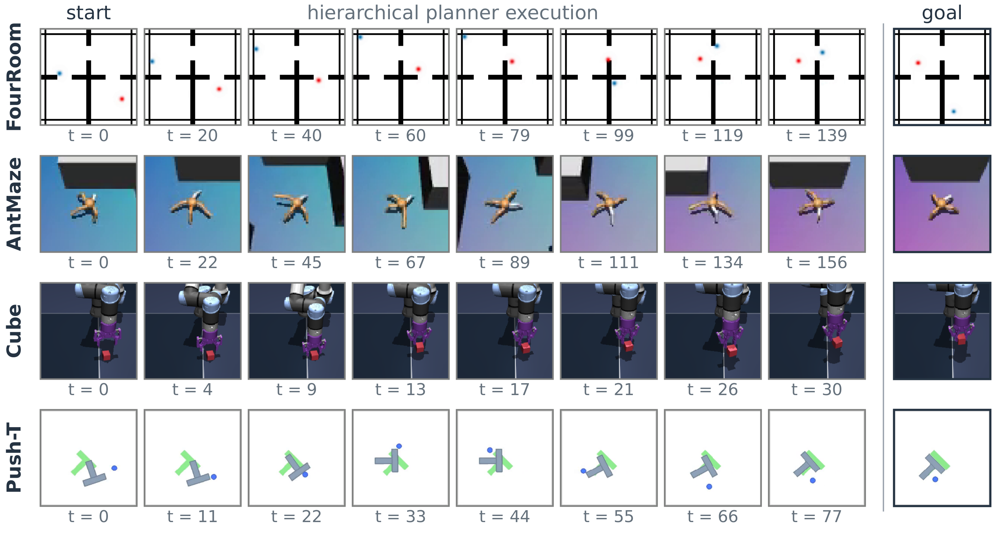

**Figure 11.** **Successful hierarchical planner executions.** Selected H-JEPA executions on one evaluation task per environment, using three-level models for FourRoom and AntMaze and two-level models for Cube and Push-T. These checkpoints also appear in Fig. 6 (bottom); the recordings use their original evaluation settings rather than the compute-selected sample counts. Each row shows eight observations sampled uniformly in environment steps, followed by the goal observation supplied to the planner. Rows end at first recorded success, except Cube, which shows the full $30$-step execution to include the completed lift. Labels give elapsed environment steps.

**图 11。** **分层规划器的成功执行。** 每个环境选取一个评估任务上的 H-JEPA 执行，FourRoom 和 AntMaze 使用三层模型，Cube 和 Push-T 使用两层模型。这些检查点也出现在图 6（下）；录像使用其原始评估设置，而非根据计算量选出的样本数量。每行展示按环境步均匀采样的八个观测，随后给出提供给规划器的目标观测。各行在首次记录成功时结束，但 Cube 展示完整的 $30$ 步执行，以包含完成抬升的过程。标签表示已用环境步数。

##### Shared solver.

**共享求解器。**

Every active level optimizes candidate action sequences by differentiating through its latent rollout, using AdamW for at most $90$ iterations with early stopping when the best cost stalls, and returns the lowest-cost candidate. Level-1 candidates are initialized from a standard Gaussian in normalized action space. Upper levels have no native action bounds, so their search is anchored to the macro-actions seen in training: each upper-level action encoder keeps its last $4000$ training macro-actions, candidates are initialized from a per-dimension Gaussian fitted to them (one candidate at its mean), and after every optimizer step the candidates are clipped to that sample's per-dimension 2nd–98th percentiles. The latent-distance cost scores the last two predicted states at level 1 and the last state at upper levels. H-JEPA plans top-down, passing the first predicted latent as a subgoal for the level below, whose rollout is encoded into the upper latent space for comparison (§2.2). On Push-T and Cube, level-1 actions are also pooled and matched to the first level-2 macro-action with weight $0.2$; upper-level optimization adds Gaussian action noise of standard deviation $0.01$. Both terms are disabled on FourRoom, AntMaze and DROID. On DROID, the initial Gaussians are $1.5$ times wider, and candidates at every level, level 1 included, are clipped to the prior mean $\pm 2$ standard deviations instead of the percentiles.

每个活跃层都对潜在展开过程求导来优化候选动作序列，使用 AdamW，最多 $90$ 次迭代，最佳代价停滞时提前停止，并返回代价最低的候选。第 1 层候选在归一化动作空间中由标准高斯分布初始化。高层没有原生动作边界，因此搜索以训练时见过的宏动作为依据：每个高层动作编码器保存最近 $4000$ 个训练宏动作，根据这些样本按维拟合高斯分布来初始化候选（其中一个候选位于均值），并在每次优化器更新后将候选裁剪到该样本各维的第 2–98 百分位范围。潜在距离代价在第 1 层评价最后两个预测状态，在高层评价最后一个状态。H-JEPA 自顶向下规划，将第一个预测潜变量传给低层作为子目标，低层的展开轨迹编码到高层潜在空间中比较（§2.2）。在 Push-T 和 Cube 上，还对第 1 层动作进行池化，并以权重 $0.2$ 与第一个第 2 层宏动作匹配；高层优化加入标准差为 $0.01$ 的高斯动作噪声。这两项在 FourRoom、AntMaze 和 DROID 中都关闭。在 DROID 上，初始化高斯分布的宽度扩大为 $1.5$ 倍，所有层（包括第 1 层）的候选均按先验均值 $\pm 2$ 个标准差裁剪，而非按百分位裁剪。

##### Replanning and horizons.

**重新规划与时域。**

All models execute two level-1 action blocks ($10$ environment steps) before replanning from scratch, truncating the final commit at the episode budget. Level 1 advances $5$ environment steps per predicted step, and each upper level doubles that interval. For LeWM and the top H-JEPA level, the horizon decreases from the configured $H$ in Table 7 to one across the episode's replanning calls. Each lower level holds horizon two until the level above reaches one, then decreases from its own configured $H$ to one over the remaining calls. An upper level at horizon one is skipped. FourRoom and AntMaze retain the goal cost in the highest skipped level's latent space; Push-T and Cube use the active level's own goal embedding.

所有模型在执行两个第 1 层动作块（$10$ 个环境步）后从头重新规划，最后一次执行按剩余回合预算截断。第 1 层每个预测步骤前进 $5$ 个环境步，每个高层将该间隔翻倍。对 LeWM 和 H-JEPA 最高层，时域在回合的多次重新规划调用中，从表 7 配置的 $H$ 逐渐减至一。每个低层将时域保持为二，直到上一层减至一，再在剩余调用中从自身配置的 $H$ 减至一。时域为一的高层被跳过。FourRoom 和 AntMaze 在最高被跳过层的潜在空间中保留目标代价；Push-T 和 Cube 使用当前活跃层自己的目标嵌入。

##### Reported settings.

**报告的设置。**

Table 7 gives the operating points in the depth comparison. On the compute-sweep tasks (Fig. 6, top), LeWM and H-JEPA select the candidate allocation with the highest observed mean success rate under $100$ mean planner TFLOPs per episode, breaking ties by lower compute. Learning rates and horizons were fixed from earlier experiments, before the compute sweeps and final evaluation. The compute sweeps vary only candidate trajectory counts, with all other planner settings held fixed. These settings are then evaluated without further tuning on the separate $50$-task set used for Fig. 6 (bottom) and Tables 1 and 9, which report success on this final evaluation set. Results report mean and SE across three paired model and planner seeds: $42$, $43$, and $44$.

表 7 给出深度比较采用的工作点。在计算量扫描任务（图 6，上）中，LeWM 与 H-JEPA 从每回合平均规划 TFLOPs 小于 $100$ 的候选分配中，选择观测到的平均成功率最高者，并在并列时选计算量更低者。学习率和时域在计算量扫描和最终评估之前，已根据先前实验固定。计算量扫描仅改变候选轨迹数量，其余所有规划器设置固定。随后，这些设置不再调优，直接用于图 6（下）及表 1、9 的独立 $50$ 任务集，后者报告该最终评估集上的成功率。结果报告三组配对模型和规划器种子的均值与标准误：$42$、$43$ 和 $44$。

**Table 7.** **Planning settings for the simulated depth comparison.** $S$: candidate sequences; $\eta$: AdamW learning rate; $H$: configured horizon in predicted steps of that level, used by the schedule described above. Tuples list levels from lowest to highest, except the H-JEPA learning-rate row, which lists level one and the rate shared by all upper levels. Episode budgets are in environment steps. Cube's horizon-one upper solvers are skipped, so their listed candidate counts are unused.

**表 7。** **模拟环境深度比较的规划设置。** $S$：候选序列数；$\eta$：AdamW 学习率；$H$：以该层预测步数计的配置时域，供上述调度使用。元组按从低到高的层级顺序列出，但 H-JEPA 学习率行列出第 1 层学习率和所有高层共享的学习率。回合预算以环境步计。Cube 中时域为一的高层求解器会被跳过，因此所列候选数不会使用。

|  | FourRoom | AntMaze | Push-T | Cube |
| --- | --- | --- | --- | --- |
| Episode budget 回合预算 | $210$ | $350$ | $90$ | $30$ |
| $\eta$, LeWM | $0.1$ | $0.3$ | $0.05$ | $0.05$ |
| $\eta$, H-JEPA (L1, upper) $\eta$，H-JEPA（L1，高层） | $(0.08, 0.1)$ | $(0.06, 0.1)$ | $(0.1, 0.075)$ | $(0.1, 0.075)$ |
| $H$, LeWM | $23$ | $23$ | $15$ | $4$ |
| $H$, two-level H-JEPA $H$，两层 H-JEPA | $(2, 12)$ | $(4, 9)$ | $(2, 8)$ | $(2, 2)$ |
| $H$, three-level H-JEPA $H$，三层 H-JEPA | $(2, 2, 6)$ | $(4, 2, 5)$ | $(2, 2, 4)$ | $(2, 2, 1)$ |
| $H$, four-level H-JEPA $H$，四层 H-JEPA | $(2, 2, 2, 3)$ | $(3, 2, 2, 3)$ | $(2, 2, 2, 2)$ | $(2, 2, 1, 1)$ |
| $S$, LeWM | $200$ | $100$ | $800$ | $800$ |
| $S$, two-level H-JEPA $S$，两层 H-JEPA | $(100, 800)$ | $(25, 200)$ | $(50, 400)$ | $(400, 100)$ |
| $S$, three-level H-JEPA $S$，三层 H-JEPA | $(50, 200, 200)$ | $(100, 100, 400)$ | $(25, 50, 200)$ | $(25, 800, 800)$ |
| $S$, four-level H-JEPA $S$，四层 H-JEPA | $(50, 200, 200, 400)$ | $(50, 200, 25, 50)$ | $(200, 800, 800, 800)$ | $(200, 50, 800, 800)$ |

Plans are executed under a *commit schedule*: the agent replans at environment times $t_0 = 0 < t_1 < t_2 < \cdots$; at phase $j$ it encodes the observation at $t_j$, runs the top-down solve of Eqs. (4)–(6) from that state, executes the first $\xi_j = t_{j+1} - t_j \le H_1$ actions of $a^{(1),*}_{0:H_1-1}$, and discards the rest. At planning time every level encodes only the current observation and the goal, one frame each, and $\mathrm{Roll}^{(\ell)}$ conditions each predictor step on the latest state alone, observed or predicted, so the planning context is $c_\ell=1$ at every level and in every environment. Training covers this regime: under the causal mask, the first position of each training context attends only to itself. The schedule need not be uniform; the remaining episode budget truncates the last phase. Committing one command per phase, $\xi_j \equiv 1$, is fully closed-loop control; committing an entire plan in one phase, $\xi_0 = H_1$, is open-loop single-shot execution.

计划按*执行承诺调度*执行：智能体在环境时刻 $t_0 = 0 < t_1 < t_2 < \cdots$ 重新规划；在阶段 $j$，它编码 $t_j$ 时刻的观测，从该状态执行式 (4)–(6) 的自顶向下求解，执行 $a^{(1),*}_{0:H_1-1}$ 的前 $\xi_j = t_{j+1} - t_j \le H_1$ 个动作，并舍弃其余动作。规划时，每层仅编码当前观测和目标，各一帧，且 $\mathrm{Roll}^{(\ell)}$ 在每个预测步骤仅以最新状态（观测或预测所得）为条件，因此每个环境、每个层级的规划上下文均为 $c_\ell=1$。训练覆盖了这种情况：在因果掩码下，每个训练上下文的第一个位置只关注自身。调度不必均匀；剩余回合预算会截断最后阶段。每阶段仅执行一个指令，即 $\xi_j \equiv 1$，为完全闭环控制；单阶段执行整个计划，即 $\xi_0 = H_1$，为开环单次执行。

DROID is offline and open-loop: one plan covers the whole window, so the commit width equals the horizon and nothing is replanned. It is scored on the $16$ clips of §J.1 with three planner seeds and three training seeds. Table 8 gives its settings.

DROID 采用离线开环设置：一个计划覆盖整个窗口，因此执行宽度等于时域，不进行重新规划。使用三个规划器种子和三个训练种子，在 §J.1 的 $16$ 个片段上评分。表 8 给出设置。

**Table 8.** **Planning settings on DROID.** $S$: candidate sequences; $\eta$: AdamW learning rate; $H$: configured horizon in predicted steps of that level. Tuples list levels from lowest to highest. Every level runs AdamW for at most $90$ iterations with early stopping when the best cost stalls; the cross-level action cost is $0$ and the subgoal weight $\beta$ of Eq. (6) is $0.5$, for both two-level arms. Planning is open-loop: the whole level-1 plan is executed, so the commit width equals the level-1 horizon. Each model keeps one $\eta$ and these settings at every planner budget: the compute-Pareto of Fig. 9(c) varies only the number of candidates, chosen independently per level for the two-level arms. The listed $S$ is the operating point of each bar in Fig. 9(b).

**表 8。** **DROID 的规划设置。** $S$：候选序列数；$\eta$：AdamW 学习率；$H$：以该层预测步数计的配置时域。元组按层级从低到高排列。每层运行 AdamW 最多 $90$ 次迭代，最佳代价停滞时提前停止；两个两层实验分支的跨层动作代价均为 $0$，式 (6) 的子目标权重 $\beta$ 均为 $0.5$。规划为开环：执行完整第 1 层计划，因此执行宽度等于第 1 层时域。每个模型在所有规划预算下都维持同一个 $\eta$ 及这些设置：图 9(c) 的计算量帕累托扫描只改变候选数，两层分支在各层独立选择候选数。所列 $S$ 是图 9(b) 各柱对应的工作点。

|  | DROID, $5$ fps |
| --- | --- |
| Episode budget 回合预算 | $36$ |
| $\eta$, LeWM+IDM | $0.01$ |
| $\eta$, HWM (L1, L2) | $(0.01, 0.3)$ |
| $\eta$, H-JEPA (L1, L2) | $(0.01, 0.3)$ |
| $H$, LeWM+IDM | $36$ |
| $H$, HWM | $(36, 12)$ |
| $H$, H-JEPA | $(36, 12)$ |
| $S$, LeWM+IDM | $32$ |
| $S$, HWM | $(16, 16)$ |
| $S$, H-JEPA | $(16, 16)$ |

## F Temporal-frequency separation and selective abstraction

**F 时间频率分离与选择性抽象**

### F.1 Frequency separation within a trajectory

**F.1 单条轨迹内的频率分离**

The entity frequency gap of §3 is a dataset-level statistic: one spectral centroid per entity, pooled over episodes, and their fast/slow ratio. Fig. 12(a) shows the raw behaviour that statistic summarizes on a single AntMaze training episode, so the reader can verify the gap by eye rather than trust the aggregate. The episode is drawn from the same dataset and decimated to the same level-1 frame rate (frameskip $5$) that the centroids in Fig. 12(b) are computed from; it is the episode among the first $64$ whose own fast/slow centroid ratio is closest to the dataset value, so it is representative rather than the most striking case (per-episode ratios have median $6.4\times$ and interquartile range $4.9$–$7.8\times$).

§3 的实体频率差距是数据集层面的统计量：跨回合汇总得到每个实体的一个频谱质心，再计算快/慢之比。图 12(a) 在一条 AntMaze 训练回合上展示该统计量所概括的原始行为，使读者能够直观看出差距，而不必只相信汇总结果。该回合来自相同数据集，并降采样到计算图 12(b) 质心时使用的第 1 层帧率（跳帧数 $5$）；它是在前 $64$ 个回合中，自身快/慢质心比最接近数据集数值的回合，因此是具有代表性的案例，而非最显著的案例（逐回合比值的中位数为 $6.4\times$，四分位距为 $4.9$–$7.8\times$）。

The entities are AntMaze's probe targets: the slow entity is the global position ($xy$, two dimensions) and the fast entity is the body state. For legibility we plot the body's $13$ position-like dimensions (torso height, root orientation, and the eight hip and ankle joint angles) and omit the $14$ joint- and root-velocity dimensions, which oscillate at least as fast and would fill the panel; the episode's gap is $8.3\times$ with either choice. Because the entities have different units, every dimension is normalized to zero mean and unit variance over the episode, making the spectral centroid amplitude-invariant.

这些实体就是 AntMaze 的探针目标：慢速实体是全局位置（$xy$，二维），快速实体是身体状态。为便于阅读，我们绘制身体中 $13$ 个位置类维度（躯干高度、根部朝向、八个髋关节与踝关节角度），省略 $14$ 个关节及根部速度维度；这些维度的振荡至少同样快，会挤满面板。无论是否包含它们，该回合的差距均为 $8.3\times$。由于实体单位不同，每个维度都在该回合内归一化为零均值、单位方差，使频谱质心不受幅度影响。

**(a)**

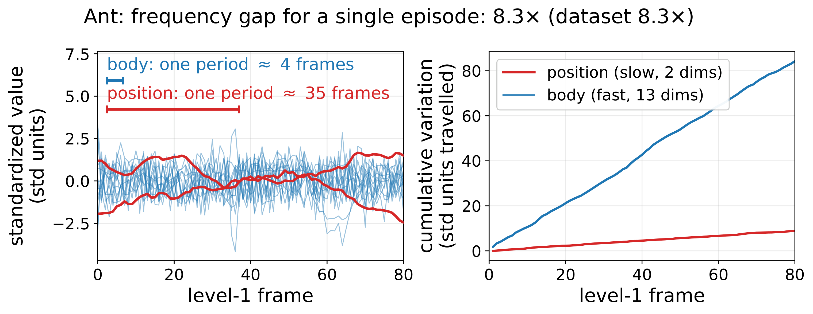

**(b)**

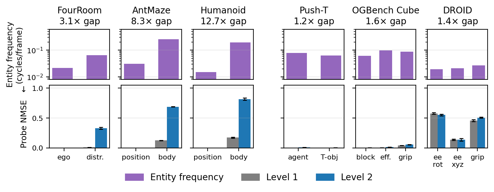

**Figure 12.** **Temporal-frequency separation and selective abstraction.** *(a)* One AntMaze episode: normalized global position (red) and $13$ body-state dimensions (blue) over $81$ level-1 frames (left), and cumulative absolute normalized increments averaged across dimensions (right). Inverse spectral centroids are about $35$ frames for position and $4$ for body state ($8.3\times$ gap); body state accumulates roughly ten times more variation. Including the omitted velocity dimensions leaves the frequency gap unchanged. *(b)* Per-entity spectral centroids in cycles per level-1 frame (top, log scale) and paired level-1 and level-2 probe macro NMSE (bottom). The left group shows FourRoom, AntMaze and Humanoid; the right shows Push-T, OGBench Cube and DROID. Probe heads are matched across levels within each environment and differ across environments. Error bars are one SE over three training seeds. All entities in an environment share the same level-2 configuration.

**图 12。** **时间频率分离与选择性抽象。** *(a)* 一条 AntMaze 回合：$81$ 个第 1 层帧上的归一化全局位置（红色）和 $13$ 个身体状态维度（蓝色，左），以及跨维度平均的归一化增量绝对值累积和（右）。位置频谱质心的倒数约为 $35$ 帧，身体状态约为 $4$ 帧（差距 $8.3\times$）；身体状态累积的变化约多十倍。加入省略的速度维度不会改变频率差距。*(b)* 各实体的频谱质心，单位为每个第 1 层帧的周期数（上，对数刻度），以及配对的第 1 层与第 2 层探针宏平均 NMSE（下）。左组为 FourRoom、AntMaze 和 Humanoid；右组为 Push-T、OGBench Cube 和 DROID。每个环境内部，不同层的探针头相匹配，不同环境之间则有所不同。误差条为三个训练种子的一个标准误。同一环境中的全部实体共享相同的第 2 层配置。

The trajectory illustrates the slow position changes and fast body-state variation summarized by the dataset-level frequency gap. Frequency separation alone does not establish a difference in predictability, since fast periodic motion can remain predictable. The per-entity probes below show how this separation relates empirically to content retained at level 2 across environments.

该轨迹展示了缓慢的位置变化和快速的身体状态变化，数据集层面的频率差距概括的正是这种现象。频率分离本身并不证明可预测性不同，因为快速周期运动仍然可能可预测。下文的逐实体探针展示了这种分离与不同环境中第 2 层保留内容之间的经验关系。

### F.2 Per-entity probes across environments

**F.2 不同环境的逐实体探针**

For each state entity, we compute the spectral centroid of its amplitude-normalized trajectory stream at the level-1 sampling rate, pooling over episodes. The entity-frequency gap is the ratio of the largest to smallest entity centroid. Fig. 12(b) expands Fig. 5 with each entity's centroid and paired level-1 and level-2 probe NMSE, computed from two-level H-JEPA models. Humanoid, AntMaze, and FourRoom have gaps of $3.1$–$12.7\times$: body-state or distractor decoding worsens at level 2 while agent position remains near its level-1 floor. Push-T, OGBench Cube and DROID have gaps of $1.2$–$1.6\times$ and show little selective abstraction, with comparable entity recoverability at both levels. The relevant comparison is the within-entity change between levels: absolute NMSE differs across environments, particularly for DROID's natural video.

对每个状态实体，我们在第 1 层采样率下，对幅度归一化的轨迹流跨回合汇总并计算频谱质心。实体频率差距是最大与最小实体质心之比。图 12(b) 扩展了图 5，给出每个实体的质心以及从两层 H-JEPA 计算得到的配对第 1 层和第 2 层探针 NMSE。Humanoid、AntMaze 和 FourRoom 的差距为 $3.1$–$12.7\times$：第 2 层的身体状态或干扰物解码变差，而智能体位置仍接近其第 1 层误差下限。Push-T、OGBench Cube 和 DROID 的差距为 $1.2$–$1.6\times$，几乎没有选择性抽象，两个层级的实体可恢复性相近。关键比较是同一实体在不同层之间的变化：绝对 NMSE 在环境间不同，尤其是 DROID 的自然视频。

## G Data specialization across levels

**G 跨层级的数据专门化**

We test whether training each hierarchy level on a different type of data improves planning. We use stagewise training, which freezes each lower level before training the next, so each level can have its own dataset.

我们检验为每个层级采用不同类型数据训练能否改善规划。我们采用分阶段训练，即在训练下一层前冻结每个低层，使每层能够拥有自己的数据集。

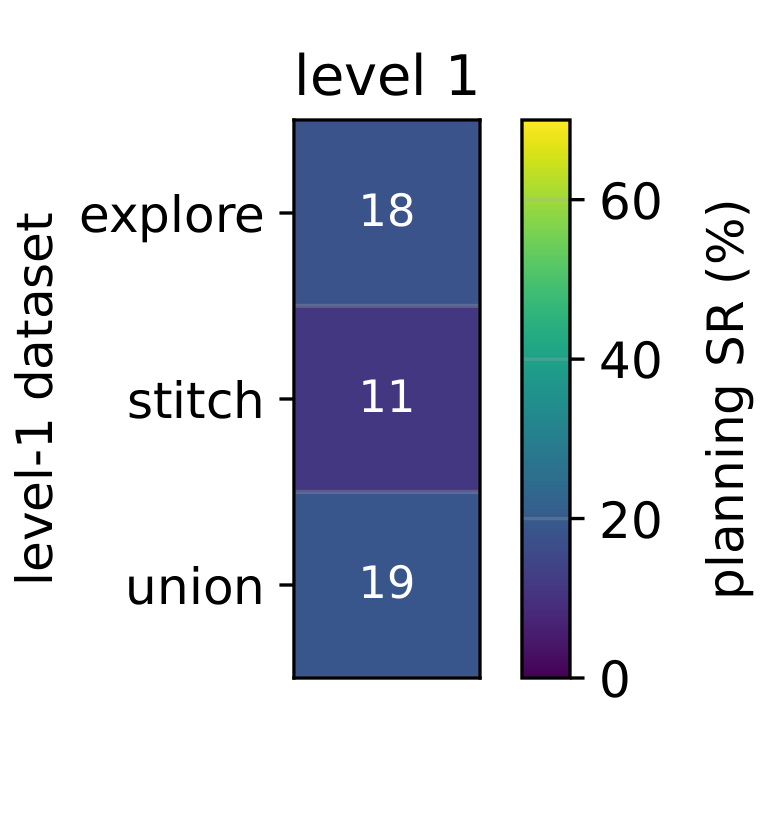

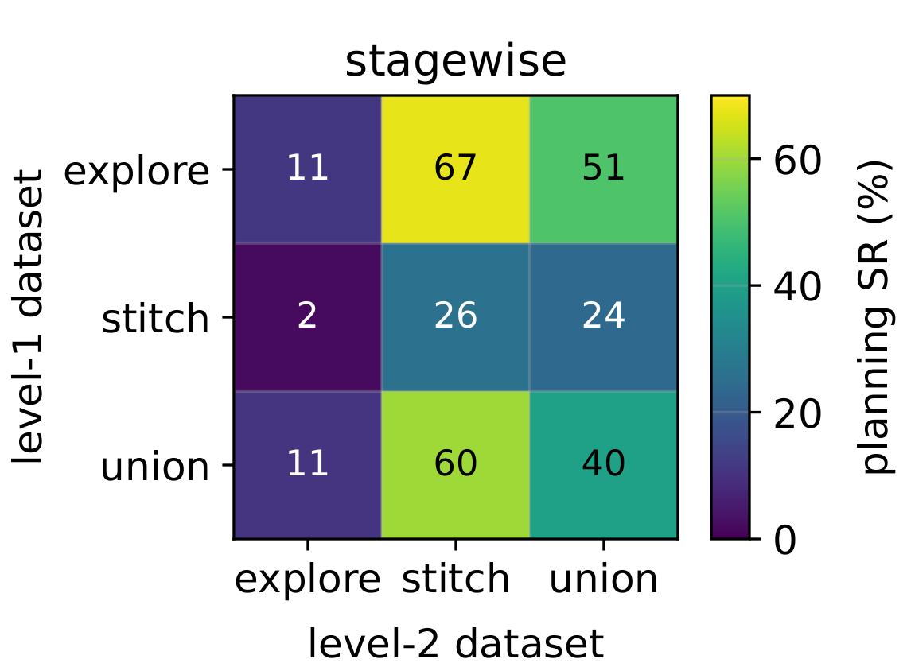

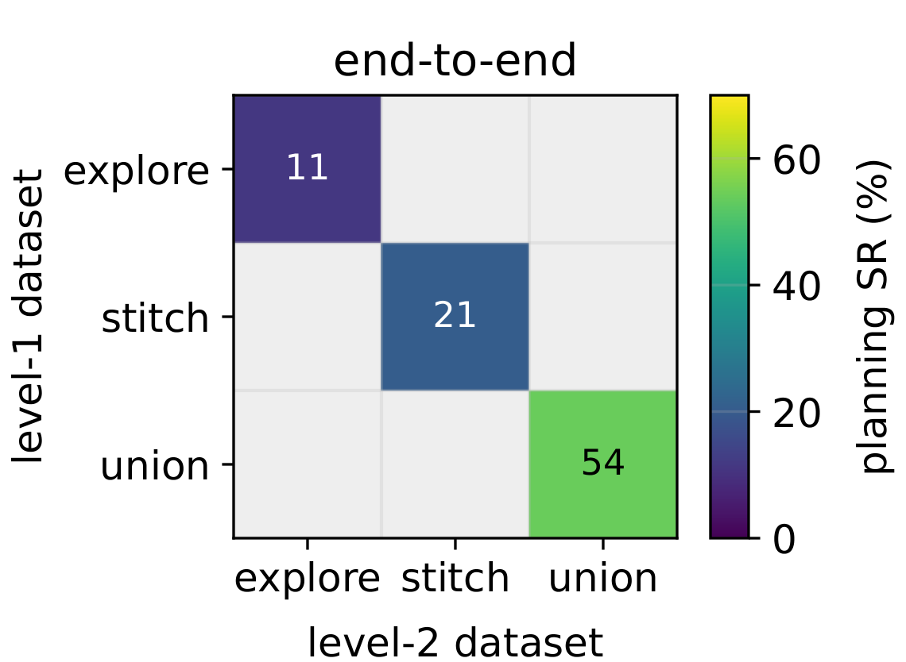

**Figure 13.** **Planning with different training datasets on Visual AntMaze.** Planning success rate (GD online, mean over three seeds), using `explore`, `stitch`, or their `union` for training. *Left:* flat level-1 planning, with one model trained on each of the three datasets. *Middle:* two-level hierarchical planning after stagewise training, covering all nine combinations of level-1 (rows) and level-2 (columns) datasets. *Right:* two-level hierarchical planning after end-to-end training, with both levels trained on the same dataset in each run, giving only diagonal entries. Grey cells were not run. The end-to-end runs are FLOP-matched to the stagewise ones.

**图 13。** **Visual AntMaze 上采用不同训练数据集的规划。** 使用 `explore`、`stitch` 或二者的 `union` 训练，报告规划成功率（在线梯度下降，三个种子的均值）。*左：* 扁平第 1 层规划，三个数据集各训练一个模型。*中：* 分阶段训练后的两层分层规划，覆盖第 1 层（行）和第 2 层（列）数据集的全部九种组合。*右：* 端到端训练后的两层分层规划，每次实验中两层使用同一数据集，因此只有对角线条目。灰色单元格表示未运行。端到端实验与分阶段实验按 FLOPs 匹配。

##### Experimental setup.

**实验设置。**

We use a two-level hierarchy for ease of analysis, with Visual AntMaze's two OGBench dataset types, `explore` and `stitch`, and their `union`. For stagewise training, we vary the dataset independently at each level; for end-to-end training, both levels use the same dataset. Fig. 13 compares the resulting two-level hierarchical planners with flat level-1 planners trained on each of the three datasets.

为便于分析，我们采用两层结构，使用 Visual AntMaze 的两类 OGBench 数据集 `explore`、`stitch` 及二者的 `union`。分阶段训练中，我们独立改变每层的数据集；端到端训练中，两层使用相同数据集。图 13 将得到的两层分层规划器，与分别在这三种数据集上训练的扁平第 1 层规划器比较。

##### Matched data: a second level helps only when the data is temporally structured.

**匹配数据：只有数据具有时间结构时，第二层才有帮助。**

Along the diagonal, adding an abstract level improves long-horizon planning on `stitch` and `union` (end-to-end hierarchical planning SR rises to $21$ from the single-level $11$ on `stitch` and to $54$ from $19$ on `union`) but not on `explore`, where neither two-level model (`stagewise` $11$, end-to-end $11$) beats the single-level baseline ($18$). We read this as the level-2 model being unable to form a useful temporal abstraction from purely exploratory rollouts, whose trajectories lack the temporal correlation the abstract level relies on; hierarchy then brings no performance gain.

沿对角线，增加一个抽象层能够改善 `stitch` 和 `union` 上的长时域规划（端到端分层规划在 `stitch` 上的成功率由单层的 $11$ 提升到 $21$，在 `union` 上由 $19$ 提升到 $54$），但对 `explore` 无效，其两个两层模型（`stagewise` $11$、端到端 $11$）均未超过单层基线（$18$）。我们的解释是，第 2 层模型无法从纯探索展开轨迹中形成有用的时间抽象，因为这些轨迹缺少抽象层依赖的时间相关性；因此层级结构没有带来性能提升。

**Mismatched data: the two levels prefer different data.** The pattern in the `stagewise` panel is that the low-level model benefits from broad, weakly-correlated exploration while the abstract level benefits from more temporally coherent, goal-directed trajectories. The best configuration anywhere in Fig. 13 is exactly this pairing (`explore` at level 1 and `stitch` at level 2) reaching $67$, well above every matched-dataset cell of either procedure, including end-to-end on `union`/`union` ($54$) and stagewise on `union`/`union` ($40$), while the reverse assignment (`stitch` at level 1, `explore` at level 2) collapses to $2$. It is the *pairing* (exploratory data low, coherent data high) not either dataset on its own, that drives the gain. This is a practical case for stagewise training: freezing the lower-level model lets us specialize the upper level's data without changing the lower level's learned dynamics, a choice the default joint procedure does not offer.

**不匹配数据：两层偏好不同的数据。** `stagewise` 面板呈现的模式是：低层模型受益于广泛、弱相关的探索，而抽象层受益于时间上更连贯、目标导向的轨迹。图 13 中最好的配置恰好是这种配对（第 1 层使用 `explore`，第 2 层使用 `stitch`），达到 $67$，明显高于任一过程的所有同数据集组合，包括端到端 `union`/`union`（$54$）与分阶段 `union`/`union`（$40$）；反向分配（第 1 层用 `stitch`，第 2 层用 `explore`）则降到 $2$。带来收益的是这种*配对*——低层使用探索数据，高层使用连贯数据——而非任一数据集本身。这为分阶段训练提供了实践依据：冻结低层模型，使我们能够专门选择高层数据，同时不改变低层学到的动力学；默认联合训练过程无法提供这种选择。

## H Planning-cost ablations across environments

**H 跨环境的规划代价消融**

Table 9 extends the AntMaze cost ablation of Table 1 to FourRoomDistractors, OGBench Cube and Push-T, on the tasks of Fig. 6 (bottom). Within each model, we hold the level-1 rollout dynamics and planner settings fixed and vary only the latent space used to score the goal cost.

表 9 将表 1 的 AntMaze 代价消融扩展到 FourRoomDistractors、OGBench Cube 和 Push-T，采用图 6（下）的任务。在每个模型内，我们固定第 1 层展开动力学和规划器设置，仅改变评价目标代价的潜在空间。

##### FourRoom: gains from projected costs.

**FourRoom：投影代价带来的收益。**

As on AntMaze, at least one upper-level cost improves mean success over the native level-1 cost at every tested depth. The best projection also exceeds the separately trained LeWM baseline at three and four levels. The deepest cost is not always best: the four-level model has its highest mean success with the level-2 projection, although the projected-cost error bars overlap.

与 AntMaze 一样，在每个测试深度，至少有一种高层代价的平均成功率高于原生第 1 层代价。三层和四层时，最佳投影还超过独立训练的 LeWM 基线。最深层代价不一定最好：四层模型采用第 2 层投影时平均成功率最高，但不同投影代价的误差条存在重叠。

##### Cube and Push-T: no clear gain from projected costs.

**Cube 与 Push-T：投影代价没有明显收益。**

These environments do not exhibit the selective abstraction observed on AntMaze and FourRoom. On Cube, the level-2 projection lowers success in the two-level model. At three and four levels it gives similar success to the native cost, while the level-3 and level-4 projections roughly halve success. On Push-T, projected and native costs give similar success at two and three levels; the four-level model has near-zero success under every cost and with hierarchical planning. These results show that an upper-level cost need not improve planning; they do not establish that selective abstraction alone causes the gains in the other environments.

这些环境没有呈现 AntMaze 和 FourRoom 上观察到的选择性抽象。在 Cube 上，第 2 层投影降低了两层模型的成功率；在三层和四层模型中，它的成功率与原生代价接近，而第 3、4 层投影大约将成功率减半。在 Push-T 上，两层和三层时投影代价与原生代价的成功率相似；四层模型在每种代价和分层规划下的成功率都接近零。这些结果表明，高层代价并不必然改善规划；它们也没有证明其他环境的收益仅由选择性抽象造成。

**Table 9.** **Planning-cost ablations across environments.** Success (%, mean $\pm$ SE, three seeds), using the same protocol as Table 1. Within each H-JEPA row, only the cost space varies across the four level-1 planning columns; LeWM and hierarchical H-JEPA are references. For FourRoom, bold marks the highest mean among cost spaces. FourRoom gains from projected costs, while Cube and Push-T show no clear benefit.

**表 9。** **跨环境的规划代价消融。** 成功率（%，均值 $\pm$ 标准误，三个种子），采用与表 1 相同的协议。在每个 H-JEPA 行中，四个第 1 层规划列仅改变代价空间；LeWM 与分层 H-JEPA 作为参照。FourRoom 中，加粗表示各代价空间中最高的均值。FourRoom 受益于投影代价，而 Cube 和 Push-T 没有明确收益。

| Environment 环境 | Depth 深度 | Level-1 planning: vary cost space / Native L1 $\uparrow$ 第 1 层规划：改变代价空间 / 原生 L1 $\uparrow$ | Level-1 planning: vary cost space / L2 proj. $\uparrow$ 第 1 层规划：改变代价空间 / L2 投影 $\uparrow$ | Level-1 planning: vary cost space / L3 proj. $\uparrow$ 第 1 层规划：改变代价空间 / L3 投影 $\uparrow$ | Level-1 planning: vary cost space / L4 proj. $\uparrow$ 第 1 层规划：改变代价空间 / L4 投影 $\uparrow$ | Hierarchical planner / H-JEPA $\uparrow$ 分层规划器 / H-JEPA $\uparrow$ |
| --- | --- | --- | --- | --- | --- | --- |
| FourRoom Distractors | LeWM (flat) LeWM（扁平） | $40.7 \pm 6.8$ |  |  |  |  |
| FourRoom Distractors | 2 levels 2 层 | $9.3 \pm 0.7$ | **$38.7 \pm 6.6$** |  |  | $81.3 \pm 6.7$ |
| FourRoom Distractors | 3 levels 3 层 | $43.3 \pm 8.7$ | $65.3 \pm 5.5$ | **$71.3 \pm 4.1$** |  | $96.0 \pm 1.1$ |
| FourRoom Distractors | 4 levels 4 层 | $68.7 \pm 4.7$ | **$72.0 \pm 3.1$** | $66.0 \pm 3.1$ | $70.7 \pm 2.7$ | $80.0 \pm 4.0$ |
| OGBench Cube | LeWM (flat) LeWM（扁平） | $32.0 \pm 6.1$ |  |  |  |  |
| OGBench Cube | 2 levels 2 层 | $24.0 \pm 1.2$ | $13.3 \pm 0.7$ |  |  | $47.3 \pm 2.7$ |
| OGBench Cube | 3 levels 3 层 | $24.7 \pm 1.3$ | $28.0 \pm 4.2$ | $14.0 \pm 3.5$ |  | $60.0 \pm 5.0$ |
| OGBench Cube | 4 levels 4 层 | $26.7 \pm 2.7$ | $25.3 \pm 2.4$ | $12.0 \pm 2.0$ | $12.0 \pm 2.3$ | $55.3 \pm 4.4$ |
| Push-T | LeWM (flat) LeWM（扁平） | $40.0 \pm 2.3$ |  |  |  |  |
| Push-T | 2 levels 2 层 | $36.7 \pm 1.8$ | $38.0 \pm 3.1$ |  |  | $45.3 \pm 1.3$ |
| Push-T | 3 levels 3 层 | $30.7 \pm 1.8$ | $28.0 \pm 4.0$ | $24.7 \pm 4.1$ |  | $17.3 \pm 3.5$ |
| Push-T | 4 levels 4 层 | $1.3 \pm 0.7$ | $1.3 \pm 0.7$ | $0.7 \pm 0.7$ | $1.3 \pm 1.3$ | $0.7 \pm 0.7$ |

## I Prediction-cost monotonicity

**I 预测代价的单调性**

Table 10 expands the comparison in §4.2. It reports goal-cost monotonicity over full held-out trajectories and subgoal-cost monotonicity within shorter segments, using the two-level HWM and H-JEPA models in the four simulated benchmarks. These measurements characterize costs along expert trajectories rather than the success of optimized plans.

表 10 扩展 §4.2 的比较，报告四个模拟基准中两层 HWM 和 H-JEPA 在完整留出轨迹上的目标代价单调性，以及较短片段内的子目标代价单调性。这些测量描述专家轨迹上的代价，而非优化计划的成功率。

**Table 10.** **Prediction-cost monotonicity** ($-\mathrm{Spearman}$ of $\|z^{(\ell)}-g^{(\ell)}\|_2^2$ against time; higher is better; mean over three training seeds, held-out episodes). *L2* columns score each model's level-2 encoding against the final goal; *subgoal* scores a level-1 rollout, re-anchored to the true state at each subgoal (bounded horizon), against the level-2 subgoals (per-segment).

**表 10。** **预测代价单调性**（$\|z^{(\ell)}-g^{(\ell)}\|_2^2$ 相对于时间的 $-\mathrm{Spearman}$；越高越好；三个训练种子在留出回合上的均值）。*L2* 列评价各模型第 2 层编码与最终目标之间的代价；*subgoal* 列将第 1 层展开在每个子目标处重新锚定到真实状态（有界时域），并按片段评价其与第 2 层子目标的代价。

| Environment 环境 | Level-1 $\uparrow$ 第 1 层 $\uparrow$ | HWM / Level-2 $\uparrow$ HWM / 第 2 层 $\uparrow$ | HWM / subgoal $\uparrow$ HWM / 子目标 $\uparrow$ | H-JEPA / Level-2 $\uparrow$ H-JEPA / 第 2 层 $\uparrow$ | H-JEPA / subgoal $\uparrow$ H-JEPA / 子目标 $\uparrow$ |
| --- | --- | --- | --- | --- | --- |
| Visual AntMaze | 0.48 | 0.52 | 0.94 | **0.68** | **0.94** |
| Push-T | 0.75 | 0.77 | 0.85 | **0.77** | **0.89** |
| OGBench Cube | 0.65 | 0.74 | 0.79 | **1.00** | **0.99** |
| FourRoom Distractors | 0.56 | 0.62 | 0.92 | **0.85** | **1.00** |

## J DROID: corpus, planning evaluation and offline metric

**J DROID：语料库、规划评估与离线指标**

DROID exposes no simulator, at least none that runs without the ray-tracing cores IsaacSim requires [[61]](#ref-nvidia2025isaaclabgpuacceleratedsimulation), so every DROID number in this paper is offline: plans are scored against logged expert trajectories. This section covers the evaluation protocol (§J.1), the metric and what it measures (§J.2), the decoded plans (§J.3), and the re-encoded corpus every DROID model is trained on (§J.4).

DROID 未提供模拟器，至少没有无需 IsaacSim 所要求的光线追踪核心即可运行的模拟器 [[61]](#ref-nvidia2025isaaclabgpuacceleratedsimulation)，因此本文的全部 DROID 数值都是离线结果：计划针对记录的专家轨迹评分。本节介绍评估协议（§J.1）、指标及其含义（§J.2）、计划解码（§J.3），以及所有 DROID 模型训练使用的重新编码语料库（§J.4）。

### J.1 Planning-evaluation protocol

**J.1 规划评估协议**

##### Clips.

**片段。**

The headline set is the *16-clip evaluation set*: 16 pick-and-place clips, with good lighting, good visibility of the manipulated objects from the left and right cameras, and big enough manipulated objects. Once chosen, the exact frame indices of each clip's evaluation slice are frozen so that every run scores the same initial and goal frame and the same ground-truth actions. For each of the 16 clips, contact waypoints $[\textit{init},\textit{grasp},\textit{pre-release},\textit{place}]$ are read off the gripper-closure trace (grasp $=$ first frame with grip $>0.85\times$max), and each clip is a fixed-length strided window *centered on the grasp*. Episodes whose window does not fit inside the video are dropped rather than clamped. Centering on the grasp makes the evaluation a probe of non-greedy behavior: a plan that drives straight to the deposit matches the ground-truth net displacement but misses the descent to the object and its transport to the target. The metric of §J.2 therefore scores the shape of the whole path. Each window spans $108$ recorded frames, $\sim$$7.2$ s, with the goal as its last frame. A clip is read at the frame rate its model was trained at, so the level-1 horizon is that span divided by the stride: $H_1 = 36$ at $5$ fps, the setting this paper trains and evaluates at.

主要评估集是 *16 片段评估集*：16 个抓取放置片段，光照良好、左右相机中被操作物体可见性良好，且物体足够大。选定后，各片段评估切片的精确帧索引固定，使每次实验都评价同样的初始帧、目标帧和真实动作。对这 16 个片段，接触路点 $[\textit{init},\textit{grasp},\textit{pre-release},\textit{place}]$ 从夹爪闭合轨迹读取（抓取 $=$ 夹爪值首次达到 $>0.85\times$ 最大值的帧），每个片段都是*以抓取为中心*的固定长度、按步幅采样窗口。窗口无法完整落在视频内的回合会被丢弃，而非截断到边界。以抓取为中心使评估能够检验非贪心行为：直接朝放置点运动的计划虽然匹配真实净位移，却遗漏了下降到物体以及将物体运送到目标的过程。因此，§J.2 的指标评价整条路径的形状。每个窗口跨越 $108$ 个记录帧，即 $\sim$$7.2$ 秒，最后一帧作为目标。片段按模型训练时的帧率读取，因此第 1 层时域等于跨度除以步幅：在 $5$ fps 下为 $H_1 = 36$，这是本文训练与评估采用的设置。

##### Frame rates.

**帧率。**

DROID is recorded at $15$ Hz [[42]](#ref-khazatsky2024droid), but its video containers are *tagged* $60$ fps, so a loader that derives its temporal stride from the tag samples at a quarter of its configured rate. The frozen-encoder baselines [[78]](#ref-terver2026whatdrives), [[2]](#ref-assran2025vjepa2) are configured at $4$ fps with such a loader, which corresponds to $1$ frame per second of recorded time, and we evaluate them at that native rate on the matching manifest (15 clips; one clip's window does not fit at $1$ fps).

DROID 以 $15$ Hz 记录 [[42]](#ref-khazatsky2024droid)，但其视频容器被*标记*为 $60$ fps，因此按该标签计算时间步幅的加载器，实际采样率只有配置值的四分之一。冻结编码器基线 [[78]](#ref-terver2026whatdrives), [[2]](#ref-assran2025vjepa2) 使用这类加载器配置为 $4$ fps，对应记录时间每秒 $1$ 帧，我们以该原生帧率在匹配的清单上评估（15 个片段；一个片段的窗口在 $1$ fps 下无法适配）。

##### Leak control.

**泄漏控制。**

Every DROID model in this paper is trained on one corpus: the re-encoded corpus of §J.4, with the $16$ evaluation clips of Fig. 16 removed. Plan-evaluation fidelity is therefore held out throughout. Only those $16$ clips are removed, so the auxiliary unroll and light-eval metrics remain train-set metrics.

本文所有 DROID 模型都在同一个语料库训练：§J.4 的重新编码语料库，并移除图 16 的 $16$ 个评估片段。因此，计划评估保真度始终在留出数据上计算。只移除这 $16$ 个片段，因此辅助的展开与轻量评估指标仍然是训练集指标。

##### Task and action space.

**任务与动作空间。**

Actions are 7-dimensional end-effector delta-poses (Cartesian $xyz$, roll-pitch-yaw, gripper). The goal is specified as a single RGB frame, encoded by the model's own encoder; the planning cost is a Euclidean distance in that latent space. All metrics use the first three (translation) dimensions; the 7-dimensional variant is dominated by gripper nuisance.

动作是七维末端执行器增量位姿（笛卡尔 $xyz$、滚转角—俯仰角—偏航角、夹爪）。目标由一帧 RGB 图像指定，使用模型自身编码器编码；规划代价是该潜在空间中的欧氏距离。所有指标均只使用前三个平移维度；七维版本会被夹爪这一干扰因素主导。

### J.2 The Fréchet fidelity offline metric

**J.2 Fréchet 保真度离线指标**

Fréchet fidelity is defined in Eq. (7); the paths it compares are $p_{1:T+1}$ and $\tilde{p}_{1:T+1}$, the origin-prepended cumulative $xyz$ paths of the planned and ground-truth delta-pose sequences. Each planner seed in $\{42,43,44\}$ is reduced to one scalar by averaging over clips; we report the median over (training seed $\times$ planner seed) cells, because the per-clip mean is in absolute meters and is therefore dominated by large-motion clips.

Fréchet 保真度定义于式 (7)；其比较的路径为 $p_{1:T+1}$ 和 $\tilde{p}_{1:T+1}$，即计划与真实增量位姿序列在开头补上原点后的累积 $xyz$ 路径。$\{42,43,44\}$ 中每个规划器种子通过对片段平均归约为一个标量；我们报告（训练种子 $\times$ 规划器种子）单元格的中位数，因为逐片段均值以绝对米数计，因而由大幅运动片段主导。

We need a path metric. The cumulative $xyz$ action trajectory error used in prior work [[78]](#ref-terver2026whatdrives), [[7]](#ref-nwm) compares net displacements, $|\sum \text{planned} - \sum \text{ground truth}|$ per dimension, and is therefore blind to the detour the grasp-centered protocol tests: a straight-line plan to the deposit scores as well as one that descends to the object and carries it. Within path metrics the choice was made empirically: Fréchet agrees with dynamic time warping and with an arc-length-split reach/transport score. We calibrate the metric in two simulated environments where the outcome is observable: OGBench Cube, whose outcome is *binary* (grasp success), and RoboCasa CloseDrawer [[58]](#ref-nasiriany2024robocasa), a kitchen task whose scenes vary between episodes like DROID's and whose outcome is *continuous* (graded drawer-closure progress). On RoboCasa, we vary the planner on one frozen checkpoint to spread the outcomes, and read how well the metric tracks them.

我们需要路径指标。先前工作 [[78]](#ref-terver2026whatdrives), [[7]](#ref-nwm) 使用的累积 $xyz$ 动作轨迹误差比较净位移，即各维度的 $|\sum \text{planned} - \sum \text{ground truth}|$，因此看不到以抓取为中心的协议所检验的绕行：直线到达放置点的计划与先下降到物体、再搬运物体的计划得分相同。在路径指标中，我们根据经验选择 Fréchet：它与动态时间规整及按弧长划分的接近/搬运得分一致。我们在两个可观测结果的模拟环境中校准该指标：OGBench Cube 的结果是*二值*的（抓取成功）；RoboCasa CloseDrawer [[58]](#ref-nasiriany2024robocasa) 是一个厨房任务，其场景像 DROID 一样在回合间变化，结果是*连续*的（分级抽屉关闭进度）。在 RoboCasa 上，我们在一个冻结检查点上改变规划器，使结果分散，并观察该指标对结果的跟踪程度。

##### Against a binary outcome it is a necessary condition.

**相对于二值结果，它是必要条件。**

On OGBench Cube (Fig. 14) no episode succeeds below a floor of Fréchet fidelity, and clearing that floor does not say which episodes will succeed. A grasp either closes or it does not, and no continuous measure of path agreement separates the episodes that complete it from those that come close. This is expected of any path metric.

在 OGBench Cube 上（图 14），没有回合能在 Fréchet 保真度低于某个下限时成功，而超过该下限也不能判断哪些回合会成功。抓取要么完成，要么没有完成，任何连续的路径一致性度量都无法区分真正完成抓取与接近完成的回合。这是任何路径指标都会有的预期表现。

##### Against a continuous outcome it ranks progress.

**相对于连续结果，它能够排列进展。**

Scored against graded drawer closure on RoboCasa CloseDrawer (Fig. 15), the within-configuration rank correlation is positive and moderate, and it survives controlling for executed path length and for per-episode difficulty. The metric measures how far along the expert path a plan got.

在 RoboCasa CloseDrawer 上对照分级抽屉关闭程度评分（图 15）时，同一配置内的秩相关为中等程度的正相关，且在控制执行路径长度和逐回合难度后仍然成立。该指标衡量一个计划沿专家路径前进了多远。

Together, the two calibrations set how we read the metric. The end of the path turns progress into a completed task, so a plan can follow most of the expert path and still not finish. On Cube this shows up as a small offline advantage for the hierarchy alongside a large advantage in grasp success: the Fréchet gap understates the outcome gap. On DROID, where no outcome exists, we therefore read a gap in Fréchet fidelity as evidence that one planner is better, not as a measure of how much better.

这两项校准共同规定了我们如何解读指标。路径末尾才将进展转化为任务完成，因此计划可以遵循大部分专家路径，却仍未完成任务。在 Cube 上，这表现为层级结构的离线优势较小，但抓取成功率优势很大：Fréchet 差距低估了结果差距。因此，在无法获得执行结果的 DROID 上，我们将 Fréchet 保真度差距理解为某个规划器更好的证据，而非好出多少的度量。

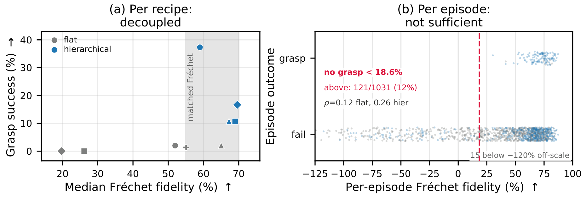

**Figure 14.** **On OGBench Cube, where the outcome *is* observable, Fréchet fidelity separates the episodes that can succeed from those that cannot, but not the ones that do.** One frozen checkpoint, $9$ configuration groups $\times$ $3$ planner seeds $\times$ $50$ episodes. *(a)* One point per planner configuration; in the shaded band the flat and hierarchical planners have equal offline fidelity and opposite grasp outcomes. *(b)* Every episode: none succeeds below a fidelity threshold, and most above it still fail.

**图 14。** **在结果*可观测*的 OGBench Cube 上，Fréchet 保真度能区分可能成功与不可能成功的回合，却不能区分实际成功的回合。** 一个冻结检查点，$9$ 组配置 $\times$ $3$ 个规划器种子 $\times$ $50$ 个回合。*(a)* 每个点对应一个规划器配置；在阴影带中，扁平与分层规划器具有相同离线保真度，但抓取结果相反。*(b)* 所有回合：保真度阈值以下无一成功，阈值以上仍有大多数失败。

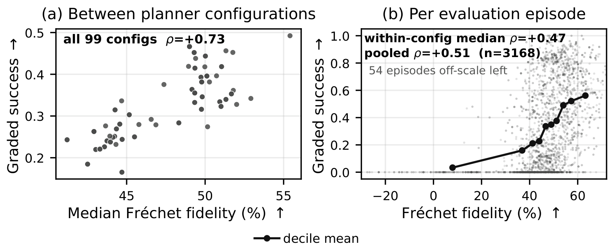

**Figure 15.** **Against a continuous outcome the same offline metric ranks degree of progress.** RoboCasa CloseDrawer, one frozen checkpoint, $99$ planner configurations $\times$ $32$ held-out episodes, budget $200$ steps; the configurations are varied to spread the outcomes, not tuned for task performance. $x$ is Fréchet fidelity, computed exactly as on DROID; $y$ is graded drawer-closure success, a continuous outcome DROID cannot report. *(a)* One point per planner configuration, median fidelity against mean graded success. *(b)* Every episode, with the mean of each fidelity decile joined. The claim rests on the *within-configuration* rank correlation, which holds episode difficulty and planner settings fixed; the pooled and between-configuration values are inflated by a between-configuration mean shift.

**图 15。** **面对连续结果，同一个离线指标能够排列进展程度。** RoboCasa CloseDrawer，一个冻结检查点，$99$ 个规划器配置 $\times$ $32$ 个留出回合，预算 $200$ 步；改变配置是为了分散结果，而非为任务性能调参。$x$ 是按与 DROID 完全相同方法计算的 Fréchet 保真度；$y$ 是分级抽屉关闭成功程度，这是 DROID 无法报告的连续结果。*(a)* 每点对应一个规划器配置，展示保真度中位数与平均分级成功程度。*(b)* 所有回合，并连起各保真度十分位组的均值。结论依据的是*同一配置内*的秩相关，它固定回合难度和规划器设置；汇总值与配置间值则会被配置间的均值偏移抬高。

### J.3 Decoded plans

**J.3 计划解码**

The Fréchet numbers in §4.3 summarize a plan by one scalar. Since DROID plans cannot be executed, we decode them in Fig. 16: the visual decoder is applied to the level-1 latents the planner rolls out under its own committed commands, and to the level-2 macro-plan that supplies its subgoals.

§4.3 的 Fréchet 数值用一个标量概括计划。由于 DROID 计划无法执行，我们在图 16 中解码这些计划：视觉解码器作用于规划器在其自身承诺指令下展开的第 1 层潜变量，以及为其提供子目标的第 2 层宏计划。

Two things are visible that the scalar does not carry. First, the imagined rollouts move the gripper *down toward the manipulated object* rather than straight at the goal frame: the non-greedy behavior the evaluation clips are chosen to elicit. This holds even for the clip scoring at the zero-action floor: a fidelity of zero means the planned path did not follow the expert's, not that the plan had no idea where the object was. Second, the level-2 macro-plan is a coarse but coherent version of the same trajectory, not a degenerate one, as the coarse cost of Eq. (4), which scores only the final predicted state, requires. All 16 clips are shown, ordered best to worst, so both observations can be checked against the full fidelity distribution rather than against a selection. The level-2 macro-plan advances one frame for every three of level 1, so it shares the level-1 strip rather than occupying a row of its own that would be two-thirds empty.

其中可以看到标量没有体现的两件事。首先，想象展开会让夹爪*向下朝被操作物体移动*，而非直接冲向目标帧；这正是选择这些评估片段所要激发的非贪心行为。即便得分处于零动作下限的片段也如此：保真度为零表示规划路径没有遵循专家路径，而非计划不知道物体在哪里。其次，第 2 层宏计划是同一轨迹的粗糙但连贯版本，没有退化，这符合只评价最终预测状态的式 (4) 粗粒度代价的要求。全部 16 个片段按从优到劣展示，因此两种观察都可在完整保真度分布上验证，而非只针对精选样本。第 2 层宏计划每前进一帧，对应第 1 层前进三帧，因此它与第 1 层共享一条图像带，而不是单独占据一行并留下三分之二空白。

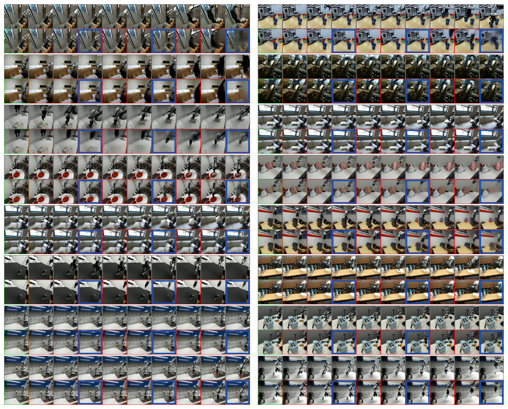

**Figure 16.** **What the DROID planner imagines, on every clip of the evaluation set.** Two-level stagewise model, held-out, training seed 1; all $16$ clips ordered best to worst by Fréchet fidelity, down the left column then the right, $+75\%$ down to $+0\%$ at the zero-action floor. Each clip is two strips: above, the logged expert clip; below, the decoded plan, which is the level-1 rollout under the planner's committed commands with the level-2 macro-plan interleaved into it at every third column (temporal stride $3$), ringed in blue. Columns are timesteps. The leftmost is the context frame the planner is given (green); the rest are imagined (red), and blur along the rollout, which is the decoder's fidelity limit and not a planning failure.

**图 16。** **DROID 规划器在评估集每个片段上的想象内容。** 两层分阶段模型，留出数据，训练种子 1；全部 $16$ 个片段按 Fréchet 保真度从优到劣排列，先左列后右列，从 $+75\%$ 降至零动作下限的 $+0\%$。每个片段有两条图像带：上方为记录的专家片段；下方为解码计划，即规划器承诺指令下的第 1 层展开，并在每第三列插入第 2 层宏计划（时间步幅 $3$），用蓝色边框标记。列对应时间步。最左侧是提供给规划器的上下文帧（绿色）；其余为想象帧（红色），并沿展开逐渐模糊，这反映解码器的保真度上限，而非规划失败。

### J.4 The re-encoded training corpus

**J.4 重新编码的训练语料库**

Raw DROID is impractical to train on repeatedly: the loader would touch ${\sim}5.5$ TB and H.264 decoding, not the GPU, sets the epoch time. Every DROID result in this paper therefore runs on a re-encoded copy: each of the three camera views downscaled to $256\times256$ (short-side center crop, then scale) with `libx264` at CRF $18$, each per-episode trajectory repacked into a flat `.npz`, and the stereo files our loader never opens dropped. We keep every frame and its timestamp rather than decimating to the training rate, which would collapse all stride phases into one. The build is $127.6$ GB for $74{,}530$ episodes, a ${\sim}45\times$ reduction that decodes $17.9\times$ faster. We measured the cost of the lossy re-encode: trajectories and assembled loader samples come back bitwise identical, the video costs a median PSNR of $33.75$ dB, and a flat configuration retrained on the re-encoded corpus but scored on the *original* clips matches raw within noise. We release the corpus, its manifests and the build script. DROID is CC-BY 4.0 [[42]](#ref-khazatsky2024droid), which permits redistributing an adapted version with credit and a statement of the change; we mark the re-encode as such.

直接在原始 DROID 上反复训练不切实际：加载器需要访问 ${\sim}5.5$ TB 数据，而决定每轮时间的是 H.264 解码而非 GPU。因此，本文所有 DROID 结果都使用重新编码的副本：三路相机视图各自缩小到 $256\times256$（按短边中心裁剪后缩放），采用 `libx264`、CRF $18$ 编码；每回合轨迹重新打包为扁平 `.npz`，并去掉加载器从不读取的立体视频文件。我们保留全部帧及其时间戳，而非降采样到训练帧率，后者会把所有步幅相位压缩为一种。构建结果为 $74{,}530$ 个回合共 $127.6$ GB，缩小 ${\sim}45\times$，解码速度提高 $17.9\times$。我们测量了有损重新编码的代价：轨迹和组装后的加载器样本逐位完全一致，视频的 PSNR 中位数为 $33.75$ dB；在重新编码语料库上重新训练、但在*原始*片段上评分的扁平配置，在噪声范围内与原始数据结果一致。我们发布语料库、清单和构建脚本。DROID 采用 CC-BY 4.0 [[42]](#ref-khazatsky2024droid)，允许在署名并说明改动后重新分发改编版本；我们据此标明重新编码。

### J.5 Future work

**J.5 未来工作**

Every model here encodes one camera at a time: both settings pool the left and right exterior views and sample one per training window. DROID's wrist camera is never used. Precise manipulation is where that costs most, since the gripper and the object it closes on are small from an exterior angle and often self-occluded, while a wrist view sees them directly. Encoding all views jointly, including the wrist view, is the clearest route to better performance; we leave it for future work. Extending the method to videos without action labels would remove the IDM term, our lever against slow-feature collapse. §L suggests that SIGReg alone, applied so that it repels the representations of different timesteps, cannot fully replace it.

这里所有模型都一次只编码一个相机：两种设置都汇集左右外部视图，每个训练窗口采样一个视图。DROID 的腕部相机从未使用。这对精细操作的代价最大，因为从外部视角看，夹爪及其夹持的物体很小，而且常被机器人自身遮挡；腕部视图则能直接看到。联合编码全部视图，包括腕部视图，是改善性能最明确的途径，我们留待未来工作。将方法扩展到没有动作标签的视频，需要移除用于抵抗慢特征坍塌的 IDM 项。§L 表明，即使以排斥不同时刻表征的方式使用 SIGReg，单靠它也无法完全替代 IDM。

## K Anti-collapse: SIGReg, inverse dynamics and detachment

**K 防止坍塌：SIGReg、逆动力学与梯度分离**

Given $Z^{(\ell)} \in \mathbb{R}^{n \times D}$, a matrix of $n$ level-$\ell$ embeddings of width $D$, SIGReg samples $M$ unit directions $u_m \in \mathbb{S}^{D-1}$ and projects the embeddings to one-dimensional samples $h_m = Z^{(\ell)}u_m$. It averages the Epps–Pulley normality statistic [[22]](#ref-epps1983test), [[6]](#ref-balestriero2025lejepa) across these projections:

给定 $Z^{(\ell)} \in \mathbb{R}^{n \times D}$，即由 $n$ 个宽度为 $D$ 的第 $\ell$ 层嵌入组成的矩阵，SIGReg 采样 $M$ 个单位方向 $u_m \in \mathbb{S}^{D-1}$，并将嵌入投影为一维样本 $h_m = Z^{(\ell)}u_m$。它对这些投影上的 Epps–Pulley 正态性统计量 [[22]](#ref-epps1983test), [[6]](#ref-balestriero2025lejepa) 求平均：

$$
\mathrm{SIGReg}\!\left(Z^{(\ell)}\right)
= \frac{1}{M}\sum_{m=1}^{M} \mathcal{T}_{\mathrm{EP}}(h_m),
\tag{9}
$$

where $\mathcal{T}_{\mathrm{EP}}$ compares the empirical characteristic function of $h_m$ to that of a standard Gaussian. The statistic, its Gaussian weighting, and the Cramér–Wold argument [[17]](#ref-cramer1936theorems) that reduces matching $\mathcal{N}(0,I_D)$ to matching every one-dimensional projection are those of Balestriero & LeCun [[6]](#ref-balestriero2025lejepa); the quadrature is that of the implementation released with LeWM [[53]](#ref-maes2026lewm), which exploits the even integrand to work on the half-domain $[0,3]$ with $17$ trapezoidal knots, at $\mathcal{O}(n)$ cost in the $n$ samples entering one test. With one embedding per frame, the tensor entering the test is $(T, N, D)$: one normality test per timestep, over the $N$ sequences of the batch. Other terms also prevent collapse: §K.1 separates what it, the inverse-dynamics term and prediction-target detachment [[66]](#ref-ponce2026dualperspectives) each contribute, and §K.2 cross-validates the coefficients of the two mechanisms that have a clear effect, IDM and SIGReg. §K.3 gives technical guidelines to implement SIGReg across devices.

其中 $\mathcal{T}_{\mathrm{EP}}$ 将 $h_m$ 的经验特征函数与标准高斯分布的特征函数比较。该统计量、高斯权重，以及将匹配 $\mathcal{N}(0,I_D)$ 化为匹配所有一维投影的 Cramér–Wold 论证 [[17]](#ref-cramer1936theorems)，均来自 Balestriero 与 LeCun [[6]](#ref-balestriero2025lejepa)；数值积分采用随 LeWM 发布的实现 [[53]](#ref-maes2026lewm)，利用被积函数的偶对称性，在半区间 $[0,3]$ 上使用 $17$ 个梯形积分节点，对每次检验的 $n$ 个样本具有 $\mathcal{O}(n)$ 复杂度。每帧一个嵌入时，输入检验的张量为 $(T, N, D)$：每个时间步进行一次正态性检验，覆盖批次中的 $N$ 条序列。其他项也能防止坍塌：§K.1 分别分析 SIGReg、逆动力学项和预测目标梯度分离 [[66]](#ref-ponce2026dualperspectives) 的贡献，§K.2 则交叉验证具有明确作用的 IDM 和 SIGReg 两种机制的系数。§K.3 给出跨设备实现 SIGReg 的技术指南。

### K.1 What SIGReg, IDM and detachment each contribute

**K.1 SIGReg、IDM 与梯度分离各自的贡献**

In §4.3, we show an inverse-dynamics term is required on DROID. We test that with a full grid over three candidate anti-collapse mechanisms, the SIGReg weight, the IDM weight and prediction-target detachment (Fig. 17).

§4.3 表明 DROID 需要逆动力学项。我们对三个候选防坍塌机制——SIGReg 权重、IDM 权重以及预测目标梯度分离——进行完整网格测试以检验这一点（图 17）。

**Representation rank against planning fidelity.** SIGReg is what maintains the visual effective rank [[25]](#ref-rankme) of the representation high enough: without it the representation collapses at every IDM weight, with or without detachment, to an effective rank between $1$ and $14$ out of $384$. Our models trained without SIGReg reach a planning performance below the “do-nothing” floor. Yet, visual representations with non-collapsed visual effective rank do not necessarily mean the JEPA world model will have high Fréchet fidelity after planning. With SIGReg on, every model keeps a high rank, but models without an IDM term still plan close to the floor. Adding the IDM term gives high planning fidelity, best at weight $100$.

**表征秩与规划保真度。** SIGReg 使表征的视觉有效秩 [[25]](#ref-rankme) 保持足够高：没有它时，无论 IDM 权重如何、是否分离梯度，表征都会坍塌，在 $384$ 个维度中仅剩 $1$ 至 $14$ 的有效秩。不使用 SIGReg 训练的模型，其规划性能低于“什么都不做”的下限。然而，视觉有效秩没有坍塌，并不必然意味着 JEPA 世界模型规划后具有较高 Fréchet 保真度。启用 SIGReg 后，所有模型都维持高秩，但没有 IDM 项的模型规划仍接近下限。加入 IDM 项带来高规划保真度，在权重 $100$ 时最好。

**When detachment matters.** On this grid it does not change the outcome. With SIGReg off, both variants collapse. With SIGReg on and an IDM term, the two variants differ by less than the spread across planner seeds. We therefore do not use target detachment in our headline setup (table 5).

**梯度分离何时重要。** 在该网格中，它不改变结果。关闭 SIGReg 时，两个变体都会坍塌。开启 SIGReg 且加入 IDM 项时，两变体间的差异小于规划器种子间的离散程度。因此，主要设置不对目标进行梯度分离（表 5）。

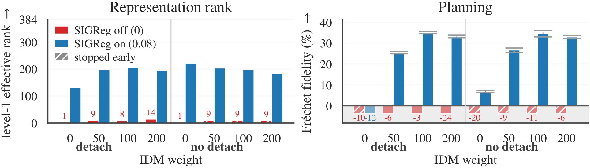

**Figure 17.** **SIGReg restores representation rank; the inverse-dynamics term is what turns rank into planning fidelity.** Full grid around the level-1 DROID configuration of table 5: SIGReg $\in\{0,0.08\}$ $\times$ IDM weight $\in\{0,50,100,200\}$ $\times$ prediction-target detachment, $16$ cells, one training seed each, read at epoch $100$. Five SIGReg-off cells (hatched) were stopped once collapsed and are read at their last epoch. *Left:* level-1 effective rank [[25]](#ref-rankme) of the `CLS` embedding, max $384$. *Right:* Fréchet fidelity on the 16-clip set; the grey band holds sub-floor cells, drawn as fixed-depth stubs annotated with their true value. Each planning bar is the mean over planner seeds $1$, $2$ and $3$ of one trained model, and its error bar is the standard error (SE) over those three planner seeds.

**图 17。** **SIGReg 恢复表征秩，而逆动力学项将秩转化为规划保真度。** 围绕表 5 第 1 层 DROID 配置的完整网格：SIGReg $\in\{0,0.08\}$ $\times$ IDM 权重 $\in\{0,50,100,200\}$ $\times$ 预测目标梯度分离，共 $16$ 个单元格，各一个训练种子，在第 $100$ 轮读取。五个关闭 SIGReg 的单元格（斜线纹理）在坍塌后停止，读取其最后一轮。*左：* `CLS` 嵌入的第 1 层有效秩 [[25]](#ref-rankme)，最大为 $384$。*右：* 16 片段集上的 Fréchet 保真度；灰色带内为低于下限的单元格，以固定深度短柱绘制并标注真实值。每个规划柱为一个已训练模型在规划器种子 $1$、$2$ 和 $3$ 上的均值，误差条为这三个规划器种子的标准误（SE）。

### K.2 Cross-validating the SIGReg and inverse-dynamics coefficients

**K.2 SIGReg 与逆动力学系数的交叉验证**

In §K.1 we studied which terms the objective needs. Here we tune their coefficients, the SIGReg coefficient and the inverse-dynamics weight, with a full grid at level 1 (Fig. 18). We then freeze level 1 and run a grid at level 2, pairing each level-2 training seed with the level-1 seed it builds on.

§K.1 研究了目标需要哪些项。这里，我们在第 1 层通过完整网格调整这些项的系数，即 SIGReg 系数和逆动力学权重（图 18）。随后冻结第 1 层，在第 2 层进行网格搜索，将每个第 2 层训练种子与其基于的第 1 层种子配对。

At level 1, the two coefficients have to be scaled together. A large inverse-dynamics weight with a small SIGReg coefficient barely beats the do-nothing floor, and a large SIGReg coefficient with a small inverse-dynamics weight falls below it. Between these two corners, a wide range of pairs plans well. Level 2 is much less sensitive: with level 1 frozen, all nine combinations reach a similar fidelity.

在第 1 层，两个系数必须共同缩放。较大的逆动力学权重配合较小的 SIGReg 系数，表现仅略高于什么都不做的下限；较大的 SIGReg 系数配合较小的逆动力学权重，则低于该下限。在这两个极端之间，较广范围的组合都能良好规划。第 2 层不敏感得多：冻结第 1 层后，全部九种组合都达到相近保真度。

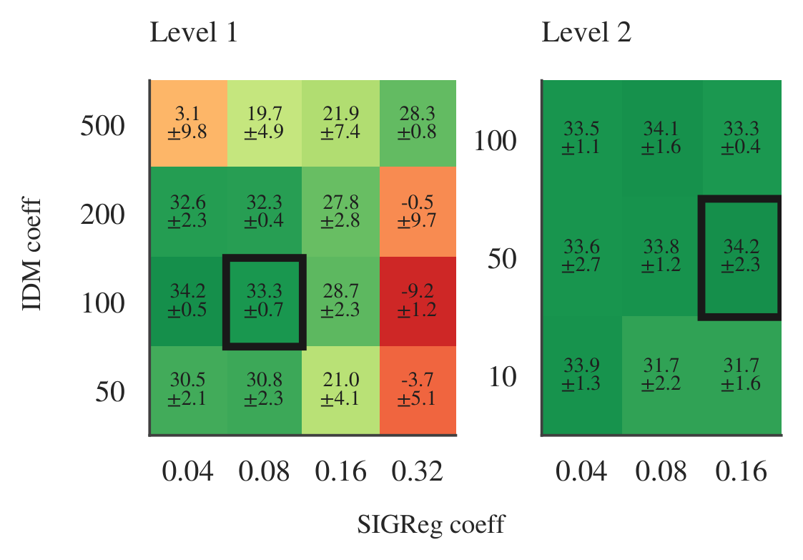

**Figure 18.** **The SIGReg and inverse-dynamics coefficients are chosen jointly, once per level.** DROID at $5$ fps; Fréchet fidelity (%, higher is better), mean and standard error over three training seeds, each averaged over three planner seeds. *Left*, the level-1 grid on single-level models; *right*, the level-2 grid on stagewise models with level 1 frozen. Both use the gradient-based planner of our headline results, and share one color scale. The heavy outline marks the coefficients we keep; at level 1 they lie within one standard error of the best cell.

**图 18。** **SIGReg 与逆动力学系数联合选择，每层选择一次。** DROID，$5$ fps；Fréchet 保真度（%，越高越好），报告三个训练种子的均值和标准误，每个训练种子先对三个规划器种子平均。*左：* 单层模型的第 1 层网格；*右：* 冻结第 1 层的分阶段模型的第 2 层网格。两者均使用主要结果中的梯度规划器，并共享色标。粗边框标出最终保留的系数；第 1 层所选组合与最佳单元格的差异在一个标准误以内。

### K.3 SIGReg under data parallelism

**K.3 数据并行下的 SIGReg**

$\mathcal{T}_{\mathrm{EP}}$ is a statistic of the whole batch, not a sum of per-sample terms. Evaluating it on each rank's $n_{\mathrm{loc}} = n/W$ samples and averaging the $W$ results gives the mean of $W$ small-sample statistics, which shifts with the number of devices. We synchronize one level lower. The empirical characteristic function (ECF) underneath the statistic is a mean over samples, so with equal shards the global ECF is the average of the per-rank ECFs: we `all_reduce` the local real and imaginary ECFs before the quadrature and pass $n_{\mathrm{loc}}W$ into the sample-count prefactor. Two $M\times17$ tensors cross the wire per call, one entry per direction and quadrature knot, whatever the batch size, and the statistic becomes exactly invariant to sharding (Table 11). The remaining $n$ dependence is deliberate: the prefactor cancels the $1/n$ variance of the ECF, so on target data the statistic sits at a floor ($1.04$ to $1.37$ over $n = 32$ to $2048$) and on collapsed data it grows linearly in $n$, holding the anti-collapse gradient per sample constant. Thus $\lambda$ transfers across batch sizes, but not across sample definitions.

$\mathcal{T}_{\mathrm{EP}}$ 是整个批次的统计量，而非逐样本项的和。在每个进程的 $n_{\mathrm{loc}} = n/W$ 个样本上计算它，再平均 $W$ 个结果，得到的是 $W$ 个小样本统计量的均值，会随设备数改变。我们在低一层同步。统计量所基于的经验特征函数（ECF）是样本均值，因此分片等大时，全局 ECF 等于各进程 ECF 的平均：我们在数值积分前对局部 ECF 的实部和虚部执行 `all_reduce`，并将 $n_{\mathrm{loc}}W$ 传入样本数前因子。每次调用传输两个 $M\times17$ 张量，每个方向和积分节点对应一个条目，与批大小无关；统计量由此对分片方式完全不变（表 11）。保留的 $n$ 依赖是有意的：前因子抵消 ECF 的 $1/n$ 方差，因此在目标分布数据上，统计量处于一个下限（在 $n = 32$ 到 $2048$ 范围内为 $1.04$ 到 $1.37$），而在坍塌数据上随 $n$ 线性增长，从而维持每个样本的防坍塌梯度恒定。因此，$\lambda$ 可以跨批大小迁移，但不能跨样本定义迁移。

**Table 11.** **Our distributed SIGReg is exactly invariant to how a fixed total batch is sharded; a single-GPU implementation is not.** One fixed Gaussian matrix ($n=256$, $D=32$, $M=64$ directions) sharded contiguously across $W$ ranks in `float64`. The reference is the SIGReg released with LeWM [[53]](#ref-maes2026lewm), formula-identical to ours but with its prefactor set by the local batch and no collective; its code documents itself as single-GPU. The data follow the target, so its $14\%$ drift is launch topology, not signal.

**表 11。** **我们的分布式 SIGReg 对固定总批次的分片方式完全不变，而单 GPU 实现并非如此。** 一个固定高斯矩阵（$n=256$、$D=32$、$M=64$ 个方向），以 `float64` 连续分配到 $W$ 个进程。参照方法为随 LeWM 发布的 SIGReg [[53]](#ref-maes2026lewm)，公式与我们相同，但其前因子由局部批次决定，也没有集合通信；其代码注明用于单 GPU。数据服从目标分布，因此其 $14\%$ 漂移来自启动拓扑，而非信号。

| Shards 分片 | $\lVert \nabla\rVert$ (ours) $\lVert \nabla\rVert$（本文） | $\mathcal{T}_{\mathrm{EP}}$ / ours $\mathcal{T}_{\mathrm{EP}}$ / 本文 | $\mathcal{T}_{\mathrm{EP}}$ / single-GPU reference $\mathcal{T}_{\mathrm{EP}}$ / 单 GPU 参照 |
| --- | --- | --- | --- |
| $1 \times 256$ | $0.349154178012$ | $1.372619178543$ | $1.372619$ |
| $2 \times 128$ | $0.349154178012$ | $1.372619178543$ | $1.180770$ |
| $4 \times 64$ | $0.349154178012$ | $1.372619178543$ | $1.186233$ |

Equal shards are assumed throughout, so we drop the last partial batch.

全文假定各分片等大，因此舍弃最后一个不完整批次。

## L Slow-feature collapse in joint-embedding predictive objectives

**L 联合嵌入预测目标中的慢特征坍塌**

This appendix argues for the inverse-dynamics term of §4.3. Sobal et al. [[72]](#ref-sobal2022slowfeatures) exhibit an encoder that copies episode-constant noise and on which a variance–covariance regularizer vanishes. That shows a degenerate encoder attains zero loss, not that the objective *prefers* it; it assumes the identity predictor; and it covers only Gaussian noise. We strengthen all three points; no result assumes a parametric encoder or predictor. We suppress the level index $\ell$ of Table 2: $E$, $F$, $I$ are the encoder, predictor and inverse-dynamics head, $z_t = E(o_t)$, $\mathcal{L}_{\mathrm{pred}}$ and $\mathcal{L}_{\mathrm{idm}}$ the losses of Eqs. (2) and (8), $\lambda$, $\gamma$, $\lambda_{\mathrm{sim}}$ the SIGReg, IDM and temporal-similarity weights, and $N$, $T$, $D$ the minibatch shapes of Table 2. SIGReg averages $G$ independent $n$-sample normality tests over $Gn$ minibatch embeddings.

本附录为 §4.3 的逆动力学项提供论证。Sobal 等人 [[72]](#ref-sobal2022slowfeatures) 展示了一个复制回合内恒定噪声、且方差—协方差正则项为零的编码器。这说明退化编码器能达到零损失，而非目标*偏好*它；该结果假设恒等预测器，且只涵盖高斯噪声。我们加强这三点；所有结果都不假设参数化编码器或预测器。我们省略表 2 的层级索引 $\ell$：$E$、$F$、$I$ 分别为编码器、预测器和逆动力学头，$z_t = E(o_t)$，$\mathcal{L}_{\mathrm{pred}}$ 与 $\mathcal{L}_{\mathrm{idm}}$ 为式 (2) 和 (8) 的损失，$\lambda$、$\gamma$、$\lambda_{\mathrm{sim}}$ 分别为 SIGReg、IDM 和时间相似性权重，$N$、$T$、$D$ 是表 2 的小批次形状。SIGReg 在 $Gn$ 个小批次嵌入上，对 $G$ 个独立的 $n$ 样本正态性检验求平均。

### L.1 Three kinds of content in a sequence of observations

**L.1 观测序列中的三类内容**

The observation $o_t = O(\xi_t)$ is a deterministic function of an unobserved latent state $\xi_t = (b, x_t, y_t)$ taking values in a standard Borel space, and $z_t = E(o_t)$ encodes it. The **background** $b$ is constant within an episode, varies across episodes (scene, camera, lighting), and is readable from a single frame: $b$ is $\sigma(o_t)$-measurable. The **foreground** $x_t$ is the agent-controlled content, $x_{t+1} = \Phi(x_t, a_t, \varepsilon_{t+1})$, where the innovation $\varepsilon_{t+1}$ is a random input independent of the past that makes the foreground only *partially* predictable (contact, occlusion). The **distractors** $y_t$ move but are action-independent and unpredictable, $y_{t+1} = \Psi(y_t,\zeta_{t+1})$ with their own innovation $\zeta_{t+1}$ (other agents, shadows), exogenous in the sense of Efroni et al. [[21]](#ref-efroni2021provablerw), Wang et al. [[81]](#ref-pmlr-v162-wang22c). A distractor that moves predictably (a clock, a fan) has no innovation, and nothing below separates it from the background.

观测 $o_t = O(\xi_t)$ 是不可观测潜在状态 $\xi_t = (b, x_t, y_t)$ 的确定性函数，该状态取值于标准 Borel 空间，并由 $z_t = E(o_t)$ 编码。**背景** $b$ 在一个回合内不变，在不同回合间变化（场景、相机、光照），且可从单帧读取：$b$ 是 $\sigma(o_t)$ 可测的。**前景** $x_t$ 是智能体控制的内容，满足 $x_{t+1} = \Phi(x_t, a_t, \varepsilon_{t+1})$，其中创新项 $\varepsilon_{t+1}$ 是独立于过去的随机输入，使前景仅*部分*可预测（接触、遮挡）。**干扰物** $y_t$ 会运动，但与动作无关且不可预测，满足 $y_{t+1} = \Psi(y_t,\zeta_{t+1})$，具有自身的创新项 $\zeta_{t+1}$（其他智能体、阴影）；它们在 Efroni 等人 [[21]](#ref-efroni2021provablerw)、Wang 等人 [[81]](#ref-pmlr-v162-wang22c) 的意义下是外生的。运动可预测的干扰物（时钟、风扇）没有创新项，下文的论证无法将其与背景区分。

**Definition 1 (Slow-feature collapse).**

**定义 1（慢特征坍塌）。**

An encoder is *slow-feature collapsed* when $z_t$ is measurable with respect to the episode-invariant $\sigma$-algebra $\mathcal{C} = \sigma(b)$, the events determined by the background alone, so $z_t$ is constant within every episode. Its *degree* is the within-episode variance share

当 $z_t$ 关于回合不变的 $\sigma$ 代数 $\mathcal{C} = \sigma(b)$ 可测时，编码器发生*慢特征坍塌*；该代数包含仅由背景决定的事件，因此 $z_t$ 在每个回合内恒定。其*程度*由回合内方差占比给出

$$
\chi(E) = \frac{\mathbb{E}_{b}\!\left[\operatorname{tr}\operatorname{Var}_{t}(z_t \mid b)\right]}
{\operatorname{tr}\operatorname{Var}_{b,t}(z_t)},
\tag{10}
$$

the complement of the between-episode share measured in §L.2, and $0$ at exact collapse.

它是 §L.2 测得的回合间方差占比的补量，在完全坍塌时为 $0$。

### L.2 Where the latent variance goes

**L.2 潜在方差流向何处**

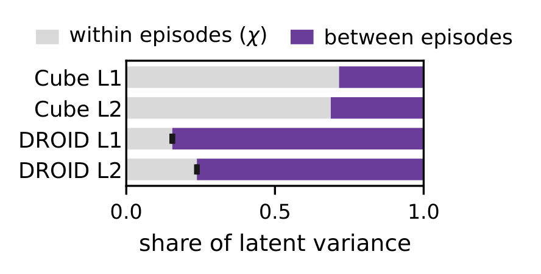

**Figure 19.** **Scene diversity sends latent variance between episodes.** Within-episode (the slow-feature degree $\chi$ of Definition 1) and between-episode shares of the latent variance. Bars are $\pm$1 standard error (SE) over three training seeds.

**图 19。** **场景多样性使潜在方差集中到回合之间。** 潜在方差的回合内占比（定义 1 的慢特征程度 $\chi$）和回合间占比。误差条为三个训练种子上的 $\pm$1 个标准误（SE）。

§4.3 claims scene diversity separates DROID from Cube. We measure it directly in the latents, splitting the total latent variance into a within-episode and a between-episode part (Fig. 19). Neither latent size nor camera site explains the gap. The within-episode part is $\chi(E)$ of Definition 1, so the diverse-scene environments start close to collapse. The cost is capacity, not reachability: a per-episode mean cancels in a same-episode state-minus-goal difference, but it leaves little of the latent for the arm. Level 2 barely moves the share, hence the inverse-dynamics term at both levels.

§4.3 认为场景多样性是 DROID 与 Cube 的区别。我们直接在潜变量中测量，将总潜在方差拆分为回合内和回合间两部分（图 19）。潜在维度和相机位置都无法解释这一差距。回合内部分就是定义 1 的 $\chi(E)$，因此多场景环境一开始就接近坍塌。代价在于容量，而非可达性：在同一回合的状态减目标差值中，回合均值会抵消，但它使潜变量只留下很少容量用于机械臂。第 2 层几乎不改变这一占比，因此两个层级都需要逆动力学项。

### L.3 No regularizer on the marginal law can exclude it

**L.3 任何仅作用于边缘分布的正则项都无法排除它**

**Proposition 1 (Feasibility).**

**命题 1（可行性）。**

Let $\mathcal{R}$ be any functional of the marginal law of $z$, the distribution of a single embedding $E(o)$ over the pooled corpus irrespective of time, with $\mathcal{R}(\mu_0) = 0$ for some law $\mu_0$ on $\mathbb{R}^D$, and let $\operatorname{law}(b)$ be atomless. Then some $E$ and $F$ attain $\mathcal{L}_{\mathrm{pred}} = 0$ and $\mathcal{R}(\operatorname{law}(z)) = 0$ simultaneously, with $F$ the identity in its state argument.

令 $\mathcal{R}$ 为 $z$ 的边缘分布的任意泛函，即不考虑时间、在汇总语料库上单个嵌入 $E(o)$ 的分布；对 $\mathbb{R}^D$ 上某个分布 $\mu_0$，满足 $\mathcal{R}(\mu_0) = 0$，并假设 $\operatorname{law}(b)$ 无原子。则存在某些 $E$ 和 $F$，可同时达到 $\mathcal{L}_{\mathrm{pred}} = 0$ 与 $\mathcal{R}(\operatorname{law}(z)) = 0$，其中 $F$ 对其状态参数是恒等映射。

**Proof.**

**证明。**

An atomless law on a standard Borel space admits $U$ with $U(b)\sim\mathrm{Unif}[0,1]$, and $Q$ pushing $\mathrm{Unif}[0,1]$ to $\mu_0$ exists for any $\mu_0$; take $E = Q\circ U\circ b$, well defined on $o$ because $b$ is $\sigma(o)$-measurable (§L.1), and $F(z,a) = z$. Then $z_{t+1} = z_t$ within every episode, so $\mathcal{L}_{\mathrm{pred}} = 0$, and $\operatorname{law}(z) = \mu_0$.

标准 Borel 空间上的无原子分布允许构造 $U$，使 $U(b)\sim\mathrm{Unif}[0,1]$；对任意 $\mu_0$，都存在将 $\mathrm{Unif}[0,1]$ 推送到 $\mu_0$ 的 $Q$。取 $E = Q\circ U\circ b$，由于 $b$ 是 $\sigma(o)$ 可测的（§L.1），它在 $o$ 上有良好定义，并取 $F(z,a) = z$。于是每个回合内 $z_{t+1} = z_t$，所以 $\mathcal{L}_{\mathrm{pred}} = 0$，且 $\operatorname{law}(z) = \mu_0$。

The atomless hypothesis is a population idealization. A corpus of finitely many scenes makes $\operatorname{law}(b)$ atomic and $\operatorname{law}(z)$ supported on at most that many points, which a normality test on far fewer embeddings per group cannot distinguish from $\mu_0$; the construction fails outright only in the point-mass limit of a single scene (§L.4). Variance–covariance regularization, whitening, entropy penalties and SIGReg (Eq. (9)) all look only at the marginal law, so none can exclude the collapse; a barrier has to act on the joint law of $z$ across time.

无原子假设是对总体的理想化。有限场景的语料库使 $\operatorname{law}(b)$ 成为原子分布，使 $\operatorname{law}(z)$ 最多支撑在同样数量的点上，而每组仅检验远少于该数量嵌入的正态性检验，无法将其与 $\mu_0$ 区分；该构造只有在单场景的点质量极限下才会完全失效（§L.4）。方差—协方差正则化、白化、熵惩罚与 SIGReg（式 (9)）都只考察边缘分布，因此都无法排除坍塌；阻止坍塌的障碍必须作用于 $z$ 跨时间的联合分布。

### L.4 The objective selects by predictability, and the collapse is an optimum

**L.4 目标按可预测性选择，而坍塌是一个最优解**

Since $F$ ranges over measurable functions, $\min_F\mathcal{L}_{\mathrm{pred}}$ equals the *irreducible risk* $\mathcal{E}(E) = \mathbb{E}\|z_{t+1}-\mathbb{E}[z_{t+1}\mid z_t,a_t]\|_2^2$ [[85]](#ref-weghenkel2016graphbasedpf). Define the *innovation sensitivity* $\nu(E) = \mathbb{E}\operatorname{tr}\operatorname{Var}(E(o_{t+1})\mid \xi_t,a_t)$, the next-embedding variance that survives knowing the full latent state and the action.

由于 $F$ 的取值范围是可测函数，$\min_F\mathcal{L}_{\mathrm{pred}}$ 等于*不可约风险* $\mathcal{E}(E) = \mathbb{E}\|z_{t+1}-\mathbb{E}[z_{t+1}\mid z_t,a_t]\|_2^2$ [[85]](#ref-weghenkel2016graphbasedpf)。定义*创新敏感度* $\nu(E) = \mathbb{E}\operatorname{tr}\operatorname{Var}(E(o_{t+1})\mid \xi_t,a_t)$，即已知完整潜在状态和动作后，下一嵌入仍保留的方差。

**Theorem 1 (Predictability bound).**

**定理 1（可预测性界）。**

For any measurable $E$, $\;\mathcal{E}(E)\geq\nu(E)\geq 0$, and $\mathcal{E}(E) = 0$ if and only if $\sigma(z)$ is *action-closed*, i.e. $z_{t+1} = \Gamma(z_t,a_t)$ almost surely for some measurable $\Gamma$.

对任意可测的 $E$，都有 $\;\mathcal{E}(E)\geq\nu(E)\geq 0$，且 $\mathcal{E}(E) = 0$ 当且仅当 $\sigma(z)$ 是*动作闭合*的，即存在某个可测 $\Gamma$，使 $z_{t+1} = \Gamma(z_t,a_t)$ 几乎处处成立。

**Proof.**

**证明。**

$\sigma(z_t,a_t)\subseteq\sigma(\xi_t,a_t)$ because $o_t = O(\xi_t)$, and coarser conditioning cannot reduce expected conditional variance, which gives $\mathcal{E}(E) = \mathbb{E}\operatorname{tr}\operatorname{Var}(z_{t+1}\mid z_t,a_t) \geq \nu(E)$; $\mathcal{E}(E) = 0$ iff $\operatorname{Var}(z_{t+1}\mid z_t,a_t) = 0$ a.s., i.e. iff $z_{t+1}$ is a measurable function of $(z_t,a_t)$.

因为 $o_t = O(\xi_t)$，所以 $\sigma(z_t,a_t)\subseteq\sigma(\xi_t,a_t)$；较粗的条件化不能降低期望条件方差，因此得到 $\mathcal{E}(E) = \mathbb{E}\operatorname{tr}\operatorname{Var}(z_{t+1}\mid z_t,a_t) \geq \nu(E)$；$\mathcal{E}(E) = 0$ 当且仅当 $\operatorname{Var}(z_{t+1}\mid z_t,a_t) = 0$ 几乎处处成立，也即当且仅当 $z_{t+1}$ 是 $(z_t,a_t)$ 的可测函数。

Reading only $b$ gives $\nu = 0$ and $\Gamma = \mathrm{id}$, hence $\mathcal{E} = 0$; reading $x_t$ or $y_t$ pays the variance injected by $\varepsilon$ or $\zeta$, unless the feature read is itself action-closed (a component of $x_t$ that $(x_t,a_t)$ determines, such as arm state under deterministic dynamics), which attains $\mathcal{E} = 0$ as well. Under any marginal constraint, which Proposition 1 shows the background can satisfy exactly, the collapse is therefore an optimum the objective cannot exclude. Among zero-loss solutions the theorem does not select; the implicit bias of training does [[52]](#ref-littwin2024how). In our runs it selects the collapse, whose predictor is the identity: action sensitivity, the relative change of the predicted rollout when the true actions are replaced by those of another episode, falls below $0.05$ in all fifteen seeds of the SIGReg ladder (Table 12). In the tabular case the theorem is a corollary of Tang et al. [[76]](#ref-tang2023understanding_self_predictive), Thm. 6, whose non-collapse guarantee needs semi-gradient targets and a near-optimal predictor; our collapsed runs use the former and lack the latter. Conversely, a background identical in every episode makes $\operatorname{law}(b)$ a point mass, so Proposition 1 fails and SIGReg alone excludes the collapse: the fixed-camera environments of §4 need no inverse-dynamics term, and DROID, whose scenes change every episode, does (§4.3, Fig. 17).

仅读取 $b$ 得到 $\nu = 0$ 和 $\Gamma = \mathrm{id}$，因此 $\mathcal{E} = 0$；读取 $x_t$ 或 $y_t$ 则需要承担 $\varepsilon$ 或 $\zeta$ 注入的方差，除非读取的特征自身是动作闭合的（例如 $x_t$ 中由 $(x_t,a_t)$ 决定的分量，如确定性动力学下的机械臂状态），此时同样达到 $\mathcal{E} = 0$。命题 1 表明背景能精确满足任意边缘约束，因此在这些约束下，坍塌是目标无法排除的一个最优解。定理并不在零损失解之间作选择，选择由训练的隐式偏置决定 [[52]](#ref-littwin2024how)。在我们的实验中，它选择了预测器为恒等映射的坍塌解：动作敏感度，即将真实动作替换为另一个回合动作时预测展开的相对变化，在 SIGReg 阶梯实验全部十五个种子上均降至 $0.05$ 以下（表 12）。在表格型情形中，本定理是 Tang 等人 [[76]](#ref-tang2023understanding_self_predictive) 定理 6 的推论；其非坍塌保证需要半梯度目标和近乎最优的预测器，而我们的坍塌实验使用前者，却缺少后者。反之，如果背景在所有回合中相同，$\operatorname{law}(b)$ 就是点质量，命题 1 不再适用，单靠 SIGReg 即可排除坍塌：§4 的固定相机环境无需逆动力学项，而场景每回合变化的 DROID 需要（§4.3，图 17）。

##### Experiments of Sobal et al. [[72]](#ref-sobal2022slowfeatures).

**Sobal 等人 [[72]](#ref-sobal2022slowfeatures) 的实验。**

The taxonomy and Theorem 1 account for three of their results. *Fixed* distractors are fatal and *changing* ones harmless: fixed noise is background and becomes the collapse target, changing noise is a distractor and is shed. Their three-dot probe errors order as $\nu$ does: stationary $0.066$, action-controlled $0.277$, random $0.273$, chance $0.235$. And their inverse-dynamics model recovers the action-controlled dot ($0.035$) but loses the stationary one ($0.272$), as Proposition 3 predicts.

上述分类和定理 1 解释了他们的三项结果。*固定*干扰物是致命的，而*变化*干扰物无害：固定噪声属于背景，成为坍塌目标；变化噪声属于干扰物，会被舍弃。其三圆点探针误差的排序与 $\nu$ 相同：静止 $0.066$、动作控制 $0.277$、随机 $0.273$、机会水平 $0.235$。其逆动力学模型恢复了动作控制圆点（$0.035$），却丢失静止圆点（$0.272$），正如命题 3 所预测。

### L.5 Pooling time into the sample axis: a real but small barrier

**L.5 将时间并入样本轴：真实但较小的障碍**

Proposition 1 concerns the distribution of a single embedding, but SIGReg is computed on a minibatch. At exact collapse every sequence contributes $T$ identical copies of one embedding, and a grouping with time in the sample axis, such as a single test on the flattened $(NT, D)$ tensor, puts them into the same normality test.

命题 1 讨论单个嵌入的分布，但 SIGReg 在小批次上计算。在完全坍塌时，每条序列提供同一个嵌入的 $T$ 个相同副本；将时间放入样本轴的分组方式，例如在展平的 $(NT, D)$ 张量上进行单次检验，会把这些副本放入同一次正态性检验。

**Proposition 2 (The barrier, per grouping).**

**命题 2（各分组下的障碍）。**

Let $\kappa$ be the expected value of $\mathcal{T}_{\mathrm{EP}}$ (§K) on $n$ samples drawn from its Gaussian target; it does not depend on $n$. At exact collapse, with the per-episode embeddings distributed as the target (the construction of Proposition 1), the SIGReg term exceeds its null value $\lambda\kappa$ by

令 $\kappa$ 为 $\mathcal{T}_{\mathrm{EP}}$（§K）在从目标高斯分布抽取的 $n$ 个样本上的期望值，它不依赖 $n$。在完全坍塌时，若逐回合嵌入服从目标分布（命题 1 的构造），则 SIGReg 项比其零假设值 $\lambda\kappa$ 高出

$$
\Delta = \lambda\,(T-1)\,\kappa
\tag{11}
$$

whenever the grouping places time in the sample axis, so that a group holds several timesteps of the same sequence, and by zero whenever it places time in the group axis.

上述差值适用于将时间放在样本轴、使一组包含同一序列多个时间步的情况；当时间放在分组轴时，差值为零。

**Proof.**

**证明。**

$\mathcal{T}_{\mathrm{EP}}$ compares an empirical characteristic function, an unweighted average over the $n$ samples of a group, against its target, and scales the squared discrepancy by $n$. Repeating each of $k = n/T$ distinct values $T$ times leaves that average unchanged, so its variance about the target remains that of $k$ samples while the prefactor stays $n$, giving $\mathbb{E}[\mathcal{T}_{\mathrm{EP}}] = T\kappa$. With time in the group axis every group holds $n$ distinct embeddings.

$\mathcal{T}_{\mathrm{EP}}$ 将经验特征函数——一组 $n$ 个样本的无权平均——与目标比较，并用 $n$ 缩放平方差异。将 $k = n/T$ 个不同值分别重复 $T$ 次，不改变该平均，因此它相对于目标的方差仍是 $k$ 个样本的方差，而前因子保持 $n$，得到 $\mathbb{E}[\mathcal{T}_{\mathrm{EP}}] = T\kappa$。当时间处于分组轴时，每组含 $n$ 个不同嵌入。

The grouping this paper uses, $(T,N,D)$, places time in the group axis: each normality test sees one timestep of $N$ different sequences, so $\Delta = 0$ and SIGReg carries no barrier against slow-feature collapse. Where a grouping does carry one, the barrier is measured against the null value $\lambda\kappa$, not against the value the statistic takes on a trained encoder, so a collapsed encoder need not score above a healthy one. In Table 12 it does not prevent collapse: every run of the SIGReg ladder collapses, later at larger $\lambda$ but to the same endpoint, with $\chi$ between $0.008$ and $0.016$ on every run past epoch $50$.

本文采用的分组 $(T,N,D)$ 将时间放在分组轴：每次正态性检验观察 $N$ 条不同序列的同一个时间步，因此 $\Delta = 0$，SIGReg 对慢特征坍塌没有构成障碍。对于确实存在障碍的分组，其大小是相对于零假设值 $\lambda\kappa$ 测量的，而非相对于训练后编码器上的统计值，因此坍塌编码器的得分不必高于健康编码器。在表 12 中，这一障碍没有阻止坍塌：SIGReg 阶梯的每次实验最终都坍塌，较大的 $\lambda$ 使坍塌更晚，但终点相同；在所有超过第 $50$ 轮的实验中，$\chi$ 均处于 $0.008$ 至 $0.016$ 之间。

**Table 12.** **Training without the inverse-dynamics term: the SIGReg ladder (top) and time repulsion at its largest coefficient (middle).** Level-1 models at $5$ fps, $\gamma = 0$, three train seeds, $100$ epochs. These runs feed SIGReg the flattened $(NT, D)$ tensor, one normality test over all $NT$ embeddings of the minibatch, which places time in the sample axis, so they carry the $\Delta$ of Proposition 2; the barrier is what the ladder probes. “Onset” is the first epoch at which Fréchet fidelity (Eq. (7)) drops clearly below the zero-action floor, the next column the epoch at which the predictor's action sensitivity first falls below $0.05$ (seed spread $\pm 2$ epochs). Best fidelity is the highest before turning over; final fidelity and sensitivity are read over epochs $98$–$100$; $\chi$ is Eq. (10) on the final checkpoint (one seed for the repulsion runs, three for the IDM-on row). Ladder rows carry no terminal value (at most two seeds reach epoch $100$).

**表 12。** **不使用逆动力学项的训练：SIGReg 阶梯（上）与采用最大系数的时间排斥（中）。** 第 1 层模型，$5$ fps，$\gamma = 0$，三个训练种子，$100$ 轮。这些实验向 SIGReg 输入展平的 $(NT, D)$ 张量，在小批次全部 $NT$ 个嵌入上进行一次正态性检验，将时间置于样本轴，因此具有命题 2 的 $\Delta$；阶梯实验检验的正是这一障碍。“Onset” 是 Fréchet 保真度（式 (7)）首次明显低于零动作下限的轮次；下一列是预测器动作敏感度首次低于 $0.05$ 的轮次（种子间差异 $\pm 2$ 轮）。最佳保真度是转折下降前的最高值；最终保真度与敏感度取自第 $98$–$100$ 轮；$\chi$ 是最终检查点上的式 (10)（排斥实验一个种子，开启 IDM 的行三个种子）。阶梯行不提供终端值（最多两个种子达到第 $100$ 轮）。

| $\lambda$ | $\lambda_{\mathrm{sim}}$ | Onset $\uparrow$ 开始下降轮次 $\uparrow$ | Sens. $<0.05$ $\uparrow$ 敏感度 $<0.05$ $\uparrow$ | Best fidelity $\uparrow$ 最佳保真度 $\uparrow$ | Final fidelity $\uparrow$ 最终保真度 $\uparrow$ | Final sens. 最终敏感度 | $\chi$ |
| --- | --- | --- | --- | --- | --- | --- | --- |
| $9.77\times10^{-6}$ | $0$ | $7$ | $13$ | $-0.64$ (2.74) | – | – | – |
| $1.95\times10^{-5}$ | $0$ | $21$ | $20$ | $3.35$ (1.40) | – | – | – |
| $3.91\times10^{-5}$ | $0$ | $27$ | $26$ | $0.63$ (5.49) | – | – | – |
| $7.81\times10^{-5}$ | $0$ | $34$ | $39$ | $5.86$ (5.10) | – | – | – |
| $1.56\times10^{-4}$ | $0$ | $48$ | $57$ | $8.38$ (2.29) | $-81.03$ | $0.014$ | $0.011$ |
| $1.56\times10^{-4}$ | $-0.05$ | – | none 无 | $6.46$ | $\mathbf{2.44}$ (5.80) | $0.301$ (0.001) | $0.17$ |
| $1.56\times10^{-4}$ | $-0.5$ | – | none 无 | $-8.05$ | $-15.18$ (17.39) | $0.210$ (0.024) | $0.84$ |
| $1.56\times10^{-4}$ | $-5.0$ | – | none 无 | $-3.26$ | $-5.96$ (2.35) | $0.529$ (0.083) | $0.92$ |
| IDM-on, $\gamma = 50$ 开启 IDM，$\gamma = 50$ | $0$ | none 无 | none 无 | $\mathbf{30.66}$ (1.05) | $\mathbf{30.66}$ (1.05) | $0.280$ (0.016) | $0.12$ |

### L.6 Time repulsion: a barrier that needs no action labels

**L.6 时间排斥：无需动作标签的障碍**

A collapsed encoder (Definition 1) produces embeddings that do not change within an episode. A direct counter is to reward change over time: we add the temporal-similarity term $\mathcal{L}_{\mathrm{sim}} = \frac{1}{T-1}\sum_t\|z_{t+1}-z_t\|_2^2$ with a weight $\lambda_{\mathrm{sim}} < 0$. Unlike SIGReg, it depends on consecutive pairs $(z_t,z_{t+1})$, not only on the distribution of $z_t$, so Proposition 1 does not apply to it. It needs no action labels.

坍塌编码器（定义 1）产生的嵌入在回合内不变。直接的对策是奖励随时间变化：加入权重为 $\lambda_{\mathrm{sim}} < 0$ 的时间相似性项 $\mathcal{L}_{\mathrm{sim}} = \frac{1}{T-1}\sum_t\|z_{t+1}-z_t\|_2^2$。不同于 SIGReg，它依赖连续对 $(z_t,z_{t+1})$，而不仅是 $z_t$ 的分布，因此命题 1 不适用于它。它不需要动作标签。

To see which features it favors, take a scalar feature $f(o_t)$ at unit variance. Its temporal roughness $\varrho(f) = \mathbb{E}\,(f(o_{t+1})-f(o_t))^2$ measures how much it moves between frames; slow feature analysis [[87]](#ref-wiskott2002slow) learns features that minimize it, and $\lambda_{\mathrm{sim}} < 0$ does the opposite. Its irreducible risk $\mathcal{E}(f)$ (§L.4) is the error of the best predictor of $f(o_{t+1})$ from $f(o_t)$ and $a_t$. Predicting no change is one such predictor, with error $\varrho(f)$, so $\theta(f) = \mathcal{E}(f)/\varrho(f) \in [0,1]$ is the fraction of the feature's motion that stays unpredictable [[86]](#ref-weghenkel2018slowness_predictability): $\theta = 0$ for an arm driven deterministically by the action, $1/2$ for a feature resampled independently at every frame, $1$ for a random walk. A background feature costs nothing in either term. Encoding $f$ instead adds $\mathcal{E}(f)$ to the prediction loss and $\lambda_{\mathrm{sim}}\varrho(f)$ to the temporal term, a total of $\varrho(f)\,(\theta(f)-|\lambda_{\mathrm{sim}}|)$, so the objective prefers $f$ to the background exactly when $\theta(f) < |\lambda_{\mathrm{sim}}|$.

为分析它偏好哪些特征，考虑单位方差的标量特征 $f(o_t)$。其时间粗糙度 $\varrho(f) = \mathbb{E}\,(f(o_{t+1})-f(o_t))^2$ 衡量帧间变化幅度；慢特征分析 [[87]](#ref-wiskott2002slow) 学习最小化该量的特征，$\lambda_{\mathrm{sim}} < 0$ 则相反。其不可约风险 $\mathcal{E}(f)$（§L.4）是根据 $f(o_t)$ 和 $a_t$ 预测 $f(o_{t+1})$ 的最佳预测器误差。预测不变也是其中一种预测器，其误差为 $\varrho(f)$，因此 $\theta(f) = \mathcal{E}(f)/\varrho(f) \in [0,1]$ 是该特征运动中仍不可预测的比例 [[86]](#ref-weghenkel2018slowness_predictability)：对由动作确定性驱动的机械臂为 $\theta = 0$，对每帧独立重新采样的特征为 $1/2$，对随机游走为 $1$。背景特征在两个项中均无代价。编码 $f$ 则向预测损失增加 $\mathcal{E}(f)$，向时间项增加 $\lambda_{\mathrm{sim}}\varrho(f)$，总计 $\varrho(f)\,(\theta(f)-|\lambda_{\mathrm{sim}}|)$；因此目标恰好在 $\theta(f) < |\lambda_{\mathrm{sim}}|$ 时偏好 $f$ 而非背景。

Let $\theta_F$ and $\theta_D$ be the ratios $\theta$ of features reading only the foreground $x_t$ and only the distractors $y_t$. The weights that prefer the foreground to the background but still reject distractors satisfy $\theta_F < |\lambda_{\mathrm{sim}}| < \theta_D$, a window that is nonempty exactly when $\theta_F < \theta_D$.

令 $\theta_F$ 和 $\theta_D$ 分别为仅读取前景 $x_t$ 与仅读取干扰物 $y_t$ 的特征的比值 $\theta$。既偏好前景胜于背景、又排斥干扰物的权重满足 $\theta_F < |\lambda_{\mathrm{sim}}| < \theta_D$，该窗口恰好在 $\theta_F < \theta_D$ 时非空。

In the middle block of Table 12, time repulsion does what no marginal regularizer can: all three repulsion runs keep action sensitivity far above the control at $\lambda_{\mathrm{sim}} = 0$, so the predictor no longer degenerates to the identity. But no repulsion run clears the zero-action floor, which the IDM-on baseline exceeds by a wide margin. On the IDM-on checkpoint, the trained predictor's one-step error is $0.51$ times that of the identity predictor. This ratio, $\hat\theta = 0.51$, is the measured $\theta$ of the encoded features: about half of their motion is unpredictable. Taking $\hat\theta$ as $\theta_F$, the window is thin at best: an uncorrelated distractor also has $\theta = 1/2$ (see above), a correlated one more. On $\theta$'s scale the three weights are $0.057$, $0.57$ and $5.7$, and the window does not select: the best run lies far below it, at $0.057$, and the run inside it, at $0.57$, fails worst. A small repulsion thus acts as a motion floor that keeps the predictor off the identity, not as a selector. Above $|\lambda_{\mathrm{sim}}| = 1$ the marginal cost $\varrho(f)(\theta(f)-|\lambda_{\mathrm{sim}}|)$ is negative for every feature, including a random walk ($\theta = 1$), so the term rewards any temporal change and strips even the episode identity: $\chi$ rises far above the healthy parent's at the two larger weights (Table 12).

在表 12 的中间部分，时间排斥做到了任何边缘正则项都做不到的事：三个排斥实验都使动作敏感度远高于 $\lambda_{\mathrm{sim}} = 0$ 的对照，因此预测器不再退化为恒等映射。但没有任何排斥实验超过零动作下限，而开启 IDM 的基线大幅超过它。在开启 IDM 的检查点上，训练后预测器的单步误差是恒等预测器的 $0.51$ 倍。该比值 $\hat\theta = 0.51$ 是编码特征实测的 $\theta$：其运动约有一半不可预测。以 $\hat\theta$ 作为 $\theta_F$，选择窗口最多也很狭窄：不相关干扰物同样具有 $\theta = 1/2$（见上文），相关干扰物则更高。在 $\theta$ 的尺度上，三个权重为 $0.057$、$0.57$ 和 $5.7$，而该窗口没有发挥选择作用：最佳实验远低于窗口，位于 $0.057$，窗口内位于 $0.57$ 的实验反而最差。因此，小幅排斥起到的是运动下限的作用，使预测器不再是恒等映射，而非作为特征选择器。当 $|\lambda_{\mathrm{sim}}| = 1$ 时，边际代价 $\varrho(f)(\theta(f)-|\lambda_{\mathrm{sim}}|)$ 对每个特征均为负，包括随机游走（$\theta = 1$），因此该项奖励任何时间变化，甚至剥离回合身份：在两个较大权重下，$\chi$ 远高于健康父模型的值（表 12）。

### L.7 The inverse-dynamics term is a barrier of a different order

**L.7 逆动力学项构成不同量级的障碍**

**Proposition 3 (IDM floor).**

**命题 3（IDM 下限）。**

If $E$ is slow-feature collapsed (Definition 1), i.e. $z_t$ is $\mathcal{C}$-measurable at every $t$ with $\mathcal{C} = \sigma(b)$, then, for any head $I$ and with $d_a$ the action dimension,

若 $E$ 发生慢特征坍塌（定义 1），即对每个 $t$，$z_t$ 都是 $\mathcal{C}$ 可测的，且 $\mathcal{C} = \sigma(b)$，则对任意预测头 $I$，并以 $d_a$ 表示动作维度，有

$$
\mathcal{L}_{\mathrm{idm}} \;\geq\; \frac{1}{d_a}\,\frac{1}{T-1}\sum_{t=1}^{T-1}
\left(\operatorname{tr}\operatorname{Var}(a_t) - \operatorname{tr}\operatorname{Var}\!\left(\mathbb{E}[a_t\mid\mathcal{C}]\right)\right),
\tag{12}
$$

a constant fixed by the data alone.

这是一个仅由数据决定的常数。

**Proof.**

**证明。**

Under collapse $(z_t,z_{t+1})$ is $\mathcal{C}$-measurable, so for each $t$ the Bayes risk of regressing $a_t$ on it is at least $\mathbb{E}\operatorname{tr}\operatorname{Var}(a_t\mid\mathcal{C})$; the law of total variance and the $1/d_a$ normalization of Eq. (8) give Eq. (12) term by term.

坍塌时，$(z_t,z_{t+1})$ 是 $\mathcal{C}$ 可测的，因此对每个 $t$，基于它回归 $a_t$ 的贝叶斯风险至少为 $\mathbb{E}\operatorname{tr}\operatorname{Var}(a_t\mid\mathcal{C})$；全方差公式与式 (8) 的 $1/d_a$ 归一化逐项给出式 (12)。

With actions normalized to unit variance per dimension ($\operatorname{tr}\operatorname{Var}(a_t) = d_a$) and not predictable from episode identity, the floor is $1$: at $\gamma = 50$ the collapse costs $50$, against a SIGReg barrier $\Delta$ that is zero for our grouping. The floor does not shrink with batch size; it is a statement at exact collapse, and the near-collapsed runs of Table 12 ($\chi\leq 0.016$) are covered by the measurements, not by the bound. The term never penalizes keeping distractors [[64]](#ref-pathak2017curiosity), [[48]](#ref-lamb2023guaranteed), [[50]](#ref-levine2024multistep). It is the only $\Omega(1)$ barrier here and needs action labels. This explains why §4.3 adds it, and why SIGReg alone restores rank but not fidelity (Fig. 17).

若动作按维归一化为单位方差（$\operatorname{tr}\operatorname{Var}(a_t) = d_a$），且无法从回合身份预测，则下限为 $1$：在 $\gamma = 50$ 时，坍塌代价为 $50$，而我们分组方式下的 SIGReg 障碍 $\Delta$ 为零。该下限不随批大小缩小；它是针对完全坍塌的论断，表 12 的近坍塌实验（$\chi\leq 0.016$）由实测结果覆盖，而非由该界覆盖。该项从不惩罚保留干扰物 [[64]](#ref-pathak2017curiosity), [[48]](#ref-lamb2023guaranteed), [[50]](#ref-levine2024multistep)。它是这里唯一的 $\Omega(1)$ 障碍，并且需要动作标签。这解释了 §4.3 为什么加入它，也解释了为什么仅靠 SIGReg 能恢复秩，却无法恢复保真度（图 17）。

## M Extended related work

**M 扩展相关工作**

### M.1 World models and planning

**M.1 世界模型与规划**

Predicting the next sensory state has long been thought central to how animals learn the structure of their world [[79]](#ref-tolman1948cognitive), [[67]](#ref-rao1999predictive), [[16]](#ref-clark2013whatever). As early as Sutton & Barto [[74]](#ref-suttonbarto1981adaptive), AI research has sought agents that build an internal model of the world and use it for planning and control. Modern instances learn such models directly from high-dimensional observations, in pixel space or in a learned latent space, and scale to both simulation and real-world robotics. Models such as PlaNet, the Dreamer line, TD-MPC and MuZero [[29]](#ref-haschmidhuber2018worldmodels), [[84]](#ref-watter2015e2c), [[30]](#ref-hafner2019planet), [[31]](#ref-hafner2020dreamer), [[33]](#ref-hafner2023dreamerv3), [[34]](#ref-hansen2022tdmpc), [[35]](#ref-hansen2024tdmpc2), [[70]](#ref-schrittwieser2020muzero), [[54]](#ref-micheli2023iris), [[41]](#ref-janner2022diffuser), [[89]](#ref-wu2022daydreamer) plan or learn behavior against a reward or value signal. A distinct robotics line plans directly with action-conditioned video prediction (visual foresight) to control real robots from raw pixels [[24]](#ref-finn2017visualforesight), [[20]](#ref-ebert2018visualforesight). More recently, task-agnostic generative world models trained on large-scale real-world video produce realistic and diverse simulations of physical environments [[11]](#ref-bruce2024genie), [[90]](#ref-yang2024unisim), [[10]](#ref-brooks2024sora), [[60]](#ref-nvidia2025cosmos), [[88]](#ref-wu2024ivideogpt), [[19]](#ref-du2023unipi), showing that predictive modeling scales beyond task-specific datasets. Both directions remain coupled to a reward signal or to modeling the pixels themselves.

长期以来，预测下一感知状态一直被认为是动物学习世界结构的核心 [[79]](#ref-tolman1948cognitive), [[67]](#ref-rao1999predictive), [[16]](#ref-clark2013whatever)。早在 Sutton 与 Barto [[74]](#ref-suttonbarto1981adaptive) 的工作中，人工智能研究就开始追求能够构建内部世界模型，并将其用于规划和控制的智能体。现代方法直接从高维观测，在像素空间或学习到的潜在空间中学习这些模型，并扩展到模拟与真实机器人。PlaNet、Dreamer 系列、TD-MPC 和 MuZero 等模型 [[29]](#ref-haschmidhuber2018worldmodels), [[84]](#ref-watter2015e2c), [[30]](#ref-hafner2019planet), [[31]](#ref-hafner2020dreamer), [[33]](#ref-hafner2023dreamerv3), [[34]](#ref-hansen2022tdmpc), [[35]](#ref-hansen2024tdmpc2), [[70]](#ref-schrittwieser2020muzero), [[54]](#ref-micheli2023iris), [[41]](#ref-janner2022diffuser), [[89]](#ref-wu2022daydreamer) 根据奖励或价值信号规划或学习行为。机器人领域另一条路线直接通过动作条件视频预测（视觉预见）进行规划，从原始像素控制真实机器人 [[24]](#ref-finn2017visualforesight), [[20]](#ref-ebert2018visualforesight)。近期，在大规模真实世界视频上训练的任务无关生成式世界模型，能够生成逼真、多样的物理环境模拟 [[11]](#ref-bruce2024genie), [[90]](#ref-yang2024unisim), [[10]](#ref-brooks2024sora), [[60]](#ref-nvidia2025cosmos), [[88]](#ref-wu2024ivideogpt), [[19]](#ref-du2023unipi)，表明预测建模可以扩展到任务特定数据集之外。这两条路线仍与奖励信号或像素本身的建模耦合。

JEPAs drop both couplings: they predict *latent* targets directly, with no decoder and no reward model [[49]](#ref-lecun2022path), [[1]](#ref-assran2023ijepa), [[9]](#ref-bardes2024vjepa). Recent action-conditioned approaches plan in this latent space [[78]](#ref-terver2026whatdrives), [[7]](#ref-nwm), [[4]](#ref-baldassarre2025dinoworld), [[82]](#ref-wang2026adajepa), [[83]](#ref-wang2026straightening), [[77]](#ref-terver2026ebjepa), [[46]](#ref-kuang2026lpwm), [[59]](#ref-nilaksh2026reconstructionsemantics). They differ mainly in how the encoder is obtained: DINO-WM [[93]](#ref-zhou2025dinowm) trains a dynamics model on *frozen* pretrained features; V-JEPA 2 [[2]](#ref-assran2025vjepa2) pretrains a video JEPA and then attaches an action-conditioned predictor, Terver et al. [[78]](#ref-terver2026whatdrives) unifies the two in the JEPA-WMs framework; and end-to-end variants such as PLDM [[73]](#ref-sobal2025pldm) and LeWM [[53]](#ref-maes2026lewm) train encoder and predictor together from pixels. H-JEPA builds directly on this end-to-end, action-conditioned setting and extends it from a single latent space to a stack of JEPA world models at increasing temporal abstraction.

JEPA 去掉了这两种耦合：直接预测*潜在*目标，不使用解码器或奖励模型 [[49]](#ref-lecun2022path), [[1]](#ref-assran2023ijepa), [[9]](#ref-bardes2024vjepa)。近期的动作条件方法在这一潜在空间中规划 [[78]](#ref-terver2026whatdrives), [[7]](#ref-nwm), [[4]](#ref-baldassarre2025dinoworld), [[82]](#ref-wang2026adajepa), [[83]](#ref-wang2026straightening), [[77]](#ref-terver2026ebjepa), [[46]](#ref-kuang2026lpwm), [[59]](#ref-nilaksh2026reconstructionsemantics)。它们主要区别在编码器的获取方式：DINO-WM [[93]](#ref-zhou2025dinowm) 在*冻结*的预训练特征上训练动力学模型；V-JEPA 2 [[2]](#ref-assran2025vjepa2) 预训练视频 JEPA，再附加动作条件预测器；Terver 等人 [[78]](#ref-terver2026whatdrives) 在 JEPA-WMs 框架下统一了二者；PLDM [[73]](#ref-sobal2025pldm) 和 LeWM [[53]](#ref-maes2026lewm) 等端到端变体则从像素联合训练编码器与预测器。H-JEPA 直接建立在这种端到端、动作条件设定上，将单一潜在空间扩展为时间抽象程度逐渐增加的一叠 JEPA 世界模型。

### M.2 Preventing collapse in non-contrastive SSL

**M.2 非对比自监督学习中的防坍塌**

Predicting latent targets risks a trivial *collapsed* solution in which the encoder and predictor emit a constant vector, driving the prediction loss to zero while encoding nothing about the input. Contrastive methods [[13]](#ref-chen2020simclr), [[12]](#ref-caron2021dino) avoid it with negatives; non-contrastive methods instead regularize the embedding distribution: BYOL and SimSiam [[26]](#ref-grill2020byol), [[14]](#ref-chen2021simsiam), [[66]](#ref-ponce2026dualperspectives) through architectural asymmetries, VICReg and Barlow Twins [[8]](#ref-bardes2022vicreg), [[91]](#ref-zbontar2021barlow) through explicit variance/covariance criteria. LeJEPA [[6]](#ref-balestriero2025lejepa) makes this a distributional target, pushing embeddings toward an isotropic Gaussian via a sketched normality test (SIGReg). Rectified LpJEPA [[47]](#ref-kuang2026rectifiedlpjepa) extends this distribution-matching approach to rectified generalized Gaussian targets, enabling explicit control over embedding sparsity.

预测潜在目标有陷入平凡*坍塌*解的风险：编码器和预测器输出恒定向量，使预测损失为零，却不编码任何输入信息。对比方法 [[13]](#ref-chen2020simclr), [[12]](#ref-caron2021dino) 通过负样本避免这一点；非对比方法则正则化嵌入分布：BYOL 和 SimSiam [[26]](#ref-grill2020byol), [[14]](#ref-chen2021simsiam), [[66]](#ref-ponce2026dualperspectives) 采用架构不对称性，VICReg 和 Barlow Twins [[8]](#ref-bardes2022vicreg), [[91]](#ref-zbontar2021barlow) 采用显式方差/协方差准则。LeJEPA [[6]](#ref-balestriero2025lejepa) 将其变为分布目标，通过随机投影正态性检验（SIGReg）将嵌入推向各向同性高斯分布。Rectified LpJEPA [[47]](#ref-kuang2026rectifiedlpjepa) 将这种分布匹配方法扩展到整流广义高斯目标，从而显式控制嵌入稀疏性。

Temporal prediction introduces a failure mode. Sobal et al. [[72]](#ref-sobal2022slowfeatures) show that a JEPA can encode static background noise while discarding the moving agent: the embeddings vary across episodes but remain constant within each episode, so an identity predictor achieves zero prediction error while satisfying variance–covariance constraints. They evaluate IDM, which predicts actions from consecutive embeddings, as a way to retain information about the moving agent. This use of inverse dynamics builds on representation learning for curiosity-driven exploration [[64]](#ref-pathak2017curiosity). PLDM [[73]](#ref-sobal2025pldm) and the action-conditioned world models in EB-JEPA [[77]](#ref-terver2026ebjepa) combine latent prediction with IDM and variance–covariance regularization. Sensorimotor World Models [[40]](#ref-sensorimotorworldmodels) instead use IDM as the sole regularizer alongside latent prediction. Our LeWM+IDM level-1 model (§4.3) follows this use of inverse dynamics, with SIGReg providing marginal anti-collapse regularization.

时间预测带来一种失效模式。Sobal 等人 [[72]](#ref-sobal2022slowfeatures) 表明，JEPA 可以编码静态背景噪声并舍弃运动智能体：嵌入在回合间变化，却在每个回合内不变，因此恒等预测器在满足方差—协方差约束的同时取得零预测误差。他们评估了根据连续嵌入预测动作的 IDM，以保留运动智能体信息。这种逆动力学用途建立在好奇心驱动探索的表征学习之上 [[64]](#ref-pathak2017curiosity)。PLDM [[73]](#ref-sobal2025pldm) 和 EB-JEPA 中的动作条件世界模型 [[77]](#ref-terver2026ebjepa) 将潜在预测与 IDM、方差—协方差正则化结合。Sensorimotor World Models [[40]](#ref-sensorimotorworldmodels) 则将 IDM 作为潜在预测之外唯一的正则项。我们的第 1 层 LeWM+IDM 模型（§4.3）沿用这种逆动力学用途，并由 SIGReg 提供边缘分布的防坍塌正则化。

### M.3 Hierarchical World Models

**M.3 分层世界模型**

Recent work builds hierarchical world models in which different levels occupy different learned representation spaces. Hierarchical latent-variable video models give each level its own latent and advance the coarser levels only once every several frames, on a fixed stride (Clockwork VAE [[68]](#ref-saxena2021clockwork)) or at learned boundaries (VTA [[44]](#ref-kim2019vta)), so the top levels come to represent slower-changing content. STREAMER [[55]](#ref-mounir2023streamer) and SUNTA [[39]](#ref-iiyama2026sunta) share a common structure: each reconstructs the input at the lowest level but, at higher levels, predicts the *latent* of the level below rather than pixels, segmenting the stream into events and summarizing each into a coarser, lower-detail code. Hierarchies of distinct representations also appear in recent language models, via content-based dynamic chunking [[62]](#ref-pagnoni2024blt), [[38]](#ref-hwang2025hnet) or a coarse latent predicting several steps ahead [[71]](#ref-shi2026hilp), though there the hierarchy is built over text tokens rather than perceptual observations of an environment.

近期工作构建了不同层位于不同学习表征空间中的分层世界模型。分层潜变量视频模型为每层分配自己的潜变量，并仅每隔若干帧推进粗层，可以采用固定步幅（Clockwork VAE [[68]](#ref-saxena2021clockwork)）或学习到的边界（VTA [[44]](#ref-kim2019vta)），使最高层逐渐表征变化较慢的内容。STREAMER [[55]](#ref-mounir2023streamer) 和 SUNTA [[39]](#ref-iiyama2026sunta) 共享一种结构：最底层重建输入，更高层则预测下一层的*潜变量*而非像素，将数据流分割为事件，并将各事件概括为更粗、细节更少的编码。不同表征的层级也出现在近期语言模型中，通过基于内容的动态分块 [[62]](#ref-pagnoni2024blt), [[38]](#ref-hwang2025hnet)，或通过提前预测若干步的粗粒度潜变量 [[71]](#ref-shi2026hilp) 实现；不过这些层级建立在文本 token 上，而非环境的感知观测上。

None of these methods is action-conditioned or used for planning, and all model the raw input at the lowest level: reconstructing pixels (the video models) or predicting tokens (the language models). H-JEPA differs on both counts: it is latent-predictive at *every* level (even the base is a JEPA trained without reconstruction), and it is *action-conditioned* and used for *planning and control* (§2.2).

这些方法都不以动作为条件，也不用于规划，并且都在最底层建模原始输入：视频模型重建像素，语言模型预测 token。H-JEPA 在这两点上均不同：它在*每一层*进行潜在预测（即使底层也是无需重建训练的 JEPA），并且*以动作为条件*，用于*规划与控制*（§2.2）。

### M.4 Hierarchical control

**M.4 分层控制**

**Table 13.** **Model-based hierarchical control methods along four axes that define H-JEPA.** *Pixels*: operates from high-dimensional visual observations rather than a low-dimensional state. *Task-agnostic*: reward-free training with no task signal; the task objective (a goal or a planning cost) is defined only at test time. *Reconstruction Free*: learns representations and dynamics with no reconstruction objective, predicting latent targets rather than decoding observations. *Hierarchy of learned latent spaces*: a stack of *distinct* latent spaces, each a coarser abstraction of the one below that discards detail (vs. a single/shared space, parallel spaces, or a hierarchy of decisions only). ✓ yes, ✗ no, ∼ partial. H-JEPA is the only method satisfying all four; HWM, our baseline, differs on exactly one axis.

**表 13。** **沿定义 H-JEPA 的四个维度比较基于模型的分层控制方法。** *Pixels*：从高维视觉观测而非低维状态出发。*Task-agnostic*：无奖励、无任务信号训练；任务目标（目标状态或规划代价）仅在测试时定义。*Reconstruction Free*：在没有重建目标的情况下学习表征与动力学，预测潜在目标而非解码观测。*Hierarchy of learned latent spaces*：一叠*不同*的潜在空间，每个都是下一层舍弃细节后的更粗抽象（区别于单一/共享空间、并行空间或仅包含决策的层级）。✓ 是，✗ 否，∼ 部分。H-JEPA 是唯一满足全部四点的方法；我们的基线 HWM 恰好在一个维度上不同。

| Method 方法 | Pixels (In) 像素（输入） | Task-Agnostic World Models 任务无关世界模型 | Reconstruction Free 无需重建 | Hierarchy of Learned Latent Spaces 学习到的潜在空间层级 |
| --- | --- | --- | --- | --- |
| Classical hierarchical MPC [[23]](#ref-fang2019cavin), [[51]](#ref-li2021latentaction), [[45]](#ref-koegel2022safehmpc) 经典分层 MPC [[23]](#ref-fang2019cavin), [[51]](#ref-li2021latentaction), [[45]](#ref-koegel2022safehmpc) | ✗ | ✓ | ✗ | ✗ |
| Director [[32]](#ref-hafner2022director) | ✓ | ✗ | ✗ | ✗ |
| Puppeteer [[36]](#ref-hansen2025puppeteer) | ✓ | ✗ | ✓ | ✗ |
| SPlaTES [[28]](#ref-guertler2025splates) | ✗ | ✗ | ✓ | ∼ |
| Schiewer et al. [[69]](#ref-schiewer2024limits) Schiewer 等人 [[69]](#ref-schiewer2024limits) | ✗ | ✗ | ✗ | ✓ |
| THICK [[27]](#ref-gumbsch2024thick) | ✓ | ∼ | ✗ | ✗ |
| GCP [[65]](#ref-pertsch2020gcp) | ✓ | ✓ | ✗ | ✗ |
| HWM [[92]](#ref-zhang2026hierarchical) | ✓ | ✓ | ✓ | ✗ |
| **H-JEPA (ours)** **H-JEPA（本文）** | ✓ | ✓ | ✓ | ✓ |

Hierarchical control has a long history in reinforcement learning, where the hierarchy is one of *decisions*: a higher-level policy commits to a subgoal or sub-policy that a low-level controller executes over many steps, as in the options framework and feudal approaches [[75]](#ref-sutton1999options), [[18]](#ref-dayan1992feudal), [[80]](#ref-vezhnevets2017feudal), [[57]](#ref-nachum2018hiro). Classical hierarchical model predictive control makes an analogous split for optimal control, pairing a high-level planner over subgoals with a low-level tracking controller [[23]](#ref-fang2019cavin), [[51]](#ref-li2021latentaction), [[45]](#ref-koegel2022safehmpc). Both organize *control* across timescales: RL methods learn subgoals and controllers by maximizing reward, and classical MPC derives its levels from supplied dynamics models and hand-designed state abstractions.

分层控制在强化学习中有悠久历史，其中的层级是*决策*层级：高层策略选定一个子目标或子策略，由低层控制器执行多个步骤，例如 options 框架和封建式方法 [[75]](#ref-sutton1999options), [[18]](#ref-dayan1992feudal), [[80]](#ref-vezhnevets2017feudal), [[57]](#ref-nachum2018hiro)。经典分层模型预测控制在最优控制中作类似拆分，将对子目标进行规划的高层规划器与低层跟踪控制器配对 [[23]](#ref-fang2019cavin), [[51]](#ref-li2021latentaction), [[45]](#ref-koegel2022safehmpc)。二者都跨时间尺度组织*控制*：强化学习方法通过最大化奖励学习子目标和控制器，经典 MPC 则根据给定动力学模型和手工设计的状态抽象构建层级。

More recent work brings hierarchy into deep model-based RL, learning the hierarchical world model itself within a reward-driven, task-specific training loop [[32]](#ref-hafner2022director), [[36]](#ref-hansen2025puppeteer), [[27]](#ref-gumbsch2024thick), [[28]](#ref-guertler2025splates), [[69]](#ref-schiewer2024limits). Setting reward aside, these methods differ in their hierarchy of *representations*. Schiewer et al. [[69]](#ref-schiewer2024limits) learn a separate state-space model per level, though the models are generative and reward-driven and each upper latent is only indirectly coupled to the level below. The high-level space of SPlaTES [[28]](#ref-guertler2025splates) is an independent low-dimensional projection of the state; THICK [[27]](#ref-gumbsch2024thick) factorizes its latent into fast- and slow-changing components and uses sparse changes in the slow component to define event-scale time steps, all within a single latent space; and the two world models of Puppeteer [[36]](#ref-hansen2025puppeteer) share one grain, bridged by a hand-engineered command interface. None of them builds the hierarchy as a stack of *distinct* latent spaces, each recursively derived from the one below at increasing temporal abstraction, as H-JEPA does.

近期工作将层级引入深度基于模型的强化学习，在奖励驱动、任务特定的训练循环中学习分层世界模型本身 [[32]](#ref-hafner2022director), [[36]](#ref-hansen2025puppeteer), [[27]](#ref-gumbsch2024thick), [[28]](#ref-guertler2025splates), [[69]](#ref-schiewer2024limits)。撇开奖励，这些方法的*表征*层级各不相同。Schiewer 等人 [[69]](#ref-schiewer2024limits) 为每层学习独立状态空间模型，但模型是生成式、奖励驱动的，各高层潜变量仅间接耦合下一层。SPlaTES [[28]](#ref-guertler2025splates) 的高层空间是状态的独立低维投影；THICK [[27]](#ref-gumbsch2024thick) 在单一潜在空间中，将潜变量分解为快变与慢变分量，并用慢分量的稀疏变化定义事件尺度的时间步；Puppeteer [[36]](#ref-hansen2025puppeteer) 的两个世界模型共享一种粒度，通过手工设计的命令接口连接。它们都没有像 H-JEPA 那样，将层级构建为一叠*不同*潜在空间，每层递归地来自下一层，且时间抽象程度逐渐增加。

Closest to us in setting are pixel-based methods that plan toward a goal zero-shot at test time. GCP [[65]](#ref-pertsch2020gcp) recursively predicts visual subgoals, decoding intermediate *images*. Our baseline HWM [[92]](#ref-zhang2026hierarchical) is a JEPA-based hierarchical world model with predictors over different time horizons. It plans hierarchically at test time, but all its predictors operate in a single shared latent space rather than a hierarchy of distinct representations.

与我们设定最接近的是基于像素、在测试时朝目标进行零样本规划的方法。GCP [[65]](#ref-pertsch2020gcp) 递归预测视觉子目标，解码中间*图像*。我们的基线 HWM [[92]](#ref-zhang2026hierarchical) 是基于 JEPA 的分层世界模型，含面向不同时间时域的预测器。它在测试时进行分层规划，但所有预测器都在单一共享潜在空间中运行，而非处于不同表征构成的层级中。
