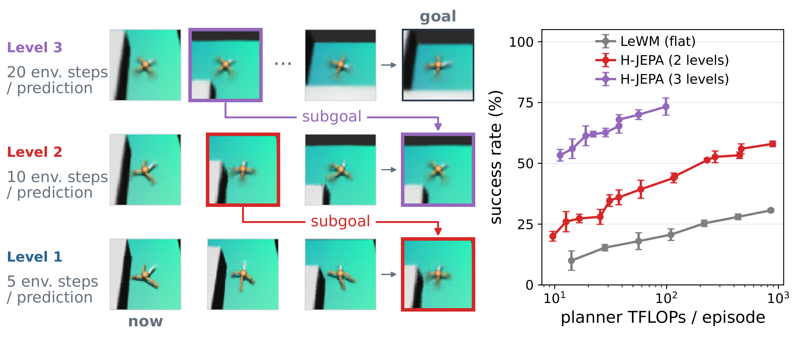
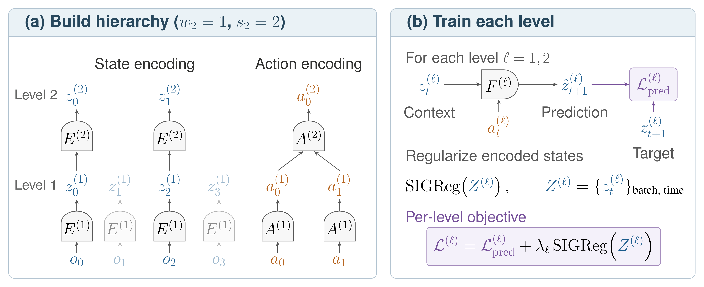
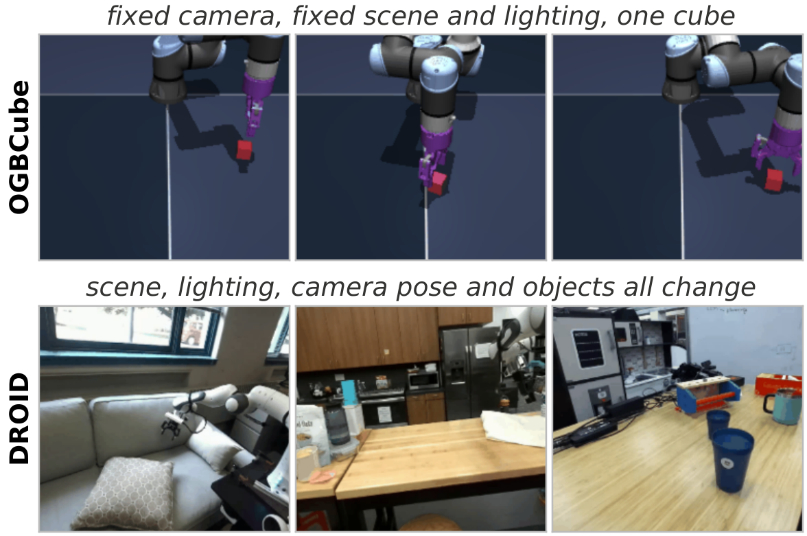
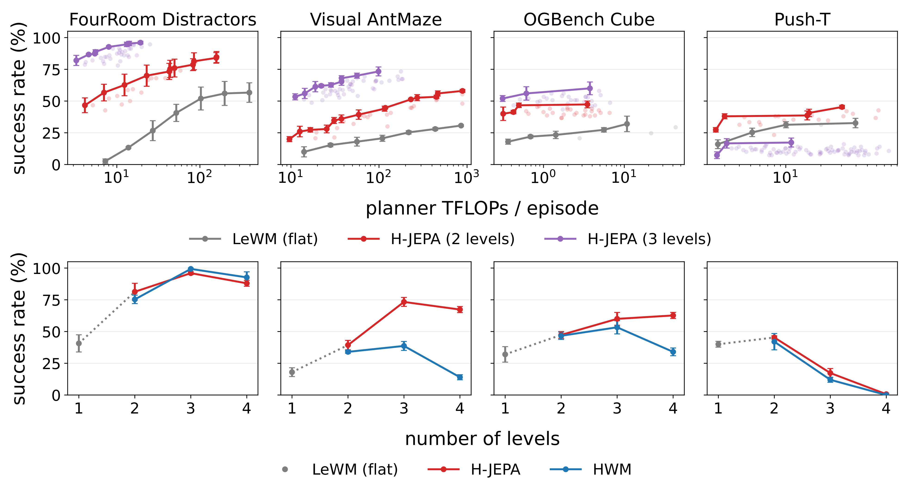
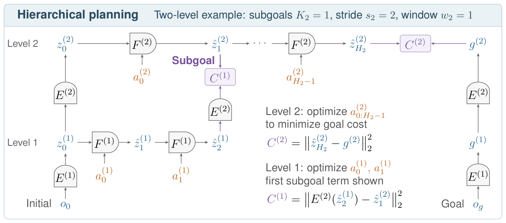
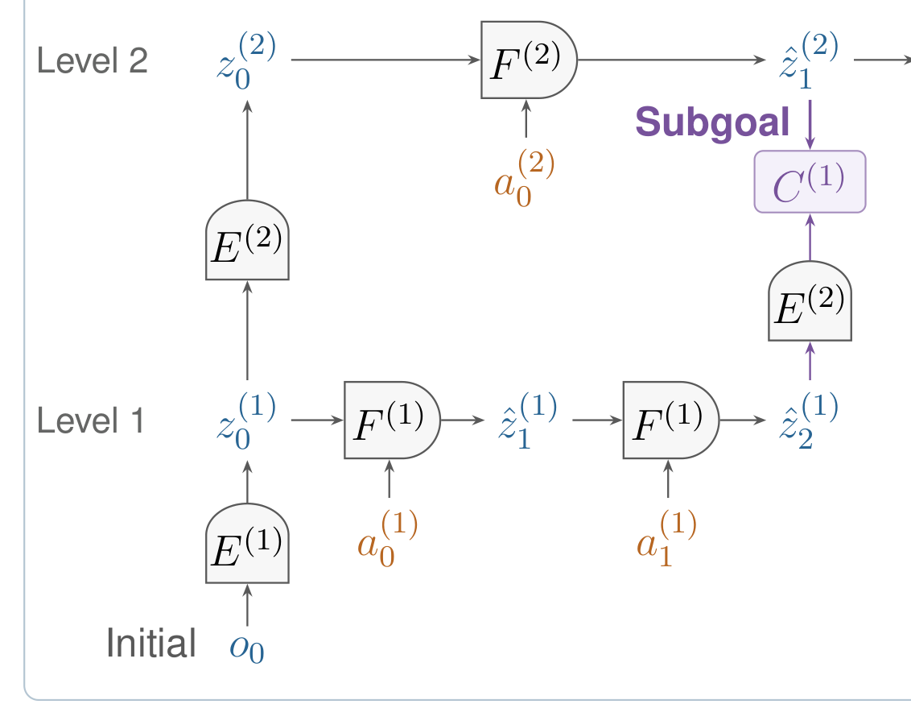

# H-JEPA 精读笔记

> 阅读日期：2026-11-05。以用户提供的 `main_release.tex` 和 `../repository-main/` 为主；arXiv 当前为 2610.06805v2。完整 HTML 讲解稿位于 [../repo/deck.html](../repo/deck.html)，逐页讲稿位于 [../repo/讲稿.md](../repo/讲稿.md)。聊天从第①站开始，本文提前备好全部六站，便于随时查阅。

## 基本情况

- **作者与机构**：Wancong Zhang、Basile Terver、Michael Rabbat、Yann LeCun、Randall Balestriero；NYU、Advanced Machine Intelligence（AMI Labs）、INRIA Paris、Brown University。前两位共同一作，后两位共同指导。`main_release.tex:503–512`。
- **时间与发表状态**：2026-10-05 首次提交，2026-11-01 更新 v2，当前按 arXiv 预印本介绍；不能凭 ICLR 模板认定录用。[arXiv](https://arxiv.org/abs/2610.06805v2)。
- **一句话接口**：当前图像 + 目标图像（AntMaze 另含本体状态）→ 多层 latent 中规划 → 原始动作序列。目标由图像给出，没有语言指令接口。
- **开放材料**：[官方代码](https://github.com/kevinghst/H-JEPA)、[模型权重](https://huggingface.co/jepa-world-models/h-jepa)、[数据](https://huggingface.co/datasets/jepa-world-models/h-jepa)均有公开入口；本轮在线核对页面，未下载训练数据/模型，未运行训练或规划实验。
- **材料**：原始 LaTeX 和双语 Markdown 保留在本目录；补充 PDF、拍平正文、大纲、19 张图和 13 张表在 `../reading/paper/`；代码细查见 [代码审计](../reading/code-audit.md)，论文出处细查见 [论文审计](../reading/paper-audit.md)。

## 导读地图

下表原文行号均指本目录 `main_release.tex`；`reading/paper/paper.tex` 是脚本拍平并展开宏的版本，行号不同。

| 站 | 讲清什么 | 图 | 原文位置 | 对应代码（相对 repository-main） |
|---|---|---|---|---|
| ① 动机 | 长期规划为什么需要不同时间尺度和不同表征 | 图1、图4 | 564–631、1181–1207 | 主配置帮助确认数字 |
| ② 架构 | E、A、F 各自吃什么、吐什么 | 图2 | 803–863、1839–1851 | `h_jepa/models/jepa.py:307`、`h_jepa/models/hjepa.py:239` |
| ③ 训练 | 预测目标、SIGReg、IDM 和梯度 | 图2、图9 | 845–863、1440–1462、1720–1981 | `h_jepa/hjepa_utils.py:55`、`h_jepa/loss.py:13` |
| ④ 数据 | 一条 Ant 训练 clip 如何形成多层时间流 | 图11、图12 | 1654–1717、1739–1766 | `stable_worldmodel/data/dataset.py:128`、`h_jepa/droid_data.py:142` |
| ⑤ 信息流 | 高层子目标如何变成低层动作 | 图3 | 1047–1111、2082–2175 | `h_jepa/hierarchical_solver.py:90`、`stable_worldmodel/solver/gd.py:273` |
| ⑥ 例子 | t=0 与 t=10 两轮 AntMaze 闭环 | 图1、图11 | 2101–2111、2164–2168 | `stable_worldmodel/policy.py:387`、`h_jepa/config/eval/ant_l3.yaml:36` |
| ⑦ 实验 | 提升来自哪里，哪些结论还不能下 | 图4–9、表1 | 1209–1519、2453–2501 | `docs/RESULTS.md`，仅作独立来源 |

## ① 动机：目标是到达位置，为什么还要关心每条腿的姿势？

H-JEPA 要做的是**用学到的世界模型规划动作**。例如给一只四足机器人当前迷宫画面和目标位置的画面，它需要选择动作，绕过墙到达目标。训练数据是历史观察和实际动作；测试时换一对起点/目标，不再为这个目标训练一套策略。



图1左边分三行：底层每预测一步跨 5 个环境步，中层 10 步，顶层 20 步。每行最左是当前状态，最右是该层目标，中间是预测状态；紫色和红色箭头表示“上一层第一个预测状态，作为下一层子目标”。右边比较成功率与每个 episode 的规划计算量。左边的图像是事后训练的 decoder 对 latent 的可视化，规划本身只使用向量。

单层方案有两个不同的困难。

1. **要算得太细、太久。** 若希望往后考虑 100 个环境步，而模型一步跨 5 步，就要串起 20 次预测。误差会积累，待优化动作也多。这个 100 是讲解示意；5 是仿真真实设置。
2. **“像不像目标”不一定等于“离任务完成近不近”。** 到达同一个位置时，腿可能正好处于不同步态。低层需要腿姿来预测下一步，但目标是到位置，并不要求复制目标图片里的腿姿。一个兼顾所有细节的 latent 距离可能混进无关差异。

作者的押注是：让高层在自己的 latent 空间里预测得更远，迫使它选择在这个时间尺度上仍然可预测的信息。在 AntMaze 中，位置慢变、腿姿快变，因此高层有机会保留位置而舍去腿姿细节。低层仍处理短期运动。

这里有条件：**“慢”不天然等于“任务相关”。** 若不同视频的背景各不相同，却在单个视频内保持不动，背景也很慢。后面 DROID 的 IDM 正是处理这个问题。图5还显示，时间频率分离较弱的操作数据并没有明显的选择性抽象。

一句话回顾：**H-JEPA 同时分解“往后看多远”和“用什么信息衡量进度”，然后逐层把远期目标变成可执行动作。**

## ② 架构：每一层都有自己的状态、动作与预测器



图2左半边构造层级，右半边训练每层。蓝色 z 是状态表征，橙色 a 是动作表示。左下的图像向上经过编码器；动作走另一条支路。淡色列仍供 L1 使用，只是 L2 按 stride 跳过它们。

先把两个时间参数分清：

| 符号 | 意义 | 主实验取值 |
|---|---|---|
| sℓ（stride） | 高层相邻状态之间隔多少个下层步 | 仿真2；DROID L2为3 |
| wℓ（window） | 构造一个高层状态时，一次读取多少个下层状态 | 全部实验1 |

因此 `w=1,s=2` 的含义是：

```text
下层状态：z¹₀  z¹₁  z¹₂  z¹₃  z¹₄
上层状态：E²(z¹₀)    E²(z¹₂)    E²(z¹₄)
上层动作：A²(e¹₀,e¹₁) A²(e¹₂,e¹₃)
```

高层状态编码器一次读一个向量，动作编码器才汇总两段动作。这不是把两张图平均，也不是把 latent 维度逐层减半。Ant 三层状态维度均为384，变化的是保留的信息和对应时间跨度。

Ant 三层主配置可按下表理解。参数总量没有在本轮实例化统计，不用猜测的 M/B 数字替代。

| 模块 | 来源/初始化 | 输入 → 输出 | 训练更新 | 用途 |
|---|---|---|---|---|
| L1视觉编码 | ViT-Tiny，从零初始化 | 64×64 RGB → CLS 192 → 投影256 | 是 | 视觉状态 |
| L1本体编码 | MLP，从零初始化 | proprio27 → 128 | 是 | 当前身体状态 |
| L1融合 | 拼接/投影路径 | 256+128 → state384 | 是 | 视觉+身体状态 |
| L2/L3状态 E | latent MLP | 384 → 384，w=1 | 是 | 学到该层表征 |
| L1动作条件 | action_embed MLP | 5×8=40 → 384 | 是 | 给 F1 条件 |
| 上层宏动作 A | 单层 transformer + CLS | 2×384 → macro4 | 是 | 压缩跨步动作效果 |
| 上层动作条件 | action_embed MLP | macro4 → 384 | 是 | 给该层 F 条件 |
| 每层 F | causal transformer | 状态+动作条件 → 下一状态384 | 是 | 预测动力学 |
| decoder/probe | 世界模型训完后另训 | latent → 图像/物理量 | 世界模型冻结 | 检查信息，不进入规划 |

尤其注意：代码中的 `action_encoder` 生成4维可规划宏动作；`action_embed` 再把它变成384维 predictor 条件。不能把4维宏动作解释为真实的四个关节或四种离散技能。出处：`h_jepa/models/jepa.py:344–351`，`config/train/base/ant.yaml:87–129`。

## ③ 训练：让每层预测未来，同时避免“什么都不记”

主训练是一轮联合优化，不是先冻一个预训练视觉模型。每层编码真实轨迹、预测下一状态、得到损失，再把各层损失相加。上层损失能够穿过上层编码器继续更新下层编码器。

```text
ẑˡₜ₊₁ = Fˡ(zˡ≤t, action_embeddingˡ≤t)
Lpredˡ = mean[(ẑˡₜ₊₁ − zˡₜ₊₁)²]
Ltotal = Σˡ [ Lpredˡ + λˡ SIGReg(Zˡ) ]
```

| 符号 | 是什么 | Ant主设置 |
|---|---|---|
| z | 真实图像/状态经过当前编码器所得 | 每个时刻384维 |
| ẑ | predictor 预测的下一状态 | 同样384维 |
| Lpred | 预测与真实未来编码的差 | 代码对元素取MSE |
| λ | 正则权重 | 各层0.09 |
| Z | 用来估计分布的一批状态 | 实现传入[T,B,D] |

**两个数的例子（示意）**：预测 `[0.8,−0.2]`，目标 `[1.0,0.0]`，MSE = `(0.04+0.04)/2 = 0.04`。若该批 SIGReg 为0.30，该层损失就是 `0.04 + 0.09×0.30 = 0.067`。SIGReg 需要一批样本，不能仅由这两个数算出0.30。

为什么不能只用预测损失？若 encoder 把所有输入都映射成零，predictor 永远输出零，预测误差也能为零。SIGReg 从1024个随机方向观察 latent 的投影分布，使其接近标准高斯，阻止这类常量解。它约束样本集合的分布，不是把每个 latent 替换成噪声，也不是简单 L2 正则。

**对照代码的 teacher forcing**（`h_jepa/hjepa_utils.py:77–80,104–123`）：

```python
teacher_pred = jepa.predict(emb[:, :history_size], act_emb[:, :history_size])
tgt_component = component_emb.detach() if level_cfg.wm.get("detach_pred_target") else component_emb
teacher_forcing_loss = F.mse_loss(teacher_pred, tgt_component[:, 1:history_size+1])
```

Ant 的 history_size=3：输入真实编码 z0,z1,z2，因果预测三个目标 z1,z2,z3。`rollout_n=1` 是一步预测目标，不是只训练最后一个转换。主设置不开 `detach_pred_target`，目标支路也有梯度，没有 EMA teacher。论文预测式 `<τ` 与 `τ+1` 的下标存在歧义，这里以代码的相邻切片对齐为准。

主文把 SIGReg 简写成 batch/time 展平；当前实现按 `[T,B,D]` 在每个时刻跨 batch 计算，DROID附录也明确这种分组。不能将两种统计方式混为一谈。

### DROID：只记住背景，也可能预测得非常好



图9(a)上面是背景几乎固定的 Cube，下面是场景差异明显的 DROID。对后一种数据，encoder 可以用很多维度记“这段视频在哪个厨房”，而忽略手臂运动。不同视频 latent 仍很丰富，SIGReg 未必发现问题；同一视频内状态却几乎不变。这叫 slow-feature collapse，区别于全部输入都编码成一个常数。

IDM 增加一项要求：**看相邻两个状态，必须能够还原使它们发生变化的动作。**

```text
Lidmˡ = MSE( Iˡ(zˡₜ,zˡₜ₊₁), stop_gradient(actionˡₜ) )
LDROID = Σˡ [Lpredˡ + λˡ SIGReg(Zˡ) + γˡ Lidmˡ]
         + 0.005 × SIGReg(L2宏动作)
```

L1 的 λ/γ 为0.08/100，L2为0.16/50。上层 IDM 的目标是8维宏动作，标签 detach 防止动作编码器只为降低 IDM loss 去改标签。**它不等于未来状态预测目标 detach，也不表示用 IDM 在规划时解码宏动作。** 主结果未来状态目标仍不 stop-gradient。

| 配方 | Ant三层 | DROID两层 |
|---|---|---|
| 阶段 | 全层从零联合训练 | 主结果全层联合；stagewise用于另一些分析 |
| 每层监督状态数 | 各4，teacher targets各3 | L1为8/7个targets；L2为3/2个targets |
| batch | 128 | 256（README为2GPU×128） |
| 峰值学习率 | L1 5e−5；上层1e−5 | 各层5e−4 |
| epoch | 5 | 100，每epoch292步 |
| 硬件/实测 | 论文写H200；本轮未跑训练 | 同样没有本轮墙钟实测 |

## ④ 数据：一个三层 Ant 样本，是13帧与中间的动作

三层模型顶层需要4个状态。stride2、window1往下展开，L2需要7个，L1需要13个：

```text
原始环境步： 0   5  10  15  20  25  30  35  40  45  50  55  60
L1状态：     ●   ●   ●   ●   ●   ●   ●   ●   ●   ●   ●   ●   ●
L2状态：     ●       ●       ●       ●       ●       ●       ●
L3状态：     ●               ●               ●               ●
```

| 单条样本字段 | 形状 | 来源与含义 |
|---|---|---|
| pixels_level1 | [13,3,64,64] | 第0,5,…,60步RGB；ImageNet归一化 |
| proprio_level1 | [13,27] | qpos去除全局xy后与qvel拼接；z-score |
| action_level1 | [13,40] | 每行依次拼5条8维actuator控制量 |
| 辅助xy/qpos/qvel | 各13个时刻 | probing/分析列，不代表主网络直接读全部辅助量 |
| 语言 | 无 | “走到门口”只是讲解场景描述 |
| 未来标签 | latent而非像素 | 真实未来观测通过同一encoder得到 |

每个8维动作是8个 actuator 的控制量；没有证据把它解释成 `[Δx,Δy,Δz,…]`。例如 `[0.10,−0.05,0.20,0.00,−0.10,0.08,0.03,−0.02]` 只能作为**归一化动作示意**，本轮没有读到真实 HDF5 数值。5条动作依次拼接为40维，不是重复同一条动作5次。

图像端点到60，至少需要61个原始时刻；loader预留65步，以读够最后一个动作块。模型先建立13→7→4的层级状态流，再为各层损失裁成4状态，因此最终三层的 `[B,4,384]` 不是同一组时间点。

训练数据：FourRoom主训练用1.0M transitions；Ant约10.05M的explore/stitch等比混合；Push-T专家轨迹；Cube脚本轨迹。DROID使用动作标注视频，当前发布README列74,896训练CSV条目。论文语料统计与发布清单统计不同，不能把某一数字当作所有版本共用的数据总量。

DROID每个窗口从两路外部相机选一路，处理为256×256、5fps；模型不输入proprio。7维动作为采样后位姿算出的 `[Δxyz,相对旋转xyz欧拉角,Δgripper]`。旋转使用 `R_next R_currentᵀ` 再转Euler，不是简单减三个Euler角。代码：`h_jepa/droid_data.py:30–40,142–170`。

## ⑤ 信息流：上层给一个状态目标，低层自己找动作


图3先从左右两端，把当前图像和目标图像自底向上编码；然后从上往下规划。每个 predictor 横向箭头是“在模型里想象未来”，不是环境已经执行。紫色向下箭头传子目标；低层终点再通过 E2 向上比较，确保两边在同一个 latent 空间。

```text
当前图像 / 目标图像 ──E1→E2→E3──→ 每层当前状态、最终目标（一次编码）

L3候选宏动作 → F3递推 → 到L3最终目标的距离 → 对候选动作反传
                         第一个L3预测 ↓
L2候选宏动作 → F2递推 → E3(预测终点) 与 L3子目标比距离
                         第一个L2预测 ↓
L1候选原动作 → F1递推 → E2(预测终点) 与 L2子目标比距离
                         最低代价候选 ↓
             2块 × 5步 × 8维 → 执行10环境步 → 新真实观测
```

模型参数在规划时固定；反向传播通过 F 和跨层 E 计算动作梯度，AdamW优化器只持有动作张量。**冻结权重不等于切断对输入动作的梯度。** 这与训练时更新 E/A/F 参数是两条不同流程。

两个层级的简化代价（w=1,s=2,K=1）：

```text
顶层：Jtop = ‖预测的顶层终点 − 顶层目标编码‖²
低层：Jlow = ‖Eupper(低层第2步预测) − 顶层第1步预测‖²
```

**示意算一下**：上层子目标为 `[1.0,0.0]`，两个低层动作方案投影后分别是 `[0.8,0.1]` 与 `[0.4,0.3]`。平方距离分别0.05和0.45；前者更接近该子目标。这里的两个坐标是虚构 latent 数，不能读作米。

仿真每层最多90轮动作优化，有早停与多候选；上层宏动作先验来自训练样本队列，初始化与截断限制搜索范围。Ant不加额外跨层动作匹配；Push-T/Cube设置中加了0.2权重的动作匹配，故“只比状态”是主干，不是所有配置的完整代价。

训练用teacher-forced真实状态，规划用自回归预测状态。训练Ant context=3，当前规划代码每步context=1，也没有证据支持跨轮持久KV cache。参见 `models/jepa.py:376–413`。

DROID是另一种执行协议：一次规划36个L1步，覆盖7.2秒；L2的12个子目标全部参与低层匹配，β=0.5，没有每10步获取新观测的循环。这些动作在本论文评估中离线评分。

## ⑥ 两轮 AntMaze 例子：从隔墙左边走向门口

场景、具体动作数为示意；形状、时间尺度、候选数量来自 `config/eval/ant_l3.yaml` 和 solver。中文任务句不是模型的语言输入。

### t=0：第一次规划

1. **拿到实测输入**：当前RGB `[1,1,3,64,64]`、proprio `[1,1,27]`；另有目标对应字段。两端都编码出三份 `[1,1,384]` 状态。
2. **L3看远处**：400个候选，每个5个4维宏动作，形状约 `[1,400,5,4]`。每步跨20环境步，初始规划覆盖100环境步。选出代价最低的候选，其第一个预测状态相当于20步尺度的子目标。
3. **L2细化前缀**：100个候选 `[1,100,2,4]`，两步各10环境步；终点经E3映射后追踪L3子目标。把L2第一个预测状态作为10步尺度的子目标给L1。
4. **L1给出动作**：100个候选 `[1,100,2,40]`。最终取 `[1,2,40]`，展开成 `[1,10,8]`，执行10个环境步。

这一刻最关键的是：L3和L2想象得比较远，但环境只执行L1输出的动作。图中“门口”子目标的解码图只是解释向量的办法；planner不需要把向量先解码成图片。

### t=10：第二次规划

动作缓存用完，重新读相机和本体状态。假设实际比第一轮预测偏右一点，第二轮必须从这个实测位置出发。重新走 E1→E2→E3，再走 L3→L2→L1，求下一批10步动作。上一轮想象的状态不会冒充新观测。

```python
# 逻辑摘录，具体实现见 stable_worldmodel/policy.py:387–430
if 动作缓存为空:
    计划 = 分层规划(当前实测观测, 目标)
    动作缓存 = 计划的前两个L1块.reshape(10, 8)
执行下一条原始动作
```

这里用中文伪代码展示流程，非可直接执行代码。真实 solver 会按剩余episode预算缩短horizon；Ant YAML中L1配置H=4，不代表初轮真的算4步，`pre_decay_horizon=2`使初轮实际H3/H2/H1为5/2/2。高层horizon降到1时会跳过，不能画成所有轮次都固定调用三层。

整条链：**当前实测 → 多层编码 → 候选动作 → latent预测 → 代价与动作梯度 → 上层子目标 → 低层动作 → 执行10步 → 新实测 → 重规划。**

## ⑦ 实验、局限与证据边界



图6上排是规划计算量扫描，下排是独立最终任务集的深度比较。下排最终深度比较每个环境50个起点/终点任务，3个模型种子及配对planner种子，误差条为SE。这里是论文结果，不是本轮复现实测。

| 结果 | 数字 | 含义 |
|---|---|---|
| AntMaze，LeWM→三层H-JEPA | 18.0±3.5% → 73.3±3.5% | 长期导航明显获益 |
| 同样三层Ant，HWM→H-JEPA | 38.7±3.5% → 73.3±3.5% | 学到不同表征空间有额外作用 |
| 三层Ant，仅L1规划换代价空间 | 16.7±1.8% → 22.0±2.3% | 高层距离有帮助，但不能解释完整73.3% |
| Push-T，两层→三层→四层 | 45.3% → 17.3% → 0.7% | 深度不是越大越好 |

Native L1=16.7%来自三层模型的底层，不是独立LeWM=18%的另一种写法。HWM对照是同实现中把高层encoder改成identity，用来隔离时间分层和表征分层。

**四层结果有材料内部不一致。** 本地TeX表格宏给Ant63.3±7.7、FourRoom80.0±4.0、Cube55.3±4.4；图6图形与仓库 `docs/RESULTS.md` 分别约为67.3±2.4、88.0±2.3、62.7±2.4。目前没有证据把差异解释为不同实验条件；讲解主结论使用一致的一至三层值。详见论文审计末尾。

DROID的指标为：

```text
fidelity = 1 − dF(计划xyz路径, 专家xyz路径) / dF(零动作路径, 专家xyz路径)
```

例如分母0.20米、分子0.08米，得到60%保真度。它不是60%成功率。只评分末端xyz轨迹，没有直接量到抓住物体、夹爪接触、碰撞等执行结果。论文仅16个选择的离线clip，真实机器人闭环明确是未来工作。仓库结果表给33.57/35.65/38.42%（LeWM+IDM/HWM/H-JEPA），这些是仓库记录，不能与图9估读数混成精确同一来源。DROID候选数论文表8为16/16，当前YAML为16/4，也要按来源分开。

局限应连着结论一起读：

- 高层舍弃快变细节依赖数据的时间尺度分离；慢背景也可能被优先保留，IDM提供动作相关约束。
- 层数越多，要求越长训练clip；Push-T四层有效clip约为单层14%。epoch相同不等于训练steps或FLOPs相同。
- 本轮核对的[公开数据卡](https://huggingface.co/datasets/jepa-world-models/h-jepa)说明：FourRoom部分validation/probing文件是training文件的前缀；DROID监测val64条有62条在训练清单中，但规划用16条已排除。这些计数来自发布说明，未本地逐条比对；不能把监测validation当作完全独立泛化证据。
- 输入依赖动作标注轨迹与目标图像；无动作视频训练、语言目标、多视角/腕部相机和真机闭环均不是本轮证实的能力。

## 易混点速查

| 容易误读 | 应当怎么理解 |
|---|---|
| 高层就是多帧平均 | 主实验w=1；状态逐点变换，动作跨步聚合 |
| 高层维度更少才叫抽象 | Ant各层都是384维；信息可恢复性改变 |
| 图里的未来画面是视频生成输出 | 是后训decoder可视化latent；主训练没有像素重建 |
| IDM把宏动作翻译成原动作 | IDM是训练约束；低层动作由规划器重新优化 |
| 推理反传就是在线训练模型 | 规划优化的是候选动作；模型权重固定 |
| 所有JEPA都有EMA与stop-grad | 本篇主设置没有；不要套用其他JEPA配方 |
| 训练history3，部署必看3帧 | 当前规划每层每步context1 |
| DROID保真度等于任务成功率 | 离线路径相似指标，不是闭环成功 |

## 问答与阅读进度

- 用户要求按 `kelip-paper-reading` 详细阅读，并用 `kelip-slide` 制作HTML。
- 用户指定HTML根目录为 `repo/`；入口 `repo/deck.html`。材料来源仍保留在原目录。
- 聊天已讲①动机、②架构；下一站③训练与损失。完整六站笔记和逐页讲稿已预先整理。
- ②重点：同层编码器跨时间共享参数；上层状态窗口w=1与时间步长stride=2分开理解；状态384维、宏动作4维与动作条件384维是不同对象；F预测未来状态，动作由规划器搜索。

### 2026-11-05：Fig. 2(b) 的训练信息流

- **问题**：给我详细解释一下 fig2(b)。
- **图**：右侧面板已单独从原图 PDF 渲染为 [Fig. 2(b)](../reading/paper/figures/fig-02-b.png)。
- **核心**：每层用真实轨迹的当前/历史状态编码及对应动作预测同层的下一状态编码；预测误差与 SIGReg 相加，各层损失再求和进行联合优化。
- **Target 来源**：L1 的 target 是 `E¹(oₜ₊₁)`。图示 `w₂=1,s₂=2` 时，L2 从 `E²(E¹(o₀))` 出发，以聚合两个 L1 动作的宏动作为条件，预测 `E²(E¹(o₂))`。target 来自真实未来观测的编码，不来自低层 predictor 的预测，也不来自规划时的高层子目标。
- **时间对齐**：L2 的 `z²₁` 对应 L1 的 `z¹₂`。各层的“下一步”使用各自的时间网格；仿真设置 L1 一步为5环境步，L2 一步为10环境步。
- **Teacher forcing**：仿真每层取4个真实编码状态，输入 `z₀,z₁,z₂`，因果地分别预测 `z₁,z₂,z₃`；预测第2个目标时上下文包含真实 `z₁`。图把这个历史前缀简画成一个 `zₜ`。见 `../repository-main/h_jepa/hjepa_utils.py:77–80,115–123`。
- **梯度**：主设置无 prediction-target stop-gradient、无 EMA teacher。预测误差通过预测支路和目标支路更新编码器。L2 损失可以更新 E2 和 E1，以及预测支路中的动作编码器；并不因此经过 F1，因为 L2 的输入由真实观测编码而来。见 `main_release.tex:1853–1857` 与 `../repository-main/h_jepa/models/hjepa.py:239–270`。
- **SIGReg**：约束一批编码状态的分布，防止所有输入映射到同一个常量。随机单位方向投影后，用 Epps–Pulley 统计量比较投影分布与标准高斯；主设置1024个方向。它不向每个 latent 注入噪声，也不保证保留动作相关信息。DROID 另需 IDM 等项，图2(b)只展示基础目标。
- **图文与实现细节**：主文把 Z 写成 batch/time 展平；当前实现传入 `[T,B,D]`，每个时间位置跨 batch 做正态性检验，再平均，附录 K 与此一致。见 `../repository-main/h_jepa/hjepa_utils.py:137–145`、`../repository-main/h_jepa/loss.py:28–47`。
- **数值示意**：预测 `[0.8,-0.2]`、目标 `[1,0]`，平方距离0.08，按代码对维度平均的 MSE 为0.04。若批量 SIGReg 假设为0.30，采用 Ant 的 λ=0.09，该层损失为0.067。0.30是示意输入，并非由一对向量算得。

### 2026-11-05：SIGReg 是什么？

- **全称与来源**：Sketched Isotropic Gaussian Regularization，随机投影的各向同性高斯正则化，来自 [LeJEPA](https://arxiv.org/abs/2511.08544)。H-JEPA 将它加入每层状态预测损失。
- **直觉**：只优化预测误差时，编码器可以把所有输入变成同一个常量，预测器输出相同常量即可得到零误差。SIGReg 对一批样本的编码分布施加约束，鼓励接近标准多维高斯 N(0,I)，排除常量及低维坍塌的目标分布。
- **Sketched 的含义**：把 D 维向量沿随机单位方向投影到1维，比较投影分布与 N(0,1)，再对许多方向平均。H-JEPA 默认1024个方向，用 Epps–Pulley 统计量比较经验特征函数与标准高斯特征函数。
- **二维示意**：四个向量 `(-2,-2),(-1,-1),(1,1),(2,2)` 虽然互不相同，却全在一条线上。沿 `u=(1,-1)/√2` 投影得到四个零，因此存在完全没有变化的方向；随机投影检验能约束这种问题。
- **边界**：有限批量和有限方向只提供近似的分布约束。它不要求每个向量内部的分量单独通过正态性检验，不向 latent 注入噪声，也不单独保证学到任务相关信息；预测损失与 DROID 的 IDM 另行提供动态约束。

### 2026-11-05：详细讲解 Fig. 3



- **任务**：使用训练好的层级世界模型，从当前观测和目标观测出发搜索动作。与 Fig. 2 的训练不同，此时优化变量是候选动作，模型权重保持不变。
- **读图顺序**：左右两列自底向上编码当前/目标观测；上排从左向右用 F2 展开高层未来，优化宏动作使末端接近 g2；中间把第一高层预测作为子目标；下排用 F1 搜索可执行动作，预测两步后通过 E2 转到高层空间，计算与子目标的距离。
- **参数**：图示 K2=1、s2=2、w2=1，所以 H1=K2*s2+w2-1=2。H2 是高层向前规划的步数，K2 是这一轮交给低层跟踪的子目标数量。K2=1 不表示高层只规划一步。
- **目标编码**：`g1=E1(og), g2=E2(g1)`；当前编码同理。各处同名 E2 共用权重。右侧 g1 在该图中是计算 g2 的中间结果；低层当前追踪的是高层第一预测。
- **高层动作来源**：优化器初始化多组候选宏动作序列，通过 F2 自回归展开、计算 C2、求动作梯度后迭代修改。F2 输入状态和动作，不直接读取目标；目标通过规划代价指导动作搜索。训练期动作编码器学出的宏动作空间在这里被搜索，主图不表示存在宏动作到原始动作的逆解码器。
- **两项代价**：`C2=||ẑ²_H2-g²||²`；固定高层选定的子目标后，`C1=||E2(ẑ¹_2)-ẑ²_1||²`。C1 标号指“给第一层动作优化用的代价”，实际距离在第二层表示空间计算。C1、C2 是距离计算，不是单独训练的网络。
- **中间连接放大**：
- **为什么再用 E2**：先对齐时间，第二层一步等于第一层两步；再对齐空间，即使两层维度都为384，也必须将低层预测映射到高层表示空间。低层选择自己的动作来实现抽象子目标，不要求复制上层没有保留的细节。
- **数值示意**：固定高层子目标 `[1,0]`，两组低层动作的预测经 E2 后分别为 `[0.8,0.1]` 与 `[0.4,0.3]`，平方距离分别0.05与0.45，前者代价更低。向量是讲解示意，无米或关节角的直接含义。
- **梯度**：低层路径为 `动作 -> F1展开 -> E2 -> C1`；反向传播计算动作梯度。固定模型权重仍允许对输入求导。上层优化完成后传下来的预测被 detach，低层求解不会同时改动上层已选子目标。见 `../repository-main/stable_worldmodel/solver/gd.py:315–358,136–157`、`../repository-main/h_jepa/models/jepa.py:420–436`。
- **执行与下一轮**：只有第一层输出的原始动作进入环境。仿真执行两个第一层动作块（10个环境步）后重新读真实观测并重规划。预测状态不能冒充下一轮真实观测。Ant 当前两层配置中高层初始 H2=9、宏动作4维；低层初始 H1=2、每块5×8=40个原始动作分量，输入 F 前另经动作嵌入。
- **一般情况与实现边界**：K>1 时式(6)增加中间子目标代价并用 beta 加权。当前闭环代码在高层 horizon 降到1时跳过该层；Push-T/Cube 还包含额外动作匹配项，图3只画基本状态匹配过程。本轮未运行规划实验。
- **代码对应**：高层到低层的求解顺序 `../repository-main/h_jepa/hierarchical_solver.py:118–216`；低层预测投影到高层 `:405–485`；动作更新 `../repository-main/stable_worldmodel/solver/gd.py:315–358`；执行与重规划 `../repository-main/stable_worldmodel/policy.py:403–438`。
