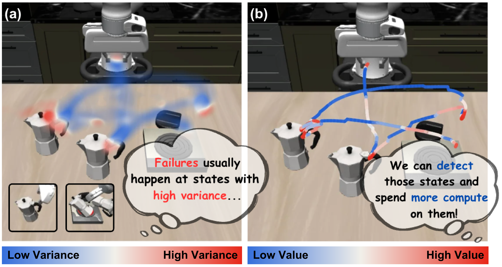
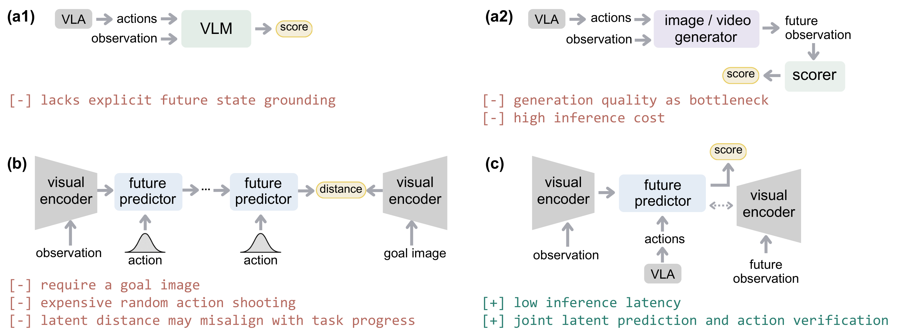
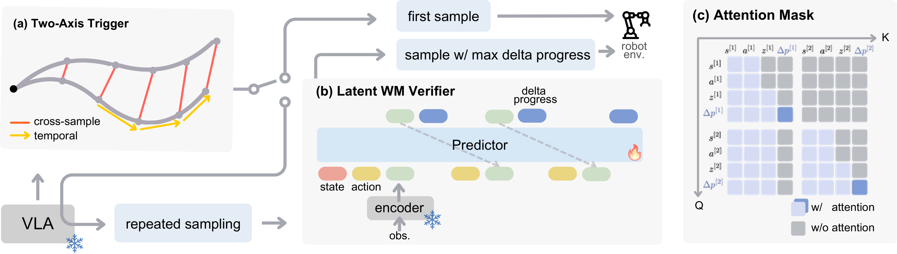
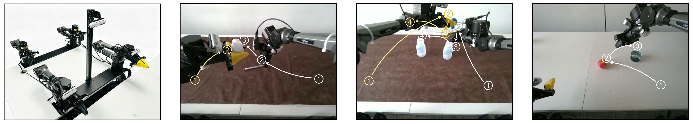
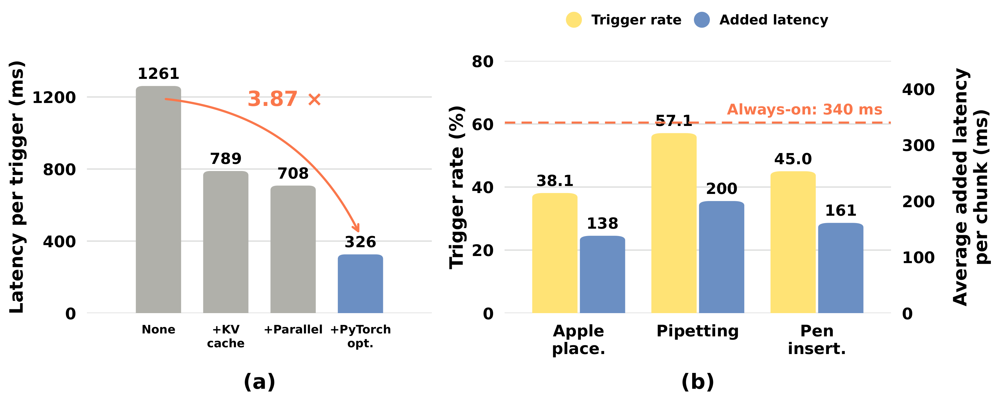
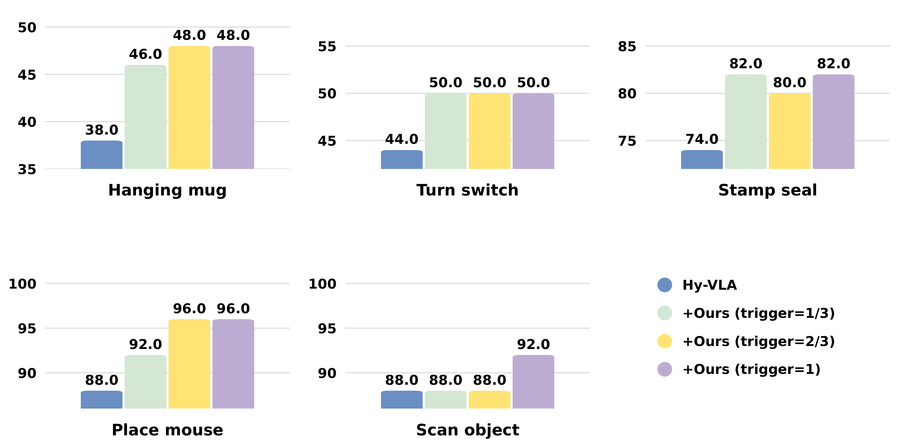
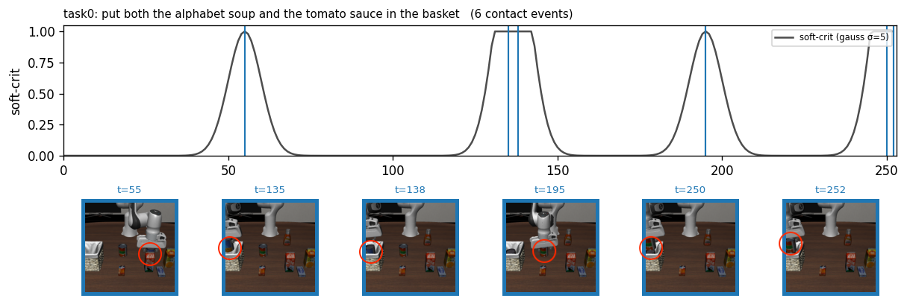
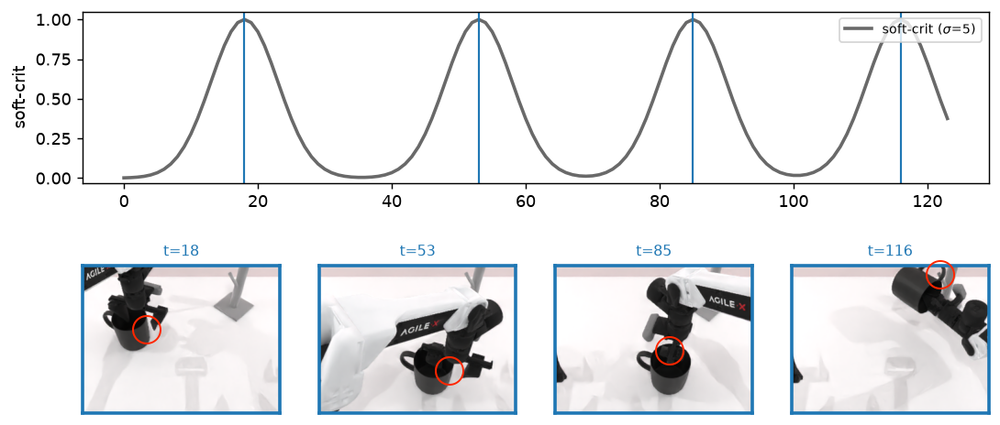

# VeriVLA: Adaptive Test-Time Verification for Flow-Based VLAs with Latent World Models

**VeriVLA：利用潜在世界模型对基于流的 VLA 进行自适应测试时验证**

Xueli Sun, Yuxiang Lu, Yantong Liu, Xianzhe Fan, Xi Chen, Zhe Liu†, Hengshuang Zhao*

The University of Hong Kong

香港大学

*Corresponding author. †Project lead.

*通讯作者。†项目负责人。

## Abstract

**摘要**

Flow-based Vision-Language-Action (VLA) policies are inherently stochastic: different noise seeds can produce action chunks of varying quality from the same observation. At test time, however, the policy typically commits to a single sample without an explicit estimate of its quality. In fine-grained manipulation, executing a suboptimal action can irreversibly disrupt task progress and lead to failure. To exploit policy stochasticity, we introduce a training-free two-axis trigger that uses two initial samples to measure within-chunk temporal variation and cross-sample variance, detecting the critical states. Once triggered, a JEPA-based latent world model ranks candidate action chunks by predicting action-conditioned future latent states and the corresponding changes in task progress. By operating in latent space, the verifier avoids pixel reconstruction and enables efficient and more accurate ranking. Across three real-world tasks (*i.e.*, pen insertion, pipetting, and apple placement), our method raises the average completion score from 50.8% to 65.5%, while adding 326 ms for sampling and verification per triggered decision on a single RTX 4090. Consistent gains are also observed in simulation, where the average success rate rises from 66.4% to 73.6% in the clean setting of RoboTwin 2.0, from 62.8% to 69.6% in its randomized setting, and from 96.9% to 97.6% on LIBERO. Project page: [https://shirley430316.github.io/projects/verivla/](https://shirley430316.github.io/projects/verivla/).

基于流的视觉—语言—动作（VLA）策略本质上具有随机性：对于同一观测，不同的噪声种子可以生成质量各异的动作块。然而，在测试时，策略通常直接采用一个样本，而不显式估计其质量。在精细操作中，执行次优动作可能不可逆地破坏任务进展并导致失败。为了利用策略的随机性，我们引入了一种无需训练的双轴触发器，利用两个初始样本衡量动作块内部的时间变化与跨样本方差，从而检测关键状态。一旦触发，基于 JEPA 的潜在世界模型便通过预测以动作为条件的未来潜在状态及相应的任务进度变化，对候选动作块进行排序。验证器在潜在空间中运行，避免了像素重建，能够实现高效且更准确的排序。在三项真实世界任务（*即*插笔、移液和苹果放置）中，我们的方法将平均完成得分从 50.8% 提升至 65.5%，同时，在单张 RTX 4090 上，每次触发决策的采样与验证增加 326 ms 延迟。在仿真中也观察到一致的提升：RoboTwin 2.0 的干净设置下，平均成功率从 66.4% 升至 73.6%；随机化设置下，从 62.8% 升至 69.6%；LIBERO 上则从 96.9% 升至 97.6%。项目主页：[https://shirley430316.github.io/projects/verivla/](https://shirley430316.github.io/projects/verivla/)。

## 1 Introduction

**1 引言**

Vision-Language-Action (VLA) models have emerged as a promising paradigm towards general robotic control [[6]](#ref-brohan2023rt1roboticstransformerrealworld), [[22]](#ref-kim2024openvlaopensourcevisionlanguageactionmodel), [[4]](#ref-black2024pi0visionlanguageactionflowmodel). In the pretraining stage, the field has evolved from VLMs autoregressively generating over discretized action tokens [[54]](#ref-brohan2023rt2visionlanguageactionmodelstransfer), [[22]](#ref-kim2024openvlaopensourcevisionlanguageactionmodel), [[38]](#ref-pertsch2025fastefficientactiontokenization) to more recent flow-matching action experts coupled with pretrained VLMs [[36]](#ref-nvidia2025gr00tn1openfoundation), [[4]](#ref-black2024pi0visionlanguageactionflowmodel), [[19]](#ref-intelligence2025pi05visionlanguageactionmodelopenworld), enabling scalable learning from diverse action trajectories. The paradigm shift was foreshadowed by diffusion-based visuomotor policies [[10]](#ref-chi2024diffusionpolicyvisuomotorpolicy), which established iterative denoising as an effective means of learning multi-modal (*i.e.*, multi-peaked) action distributions. However, the stochasticity that benefits learning also introduces a unique challenge at deployment.

视觉—语言—动作（VLA）模型已成为实现通用机器人控制的一种有前景的范式 [[6]](#ref-brohan2023rt1roboticstransformerrealworld), [[22]](#ref-kim2024openvlaopensourcevisionlanguageactionmodel), [[4]](#ref-black2024pi0visionlanguageactionflowmodel)。在预训练阶段，该领域从由 VLM 自回归生成离散动作 token [[54]](#ref-brohan2023rt2visionlanguageactionmodelstransfer), [[22]](#ref-kim2024openvlaopensourcevisionlanguageactionmodel), [[38]](#ref-pertsch2025fastefficientactiontokenization)，发展到近期将流匹配动作专家与预训练 VLM 相结合 [[36]](#ref-nvidia2025gr00tn1openfoundation), [[4]](#ref-black2024pi0visionlanguageactionflowmodel), [[19]](#ref-intelligence2025pi05visionlanguageactionmodelopenworld)，从而能够利用多样的动作轨迹进行可扩展的学习。基于扩散的视觉运动策略 [[10]](#ref-chi2024diffusionpolicyvisuomotorpolicy) 已预示了这一范式转变，它们确立了迭代去噪作为学习多模态（*即*多峰）动作分布的有效手段。然而，这种有益于学习的随机性也给部署带来了独特的挑战。

Figure 1. **(a) Policy variance in the LIBERO environment.** Repeated sampling reveals higher action variance in contact-rich regions, where task failures are most likely to occur. **(b) Values of the proposed trigger.** The trigger value aligns with task difficulty and the policy's internal uncertainty. These observations motivate triggering repeated sampling and verification at critical decision steps.

图 1. **(a) LIBERO 环境中的策略方差。** 重复采样揭示出接触密集区域具有更高的动作方差，而这些区域最容易发生任务失败。**(b) 所提出触发器的数值。** 触发值与任务难度及策略内部的不确定性相一致。这些观察促使我们在关键决策步骤触发重复采样与验证。

Figure 2. **Conceptual comparison between different paradigms.** **(a1) Sampling-and-selection with VLM:** Directly predict the delta progress with the current observation and the action chunk produced by VLAs. **(a2) Sampling-and-selection with generative models:** Extract the delta progress after generating the estimated future. **(b) Model Predictive Control (MPC) with latent world models:** Execute action(s) that minimize the latent distance with the goal image. **(c) Latent world model verifier (ours):** Estimate the future latent and the delta progress in a unified latent space.

图 2. **不同范式的概念比较。** **(a1) 使用 VLM 的采样与选择：** 根据当前观测及 VLA 生成的动作块，直接预测进度增量。**(a2) 使用生成模型的采样与选择：** 生成所估计的未来后，再提取进度增量。**(b) 使用潜在世界模型的模型预测控制（MPC）：** 执行使其与目标图像之间的潜在距离最小的动作。**(c) 潜在世界模型验证器（本文方法）：** 在统一的潜在空间中估计未来潜在表示与进度增量。

Given the same observation and instruction, different noise seeds yield samples of different quality during inference. However, the flow-based VLA model cannot distinguish which action chunk is most likely to succeed. During execution, a robot must commit to one sampled action chunk, which may irreversibly change the physical world. A good action chunk advances the task, while a poor one could directly lead to failure or accumulate errors that drift the trajectory out of distribution [[40]](#ref-ross2011reductionimitationlearningstructured), [[30]](#ref-liu2026streampi), [[31]](#ref-lu2026faster). We empirically show that the policy variance is non-uniform along the task, and failures tend to happen in high-variance segments of the action trajectory, as in Figure 1(a). What if we could detect these critical moments before committing to an irreversible action, and briefly “rewind” the decision by spending additional computation? This calls for two components: a trigger that decides *when* the states are critical and additional computation is worthwhile, and a verifier that determines *which* sampled action should be executed.

在给定相同观测和指令的情况下，不同噪声种子会在推理过程中产生不同质量的样本。然而，基于流的 VLA 模型无法分辨哪个动作块最有可能成功。执行时，机器人必须采用一个采样得到的动作块，而这可能不可逆地改变物理世界。好的动作块会推进任务，差的动作块则可能直接导致失败，或积累误差，使轨迹偏离训练分布 [[40]](#ref-ross2011reductionimitationlearningstructured), [[30]](#ref-liu2026streampi), [[31]](#ref-lu2026faster)。我们通过实验证明，策略方差沿任务过程并不均匀，失败往往发生在动作轨迹中方差较高的片段，如图 1(a) 所示。如果我们能够在执行不可逆动作前检测这些关键时刻，并通过投入额外计算来短暂地“回退”决策，会怎样？这需要两个组件：触发器决定*何时*状态是关键的、值得增加计算；验证器决定应执行*哪个*采样动作。

To answer the first question, we start with the policy's uncertainty. As shown in Figure 1(a), when the end-effector is close to a contact-rich interaction region, the trajectory follows a more complex motion [[37]](#ref-pang2023globalplanningcontactrichmanipulation), and internally, the policy uncertainty increases. We therefore combine temporal action variation and cross-sample uncertainty into a training-free two-axis trigger. Computed with two sampled action chunks, the trigger closely tracks the contact information from the environment and aligns well with the policy's intrinsic uncertainty, as shown in Figure 1(b). We therefore use the trigger to activate repeated sampling and verification at critical decision steps.

为回答第一个问题，我们从策略的不确定性出发。如图 1(a) 所示，当末端执行器接近接触密集的交互区域时，轨迹会呈现更复杂的运动 [[37]](#ref-pang2023globalplanningcontactrichmanipulation)，策略内部的不确定性也随之增加。因此，我们将动作的时间变化与跨样本不确定性相结合，构建了一个无需训练的双轴触发器。该触发器由两个采样动作块计算而得，能够紧密跟踪环境中的接触信息，并与策略的内在不确定性良好对齐，如图 1(b) 所示。因此，我们利用这一触发器，在关键决策步骤启动重复采样与验证。

Once repeated sampling is activated, the second question arises: how should candidate actions be evaluated? We argue that latent world models are a natural fit. The verifier evaluates the quality of action chunk samples by predicting the progress or relative ranking [[23]](#ref-kwok2025robomonkeyscalingtesttimesampling), [[11]](#ref-fan2026dreamavoidcriticalphasetesttimedreaming). Therefore, the model must understand world dynamics and represent the future states resulting from executing the action chunk. In addition, verification is a low-dimensional problem: how much an action chunk advances the task is a scalar judgment, and most camera pixels are irrelevant to it. As a result, pixel-level world models have two pitfalls: (1) the image or video generation incurs substantial latency, making it difficult to deploy at real-time control frequencies; and (2) they solve the harder pixel generation before the easier progress estimation, making the quality of downstream verification unnecessarily dependent on generation fidelity. We compare these paradigms in Figure 2. This motivates verification in a latent space, which compresses the pixel observation into compact and dynamic-rich features, where we can jointly predict the latent states and task progress.

一旦启动重复采样，第二个问题便随之而来：应如何评估候选动作？我们认为潜在世界模型天然适合这一任务。验证器通过预测进度或相对排序来评估动作块样本的质量 [[23]](#ref-kwok2025robomonkeyscalingtesttimesampling), [[11]](#ref-fan2026dreamavoidcriticalphasetesttimedreaming)。因此，模型必须理解世界动力学，并表示执行动作块后产生的未来状态。此外，验证是一个低维问题：动作块对任务的推进程度是一个标量判断，而大多数相机像素都与此无关。因此，像素级世界模型存在两个问题：(1) 图像或视频生成会带来显著延迟，难以在实时控制频率下部署；(2) 它们先解决较难的像素生成，再解决较容易的进度估计，使下游验证质量不必要地依赖生成保真度。我们在图 2 中比较了这些范式。这促使我们在潜在空间中进行验证，将像素观测压缩为紧凑且富含动力学信息的特征，并在其中联合预测潜在状态与任务进度。

Building on these observations, we recast action randomness not as a hazard to be suppressed but as a resource to select from, with the latent world model as a verifier. Specifically, we claim the following contributions:

基于这些观察，我们将动作随机性重新视为可供选择的资源，而非需要抑制的风险，并以潜在世界模型作为验证器。具体而言，本文的贡献如下：

1. **A latent world model as a verifier.** We exploit the action-conditioned latent representation produced by a pretrained latent world model to estimate the progress of candidate action chunks.

   **将潜在世界模型用作验证器。** 我们利用预训练潜在世界模型生成的、以动作为条件的潜在表示，估计候选动作块带来的进度。

2. **An empirical characterization of policy stochasticity in flow-based VLAs and the two-axis trigger.** We characterize policy stochasticity. Leveraging the temporal action variation and the cross-sampling variance, we propose a two-axis trigger that is action-based and training-free. It detects the critical states and reduces inference costs while preserving the benefits of test-time selection.

   **对基于流的 VLA 中的策略随机性进行实证刻画，并提出双轴触发器。** 我们刻画了策略随机性。利用动作的时间变化及跨采样方差，我们提出了一种基于动作且无需训练的双轴触发器。它可以检测关键状态，在保留测试时选择收益的同时降低推理成本。

3. **A simple training, evaluation, and real-robot deployment pipeline.** On real-world manipulation tasks, each triggered round of repeated sampling and verification adds 326 ms of latency. Our method improves the average completion score by 14.7 percentage points over the base policy, outperforming baselines, including VLM-based verifiers and pixel-level world model verifiers.

   **简洁的训练、评估及真实机器人部署流程。** 在真实世界操作任务中，每轮触发的重复采样与验证增加 326 ms 延迟。与基础策略相比，我们的方法使平均完成得分提高了 14.7 个百分点，优于包括基于 VLM 的验证器和像素级世界模型验证器在内的基线。

## 2 Related Work

**2 相关工作**

**Test-time Enhancement for VLAs.**

**VLA 的测试时增强。**

Existing approaches can be broadly categorized according to whether the VLA policy is updated at deployment time. Test-time training methods, such as EVOLVE-VLA [[3]](#ref-bai2025evolvevlatesttimetrainingenvironment) and TT-VLA [[29]](#ref-liu2026ontheflyvlaadaptationtesttime), perform online policy optimization during deployment using dense reward signals. Rather than relying on external reward estimation, T$^2$VLA [[9]](#ref-chen2026trustinstinctsconfidencedriventesttime) derives intrinsic rewards from the policy's own confidence to enable self-supervised adaptation.

现有方法大致可按部署期间是否更新 VLA 策略进行分类。EVOLVE-VLA [[3]](#ref-bai2025evolvevlatesttimetrainingenvironment) 和 TT-VLA [[29]](#ref-liu2026ontheflyvlaadaptationtesttime) 等测试时训练方法，在部署期间利用密集奖励信号进行在线策略优化。T$^2$VLA [[9]](#ref-chen2026trustinstinctsconfidencedriventesttime) 则不依赖外部奖励估计，而是从策略自身的置信度中提取内在奖励，实现自监督适应。

Another line of work keeps the pretrained VLA policy frozen and improves action quality through either gradient-free selection or gradient-based augmentation. Gradient-free methods [[46]](#ref-xu2026vgasvalueguidedactionchunkselection) generally adopt a repeated-sampling-and-selection strategy where a model-based verifier evaluates candidate actions. RoboMonkey [[23]](#ref-kwok2025robomonkeyscalingtesttimesampling) uses a VLM-based verifier to select the optimal action, demonstrating a test-time scaling law of autoregressive VLAs. GPC-RANK [[39]](#ref-qi2026inferencetimeenhancementgenerativerobot) employs a lightweight pixel-generation model with a downstream estimator to rank candidate actions. DreamAvoid [[11]](#ref-fan2026dreamavoidcriticalphasetesttimedreaming) combines a pretrained foundation-level, action-conditioned video generation model with an estimator and introduces a vision-based trigger to reduce computational overhead. In contrast, gradient-based methods such as Guided Action Flow [[47]](#ref-yang2026guidedactionflowqguided) backpropagate gradients from the verifier score to refine sampled actions.

另一类工作保持预训练 VLA 策略冻结，通过无梯度选择或基于梯度的增强来改善动作质量。无梯度方法 [[46]](#ref-xu2026vgasvalueguidedactionchunkselection) 通常采用重复采样与选择策略，由一个基于模型的验证器评估候选动作。RoboMonkey [[23]](#ref-kwok2025robomonkeyscalingtesttimesampling) 利用基于 VLM 的验证器选择最优动作，展示了自回归 VLA 的测试时扩展规律。GPC-RANK [[39]](#ref-qi2026inferencetimeenhancementgenerativerobot) 将轻量级像素生成模型与下游估计器结合，对候选动作进行排序。DreamAvoid [[11]](#ref-fan2026dreamavoidcriticalphasetesttimedreaming) 将预训练的基础级动作条件视频生成模型与估计器相结合，并引入基于视觉的触发器，以减少计算开销。相比之下，Guided Action Flow [[47]](#ref-yang2026guidedactionflowqguided) 等基于梯度的方法，将验证器得分的梯度反向传播，以改进采样动作。

In this work, we follow the repeated-sampling-and-selection paradigm. Unlike prior verifier-based methods, which rely on VLMs or pixel-level world models followed by downstream signal extraction, our approach uses a latent world model to jointly predict dynamics and estimate task-specific progress, synergizing with an action-based trigger to allocate computation adaptively. We compare more test-time verification methods in Appendix A.

本文遵循重复采样与选择范式。以往基于验证器的方法依赖 VLM，或先使用像素级世界模型再提取下游信号；我们的方法则利用潜在世界模型联合预测动力学与估计任务特定进度，并与基于动作的触发器配合，自适应地分配计算资源。附录 A 比较了更多测试时验证方法。

**Latent World Models for Robotics.**

**机器人领域的潜在世界模型。**

Building on advances in visual representation learning, prior research on latent world models has developed along two main directions. The first line of work [[42]](#ref-sobal2025learningrewardfreeofflinedata), [[33]](#ref-maes2026leworldmodelstableendtoendjointembedding), [[51]](#ref-zhang2026hierarchicalplanninglatentworld), represented by DINO-WM [[53]](#ref-zhou2025dinowmworldmodelspretrained), V-JEPA 2-AC [[2]](#ref-assran2025vjepa2selfsupervisedvideo) and H-JEPA [[50]](#ref-zhang2026hjepaendtoendlearninghierarchical) utilizes pretrained visual encoders and trains dynamics predictors to perform zero-shot planning in latent space. Given a goal image, these methods employ search-based algorithms to identify suitable action proposals. The second direction combines latent world models with VLAs. VLA-JEPA [[44]](#ref-sun2026vlajepaenhancingvisionlanguageactionmodel), Being-H0.7 [[32]](#ref-luo2026beingh07latentworldactionmodel) and Copper-Policy [[14]](#ref-feng2026copperpolicyfocusrepresentationrobust) incorporate the prediction objective of latent world models into VLA training, while LaWAM [[8]](#ref-chen2026lawamlatentworldaction) introduces a latent subgoal as an additional conditioning signal. These integrated approaches improve overall manipulation performance and generalization.

基于视觉表示学习的进展，已有潜在世界模型研究主要沿两个方向发展。第一类工作 [[42]](#ref-sobal2025learningrewardfreeofflinedata), [[33]](#ref-maes2026leworldmodelstableendtoendjointembedding), [[51]](#ref-zhang2026hierarchicalplanninglatentworld) 以 DINO-WM [[53]](#ref-zhou2025dinowmworldmodelspretrained)、V-JEPA 2-AC [[2]](#ref-assran2025vjepa2selfsupervisedvideo) 和 H-JEPA [[50]](#ref-zhang2026hjepaendtoendlearninghierarchical) 为代表，利用预训练视觉编码器，并训练动力学预测器，在潜在空间中执行零样本规划。给定目标图像后，这些方法采用基于搜索的算法寻找合适的动作提案。第二个方向将潜在世界模型与 VLA 相结合。VLA-JEPA [[44]](#ref-sun2026vlajepaenhancingvisionlanguageactionmodel)、Being-H0.7 [[32]](#ref-luo2026beingh07latentworldactionmodel) 和 Copper-Policy [[14]](#ref-feng2026copperpolicyfocusrepresentationrobust) 将潜在世界模型的预测目标纳入 VLA 训练，而 LaWAM [[8]](#ref-chen2026lawamlatentworldaction) 引入潜在子目标作为额外条件信号。这些集成方法提升了整体操作性能与泛化能力。

## 3 Method

**3 方法**

Figure 3. **Overall pipeline.** **(a) Two-Axis Trigger.** The VLA policy generates two initial action chunk samples, based on which the two-axis trigger decides whether to activate repeated sampling. **(b) Latent World Model Verifier.** If triggered, the verifier evaluates $K$ candidate chunks and selects the one with the highest estimated delta progress for execution. The JEPA-based latent world model autoregressively takes states, actions, and observations as input and predicts delta progress in the latent space. **(c) Attention Mask.** The delta progress key is designed to be invisible from other queries to remove possible task-specific shortcuts for world modeling.

图 3. **整体流程。** **(a) 双轴触发器。** VLA 策略生成两个初始动作块样本，双轴触发器据此决定是否启动重复采样。**(b) 潜在世界模型验证器。** 若被触发，验证器将评估 $K$ 个候选动作块，并选择估计进度增量最大的动作块执行。基于 JEPA 的潜在世界模型自回归地接收状态、动作和观测作为输入，并在潜在空间中预测进度增量。**(c) 注意力掩码。** 进度增量对应的键被设计为对其他查询不可见，以消除世界建模中可能存在的任务特定捷径。

### 3.1 Problem Formulation

**3.1 问题表述**

In the standard VLA setting, at each decision step $t$, a policy $\pi_\theta$ generates an action chunk with current observation $o_t$, language instruction $l$, and robot proprioceptive state $s_t$:

在标准 VLA 设置中，每个决策步骤 $t$，策略 $\pi_\theta$ 根据当前观测 $o_t$、语言指令 $l$ 和机器人本体感知状态 $s_t$ 生成一个动作块：

$$
a_{t:t+H} \sim \pi_\theta(\cdot \mid o_t, l, s_t),\tag{1}
$$

where $a_{t:t+H}$ denotes $H$ consecutive actions, from timestep $t$ to $t+H-1$. Recent VLAs commonly employ flow-matching-based action generation [[19]](#ref-intelligence2025pi05visionlanguageactionmodelopenworld), which takes random Gaussian noise as input. This noise dependence is typically omitted from the policy notation. We make this dependence explicit:

其中，$a_{t:t+H}$ 表示从时间步 $t$ 到 $t+H-1$ 的 $H$ 个连续动作。近期 VLA 通常采用基于流匹配的动作生成 [[19]](#ref-intelligence2025pi05visionlanguageactionmodelopenworld)，以随机高斯噪声作为输入。这种对噪声的依赖通常在策略记号中被省略。我们将这一依赖显式写出：

$$
a^{(i)}_{t:t+H} \sim \pi_\theta(\cdot \mid o_t, l, s_t, N_i),\tag{2}
$$

where $N_i$ denotes the random seed used to generate the Gaussian noise, with a distinct seed for each sampling index $i$. Repeated sampling therefore produces a set of diverse action chunks $\{a_{t:t+H}^{(i)}\}_{i=1}^K$.

其中，$N_i$ 表示用于生成高斯噪声的随机种子，每个采样索引 $i$ 对应不同的种子。因此，重复采样会生成一组多样的动作块 $\{a_{t:t+H}^{(i)}\}_{i=1}^K$。

Executing an action chunk changes task progress; therefore we define the quality of an action chunk as its change in progress, referred to as *delta progress*,

执行动作块会改变任务进度；因此，我们将动作块的质量定义为它带来的进度变化，称为*进度增量*，

$$
\Delta p = p_{t+H} - p_t,\tag{3}
$$

where $p_t$ is the task progress at timestep $t$. Compared with absolute progress, delta progress matches the effect of the action chunk, making it a more direct and intuitive target for action evaluation [[7]](#ref-chen2025robotwin20scalabledata).

其中，$p_t$ 为时间步 $t$ 的任务进度。与绝对进度相比，进度增量与动作块的作用相对应，因此是更直接、直观的动作评估目标 [[7]](#ref-chen2025robotwin20scalabledata)。

### 3.2 Overview

**3.2 概述**

As illustrated in Figure 3, our framework comprises two tightly related components: Two-Axis Trigger and Latent World Model Verifier. Based on initial action chunk samples, the trigger identifies decision steps at which the policy is likely to produce unreliable actions and activates verification only in these challenging situations.

如图 3 所示，我们的框架包含两个紧密相关的组件：双轴触发器和潜在世界模型验证器。触发器根据初始动作块样本，识别策略可能产生不可靠动作的决策步骤，仅在这些具有挑战性的情形下启动验证。

When the trigger is inactive, no additional action chunks are sampled, and the initial sample $a^{(1)}_{t:t+H}$ is executed directly. When the trigger is activated, the policy generates additional samples to expand the candidate action pool. The verifier $V_\phi$ then predicts the delta progress associated with each candidate:

触发器未激活时，不再采样额外的动作块，直接执行初始样本 $a^{(1)}_{t:t+H}$。触发器激活时，策略生成额外样本，扩充候选动作池。随后，验证器 $V_\phi$ 预测每个候选动作对应的进度增量：

$$
\left(\hat{z}_{t+H}^{(i)}, \Delta \hat{p}^{(i)}\right)
    = V_\phi\left(s_t, a^{(i)}_{t:t+H}, o_t; q_l\right),\tag{4}
$$

where $q_l$ is the learned query token for the instructed task, $\hat{z}_{t+H}^{(i)}$ denotes the predicted visual latent at time step $t+H$, and $\Delta \hat{p}^{(i)}$ denotes the estimated delta progress of the sample $i$. The action chunk with the largest estimated delta progress is subsequently executed.

其中，$q_l$ 是针对所指令任务学习得到的查询 token，$\hat{z}_{t+H}^{(i)}$ 表示预测的时间步 $t+H$ 的视觉潜在表示，$\Delta \hat{p}^{(i)}$ 表示样本 $i$ 的估计进度增量。随后执行估计进度增量最大的动作块。

### 3.3 Two-axis Trigger

**3.3 双轴触发器**

Following prior work [[16]](#ref-hu2024adaflowimitationlearningvarianceadaptive), [[11]](#ref-fan2026dreamavoidcriticalphasetesttimedreaming) and our empirical observations (shown in Figure 1), we design two complementary signals for allocating verification computation: (C1) activate in contact-rich regions, where manipulation is inherently more complex [[37]](#ref-pang2023globalplanningcontactrichmanipulation) and failures concentrate; and (C2) activate at states where repeated sampling produces diverse candidate actions, providing the verifier with meaningful alternatives to choose from.

依据已有工作 [[16]](#ref-hu2024adaflowimitationlearningvarianceadaptive), [[11]](#ref-fan2026dreamavoidcriticalphasetesttimedreaming) 及我们的实证观察（见图 1），我们设计了两个互补信号来分配验证计算：(C1) 在接触密集区域激活，因为这些区域的操作本质上更加复杂 [[37]](#ref-pang2023globalplanningcontactrichmanipulation)，且失败较为集中；(C2) 在重复采样能够产生多样候选动作的状态下激活，从而为验证器提供有意义的备选动作。

At timestep $t$, we draw $k$ action chunks $\{a_{t:t+H}^{(i)}\}_{i=1}^{k}$ from the VLA policy, where $k$ is chosen to be much smaller than the full sampling budget $K$ used during verification, so that the trigger incurs acceptable overhead. To avoid bias toward fast-moving stages, each action chunk is first normalized by its average action magnitude $m^{(i)}$. We denote the normalized actions by $\tilde{a}^{(i)}_{t+j}=a^{(i)}_{t+j}/m^{(i)}$. The sampled action chunks can be viewed along two complementary axes. The temporal axis of each action chunk captures C1, while the sample axis across repeated action chunks captures C2. Along the temporal axis, we measure the mean squared changes between consecutive actions within each sampled chunk, defined as

在时间步 $t$，我们从 VLA 策略中抽取 $k$ 个动作块 $\{a_{t:t+H}^{(i)}\}_{i=1}^{k}$，其中 $k$ 远小于验证时的完整采样预算 $K$，以使触发器的开销处于可接受范围。为避免偏向快速运动阶段，首先用每个动作块的平均动作幅度 $m^{(i)}$ 对其归一化。归一化后的动作记为 $\tilde{a}^{(i)}_{t+j}=a^{(i)}_{t+j}/m^{(i)}$。采样动作块可沿两个互补的轴来考察：每个动作块的时间轴反映 C1，重复动作块之间的样本轴反映 C2。沿时间轴，我们测量每个采样动作块内部相邻动作变化的均方值，定义为

$$
T_{\text{temp}}(s_t) = \frac{1}{k} \sum_{i=1}^k \frac{1}{H-1}\sum_{j=1}^{H-1}\|\tilde{a}^{(i)}_{t+j} - \tilde{a}^{(i)}_{t+j-1}\|^2.\tag{5}
$$

Motivated by AdaFlow's variance-adaptive computation [[16]](#ref-hu2024adaflowimitationlearningvarianceadaptive), we measure cross-sample action variance:

受 AdaFlow 方差自适应计算的启发 [[16]](#ref-hu2024adaflowimitationlearningvarianceadaptive)，我们测量跨样本动作方差：

$$
T_{\text{cross}}(s_t) = \frac{1}{k}\sum_{i=1}^{k}\frac{1}{H}\sum_{j=0}^{H-1}
\big\| \tilde{a}_{t+j}^{(i)} - \bar{\tilde{a}}_{t+j} \big\|^2,\tag{6}
$$

where $\bar{\tilde{a}}_{t+j} = \frac{1}{k}\sum_{i=1}^{k} \tilde{a}_{t+j}^{(i)}$ is the mean action at step $t+j$ over $k$ samples. In practice, we use $k=2$ as two samples are sufficient to reflect the cross-sample divergence.

其中，$\bar{\tilde{a}}_{t+j} = \frac{1}{k}\sum_{i=1}^{k} \tilde{a}_{t+j}^{(i)}$ 为 $k$ 个样本在步骤 $t+j$ 的平均动作。在实践中，我们使用 $k=2$，因为两个样本足以反映跨样本分歧。

Before deployment in a new environment, we perform a lightweight calibration by rolling out the base policy and computing $T_{\text{temp}}$ and $T_{\text{cross}}$ at every timestep for a small number of episodes to collect a reference set. The collected statistics form two empirical reference distributions for the environment. During execution, the trigger values $T_{\text{temp}}(s_t)$ and $T_{\text{cross}}(s_t)$ are converted into their corresponding percentiles, $\tau_{\text{temp}}(s_t)$ and $\tau_{\text{cross}}(s_t)$, within their respective reference distributions. The overall trigger score is then defined as

在新环境中部署前，我们先进行轻量级校准：让基础策略运行少量回合，在每个时间步计算 $T_{\text{temp}}$ 和 $T_{\text{cross}}$，以收集参考集。所收集的统计量形成该环境下的两个经验参考分布。在执行过程中，将触发值 $T_{\text{temp}}(s_t)$ 与 $T_{\text{cross}}(s_t)$ 转换为其在各自参考分布中对应的百分位数 $\tau_{\text{temp}}(s_t)$ 和 $\tau_{\text{cross}}(s_t)$。总体触发得分随后定义为

$$
\tau(s_t) = \max\bigl(\tau_{\mathrm{temp}}(s_t),\; \tau_{\mathrm{cross}}(s_t)\bigr).\tag{7}
$$

The trigger follows an OR rule, activating when either percentile exceeds the threshold: $\tau(s_t) > \tau_0,$ where $\tau_0$ is the only trigger hyperparameter that decides how strict the trigger is. Since the trigger correlates well with the critical states, calibrating $\tau_0$ is straightforward and a few rollout episodes are sufficient.

触发器采用 OR 规则，只要任一百分位数超过阈值便激活：$\tau(s_t) > \tau_0,$ 其中，$\tau_0$ 是决定触发严格程度的唯一触发器超参数。由于触发器与关键状态具有良好的相关性，$\tau_0$ 的校准十分直接，只需少量策略运行回合即可。

### 3.4 Latent World Model Verifier

**3.4 潜在世界模型验证器**

When the Two-Axis Trigger is activated, we perform additional sampling to obtain the remaining $K-k$ action chunk candidates, resulting in a total of $K$ candidates $\{a_{t:t+H}^{(i)}\}_{i=1}^K$. Unlike search-based planning with latent world models [[53]](#ref-zhou2025dinowmworldmodelspretrained), [[2]](#ref-assran2025vjepa2selfsupervisedvideo), our verifier ranks action chunk candidates by predicting delta progress without the need for a goal image. This makes it compatible with real-time VLA inference.

双轴触发器激活后，我们进行额外采样，获得剩余的 $K-k$ 个候选动作块，最终得到总计 $K$ 个候选 $\{a_{t:t+H}^{(i)}\}_{i=1}^K$。与利用潜在世界模型进行基于搜索的规划 [[53]](#ref-zhou2025dinowmworldmodelspretrained), [[2]](#ref-assran2025vjepa2selfsupervisedvideo) 不同，我们的验证器通过预测进度增量对候选动作块排序，无需目标图像。这使其能够适用于实时 VLA 推理。

**Architecture.**

**架构。**

We instantiate the verifier using the Joint-Embedding Predictive Architecture (JEPA) world model framework [[2]](#ref-assran2025vjepa2selfsupervisedvideo), [[34]](#ref-murlabadia2026vjepa21unlockingdense), which consists of a pretrained visual encoder and an action-conditioned autoregressive predictor. The encoder compresses the current observation into a latent representation, while the predictor models how the latent state evolves conditioned on robot actions.

我们使用联合嵌入预测架构（JEPA）世界模型框架 [[2]](#ref-assran2025vjepa2selfsupervisedvideo), [[34]](#ref-murlabadia2026vjepa21unlockingdense) 实现验证器。该框架由一个预训练视觉编码器和一个以动作为条件的自回归预测器组成。编码器将当前观测压缩为潜在表示，预测器则对机器人动作条件下潜在状态的演化进行建模。

To adapt the pretrained world model to our setting, we introduce embodiment-specific state encoders and action encoders together with sub-chunk rollouts. For each embodiment, the encoders project the raw robot states and actions into the predictor embedding dimension. Each action chunk with horizon $H$ is uniformly divided into $M$ sub-chunks, enabling multi-step latent rollouts. This design provides denser supervision than predicting only the state at the end of the full action chunk, while reducing inference overhead and mitigating error accumulation compared with predicting a state after every individual action.

为使预训练世界模型适应我们的设置，我们引入了针对不同机器人具身形态的状态编码器和动作编码器，并采用子块滚动预测。对于每种具身形态，编码器将原始机器人状态和动作投影至预测器的嵌入维度。将每个时域长度为 $H$ 的动作块均匀划分为 $M$ 个子块，以实现多步潜在空间滚动预测。相比只预测完整动作块结束时的状态，这一设计提供了更密集的监督；相比在每个单独动作之后都预测状态，它又降低了推理开销并缓解了误差累积。

Building upon the latent world model, we introduce a delta progress prediction branch. Unlike latent state prediction, which models task-agnostic environment dynamics, delta progress prediction estimates how much the executed action sub-chunk advances the specified task. Consequently, it requires task-specific information beyond the current observation, robot state, and action. For example, the same state transition corresponds to positive progress for the task “closing the closet”, but negative progress for “opening the closet”. We therefore introduce a task-specific learnable query token to condition delta progress prediction.

在潜在世界模型的基础上，我们引入进度增量预测分支。潜在状态预测对与任务无关的环境动力学建模，而进度增量预测估计已执行的动作子块对指定任务的推进程度。因此，除了当前观测、机器人状态和动作，它还需要任务特定的信息。例如，同一个状态转移对于“关柜子”任务意味着正进度，对于“开柜子”任务却意味着负进度。因此，我们引入一个任务特定的可学习查询 token，为进度增量预测提供条件。

Following the autoregressive paradigm, the predictor first imagines the next latent state $\hat{z}$ and then predicts the corresponding progress increment $\Delta\hat{p}$ for each input action sub-chunk. An attention mask prevents latent state prediction from attending to the task query. Otherwise, task-specific information could leak into the latent dynamics model, encouraging the predictor to exploit task semantics instead of learning task-agnostic environment dynamics. This design cleanly separates task-conditioned progress estimation from task-agnostic latent dynamics modeling, allowing the pretrained world model to be adapted for verification while preserving its original modeling objective.

遵循自回归范式，对于每个输入动作子块，预测器首先想象下一个潜在状态 $\hat{z}$，然后预测相应的进度增量 $\Delta\hat{p}$。注意力掩码阻止潜在状态预测关注任务查询。否则，任务特定信息可能泄露进潜在动力学模型，促使预测器利用任务语义，而不是学习与任务无关的环境动力学。这一设计将任务条件下的进度估计与任务无关的潜在动力学建模清晰分离，使预训练世界模型能够适配验证任务，同时保留其原有的建模目标。

Figure 4. **Real-world experimental setup.** We conduct the real-world experiments on an AgileX PiperX dual-arm robot, and design three fine-grained tasks, namely, pen insertion, pipetting and apple placement.

图 4. **真实世界实验设置。** 我们在 AgileX PiperX 双臂机器人上开展真实世界实验，并设计了三项精细操作任务，即插笔、移液和苹果放置。

**Training.**

**训练。**

The verifier is jointly optimized for latent prediction and progress estimation, with progress estimation as the primary objective. Across the $M$ action sub-chunks, the progress loss combines a Huber regression loss [[18]](#ref-huber1964robust) with a pairwise ranking loss:

验证器针对潜在预测与进度估计进行联合优化，其中进度估计为主要目标。对于 $M$ 个动作子块，进度损失将 Huber 回归损失 [[18]](#ref-huber1964robust) 与成对排序损失相结合：

$$
\begin{aligned}
&\mathcal{L}_{\text{prog}}
= \sum_{i=1}^{M} \Bigg[
\frac{1}{|\mathcal{B}_i|}
\sum_{k\in\mathcal{B}_i}
L_{\delta}\bigl(\Delta \hat{p}^{(k)}_i,
\Delta p^{(k)}_i\bigr)
\\&+\frac{\lambda_{\text{rank}}}{|\mathcal{P}_i|}
\sum_{(k,l)\in\mathcal{P}_i}
\max\Bigl(
0,\,
\begin{aligned}
&-\bigl(\Delta \hat{p}^{(k)}_i-\Delta \hat{p}^{(l)}_i \bigr)
\\&+\alpha\bigl(\Delta p^{(k)}_i- \Delta p^{(l)}_i\bigr)
\end{aligned}
\Bigr)
\Bigg],
\end{aligned}\tag{8}
$$

where $\Delta\hat{p}^{(k)}_i$ and $\Delta p^{(k)}_i$ denote the predicted and target progress for sample $k$ at sub-chunk $i$, respectively. Here, $\mathcal{B}_i$ is the batch; $\mathcal{P}_i$ contains same-task pairs with $\Delta p_i^{(k)}>\Delta p_i^{(l)}$, following DreamAvoid [[11]](#ref-fan2026dreamavoidcriticalphasetesttimedreaming). Empty pair sets contribute zero ranking loss. The coefficient $\lambda_{\text{rank}}$ balances regression accuracy and ranking consistency, while $\alpha$ controls the target-difference-dependent ranking margin. Huber regression fits progress targets, while ranking preserves within-task ordering. The absolute progress is labeled autonomously with Robometer [[25]](#ref-liang2026robometerscalinggeneralpurposerobotic), and then the delta progress is calculated based on the result. The visual prediction loss is defined following V-JEPA 2-AC [[2]](#ref-assran2025vjepa2selfsupervisedvideo),

其中，$\Delta\hat{p}^{(k)}_i$ 和 $\Delta p^{(k)}_i$ 分别表示样本 $k$ 在子块 $i$ 的预测进度与目标进度。这里，$\mathcal{B}_i$ 为批次；遵循 DreamAvoid [[11]](#ref-fan2026dreamavoidcriticalphasetesttimedreaming)，$\mathcal{P}_i$ 包含满足 $\Delta p_i^{(k)}>\Delta p_i^{(l)}$ 的同任务样本对。样本对集合为空时，其排序损失为零。系数 $\lambda_{\text{rank}}$ 平衡回归准确性与排序一致性，$\alpha$ 控制依赖于目标差值的排序间隔。Huber 回归拟合进度目标，排序则保留同一任务内的顺序。我们用 Robometer [[25]](#ref-liang2026robometerscalinggeneralpurposerobotic) 自动标注绝对进度，再据此计算进度增量。视觉预测损失遵循 V-JEPA 2-AC [[2]](#ref-assran2025vjepa2selfsupervisedvideo) 定义为，

$$
\mathcal{L}_{\text{vis}} =
    \sum_{i=1}^{M}
    \|\hat{z}_{t+i \cdot \frac{H}{M}} - z_{t+i \cdot \frac{H}{M}} \|_{1}.\tag{9}
$$

The total training loss is computed as

总训练损失计算为

$$
\mathcal{L} = \mathcal{L}_{\text{prog}} + \lambda_{\text{vis}}\mathcal{L}_{\text{vis}}.\tag{10}
$$

We use both teacher forcing and self-forcing [[17]](#ref-huang2026self) during the training stage to balance learning efficiency and inference distribution alignment.

在训练阶段，我们同时采用教师强制和自强制 [[17]](#ref-huang2026self)，以平衡学习效率与推理分布对齐。

**Inference.**

**推理。**

At inference time, the predictor conditions exclusively on its previously predicted latent frames and autoregressively rolls out over the $M$ sub-chunks of each candidate action chunk. The verifier thus produces $M$ delta progress estimates for each candidate. The robot then executes the action chunk with the largest cumulative predicted progress, computed as the sum of these $M$ estimates.

推理时，预测器仅以前面自己预测的潜在帧为条件，在每个候选动作块的 $M$ 个子块上进行自回归滚动预测。因此，验证器为每个候选生成 $M$ 个进度增量估计。随后，机器人执行累计预测进度最大的动作块，累计进度通过这 $M$ 个估计值求和得到。

To keep verification practical for real-world deployment, three latency optimizations are applied cumulatively: (O1) reusing the KV cache of the verifier throughout the autoregressive rollout, (O2) optimizing the inference pipeline by overlapping independent computations, including the parallel generation of candidate action chunk samples and performing latent feature encoding in parallel with the action generation of the VLA policy, and (O3) PyTorch-level optimization, including pre-compilation.

为了使验证适用于真实世界部署，我们依次叠加三项延迟优化：(O1) 在整个自回归滚动预测过程中复用验证器的 KV 缓存；(O2) 通过重叠独立计算来优化推理流程，包括并行生成候选动作块样本，以及将潜在特征编码与 VLA 策略的动作生成并行执行；(O3) PyTorch 层面的优化，包括预编译。

## 4 Experiments

**4 实验**

We organize our experiments around the core question: *how* the verifier should be designed.

我们围绕一个核心问题组织实验：应当*如何*设计验证器。

We first evaluate the mechanism in three settings: (1) real-world fine-grained manipulation tasks, validating the complete system under practical latency and hardware constraints, (2) RoboTwin 2.0 clean, studying the trade-off between inference efficiency and performance, and (3) RoboTwin 2.0 clean2random, showcasing the generalization ability of the verifier under randomized settings. We conduct ablation studies to assess the model design. We additionally evaluate on LIBERO across two base policies and 40 tasks. Section 4.4 analyzes the trigger; Appendix C provides evaluation details.

我们首先在三种设置中评估这一机制：(1) 真实世界精细操作任务，在实际延迟与硬件约束下验证完整系统；(2) RoboTwin 2.0 clean，研究推理效率与性能之间的权衡；(3) RoboTwin 2.0 clean2random，展示验证器在随机化设置下的泛化能力。我们通过消融研究评估模型设计。此外，我们还在 LIBERO 上，针对两种基础策略和 40 项任务开展评估。第 4.4 节分析触发器；附录 C 提供评估细节。

Table 1. **Comparison of different repeated-sampling-and-selection methods across tasks.**

表 1. **不同重复采样与选择方法在各项任务上的比较。**

| Method 方法 | Validation Metrics / Rank Loss $\downarrow$ 验证指标／排序损失 $\downarrow$ | Validation Metrics / Huber Loss $\downarrow$ 验证指标／Huber 损失 $\downarrow$ | Completion Score (%) $\uparrow$ / Pen Insertion 完成得分（%）$\uparrow$／插笔 | Completion Score (%) $\uparrow$ / Pipetting 完成得分（%）$\uparrow$／移液 | Completion Score (%) $\uparrow$ / Apple Placement 完成得分（%）$\uparrow$／苹果放置 | Completion Score (%) $\uparrow$ / Average 完成得分（%）$\uparrow$／平均 |
| --- | --- | --- | --- | --- | --- | --- |
| $\pi_{0.5}$ [[19]](#ref-intelligence2025pi05visionlanguageactionmodelopenworld) | -- | -- | 45.0 | 52.5 | 55.0 | 50.8 |
| + RoboMonkey [[23]](#ref-kwok2025robomonkeyscalingtesttimesampling) | 1.19 | 0.37 | 49.0 | 55.5 | 63.5 | 56.0 |
| + GPC-RANK [[39]](#ref-qi2026inferencetimeenhancementgenerativerobot) | 1.18 | 0.30 | 46.0 | 54.5 | 58.0 | 52.8 |
| + **Ours** **+ 本文方法** | **1.09** | **0.25** | 60.0 | 63.5 | 73.0 | **65.5** |

### 4.1 Real-world Experiments

**4.1 真实世界实验**

**Setup.**

**设置。**

We conduct real-world experiments on the AgileX PiperX robotic embodiment, equipped with one front camera (RealSense D455) and two wrist cameras (RealSense D435), as shown in Figure 4. To evaluate methods in different situations, we design three tasks with varying arm configurations (one single-arm and two dual-arm) and key challenges. The tasks are pen insertion (pick up the pen and insert it into the yogurt bottle), apple placement (pick up the apple and place it into the container), and pipetting (transfer liquid from the right bottle to the left with a pipette), shown in Figure 4. The detailed task configurations are provided in Appendix D.

我们在 AgileX PiperX 机器人具身平台上开展真实世界实验，该平台配备一台前置相机（RealSense D455）和两台腕部相机（RealSense D435），如图 4 所示。为评估不同情形下的方法表现，我们设计了三项任务，采用不同的机械臂配置（一项单臂、两项双臂），并设置不同的关键挑战。这些任务分别为插笔（拿起笔并插入酸奶瓶）、苹果放置（拿起苹果并放入容器），以及移液（使用移液器将液体从右侧瓶子转移到左侧），如图 4 所示。详细任务配置见附录 D。

**Implementation Details.**

**实现细节。**

For each task, we collect 50 demonstration episodes to fine-tune the base policy. We then collect another 50 policy rollout episodes per task, label them using Robometer [[25]](#ref-liang2026robometerscalinggeneralpurposerobotic), and train one verifier for all tasks in the environment on a single H800 GPU. The same protocol is used in the simulation experiments. Each method is evaluated over 50 trials per task in the real-world, RoboTwin 2.0, and LIBERO experiments. The test-time deployment is based on one RTX 4090 GPU, with the policy model and the verifier running on the same device. During testing, we set the trigger threshold to a certain value, where verification is turned on during contact-rich phases. We use $k=2$ samples for Two-Axis Trigger and $K=10$ samples for the verifier.

对于每项任务，我们收集 50 个示范回合以微调基础策略。然后为每项任务再收集 50 个策略运行回合，使用 Robometer [[25]](#ref-liang2026robometerscalinggeneralpurposerobotic) 进行标注，并在单张 H800 GPU 上，为该环境中的所有任务训练一个验证器。仿真实验也采用相同流程。在真实世界、RoboTwin 2.0 和 LIBERO 实验中，每种方法在每项任务上均进行 50 次试验。测试时部署使用一张 RTX 4090 GPU，策略模型与验证器运行在同一设备上。测试期间，我们将触发阈值设为某个值，使验证在接触密集阶段启动。双轴触发器使用 $k=2$ 个样本，验证器使用 $K=10$ 个样本。

**Metrics.**

**指标。**

We utilize three metrics: two validation losses and one closed-loop completion score. Specifically, *rank loss* measures the model's ability to rank the action chunk samples within one task. *Huber loss* measures how well the model regresses delta progress. *Completion score* reflects the system's closed-loop performance on the real-world tasks, where each stage is assigned a predefined score; details are provided in Appendix D.

我们使用三个指标：两个验证损失与一个闭环完成得分。具体而言，*排序损失*衡量模型在同一任务内对动作块样本进行排序的能力；*Huber 损失*衡量模型对进度增量的回归效果；*完成得分*反映系统在真实世界任务中的闭环性能，其中每个阶段都被赋予预定义分值，详见附录 D。

**Baselines.**

**基线。**

We compare against the following methods: (1) Base policy ($\pi_{0.5}$) with single sampling; (2) VLM-based verifier following RoboMonkey [[23]](#ref-kwok2025robomonkeyscalingtesttimesampling), with the training objective adapted to delta progress estimation; (3) Pixel-level world model verifier following GPC-RANK [[39]](#ref-qi2026inferencetimeenhancementgenerativerobot).

我们与以下方法比较：(1) 单次采样的基础策略（$\pi_{0.5}$）；(2) 遵循 RoboMonkey [[23]](#ref-kwok2025robomonkeyscalingtesttimesampling) 的基于 VLM 的验证器，其训练目标调整为进度增量估计；(3) 遵循 GPC-RANK [[39]](#ref-qi2026inferencetimeenhancementgenerativerobot) 的像素级世界模型验证器。

**Results.**

**结果。**

The results are shown in Table 1. Our method improves the real-world completion score by 14.7 percentage points, outperforming all baselines. Our three-level optimization reduces the latency to 326 ms per triggered decision (trigger latency excluded), shown in Figure 5. RoboMonkey performs competitively on tasks requiring only coarse-scale localization (*e.g.*, apple placement), but struggles with fine-grained manipulation, likely because its VLM lacks an explicit understanding of world dynamics. GPC-RANK achieves strong performance when estimating progress from real observations; however, its performance degrades on test-time rollout frames, indicating that the test-time generation quality becomes a bottleneck.

结果见表 1。我们的方法使真实世界完成得分提高了 14.7 个百分点，优于所有基线。三级优化将每次触发决策的延迟降至 326 ms（不含触发器延迟），如图 5 所示。RoboMonkey 在只需粗粒度定位的任务（*例如*苹果放置）中表现具有竞争力，但在精细操作上表现不佳，可能是因为其 VLM 缺乏对世界动力学的显式理解。GPC-RANK 在根据真实观测估计进度时表现良好，但在测试时滚动生成的帧上性能下降，表明测试时生成质量成为瓶颈。

Figure 5. **Latency analysis.** **(a) Additional verification latency per triggered decision for 10 samples under successive optimizations.** The three optimization stages cumulatively reduce latency. KV caching provides the largest latency reduction. **(b) Trigger rate (left axis) and the resulting average added latency per chunk (right axis) on the three real-world tasks.**

图 5. **延迟分析。** **(a) 在逐步优化下，每次触发决策针对 10 个样本的额外验证延迟。** 三个优化阶段逐步叠加，降低延迟。其中，KV 缓存带来的延迟降幅最大。**(b) 三项真实世界任务中的触发率（左轴）及其对应的每个动作块平均增加延迟（右轴）。**

### 4.2 Simulation Results

**4.2 仿真结果**

To provide reproducible results, we evaluate the combination of the trigger and the verifier in simulation environments, including RoboTwin 2.0 [[7]](#ref-chen2025robotwin20scalabledata) and LIBERO [[27]](#ref-liu2023liberobenchmarkingknowledgetransfer).

为提供可复现的结果，我们在包括 RoboTwin 2.0 [[7]](#ref-chen2025robotwin20scalabledata) 和 LIBERO [[27]](#ref-liu2023liberobenchmarkingknowledgetransfer) 在内的仿真环境中，评估触发器与验证器的组合。

**RoboTwin 2.0.**

**RoboTwin 2.0。**

RoboTwin 2.0 is a benchmark for bimanual manipulation with both clean and randomized settings. For RoboTwin 2.0, we use Hy-Embodied-0.5-VLA [[49]](#ref-zhang2026hyembodied05vlavisionlanguageactionmodelsrealworld) as the base policy. We evaluate our method on five fine-grained tasks that have relatively low baseline success rates. In the clean setting, we sweep a trigger threshold for all the tasks so that different fractions of decision steps trigger verification. Results show that (1) always-on verification improves the success rate on all five tasks; (2) the trigger could reduce computation while retaining much of the success-rate improvement, as shown in the first four tasks in Figure 6. In the Clean2Random setting, both the policy and verifier are trained exclusively on clean data and evaluated in randomized environments with always-on verification. Table 2 shows that our verifier can boost the base policy in randomized settings by 6.8 percentage points, showcasing generalization capability.

RoboTwin 2.0 是一个双臂操作基准，包含干净设置和随机化设置。对于 RoboTwin 2.0，我们使用 Hy-Embodied-0.5-VLA [[49]](#ref-zhang2026hyembodied05vlavisionlanguageactionmodelsrealworld) 作为基础策略。我们在五项基线成功率相对较低的精细操作任务上评估本方法。在干净设置中，我们对适用于所有任务的触发阈值进行扫描，使不同比例的决策步骤触发验证。结果表明：(1) 始终开启验证能提高全部五项任务的成功率；(2) 触发器能够在保留大部分成功率增益的同时减少计算，如图 6 中前四项任务所示。在 Clean2Random 设置中，策略与验证器均仅在干净数据上训练，并在随机化环境中以始终开启验证的方式评估。表 2 表明，验证器能使基础策略在随机化设置中的表现提高 6.8 个百分点，展示了泛化能力。

Table 2. **Results on RoboTwin 2.0 Clean and Clean2Random with always-on verification.** Success rates are reported in percent.

表 2. **始终开启验证时，RoboTwin 2.0 Clean 与 Clean2Random 上的结果。** 成功率以百分数报告。

| Setting 设置 | Method 方法 | Mug 马克杯 | Switch 开关 | Seal 印章 | Mouse 鼠标 | Scan 扫描 | Avg. 平均 |
| --- | --- | --- | --- | --- | --- | --- | --- |
| *RoboTwin 2.0 Clean* *RoboTwin 2.0 干净设置* | Hy-VLA | 38.0 | 44.0 | 74.0 | 88.0 | 88.0 | 66.4 |
| *RoboTwin 2.0 Clean* *RoboTwin 2.0 干净设置* | + RoboMonkey | 34.0 | 48.0 | 70.0 | 88.0 | 86.0 | 65.2 |
| *RoboTwin 2.0 Clean* *RoboTwin 2.0 干净设置* | + GPC-RANK | 42.0 | **50.0** | 78.0 | 88.0 | 86.0 | 68.8 |
| *RoboTwin 2.0 Clean* *RoboTwin 2.0 干净设置* | + **Ours** **+ 本文方法** | **48.0** | **50.0** | **82.0** | **96.0** | **92.0** | **73.6** |
| *RoboTwin 2.0 Clean2Random* *RoboTwin 2.0 干净训练到随机化测试* | Hy-VLA | 16.0 | 50.0 | 72.0 | 80.0 | **96.0** | 62.8 |
| *RoboTwin 2.0 Clean2Random* *RoboTwin 2.0 干净训练到随机化测试* | + RoboMonkey | 22.0 | 44.0 | 78.0 | 86.0 | 94.0 | 64.8 |
| *RoboTwin 2.0 Clean2Random* *RoboTwin 2.0 干净训练到随机化测试* | + GPC-RANK | 22.0 | 50.0 | **80.0** | 82.0 | 90.0 | 64.8 |
| *RoboTwin 2.0 Clean2Random* *RoboTwin 2.0 干净训练到随机化测试* | + **Ours** **+ 本文方法** | **26.0** | **56.0** | 78.0 | **92.0** | **96.0** | **69.6** |

Figure 6. **Results on RoboTwin 2.0 Clean with Varying Trigger Thresholds.** For $\text{trigger}=r$, we adjust a general trigger threshold for all the tasks, so that approximately an $r$ fraction of decision steps trigger verification.

图 6. **不同触发阈值下，RoboTwin 2.0 Clean 上的结果。** 对于 $\text{trigger}=r$，我们为所有任务调整一个通用触发阈值，使大约 $r$ 比例的决策步骤触发验证。

**LIBERO.**

**LIBERO。**

We evaluate our method on LIBERO [[27]](#ref-liu2023liberobenchmarkingknowledgetransfer), using $\pi_{0.5}$ and StarVLA-GR00T [[43]](#ref-community2026starvlalegolikecodebasevisionlanguageaction) as the base policies. As shown in Table 3, the results indicate that our method improves performance on LIBERO-10 suite, while maintaining strong performance on other suites. Each policy uses its own verifier weights, shared across all 40 tasks but not across the two policies.

我们在 LIBERO [[27]](#ref-liu2023liberobenchmarkingknowledgetransfer) 上评估本方法，使用 $\pi_{0.5}$ 和 StarVLA-GR00T [[43]](#ref-community2026starvlalegolikecodebasevisionlanguageaction) 作为基础策略。如表 3 所示，结果表明我们的方法提升了 LIBERO-10 任务套件的性能，同时在其他套件上保持较强表现。每种策略使用各自的验证器权重，这些权重在全部 40 项任务之间共享，但不在两种策略之间共享。

Table 3. **LIBERO results.** Our method boosts the base policy, especially on LIBERO-10, the task suite that has not been saturated.

表 3. **LIBERO 结果。** 我们的方法提升了基础策略的表现，尤其是在尚未达到性能饱和的 LIBERO-10 任务套件上。

| Base policy 基础策略 | Method 方法 | Spatial 空间 | Object 物体 | Goal 目标 | 10 | Avg. 平均 |
| --- | --- | --- | --- | --- | --- | --- |
| $\pi_{0.5}$ | $\pi_{0.5}$ | **98.8** | 98.2 | 98.0 | 92.4 | 96.9 |
| $\pi_{0.5}$ | + RoboMonkey | 98.6 | **99.0** | 97.6 | **94.0** | 97.3 |
| $\pi_{0.5}$ | + GPC-RANK | 97.6 | 96.8 | 97.8 | 89.0 | 95.3 |
| $\pi_{0.5}$ | + Ours + 本文方法 | **98.8** | 98.8 | **98.6** | **94.0** | **97.6** |
| StarVLA-GR00T | StarVLA-GR00T | 98.0 | **99.4** | 96.4 | 91.0 | 96.2 |
| StarVLA-GR00T | + RoboMonkey | 98.2 | **99.4** | 96.0 | 91.6 | 96.3 |
| StarVLA-GR00T | + GPC-RANK | **98.6** | 99.2 | 96.6 | 92.4 | 96.7 |
| StarVLA-GR00T | + Ours + 本文方法 | 98.4 | 99.0 | **97.8** | **93.6** | **97.2** |

### 4.3 Ablation Study

**4.3 消融研究**

In this section, we discuss the design of the verifier, and specifically answer the following question: Do *latent world modeling* and *pretrained latent dynamics* improve progress estimation? We conduct two sets of ablation studies. First, we assess the role of latent world modeling by removing the visual prediction objective. Second, we investigate whether pretraining the predictor on the general-purpose DROID dataset [[21]](#ref-khazatsky2024droid) leads to better performance.

本节讨论验证器的设计，具体回答以下问题：*潜在世界建模*和*预训练潜在动力学*能否改善进度估计？我们开展两组消融研究。首先，通过移除视觉预测目标来评估潜在世界建模的作用。其次，研究在通用 DROID 数据集 [[21]](#ref-khazatsky2024droid) 上预训练预测器能否带来更好的性能。

#### 4.3.1 Effect of World Modeling.

**4.3.1 世界建模的影响。**

Does the test-time improvement stem from latent world modeling, or merely from a strong visual encoder? To answer the question, we implement a variant that predicts only delta progress, without jointly predicting future visual latents. Therefore, the variant degenerates into an autoregressive transformer without world modeling. We train the variant on the same three real-world tasks. As shown in Table 4, the completion score drops from 65.5% to 55.2%. These results suggest that without the dense world modeling objective, the model struggles to learn informative dynamics, leading to substantially weaker performance.

测试时的提升究竟来自潜在世界建模，还是仅仅来自强大的视觉编码器？为回答这一问题，我们实现了一个仅预测进度增量、不联合预测未来视觉潜在表示的变体。因此，该变体退化为一个不包含世界建模的自回归 Transformer。我们在相同的三项真实世界任务上训练该变体。如表 4 所示，完成得分从 65.5% 降至 55.2%。这些结果表明，缺少密集的世界建模目标时，模型难以学习包含有效信息的动力学，导致性能显著减弱。

#### 4.3.2 Effect of Predictor Pretraining

**4.3.2 预测器预训练的影响**

Our verifier builds on a frozen pretrained V-JEPA 2 encoder, which provides a rich visual prior learned from web-scale video data. In addition, the action-conditioned predictor is pretrained on 23k trajectories from the DROID dataset, offering a strong dynamics prior for robotic manipulation. To assess whether this predictor pretraining is beneficial for knowledge transfer, we train a variant without pretraining where the predictor is initialized randomly. In Table 4, the variant shows lower completion scores on real-world tasks, especially on the tasks with stronger generalization requirements, *e.g.* apple placement. In contrast, on the pipetting task, where bottle locations remain almost fixed and generalization is less critical, the performance degradation is relatively minor.

我们的验证器建立在冻结的预训练 V-JEPA 2 编码器之上，后者提供了从网络规模视频数据中学到的丰富视觉先验。此外，动作条件预测器已在 DROID 数据集的 23k 条轨迹上预训练，为机器人操作提供强大的动力学先验。为评估这种预测器预训练是否有助于知识迁移，我们训练了一个不进行预训练、预测器随机初始化的变体。表 4 中，该变体在真实世界任务上的完成得分较低，尤其是在泛化要求较强的任务上，*例如*苹果放置。相反，在瓶子位置几乎固定、泛化要求较低的移液任务中，性能下降相对较小。

Table 4. **Ablation on world modeling and predictor pretraining.** Completion scores (%) are reported overall and per task. The visual encoder remains pretrained in all variants.

表 4. **世界建模与预测器预训练的消融。** 报告总体及各任务的完成得分（%）。所有变体的视觉编码器均保持预训练。

| Method 方法 | Rank $\downarrow$ 排序损失 $\downarrow$ | Huber $\downarrow$ Huber 损失 $\downarrow$ | Pen $\uparrow$ 插笔 $\uparrow$ | Pipetting $\uparrow$ 移液 $\uparrow$ | Apple $\uparrow$ 苹果放置 $\uparrow$ | Avg. $\uparrow$ 平均 $\uparrow$ |
| --- | --- | --- | --- | --- | --- | --- |
| VeriVLA | **1.09** | **0.25** | **60.0** | **63.5** | **73.0** | **65.5** |
| w/o WM 不使用世界建模 | 1.21 | 0.26 | 52.0 | 55.5 | 58.0 | 55.2 |
| w/o pretrain 不进行预测器预训练 | 1.17 | **0.25** | 54.0 | 61.0 | 63.5 | 59.5 |

### 4.4 Trigger Analysis

**4.4 触发器分析**

We compare the Two-Axis Trigger with a trained DINOv2–MLP baseline, action chunk entropy (ACE) [[26]](#ref-liang2026adaptiveactionchunkinginferencetime), and its temporal and cross-sample components. Our trigger requires no training. Baseline configurations and evaluation details are provided in Appendix C.

我们将双轴触发器与一个经过训练的 DINOv2–MLP 基线、动作块熵（ACE）[[26]](#ref-liang2026adaptiveactionchunkinginferencetime)，以及其时间分量和跨样本分量进行比较。我们的触发器无需训练。基线配置与评估细节见附录 C。

**Metrics.**

**指标。**

*Status AUC* measures alignment between trigger scores and contact-based reference labels from privileged simulator states. *Variance Correlation* measures Spearman's $\rho$ between trigger scores and reference action variance estimated from $K$ policy samples per state. These diagnostics assess contact relevance and candidate diversity; full definitions appear in Appendix C.1.

*状态 AUC* 衡量触发得分与根据仿真器特权状态获得的接触参考标签之间的对齐程度。*方差相关性*衡量触发得分与参考动作方差之间的 Spearman $\rho$，参考方差由每个状态下的 $K$ 个策略样本估计。这些诊断指标评估接触相关性和候选动作多样性；完整定义见附录 C.1。

Table 5. **Trigger performance analysis.** $k$ denotes the number of action samples; latency is additional per decision.

表 5. **触发器性能分析。** $k$ 表示动作样本数；延迟为每次决策增加的延迟。

| Method 方法 | Status AUC $\uparrow$ 状态 AUC $\uparrow$ | Variance Correlation $\uparrow$ 方差相关性 $\uparrow$ | $k$ / add. latency (ms) $\downarrow$ $k$／额外延迟（ms）$\downarrow$ |
| --- | --- | --- | --- |
| random 随机 | 0.487 | -- | -- |
| DINO | 0.702 | 0.630 | **0 / 0** |
| ACE | 0.588 | 0.716 | 2 / 14 |
| $T_{\text{temp}}$ | 0.704 | 0.789 | **1 / 0** |
| $T_{\text{cross}}$ | 0.694 | 0.877 | 2 / 14 |
| Ours 本文方法 | **0.727** | **0.887** | 2 / 14 |

**Results.**

**结果。**

In Table 5, the combined trigger achieves a Status AUC of 0.727 and a Variance Correlation of 0.887, exceeding both individual components. The temporal component has higher Status AUC (0.704 versus 0.694), while the cross-sample component has higher Variance Correlation (0.877 versus 0.789), suggesting complementary signals. Our trigger uses two samples with 14 ms of additional latency per decision.

在表 5 中，组合触发器取得 0.727 的状态 AUC 和 0.887 的方差相关性，均超过两个单独分量。时间分量的状态 AUC 更高（0.704 对 0.694），而跨样本分量的方差相关性更高（0.877 对 0.789），表明这两个信号具有互补性。我们的触发器使用两个样本，每次决策增加 14 ms 延迟。

Variance Correlation thus evaluates whether a $k=2$ trigger tracks the $K$-sample reference. Figure 6 separately evaluates the closed-loop success–computation trade-off.

因此，方差相关性评估的是 $k=2$ 的触发器能否跟踪由 $K$ 个样本构成的参考。图 6 则另行评估了闭环成功率与计算开销之间的权衡。

## 5 Limitations and Future Work

**5 局限性与未来工作**

A key limitation of repeated sampling and selection is the difficulty of steering a pretrained VLA model. Although the verifier can rank sampled action candidates, its effectiveness depends on the diversity and quality of the proposals generated by the underlying policy. The diversity of repeated sampling with different random seeds is still relatively limited. Another limitation is the use of a frozen visual encoder. While freezing the encoder reduces training cost and preserves pretrained representations, these representations are not explicitly optimized for manipulation progress estimation. They may overlook subtle changes in object configurations, contact conditions, or task completion that are essential for distinguishing promising actions from ineffective ones. Future work can investigate learning an encoder–predictor pair for progress estimation within a JEPA framework by considering progress estimation as an optimization goal.

重复采样与选择的一个主要局限在于，难以引导预训练 VLA 模型。虽然验证器能够对采样候选动作排序，但其有效性依赖于底层策略所生成提案的多样性与质量。使用不同随机种子进行重复采样，所得多样性仍相对有限。另一个局限是使用冻结的视觉编码器。冻结编码器虽然能降低训练成本并保留预训练表示，但这些表示并未针对操作进度估计进行显式优化。它们可能忽略物体配置、接触条件或任务完成情况的细微变化，而这些变化对于区分有希望的动作和无效动作至关重要。未来工作可以将进度估计纳入优化目标，研究在 JEPA 框架内学习用于进度估计的编码器—预测器组合。

## 6 Conclusion

**6 结论**

We have introduced an adaptive test-time verification framework for exploiting the stochasticity of flow-based VLA policies. Our training-free two-axis trigger identifies critical states from within-chunk motion variation and cross-sample disagreement, invoking additional sampling only when it is likely to be useful. A JEPA-based latent world model then ranks candidate action chunks by jointly predicting action-conditioned future latents and delta task progress, avoiding pixel reconstruction and goal-image dependence. Experiments in both real-world and simulation demonstrate consistent gains across tasks, environments, and base policies. On three real-world tasks, our method increases the average completion score from 50.8% to 65.5% while adding 326 ms for sampling and verification per triggered decision, excluding the 14 ms trigger overhead. Ablation studies further confirm the benefits of latent dynamics modeling and pretraining. Taken together, these results establish adaptive latent verification as an effective and practical approach to improving frozen generative VLAs at deployment.

我们提出了一个自适应测试时验证框架，用于利用基于流的 VLA 策略的随机性。无需训练的双轴触发器根据动作块内部的运动变化及跨样本分歧识别关键状态，仅在额外采样可能有用时调用它。随后，基于 JEPA 的潜在世界模型通过联合预测动作条件下的未来潜在表示与任务进度增量，对候选动作块排序，避免像素重建及对目标图像的依赖。真实世界和仿真实验均表明，该方法在不同任务、环境和基础策略下持续带来收益。在三项真实世界任务中，本方法将平均完成得分从 50.8% 提高至 65.5%，每次触发决策的采样与验证增加 326 ms 延迟，不含 14 ms 的触发器开销。消融研究进一步验证了潜在动力学建模与预训练的收益。这些结果共同表明，自适应潜在验证是一种有效、实用的方法，能够在部署时改善冻结的生成式 VLA。

## References

**参考文献**

[1] Christopher Agia, Rohan Sinha, Jingyun Yang, Ziang Cao, Rika Antonova, Marco Pavone, Jeannette Bohg. Unpacking Failure Modes of Generative Policies: Runtime Monitoring of Consistency and Progress. CoRL. 2024. arXiv:2410.04640.

[2] Mido Assran, Adrien Bardes, David Fan, Quentin Garrido, Russell Howes, Mojtaba Komeili, Matthew Muckley, Ammar Rizvi, Claire Roberts, Koustuv Sinha, Artem Zholus, Sergio Arnaud, Abha Gejji, Ada Martin, Francois Robert Hogan, Daniel Dugas, Piotr Bojanowski, Vasil Khalidov, Patrick Labatut, Francisco Massa, Marc Szafraniec, Kapil Krishnakumar, Yong Li, Xiaodong Ma, Sarath Chandar, Franziska Meier, Yann LeCun, Michael Rabbat, Nicolas Ballas. V-JEPA 2: Self-Supervised Video Models Enable Understanding, Prediction and Planning. 2025. arXiv:2506.09985 [cs.AI]. [Link](https://arxiv.org/abs/2506.09985).

[3] Zechen Bai, Chen Gao, Mike Zheng Shou. EVOLVE-VLA: Test-Time Training from Environment Feedback for Vision-Language-Action Models. 2025. arXiv:2512.14666 [cs.RO]. [Link](https://arxiv.org/abs/2512.14666).

[4] Kevin Black, Noah Brown, Danny Driess, Adnan Esmail, Michael Equi, Chelsea Finn, Niccolo Fusai, Lachy Groom, Karol Hausman, Brian Ichter, et al. $\pi_0$: A Vision-Language-Action Flow Model for General Robot Control. RSS. 2025.

[5] Kevin Black, Manuel Y. Galliker, Sergey Levine. Real-Time Execution of Action Chunking Flow Policies. NeurIPS. 2025. arXiv:2506.07339.

[6] Anthony Brohan, Noah Brown, Justice Carbajal, Yevgen Chebotar, Joseph Dabis, Chelsea Finn, Keerthana Gopalakrishnan, Karol Hausman, Alexander Herzog, Jasmine Hsu, Julian Ibarz, Brian Ichter, Alex Irpan, Tomas Jackson, Sally Jesmonth, Nikhil Joshi, Ryan Julian, Dmitry Kalashnikov, Yuheng Kuang, Isabel Leal, Kuang-Huei Lee, Sergey Levine, Yao Lu, Utsav Malla, Deeksha Manjunath, Igor Mordatch, Ofir Nachum, Carolina Parada, Jodilyn Peralta, Emily Perez, Karl Pertsch, Jornell Quiambao, Kanishka Rao, Michael S Ryoo, Grecia Salazar, Pannag R Sanketi, Kevin Sayed, Jaspiar Singh, Sumedh Sontakke, Austin Stone, Clayton Tan, Huong Tran, Vincent Vanhoucke, Steve Vega, Quan H Vuong, Fei Xia, Ted Xiao, Peng Xu, Sichun Xu, Tianhe Yu, Brianna Zitkovich. RT-1: Robotics Transformer for Real-World Control at Scale. Proceedings of Robotics: Science and Systems. 2023.

[7] Tianxing Chen, Zanxin Chen, Baijun Chen, Zijian Cai, Yibin Liu, Zixuan Li, Qiwei Liang, Xianliang Lin, Yiheng Ge, Zhenyu Gu, Weiliang Deng, Yubin Guo, Tian Nian, Xuanbing Xie, Qiangyu Chen, Kailun Su, Tianling Xu, Guodong Liu, Mengkang Hu, Huan-ang Gao, Kaixuan Wang, Zhixuan Liang, Yusen Qin, Xiaokang Yang, Ping Luo, Yao Mu. RoboTwin 2.0: A Scalable Data Generator and Benchmark with Strong Domain Randomization for Robust Bimanual Robotic Manipulation. 2025. arXiv:2506.18088 [cs.RO]. [Link](https://arxiv.org/abs/2506.18088).

[8] Jialei Chen, Kai Wang, Kang Chen, Shuaihang Chen, Feng Gao, Wenhao Tang, Zhiyuan Li, Weilin Liu, Zhuyu Yao, Boxun Li, Yuanbo Xu, Chao Yu. LaWAM: Latent World Action Models for Efficient Dynamics-Aware Robot Policies. 2026. arXiv:2606.15768 [cs.RO]. [Link](https://arxiv.org/abs/2606.15768).

[9] Siyao Chen, Jiakang Yuan, Jiaxin Wang, Tao Chen. Trust Your Instincts: Confidence-Driven Test-Time RL for Vision-Language-Action Models. 2026. arXiv:2606.29892 [cs.RO]. [Link](https://arxiv.org/abs/2606.29892).

[10] Cheng Chi, Siyuan Feng, Yilun Du, Zhenjia Xu, Eric Cousineau, Benjamin Burchfiel, Shuran Song. Diffusion Policy: Visuomotor policy learning via action diffusion. RSS. 2023.

[11] Xianzhe Fan, Yuxiang Lu, Shenyuan Gao, Xiaoyang Wu, Ruihua Han, Manling Li, Hengshuang Zhao. DreamAvoid: Critical-Phase Test-Time Dreaming to Avoid Failures in VLA Policies. 2026. arXiv:2605.11750 [cs.RO]. [Link](https://arxiv.org/abs/2605.11750).

[12] Senyu Fei, Siyin Wang, Junhao Shi, Zihao Dai, Jikun Cai, Pengfang Qian, Li Ji, Xinzhe He, Shiduo Zhang, Zhaoye Fei, Jinlan Fu, Jingjing Gong, Xipeng Qiu. LIBERO-Plus: In-depth Robustness Analysis of Vision-Language-Action Models. 2025. arXiv:2510.13626 [cs.RO]. [Link](https://arxiv.org/abs/2510.13626).

[13] Xiangdong Feng, Yuxuan Cheng, Chen Shi, Boyao Han, Yuxuan Yan, Yitong Hong, Zhuotao Tian, Li Jiang. Denoising Tells When to Replan: Denoising-Variance Adaptive Chunking for Flow-Based Robot Policies. arXiv preprint arXiv:2606.03847. 2026.

[14] Zexin Feng, Yixu Feng, Lingyu Xiao, Shang Su, Kexin Zheng, Chang Xu, Mengkai Shi, Shuo Feng, Xintao Yan. Copper-Policy: Focus on the Representation for Robust Robot Manipulation. 2026. arXiv:2609.32779 [cs.RO]. [Link](https://arxiv.org/abs/2609.32779).

[15] Qiao Gu, Yuanliang Ju, Shengxiang Sun, Igor Gilitschenski, Haruki Nishimura, Masha Itkina, Florian Shkurti. Safe: Multitask failure detection for vision-language-action models. Advances in Neural Information Processing Systems. vol. 38. pp. 40041–40076. 2025.

[16] Xixi Hu, Bo Liu, Xingchao Liu, Qiang Liu. Adaflow: Imitation learning with variance-adaptive flow-based policies. NeurIPS. 2024.

[17] Xun Huang, Zhengqi Li, Guande He, Mingyuan Zhou, Eli Shechtman. Self Forcing: Bridging the train-test gap in autoregressive video diffusion. NeurIPS. 2025.

[18] Peter J. Huber. Robust Estimation of a Location Parameter. The Annals of Mathematical Statistics. vol. 35. no. 1. pp. 73–101. 1964. [DOI](https://doi.org/10.1214/aoms/1177703732).

[19] Physical Intelligence, Kevin Black, Noah Brown, James Darpinian, Karan Dhabalia, Danny Driess, Adnan Esmail, Michael Equi, Chelsea Finn, Niccolo Fusai, Manuel Y. Galliker, Dibya Ghosh, Lachy Groom, Karol Hausman, Brian Ichter, Szymon Jakubczak, Tim Jones, Liyiming Ke, Devin LeBlanc, Sergey Levine, Adrian Li-Bell, Mohith Mothukuri, Suraj Nair, Karl Pertsch, Allen Z. Ren, Lucy Xiaoyang Shi, Laura Smith, Jost Tobias Springenberg, Kyle Stachowicz, James Tanner, Quan Vuong, Homer Walke, Anna Walling, Haohuan Wang, Lili Yu, Ury Zhilinsky. $\pi_{0.5}$: a Vision-Language-Action Model with Open-World Generalization. 2025. arXiv:2504.16054 [cs.LG]. [Link](https://arxiv.org/abs/2504.16054).

[20] Suhyeok Jang, Dongyoung Kim, Changyeon Kim, Youngsuk Kim, Jinwoo Shin. Verifier-free Test-Time Sampling for Vision-Language-Action Models. ICLR. 2026. arXiv:2510.05681.

[21] Alexander Khazatsky, Karl Pertsch, Suraj Nair, Ashwin Balakrishna, Sudeep Dasari, Siddharth Karamcheti, Soroush Nasiriany, Mohan Kumar Srirama, Lawrence Yunliang Chen, Kirsty Ellis, et al. Droid: A large-scale in-the-wild robot manipulation dataset. arXiv preprint arXiv:2403.12945. 2024.

[22] Moo Jin Kim, Karl Pertsch, Siddharth Karamcheti, Ted Xiao, Ashwin Balakrishna, Suraj Nair, Rafael Rafailov, Ethan Foster, Grace Lam, Pannag Sanketi, et al. OpenVLA: An Open-Source Vision-Language-Action Model. CoRL. 2024.

[23] Jacky Kwok, Christopher Agia, Rohan Sinha, Matt Foutter, Shulu Li, Ion Stoica, Azalia Mirhoseini, Marco Pavone. RoboMonkey: Scaling Test-Time Sampling and Verification for Vision-Language-Action Models. CoRL. 2025.

[24] Jacky Kwok, Xilun Zhang, Mengdi Xu, Yuejiang Liu, Azalia Mirhoseini, Chelsea Finn, Marco Pavone. Scaling verification can be more effective than scaling policy learning for vision-language-action alignment. arXiv preprint arXiv:2602.12281. 2026.

[25] Anthony Liang, Yigit Korkmaz, Jiahui Zhang, Minyoung Hwang, Abrar Anwar, Sidhant Kaushik, Aditya Shah, Alex S. Huang, Luke Zettlemoyer, Dieter Fox, Yu Xiang, Anqi Li, Andreea Bobu, Abhishek Gupta, Stephen Tu, Erdem Biyik, Jesse Zhang. Robometer: Scaling General-Purpose Robotic Reward Models via Trajectory Comparisons. 2026. arXiv:2603.02115 [cs.RO]. [Link](https://arxiv.org/abs/2603.02115).

[26] Yuanchang Liang, Xiaobo Wang, Kai Wang, Shuo Wang, Xiaojiang Peng, Haoyu Chen, David Kim Huat Chua, Prahlad Vadakkepat. Adaptive Action Chunking at Inference-time for Vision-Language-Action Models. 2026. arXiv:2604.04161 [cs.RO]. [Link](https://arxiv.org/abs/2604.04161).

[27] Bo Liu, Yifeng Zhu, Chongkai Gao, Yihao Feng, Qiang Liu, Yuke Zhu, Peter Stone. LIBERO: Benchmarking Knowledge Transfer for Lifelong Robot Learning. NeurIPS. 2023.

[28] Yuejiang Liu, Jubayer Ibn Hamid, Annie Xie, Yoonho Lee, Max Du, Chelsea Finn. Bidirectional Decoding: Improving Action Chunking via Guided Test-Time Sampling. ICLR. 2025. arXiv:2408.17355.

[29] Changyu Liu, Yiyang Liu, Taowen Wang, Qiao Zhuang, James Chenhao Liang, Wenhao Yang, Renjing Xu, Qifan Wang, Dongfang Liu, Cheng Han. On-the-Fly VLA Adaptation via Test-Time Reinforcement Learning. 2026. arXiv:2601.06748 [cs.RO]. [Link](https://arxiv.org/abs/2601.06748).

[30] Zhe Liu, Jinghua Hou, Yuxiang Lu, Zhenya Yang, Xianzhe Fan, Junwei Luo, Junyi Li, Ruihua Han, Zhi Hou, Hengshuang Zhao. StreamPI: Streaming Multimodal Temporal Modeling for Vision-Language-Action Models. arXiv preprint arXiv:2608.26067. 2026.

[31] Yuxiang Lu, Zhe Liu, Xianzhe Fan, Zhenya Yang, Jinghua Hou, Junyi Li, Kaixin Ding, Hengshuang Zhao. Faster: Rethinking real-time flow vlas. arXiv preprint arXiv:2603.19199. 2026.

[32] Hao Luo, Wanpeng Zhang, Yicheng Feng, Sipeng Zheng, Haiweng Xu, Chaoyi Xu, Ziheng Xi, Yuhui Fu, Zongqing Lu. Being-H0.7: A Latent World-Action Model from Egocentric Videos. 2026. arXiv:2605.00078 [cs.RO]. [Link](https://arxiv.org/abs/2605.00078).

[33] Lucas Maes, Quentin Le Lidec, Damien Scieur, Yann LeCun, Randall Balestriero. LeWorldModel: Stable End-to-End Joint-Embedding Predictive Architecture from Pixels. 2026. arXiv:2603.19312 [cs.LG]. [Link](https://arxiv.org/abs/2603.19312).

[34] Lorenzo Mur-Labadia, Matthew Muckley, Amir Bar, Mido Assran, Koustuv Sinha, Mike Rabbat, Yann LeCun, Nicolas Ballas, Adrien Bardes. V-JEPA 2.1: Unlocking Dense Features in Video Self-Supervised Learning. 2026. arXiv:2603.14482 [cs.CV]. [Link](https://arxiv.org/abs/2603.14482).

[35] Mitsuhiko Nakamoto, Oier Mees, Aviral Kumar, Sergey Levine. Steering Your Generalists: Improving Robotic Foundation Models via Value Guidance. 8th Annual Conference on Robot Learning. 2024. [Link](https://openreview.net/forum?id=6FGlpzC9Po).

[36] NVIDIA, Johan Bjorck, Fernando Castañeda, Nikita Cherniadev, Xingye Da, Runyu Ding, Linxi "Jim" Fan, Yu Fang, Dieter Fox, Fengyuan Hu, Spencer Huang, Joel Jang, Zhenyu Jiang, Jan Kautz, Kaushil Kundalia, Lawrence Lao, Zhiqi Li, Zongyu Lin, Kevin Lin, Guilin Liu, Edith Llontop, Loic Magne, Ajay Mandlekar, Avnish Narayan, Soroush Nasiriany, Scott Reed, You Liang Tan, Guanzhi Wang, Zu Wang, Jing Wang, Qi Wang, Jiannan Xiang, Yuqi Xie, Yinzhen Xu, Zhenjia Xu, Seonghyeon Ye, Zhiding Yu, Ao Zhang, Hao Zhang, Yizhou Zhao, Ruijie Zheng, Yuke Zhu. GR00T N1: An Open Foundation Model for Generalist Humanoid Robots. 2025. arXiv:2503.14734 [cs.RO]. [Link](https://arxiv.org/abs/2503.14734).

[37] Tao Pang, H. J. Terry Suh, Lujie Yang, Russ Tedrake. Global Planning for Contact-Rich Manipulation via Local Smoothing of Quasi-dynamic Contact Models. 2023. arXiv:2206.10787 [cs.RO]. [Link](https://arxiv.org/abs/2206.10787).

[38] Karl Pertsch, Kyle Stachowicz, Brian Ichter, Danny Driess, Suraj Nair, Quan Vuong, Oier Mees, Chelsea Finn, Sergey Levine. FAST: Efficient Action Tokenization for Vision-Language-Action Models. 2025. arXiv:2501.09747 [cs.RO]. [Link](https://arxiv.org/abs/2501.09747).

[39] Han Qi, Haocheng Yin, Aris Zhu, Yilun Du, Heng Yang. Inference-time enhancement of generative robot policies via predictive world modeling. IEEE Robotics and Automation Letters. 2026.

[40] Stephane Ross, Geoffrey J. Gordon, J. Andrew Bagnell. A Reduction of Imitation Learning and Structured Prediction to No-Regret Online Learning. 2011. arXiv:1011.0686 [cs.LG]. [Link](https://arxiv.org/abs/1011.0686).

[41] Florian Seligmann, Emiliyan Gospodinov, Enes Ulas Dincer, Gerhard Neumann. VLA-FAIL: Efficient Task Failure Detection for Finetuned Vision-Language-Action Models. arXiv preprint arXiv:2606.21386. 2026.

[42] Uladzislau Sobal, Wancong Zhang, Kyunghyun Cho, Randall Balestriero, Tim GJ Rudner, Yann LeCun. Learning from reward-free offline data: A case for planning with latent dynamics models. Advances in Neural Information Processing Systems. 2025.

[43] StarVLA Community. StarVLA: A Lego-like Codebase for Vision-Language-Action Model Developing. 2026. arXiv:2604.05014 [cs.RO]. [Link](https://arxiv.org/abs/2604.05014).

[44] Jingwen Sun, Wenyao Zhang, Zekun Qi, Shaojie Ren, Zezhi Liu, Hanxin Zhu, Guangzhong Sun, Xin Jin, Zhibo Chen. VLA-JEPA: Enhancing Vision-Language-Action Model with Latent World Model. 2026. arXiv:2602.10098 [cs.RO]. [Link](https://arxiv.org/abs/2602.10098).

[45] Yilin Wu, Ran Tian, Gokul Swamy, Andrea Bajcsy. From Foresight to Forethought: VLM-In-the-Loop Policy Steering via Latent Alignment. Robotics: Science and Systems (RSS). 2025. arXiv:2502.01828.

[46] Changhua Xu, En Yu, Junyu Xuan, Jie Lu. VGAS: Value-Guided Action-Chunk Selection for Few-Shot Vision-Language-Action Adaptation. 2026. arXiv:2602.07399 [cs.AI]. [Link](https://arxiv.org/abs/2602.07399).

[47] Liuhaichen Yang, Zhuang Jiang, Chenchao Sheng, Zezhi Tang. Guided Action Flow: Q-Guided Inference for Flow-Matching Vision-Language-Action Policies. 2026. arXiv:2607.02092 [cs.RO]. [Link](https://arxiv.org/abs/2607.02092).

[48] Haoran Zhang, Yifu Lu, Boyang Wang, Xuhui Kang, Yen-Ling Kuo, Zezhou Cheng, Mengdi Wang, Odest Chadwicke Jenkins. Foresight: Failure Detection for Long-Horizon Robotic Manipulation with Action-Conditioned World Model Latents. arXiv preprint arXiv:2606.23085. 2026.

[49] He Zhang, Lingzhu Xiang, Haitao Lin, Zeyu Huang, Minghui Wang, Dingyan Zhong, Yubo Dong, Yihao Wu, Yongming Rao, Dongsheng Zhang, Wanjia He, Ling Chen, Kai Huang, Jiahao Chen, Sichang Su, Xumin Yu, Ziyi Wang, Chengwei Zhu, Xiao Teng, Yuchun Guo, Yufeng Zhang, Yuandong Liu, Rui Wang, Zisheng Lu, Han Hu, Zhengyou Zhang. Hy-Embodied-0.5-VLA: From Vision-Language-Action Models to a Real-World Robot Learning Stack. 2026. arXiv:2606.14409 [cs.RO]. [Link](https://arxiv.org/abs/2606.14409).

[50] Wancong Zhang, Basile Terver, Michael Rabbat, Yann LeCun, Randall Balestriero. H-JEPA: End-to-End Learning of Hierarchical World Models for Visual Planning. 2026. arXiv:2610.06805 [cs.LG]. [Link](https://arxiv.org/abs/2610.06805).

[51] Wancong Zhang, Basile Terver, Artem Zholus, Soham Chitnis, Harsh Sutaria, Mido Assran, Randall Balestriero, Amir Bar, Adrien Bardes, Yann LeCun, Nicolas Ballas. Hierarchical Planning with Latent World Models. 2026. arXiv:2604.03208 [cs.LG]. [Link](https://arxiv.org/abs/2604.03208).

[52] Chen Zhao, Zhuoran Wang, Haoyang Li, Shifeng Bao, Guanlin Li, Youhe Feng, Yang Li, Jie Tang, Jing Zhang. Action Draft and Verify: A Self-Verifying Framework for Vision-Language-Action Model. 2026. arXiv:2603.18091 [cs.CV]. [Link](https://arxiv.org/abs/2603.18091).

[53] Gaoyue Zhou, Hengkai Pan, Yann Lecun, Lerrel Pinto. DINO-WM: World Models on Pre-trained Visual Features enable Zero-shot Planning. ICML. 2025.

[54] Brianna Zitkovich, Tianhe Yu, Sichun Xu, Peng Xu, Ted Xiao, Fei Xia, Jialin Wu, Paul Wohlhart, Stefan Welker, Ayzaan Wahid, et al. Rt-2: Vision-language-action models transfer web knowledge to robotic control. CoRL. pp. 2165–2183. 2023.

## Appendix

**附录**

## A Extended Related Work

**A 扩展相关工作**

In this section, we provide an extended review of prior work.

本节对已有工作进行扩展综述。

### A.1 Test-time Verification

**A.1 测试时验证**

Existing methods differ in how the verifier is constructed. *Model-based verifiers* train a separate scoring model: RoboMonkey [[23]](#ref-kwok2025robomonkeyscalingtesttimesampling) fine-tunes a 7B VLM on synthetic action preferences, CoVer [[24]](#ref-kwok2026scaling) argues that scaling such verifiers beats scaling policy learning, and V-GPS [[35]](#ref-nakamoto2024steering) re-ranks samples with an offline-RL value function. *Model-free* methods instead read the signal off the policy itself, via masked-condition divergence [[20]](#ref-jang2026verifierfree) or proximity to the discrete action tokens [[52]](#ref-zhao2026actiondraftverifyselfverifying); both measure agreement rather than progress, and neither reasons about the physical consequences of a candidate. *World-model verifiers* close this gap by imagining outcomes, but do so in two stages: GPC-RANK [[39]](#ref-qi2026inferencetimeenhancementgenerativerobot) and DreamAvoid [[11]](#ref-fan2026dreamavoidcriticalphasetesttimedreaming) synthesize future pixels before scoring them, while FOREWARN [[45]](#ref-wu2025foresight) rolls out latents and then aligns a per-task finetuned VLM to narrate them. VeriVLA keeps the world model but removes the second stage, reading delta progress directly from predicted latents. Combined with a two-axis action-based trigger, verification is invoked adaptively.

现有方法在验证器的构建方式上有所不同。*基于模型的验证器*训练独立的评分模型：RoboMonkey [[23]](#ref-kwok2025robomonkeyscalingtesttimesampling) 利用合成动作偏好微调一个 7B VLM；CoVer [[24]](#ref-kwok2026scaling) 认为，扩展此类验证器优于扩展策略学习；V-GPS [[35]](#ref-nakamoto2024steering) 利用离线强化学习价值函数重新排序样本。*无模型*方法则通过掩蔽条件分歧 [[20]](#ref-jang2026verifierfree) 或与离散动作 token 的接近程度 [[52]](#ref-zhao2026actiondraftverifyselfverifying)，直接从策略本身读取信号；二者衡量的都是一致性而非进度，也都不推理候选动作的物理后果。*世界模型验证器*通过想象结果弥补这一缺口，但采用两个阶段：GPC-RANK [[39]](#ref-qi2026inferencetimeenhancementgenerativerobot) 和 DreamAvoid [[11]](#ref-fan2026dreamavoidcriticalphasetesttimedreaming) 先合成未来像素再评分；FOREWARN [[45]](#ref-wu2025foresight) 则先进行潜在空间滚动预测，再对齐一个按任务微调的 VLM 来叙述这些潜在表示。VeriVLA 保留世界模型并移除第二阶段，直接从预测的潜在表示中读取进度增量。结合基于动作的双轴触发器，验证可以被自适应调用。

Table 6. **Comparison of test-time verification methods.**

表 6. **测试时验证方法的比较。**

| **Method** **方法** | **Trigger** **触发器** | **World** **Modeling** **世界建模** | **Verification** **Pipeline** **验证流程** | **Prediction** **Target** **预测目标** |
| --- | --- | --- | --- | --- |
| RoboMonkey | always-on 始终开启 | $\times$ | one-stage 单阶段 | action preference 动作偏好 |
| FOREWARN | always-on 始终开启 | ✓ | two-stage 两阶段 | latent, VLM narration 潜在表示、VLM 叙述 |
| GPC-RANK | always-on 始终开启 | ✓ | two-stage 两阶段 | pixel, reward 像素、奖励 |
| ADV | always-on 始终开启 | $\times$ | one-stage 单阶段 | proximity to discrete action tokens 与离散动作 token 的接近程度 |
| MG-Select | always-on 始终开启 | $\times$ | one-stage 单阶段 | masked-condition divergence 掩蔽条件分歧 |
| DreamAvoid | vision-based 基于视觉 | ✓ | two-stage 两阶段 | pixel, delta progress 像素、进度增量 |
| VeriVLA | action-based 基于动作 | ✓ | one-stage 单阶段 | latent, delta progress 潜在表示、进度增量 |

### A.2 Other Test-time Enhancement

**A.2 其他测试时增强**

In addition to test-time verification, we provide an overview of other existing test-time enhancement methods, including test-time RL, adaptive action chunking, and online monitoring.

除了测试时验证，我们还概述其他现有的测试时增强方法，包括测试时强化学习、自适应动作分块和在线监测。

**Test-time training and RL.** Test-time training methods, such as EVOLVE-VLA [[3]](#ref-bai2025evolvevlatesttimetrainingenvironment) and TT-VLA [[29]](#ref-liu2026ontheflyvlaadaptationtesttime), perform online policy optimization during deployment using dense reward signals. Rather than relying on external reward estimation, T$^2$VLA [[9]](#ref-chen2026trustinstinctsconfidencedriventesttime) derives intrinsic rewards from the policy's own confidence to enable self-supervised adaptation. These methods update policy parameters and therefore require reward access, gradient computation, and tolerance for transient regression during adaptation.

**测试时训练与强化学习。** EVOLVE-VLA [[3]](#ref-bai2025evolvevlatesttimetrainingenvironment) 和 TT-VLA [[29]](#ref-liu2026ontheflyvlaadaptationtesttime) 等测试时训练方法，在部署期间利用密集奖励信号进行在线策略优化。T$^2$VLA [[9]](#ref-chen2026trustinstinctsconfidencedriventesttime) 不依赖外部奖励估计，而是从策略自身的置信度中提取内在奖励，实现自监督适应。这些方法会更新策略参数，因此需要能够获取奖励、进行梯度计算，并容忍适应过程中暂时的性能退化。

**Adaptive action chunking.** A parallel line of work asks not *which* action to take but *how* to emit it. BID [[28]](#ref-liu2025bidirectional) resamples action chunks under backward coherence and forward contrast to trade off consistency against reactivity. RTC [[5]](#ref-black2025realtime) targets the latency gap by generating the next chunk while the current one executes, freezing the actions guaranteed to run and inpainting the remainder. AAC [[26]](#ref-liang2026adaptiveactionchunkinginferencetime) adaptively sets the chunk size from action entropy, and DVAC [[13]](#ref-feng2026denoising) triggers replanning from denoising variance. The underlying intuition traces back to AdaFlow [[16]](#ref-hu2024adaflowimitationlearningvarianceadaptive), which links the conditional variance of the flow-matching loss to ODE discretization error and reduces to a one-step generator when the action distribution is unimodal. Our trigger shares this variance-based intuition, but these methods reshape the execution or decoding schedule of a single trajectory and never assess whether the emitted actions make task progress; our trigger instead gates a verifier that can reject and replace a chunk rather than merely smoothing or resizing it.

**自适应动作分块。** 另一条并行研究路线关注的不是采取*哪个*动作，而是*如何*输出动作。BID [[28]](#ref-liu2025bidirectional) 在后向一致性与前向对比的约束下重新采样动作块，以权衡一致性和反应能力。RTC [[5]](#ref-black2025realtime) 针对延迟间隙，在当前动作块执行期间生成下一个动作块，冻结确定会执行的动作，并补全剩余部分。AAC [[26]](#ref-liang2026adaptiveactionchunkinginferencetime) 根据动作熵自适应设置动作块大小，DVAC [[13]](#ref-feng2026denoising) 则根据去噪方差触发重新规划。其基本直觉可追溯至 AdaFlow [[16]](#ref-hu2024adaflowimitationlearningvarianceadaptive)：它将流匹配损失的条件方差与 ODE 离散化误差联系起来，并在动作分布为单峰时退化为单步生成器。我们的触发器也遵循这种基于方差的直觉，但上述方法改变的是单条轨迹的执行或解码安排，从不评估所输出的动作能否推进任务；我们的触发器则控制一个能够拒绝并替换动作块的验证器，而不只是对动作块进行平滑或调整大小。

**Online monitoring and failure detection.** Runtime monitors aim to predict failure before it becomes irrecoverable. Sentinel [[1]](#ref-agia2024unpacking) splits failures into erratic modes, detected by statistical temporal consistency of action-chunk distributions (STAC), and task-progression modes, detected via VLM video QA; the two detectors together catch 18% more failures than either alone. SAFE [[15]](#ref-gu2026safe) shows that VLA internal features carry task-generic success/failure information and trains a lightweight scalar failure predictor on them, using conformal prediction for a calibrated time-varying threshold; VLA-FAIL [[41]](#ref-seligmann2026vla) pairs a last-layer Mahalanobis distance with an action-chunk consistency term to remove the need for failure data. Closest to our setting, Foresight [[48]](#ref-zhang2026foresight) extracts action-conditioned latents from V-JEPA 2-AC and predicts a per-timestep failure score, showing that world-model features generalize across policies better than policy-internal ones.

**在线监测与失败检测。** 运行时监测器旨在失败变得无法挽回之前预测失败。Sentinel [[1]](#ref-agia2024unpacking) 将失败分为两类：异常行为模式通过动作块分布的统计时间一致性（STAC）检测，任务进展模式则通过 VLM 视频问答检测；两种检测器结合，比任一单独检测器多检出 18% 的失败。SAFE [[15]](#ref-gu2026safe) 表明，VLA 内部特征携带与具体任务无关的成功／失败信息，并在这些特征上训练轻量级标量失败预测器，使用保形预测获得经过校准、随时间变化的阈值；VLA-FAIL [[41]](#ref-seligmann2026vla) 将末层 Mahalanobis 距离与动作块一致性项结合，消除了对失败数据的需求。与我们的设置最接近的 Foresight [[48]](#ref-zhang2026foresight) 从 V-JEPA 2-AC 中提取以动作为条件的潜在表示，预测逐时间步的失败得分，表明世界模型特征在跨策略泛化方面优于策略内部特征。

## B Training Details

**B 训练细节**

### B.1 Hyperparameters

**B.1 超参数**

We list the training hyperparameters in Table 7.

训练超参数列于表 7。

Table 7. **Training hyperparameters and resource configuration.** The table specifically shows the real-world adaptation experiments. The actual training epochs and duration can largely depend on the scale of the dataset.

表 7. **训练超参数与资源配置。** 该表具体展示真实世界适配实验的配置。实际训练轮数与时长在很大程度上取决于数据集规模。

| **Hyperparameter** **超参数** | **Value** **取值** |
| --- | --- |
| Learning rate 学习率 | $5 \times 10^{-4}$ |
| Weight decay 权重衰减 | $0.04$ |
| Batch size 批次大小 | 32 |
| Optimizer 优化器 | AdamW |
| JEPA loss weight JEPA 损失权重 | $1$ |
| Rank loss weight 排序损失权重 | 1 |
| Crop size 裁剪尺寸 | $256 \times 256$ |
| Patch size 图像块尺寸 | 16 |
| Tubelet size 时空管块尺寸 | 2 |
| Number of sub-chunks 子块数量 | 5 |

| **Resource** **资源** | **Specification** **规格** |
| --- | --- |
| GPU model GPU 型号 | 1 NVIDIA H800 (80 GB) |

## C Trigger Experiments

**C 触发器实验**

### C.1 Evaluation Metrics

**C.1 评估指标**

Our trigger aims to detect critical task states or states where the policy is uncertain. Since there is no ground truth for when to trigger, we propose two metrics in simulation environments to evaluate how well the trigger value aligns with our setting: (1) *Status AUC* is the AUC-ROC between the trigger value and a rule-based *critical label*. The label is a binary indicator obtained by thresholding temporal proximity to *critical moments*, which are read from the simulator and defined as the moments when task-related objects switch between contact and non-contact, with the gripper or another task-related object. This measures how well the trigger identifies contact-relevant stages that we hypothesize to be most challenging. It serves as a fair metric, since the criterion is computed solely from simulator states rather than the visual states or policy actions that are used by triggers, and it avoids manual annotation. The critical-label construction is detailed in Section C.2. (2) *Variance Correlation* measures Spearman's $\rho$ between trigger scores and a $K$-sample reference variance. At each evaluated state, we draw $K$ action chunk samples from the policy and compute their variance as an empirical ground-truth reference for policy variability. This $K$-sample Monte Carlo reference differs from the $k=2$ sample variance used by the trigger at deployment. The metric evaluates whether a trigger computed with few samples tracks variability estimated from the larger sample set; it does not correlate the trigger with its own two-sample variance.

我们的触发器旨在检测关键任务状态或策略存在不确定性的状态。由于不存在何时触发的真实标签，我们在仿真环境中提出两个指标，评估触发值与本文设置的契合程度：(1) *状态 AUC* 是触发值与基于规则的*关键标签*之间的 AUC-ROC。该标签是一个二值指示量，通过对与*关键时刻*的时间接近程度设置阈值得到。关键时刻从仿真器中读取，定义为任务相关物体与夹爪或另一任务相关物体在接触和非接触之间发生切换的时刻。它衡量触发器识别接触相关阶段的能力，我们假设这些阶段最具挑战性。该指标是公平的，因为其判据完全由仿真器状态计算，而非由触发器使用的视觉状态或策略动作计算，并且无需人工标注。关键标签的构建详见第 C.2 节。(2) *方差相关性*衡量触发得分与一个由 $K$ 个样本构成的参考方差之间的 Spearman $\rho$。在每个被评估状态下，我们从策略中抽取 $K$ 个动作块样本，计算其方差，作为策略变异性的经验真值参考。这种由 $K$ 个样本构成的 Monte Carlo 参考不同于触发器部署时使用的 $k=2$ 样本方差。该指标评估的是由少量样本计算的触发器能否跟踪更大样本集估计出的变异性，并非计算触发器与其自身双样本方差的相关性。

### C.2 Critical-label Construction

**C.2 关键标签的构建**

To evaluate whether a trigger signal at a state $V_\text{trigger}(s_t)$ identifies moments that genuinely require more compute, we construct a reference label $\text{crit}(t) \in [0, 1]$ that is independent of the action or vision. We find the *critical moments* from privileged simulator state (object/gripper pose, joint angles, contact) using a rule: we mark frames where gripper-object or object-object contact state flips (grasp / release) for any task-relevant object. For each support moment, we assign a Gaussian kernel function. The *critical index* for each frame is then computed as the sum of all overlapping kernel contributions, clipped to a maximum of 1.

为评估状态下的触发信号 $V_\text{trigger}(s_t)$ 能否识别确实需要更多计算的时刻，我们构建了与动作或视觉无关的参考标签 $\text{crit}(t) \in [0, 1]$。我们利用一条规则，从仿真器特权状态（物体／夹爪位姿、关节角、接触）中找出*关键时刻*：对任何任务相关物体，标记夹爪—物体或物体—物体接触状态发生切换（抓取／释放）的帧。我们为每个支撑时刻赋予一个高斯核函数。随后，将所有重叠核的贡献相加，并截断至最大值 1，得到每一帧的*关键指数*。

After labeling an episode with the continuous critical index, we compute the trigger value for each chunk $a_{t:t+H}$ and take the maximum critical index within that window. Thresholding the latter at 0.5 yields the binary label, and the trigger value serves as the score; we then compute the ROC curve and the Status AUC. We visualize two tasks from LIBERO and RoboTwin for reference:

使用连续关键指数标注一个回合后，我们计算每个动作块 $a_{t:t+H}$ 的触发值，并取该窗口内关键指数的最大值。对后者以 0.5 为阈值进行二值化，得到二值标签；将触发值作为得分，然后计算 ROC 曲线和状态 AUC。我们将来自 LIBERO 和 RoboTwin 的两项任务可视化，以供参考：

Figure 7. **Critical Index and Critical Moments in LIBERO.**

图 7. **LIBERO 中的关键指数与关键时刻。**

Figure 8. **Critical Index and Critical Moments in RoboTwin.**

图 8. **RoboTwin 中的关键指数与关键时刻。**

### C.3 Baselines

**C.3 基线**

We compare the proposed Two-Axis Trigger against representative prior methods as well as its individual components: (1) A lightweight MLP trained on frozen DINOv2 features, as a representative method for a vision-based baseline [[11]](#ref-fan2026dreamavoidcriticalphasetesttimedreaming). We train the model with the signals read from the simulator, and evaluate it together with the other methods on the perturbation set from LIBERO-Plus [[12]](#ref-fei2025liberoplusindepthrobustnessanalysis). (2) Action chunk entropy (ACE) [[26]](#ref-liang2026adaptiveactionchunkinginferencetime). Although originally designed for adaptive action chunking rather than the trigger, it provides an action-based baseline. (3) The temporal trigger $T_\text{temp}$ and cross-sample variance trigger $T_\text{cross}$, components of our Two-Axis Trigger.

我们将所提出的双轴触发器与有代表性的已有方法及其自身的各个分量比较：(1) 在冻结的 DINOv2 特征上训练的轻量级 MLP，作为基于视觉的代表性基线 [[11]](#ref-fan2026dreamavoidcriticalphasetesttimedreaming)。我们使用从仿真器读取的信号训练该模型，并在 LIBERO-Plus [[12]](#ref-fei2025liberoplusindepthrobustnessanalysis) 的扰动集上，将它与其他方法一同评估。(2) 动作块熵（ACE）[[26]](#ref-liang2026adaptiveactionchunkinginferencetime)。它最初面向自适应动作分块而非触发器设计，但仍可提供基于动作的基线。(3) 时间触发器 $T_\text{temp}$ 与跨样本方差触发器 $T_\text{cross}$，它们是我们双轴触发器的组成部分。

The quantitative comparison is reported in Section 4.4 and Table 5.

定量比较见第 4.4 节和表 5。

## D Real-world Setting

**D 真实世界设置**

### D.1 Tasks

**D.1 任务**

We conduct experiments on three real-world tasks, pen insertion, pipetting, and apple placement. Table 8 defines the completion score of each task.

我们在三项真实世界任务上开展实验：插笔、移液和苹果放置。表 8 定义了各任务的完成得分。

Table 8. **Completion score breakdown for the three real-world tasks.**

表 8. **三项真实世界任务的完成得分细则。**

| Task 任务 | Stage 阶段 | Completion criterion 完成标准 | Score 得分 |
| --- | --- | --- | --- |
| Pen Insertion 插笔 | 1 | Grasp the pen 抓住笔 | 0.5 |
| Pen Insertion 插笔 | 2 | Insert the pen into the yogurt bottle 将笔插入酸奶瓶 | 0.5 |
| Pipetting 移液 | 1 | Move the right hand to the correct position at the right bottle 将右手移至右侧瓶子处的正确位置 | 0.25 |
| Pipetting 移液 | 2 | Successfully aspirate water with the left hand 用左手成功吸取水 | 0.25 |
| Pipetting 移液 | 3 | Move the right hand to the correct position at the left bottle 将右手移至左侧瓶子处的正确位置 | 0.25 |
| Pipetting 移液 | 4 | Successfully dispense water with the left hand 用左手成功排出水 | 0.25 |
| Apple Placement 苹果放置 | 1 | Grasp the apple 抓住苹果 | 0.5 |
| Apple Placement 苹果放置 | 2 | Place the apple into the container 将苹果放入容器 | 0.5 |

For apple placement, if successful placement requires multiple attempts, the placement stage receives 0.25 points instead of 0.5 points.

对于苹果放置任务，如果需要多次尝试才能成功放置，则放置阶段获得 0.25 分，而非 0.5 分。

### D.2 Computational Cost

**D.2 计算成本**

We report the inference computational cost in Table 9, including latency and GPU usage.

表 9 报告了推理计算成本，包括延迟和 GPU 使用情况。

Table 9. **Latency and GPU memory usage breakdown.**

表 9. **延迟与 GPU 显存占用明细。**

**Latency**

**延迟**

| Component 组件 | Latency (ms) 延迟（ms） |
| --- | --- |
| VLA policy VLA 策略 | 82 |
| Two-Axis Trigger ($k{=}2$) 双轴触发器（$k{=}2$） | 14 |
| Additional sampling ($K{-}k{=}8$ more candidates) 额外采样（再增加 $K{-}k{=}8$ 个候选） | 80 |
| Verifier forward (all $K{=}10$ candidates) 验证器前向计算（全部 $K{=}10$ 个候选） | 246 |
| Total latency (deactivated) 总延迟（未激活） | 96 |
| Total latency (activated) 总延迟（已激活） | 422 |
| Additional latency (verification only) 额外延迟（仅验证） | 326 |

**GPU Memory Usage**

**GPU 显存占用**

| Component 组件 | GPU Memory (GB) GPU 显存（GB） |
| --- | --- |
| VLA policy VLA 策略 | 9.8 |
| Verifier forward (all $K{=}10$ candidates) 验证器前向计算（全部 $K{=}10$ 个候选） | 8.7 |
| Combined GPU memory 合计 GPU 显存 | 18.5 |
