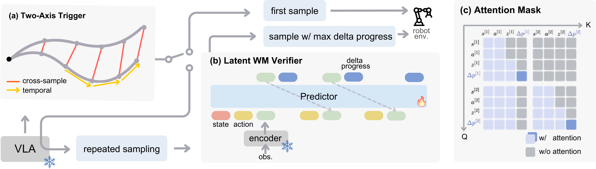

# VeriVLA 论文阅读报告

**论文题目：** VeriVLA: Adaptive Test-Time Verification for Flow-Based VLAs with Latent World Models  
**作者与机构：** Xueli Sun 等，香港大学  
**报告依据：** [中文网页报告](../repo/index.html)与[论文中英双语正文](VeriVLA.md)

VeriVLA 研究如何通过额外的推理计算，提高视觉—语言—动作模型（VLA）的执行表现。其核心思路是：先判断当前是否值得增加计算，再利用潜在世界模型预测多个候选动作的后果，选择最能推进任务的方案。在部署过程中，基础 VLA 的参数保持冻结，性能提升主要来自候选动作的采样与筛选。

**论文要解决的问题，是随机生成的动作质量存在差异。** 基于 Flow Matching 的 VLA 从随机噪声生成动作，即使当前图像、语言指令和机器人状态相同，不同噪声也可能产生不同的动作块。在插笔、移液等精细操作中，一次偏差就可能导致失败，而基础策略通常只生成一个动作块便执行。VeriVLA 希望利用多个候选之间的差异，在执行前选出更好的方案，同时控制额外计算成本。

这里的一次“采样”是生成一整段候选动作。若动作块包含 $H$ 个时间步、每步动作维度为 $d_a$，则一个候选可以表示为 $A^{(i)}\in\mathbb{R}^{H\times d_a}$。多个候选先在计算机中生成，机器人最终执行其中选中的一段。

*图：论文图 3。双轴触发器决定是否增加采样，潜在世界模型验证器负责预测后果与评价进度。*

**方法由双轴触发器和潜在世界模型验证器组成。** 一次决策的主要流程如下：

1. VLA 在同一当前状态下生成两个候选动作块。
2. 双轴触发器检查动作变化与候选分歧，判断是否启动验证。
3. 若触发，再生成 8 个候选，形成总计 10 个候选的动作池；若未触发，直接执行第一个候选。
4. 验证器评价候选动作，执行累计预测进度增量最大的方案。

触发器沿两个方向计算统计量：时间轴衡量一个动作块内部相邻动作的变化；样本轴衡量不同候选在对应时刻的动作差异。前者用于捕捉复杂操作阶段，后者反映策略分歧与可供选择的动作多样性。计算前，各动作块按平均动作幅度归一化，以减弱整体运动幅度的影响。

部署前，系统通过少量基础策略运行回合建立两个参考分布。运行时，将当前统计量分别转换为百分位 $\tau_{\mathrm{temp}}$ 和 $\tau_{\mathrm{cross}}$，按以下规则触发：

$$
\max\left(\tau_{\mathrm{temp}},\tau_{\mathrm{cross}}\right)>\tau_0.
$$

因此，只要任意一个轴超过阈值，就会启动验证。触发器无需训练网络参数，但需要环境校准；百分位表示分数在参考分布中的相对位置，不能直接当作失败概率。

**验证器通过“预测未来”和“评价任务进度”给动作评分。** 它使用冻结的预训练 V-JEPA 2 视觉编码器，将当前图像转换为潜在特征，再由动作条件自回归预测器，根据机器人状态与候选动作预测未来特征。动作预测器利用了在 23k 条 DROID 轨迹上获得的预训练基础。

在动力学预测基础上，VeriVLA 增加了任务进度预测分支。进度增量定义为动作执行前后的任务进度之差：

$$
\Delta p=p_{t+H}-p_t.
$$

同一个状态变化对不同任务可能具有不同价值。例如，关上柜门对“关门”任务是正进度，对“开门”任务则是负进度。因此，进度分支使用任务专属的可学习 query token；注意力掩码阻止潜在状态预测读取任务 query，旨在保持动力学建模与任务评价之间的分工。

一个动作块被均匀分为 $M$ 个子块，真实机器人配置使用 $M=5$。模型逐段预测未来 latent 与进度增量，推理时使用自身预测的 latent 作为后续滚动预测的条件。候选 $i$ 的最终评分为各子块增量之和：

$$
S_i=\sum_{m=1}^{M}\Delta\hat p_m^{(i)},
\qquad i^*=\arg\max_i S_i.
$$

该设计在潜在空间完成预测与评价，无需生成未来视频像素，也无需目标图像。真正用于排序的是预测的进度增量，未来特征预测则帮助模型学习动作后果。

**验证器的评价能力来自离线训练。** 真实机器人实验中，每项任务使用 50 个示范回合微调基础策略，再收集 50 个策略运行回合训练验证器。Robometer 自动标注轨迹中的绝对任务进度，再对子块起止时刻的分数做差，构造进度增量目标。这些标签是模型估计的任务进度。

训练包含三类监督：Huber 损失拟合进度增量；同任务样本之间的成对排序损失学习动作优劣；未来 latent 的 L1 损失约束动力学预测。论文还结合 teacher forcing 与 self-forcing，以兼顾学习效率与滚动推理时的分布匹配。因此，“无需训练”特指触发器，验证器仍需学习和适配。

**实验结果表明，该方法在真实机器人与仿真中均有收益。** 主要结果如下：

| 实验设置 | 指标 | 基础策略 | 加入 VeriVLA | 实验条件 |
| --- | --- | ---: | ---: | --- |
| 真实机器人：插笔、移液、苹果放置 | 平均完成得分 | 50.8% | 65.5% | 3 项任务，按阶段计分 |
| RoboTwin 2.0 Clean | 平均成功率 | 66.4% | 73.6% | 5 项任务，始终开启验证 |
| RoboTwin 2.0 Clean2Random | 平均成功率 | 62.8% | 69.6% | 仅使用 clean 数据训练，始终开启验证 |
| LIBERO，基础策略为 $\pi_{0.5}$ | 平均成功率 | 96.9% | 97.6% | 40 项任务 |
| LIBERO，基础策略为 StarVLA-GR00T | 平均成功率 | 96.2% | 97.2% | 使用该策略独立的验证器权重 |

真实机器人的平均完成得分提升了 **14.7 个百分点**，但这一指标允许部分完成获得分数，与完整任务成功率不同。RoboTwin 表中结果采用始终开启验证，论文另外通过改变触发阈值展示了成功率与计算量之间的权衡。LIBERO 已接近性能饱和，平均提升相对较小。

消融实验也支持世界建模的作用：完整模型的真实任务平均完成得分为 65.5%，移除未来世界建模后降至 55.2%，移除动作预测器预训练后降至 59.5%。三组均保留预训练视觉编码器，说明动力学预测与动作预测器预训练都有助于最终评价效果。

计算成本方面，论文在一张 RTX 4090 上同时运行策略与验证器，合计显存约 18.5 GB。基础策略推理需要 82 ms，触发机制增加 14 ms；触发后，额外采样需要 80 ms，验证全部 10 个候选需要 246 ms。因此，未触发时总延迟为 96 ms，触发后总延迟为 422 ms。摘要中的 326 ms 指额外采样与验证的开销，不包含触发机制的 14 ms。

**这项工作的贡献集中在潜在验证与自适应计算分配的结合。** VLA、JEPA、重复采样选优和 Robometer 都有已有工作基础。VeriVLA 将动作条件下的未来特征预测与任务进度评价放入同一个预测框架，并利用双轴动作统计量决定何时调用验证器，使额外计算更集中于复杂或存在分歧的决策阶段。

作者明确提出两项主要局限：第一，候选动作的质量和多样性受基础策略限制，验证器只能从已有方案中选择；第二，冻结的视觉编码器可能遗漏精细操作中的接触、物体配置和完成状态变化。从报告解读的角度看，自动进度标签的质量、短期进度与长期成功的关系，以及验证器向新任务和新策略的迁移能力，也值得进一步研究。

对世界模型研究的启发在于：预测能力可以服务于执行前的动作评价。VeriVLA 展示了如何将预训练动力学知识转化为候选动作的选择依据，并通过有限的推理开销改善冻结策略的表现。

资料链接：[原论文](https://arxiv.org/abs/2610.21985) · [项目官网](https://shirley430316.github.io/projects/verivla/) · [交互解读网页](../repo/index.html)
